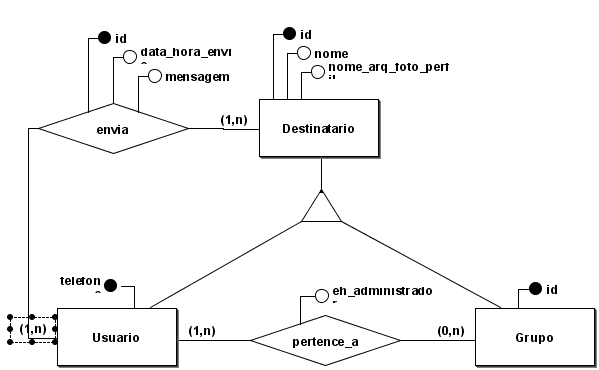
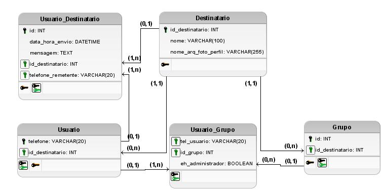

## Solucao - Sistema de Chat On-line (WhatsApp-like)

A descricao dos requisitos do sistema podem ser encontrados no arquivo [README.md](./README.md).

### Modelo conceitual (completo)

Abra o arquivo do BrModelo [./modelo_conceitual.brM3](./modelo_conceitual.brM3) para maiores detalhes.

### Modelo lógico (completo)

Abra o arquivo do BrModelo [./modelo_logico.brM3](./modelo_logico.brM3) para maiores detalhes.
 
#### Exemplos de tabelas

**Destinatario**:
| id_destinatario | nome              | nome_arq_foto_perfil |
| --------------- | ----------------- | -------------------- |
| 3               | Carlos Alberto    | carlos.jpg           |
| 4               | Padaria do Seu Zé | pze.png              |
| 5               | Josefina Silva    | jsilva.jpg           |
| 6               | Grupo de ADS      | ads_broca.png        |

**Usuario**:
| telefone        | id_destinatario |
| --------------- | --------------- |
| (71) 98765-4532 | 3               |
| (21) 3421-0000  | 4               |
| (75) 91234-5678 | 5               |

**Grupo**:
| id  | id_destinatario |
| --- | --------------- |
| 1   | 6               |

**Usuario_Destinatario**:
| id  | data_hora_envio     | mensagem                      | id_destinatario | telefone_remetente |
| --- | ------------------- | ----------------------------- | --------------- | ------------------ |
| 1   | 2025-07-10 07:55:26 | Ola Seu Zé, tudo bem?         | 4               | (75) 91234-5678    |
| 2   | 2024-02-28 16:41:02 | O que vai cair na prova hoje? | 6               | (71) 98765-4532    |

**Usuario_Grupo**:
| tel_usuario     | id_grupo | eh_administrador |
| --------------- | -------- | ---------------- |
| (71) 98765-4532 | 6        | true             |
| (75) 91234-5678 | 6        | false            |
