# Fundamentos de Redes de Computadores - Parte 1

**Sumário**:
- [Fundamentos de Redes de Computadores - Parte 1](#fundamentos-de-redes-de-computadores---parte-1)
- [1. Conceitos fundamentais de redes de computadores](#1-conceitos-fundamentais-de-redes-de-computadores)
  - [1.1. O que é uma rede de computadores?](#11-o-que-é-uma-rede-de-computadores)
    - [1.1.1. Exemplo prático: compartilhamento de uma impressora](#111-exemplo-prático-compartilhamento-de-uma-impressora)
  - [1.2. Elementos necessários para a comunicação em rede](#12-elementos-necessários-para-a-comunicação-em-rede)
  - [1.3. Protocolos de comunicação](#13-protocolos-de-comunicação)
- [2. Classificação das redes de computadores](#2-classificação-das-redes-de-computadores)
  - [2.1. PAN - Personal Area Network](#21-pan---personal-area-network)
  - [2.2. LAN - Local Area Network](#22-lan---local-area-network)
  - [2.3. WLAN — Wireless Local Area Network](#23-wlan--wireless-local-area-network)
  - [2.4. MAN — Metropolitan Area Network](#24-man--metropolitan-area-network)
  - [2.5. WAN — Wide Area Network](#25-wan--wide-area-network)
  - [2.6. Comparação entre os tipos de redes](#26-comparação-entre-os-tipos-de-redes)
  - [2.7. Redes cabeadas e redes sem fio](#27-redes-cabeadas-e-redes-sem-fio)
    - [2.7.1. Redes cabeadas (wired networks)](#271-redes-cabeadas-wired-networks)
    - [2.7.2. Redes sem fio (wireless networks)](#272-redes-sem-fio-wireless-networks)
    - [2.7.3. Comparação entre Redes Cabeadas e Wireless](#273-comparação-entre-redes-cabeadas-e-wireless)
  - [2.8. Redes ponto a ponto (P2P) e cliente-servidor](#28-redes-ponto-a-ponto-p2p-e-cliente-servidor)
    - [2.8.1. Arquitetura cliente-servidor](#281-arquitetura-cliente-servidor)
    - [2.8.2. Arquitetura ponto a ponto (Peer-to-Peer — P2P)](#282-arquitetura-ponto-a-ponto-peer-to-peer--p2p)
    - [2.8.3. Comparação P2P x Cliente-servidor](#283-comparação-p2p-x-cliente-servidor)
- [3. Topologias de redes](#3-topologias-de-redes)
  - [3.1. Topologia em barramento (Bus)](#31-topologia-em-barramento-bus)
  - [3.2. Topologia em estrela (Star)](#32-topologia-em-estrela-star)
  - [3.3. Topologia em anel (Ring)](#33-topologia-em-anel-ring)
  - [3.4. Topologia em malha (Mesh)](#34-topologia-em-malha-mesh)
  - [3.5. Topologia em árvore (Tree)](#35-topologia-em-árvore-tree)
  - [3.6. Comparação das topologias de rede](#36-comparação-das-topologias-de-rede)
- [4. Exercícios de fixação](#4-exercícios-de-fixação)
  - [Parte A — Questões conceituais](#parte-a--questões-conceituais)
- [5. Atividades práticas](#5-atividades-práticas)
  - [Atividade 1 — Identificação de topologias no Packet Tracer](#atividade-1--identificação-de-topologias-no-packet-tracer)

# 1. Conceitos fundamentais de redes de computadores

## 1.1. O que é uma rede de computadores?

Uma rede de computadores é um **conjunto de dispositivos interconectados** que conseguem trocar informações e compartilhar recursos por meio de algum meio de comunicação e utilizando regras previamente estabelecidas (que chamamos de **protocolos**).

Esses dispositivos podem ser:

- Computadores e notebooks.
- Smartphones e tablets.
- Servidores.
- Impressoras.
- Câmeras de segurança.
- Roteadores e switches.
- Televisores, relogios, e outros dispositivos inteligentes (Internet das Coisas - IoT).
- Dispositivos de automação residencial.
- Equipamentos de automação industrial.

Uma rede não precisa necessariamente ser formada apenas por computadores convencionais. 
> Qualquer dispositivo capaz de participar de uma comunicação digital pode fazer parte de uma rede.

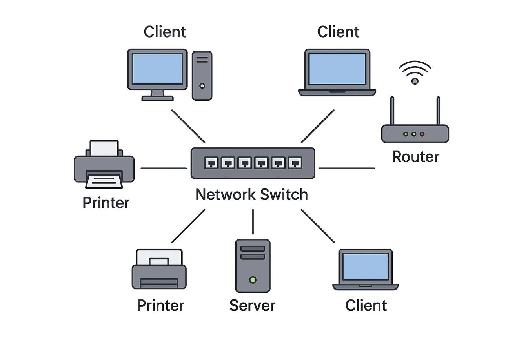

Imagine uma escola com 30 computadores, duas impressoras de rede, um servidor de arquivos e um acesso compartilhado à Internet.
- Sem uma rede, cada computador precisaria trabalhar de maneira independente. 
  - Os arquivos teriam que ser transferidos por dispositivos externos, 
  - As impressoras precisariam estar conectadas individualmente aos computadores,
  - Cada equipamento poderia precisar de uma conexão própria com a Internet.

Com uma rede, todos esses recursos podem ser compartilhados.

Portanto, uma rede de computadores permite principalmente:

1. **Comunicação**: troca de informações entre dispositivos.
2. **Compartilhamento de recursos**: utilização de impressoras, arquivos, armazenamento e conexões de Internet.
3. **Centralização**: armazenamento e administração de informações em servidores.
4. **Colaboração**: utilização simultânea de sistemas e documentos.
5. **Gerenciamento**: administração centralizada dos dispositivos e usuários.
6. **Escalabilidade**: possibilidade de adicionar novos dispositivos e serviços.

### 1.1.1. Exemplo prático: compartilhamento de uma impressora

Considere 3 computadores conectados à mesma rede e uma impressora de rede:

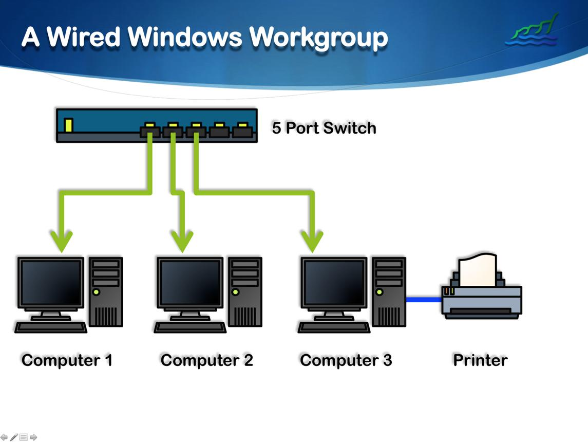

Quando um usuário envia um documento para impressão:

1. O computador identifica o endereço da impressora na rede.
2. Os dados do documento são enviados por meio dos protocolos de comunicação.
3. A infraestrutura de rede encaminha os dados até a impressora.
4. A impressora recebe os dados e executa a impressão.

Os demais computadores também podem utilizar a mesma impressora, sem que seja necessário conectar fisicamente cada um deles a ela.

**Atenção**: compartilhar recursos não significa necessariamente que todos os usuários terão acesso irrestrito. 
- É possível estabelecer permissões, autenticação e políticas de segurança 
  - *"quem acessa quais recursos"*

## 1.2. Elementos necessários para a comunicação em rede

Para que dois ou mais dispositivos consigam trocar informações, alguns elementos são necessários:

| Elemento                      | Função                                                              | Exemplos                                                            |
| ----------------------------- | ------------------------------------------------------------------- | ------------------------------------------------------------------- |
| Dispositivos finais (*hosts*) | Origem ou destino das informações                                   | Computadores, Smartphones, Laptops, Cameras IP, IoT, etc            |
| Interfaces de rede (*NIC*)    | Permitem que os dispositivos se conectem à rede                     | Placas de rede, adaptadores Wi-Fi, etc                              |
| Meio de transmissão           | Transporta os sinais entre os dispositivos                          | Cabos metalicos (Ethernet, Coaxial), ar, fibra óptica, etc          |
| Equipamentos intermediários   | Encaminham os dados entre os dispositivos                           | Roteadores, switches, hubs, etc                                     |
| Protocolos                    | Estabelecem regras para a comunicação                               | TCP/IP, HTTP, HTTPS, etc                                            |
| Endereço                      | Permite identificar o dispositivo e definir uma rota de comunicação | IPs, MACs, etc                                                      |
| Rota de comunicação           | Caminho que os dados percorrem entre origem e destino               | Saindo da porta 1, passando pelo roteador, chegando à porta 2, etc. |
| Pacote                        | Unidade de dados que é transmitida pela rede                        | Pacote IP, Frame Ethernet, Fragmento TCP, etc                       |

Por exemplo, quando você acessa um site pelo notebook, vários desses elementos participam simultaneamente:

- O notebook é o dispositivo de origem.
- A placa Wi-Fi é a interface de rede.
- O sinal de rádio é o meio de transmissão até o roteador.
- O roteador e outros equipamentos encaminham os dados.
- Os protocolos TCP/IP estabelecem as regras de comunicação.
- Os endereços IP identificam a origem e o destino dos pacotes.

Uma rede depende da combinação desses elementos. 

## 1.3. Protocolos de comunicação

Um protocolo de rede é um conjunto de regras que determina como os dispositivos devem se comunicar.

Podemos fazer uma analogia com uma conversa entre duas pessoas.
- Para que uma conversa aconteça, os participantes precisam compartilhar um idioma ou algum mecanismo de interpretação. 
  - **Ex**: Portugues, Ingles, Libras, etc
- Também precisam compreender como 
  - iniciar a conversa, 
  - transmitir informações,
  - identificar quando ela terminou.

Nas redes de computadores, os protocolos desempenham funções semelhantes.

Alguns exemplos:

| Protocolo | Finalidade                                                                                                                                                              |
| --------- | ----------------------------------------------------------------------------------------------------------------------------------------------------------------------- |
| IP        | Endereçamento e encaminhamento de pacotes (permitir que um dispositivo defina quem deve receber os pacotes - para entao a rede dizer qual rota o pacote deve percorrer) |
| TCP       | Comunicação confiável entre aplicações (precisa estabelecer uma conexão antes de enviar os dados)                                                                       |
| UDP       | Comunicação rápida entre aplicações (sem estabelecimento prévio de conexão)                                                                                             |
| HTTP      | Transferência de conteúdo da Web                                                                                                                                        |
| HTTPS     | HTTP + proteção dos dados usando criptografia TLS                                                                                                                       |
| DNS       | Resolução de nomes em endereços IP                                                                                                                                      |
| DHCP      | Distribuição automática de configurações IP                                                                                                                             |
| Ethernet  | Comunicação entre dispositivos que pertencem a uma mesma rede                                                                                                           |

É importante compreender que diferentes protocolos podem atuar conjuntamente.

Por exemplo, ao acessar um site HTTPS, normalmente temos:

- Ethernet ou Wi-Fi para a comunicação na rede local.
- IP para encaminhar os pacotes.
- TCP para transportar os dados.
- TLS para proteger a comunicação.
- HTTP para realizar a transferência do conteúdo.

A combinação desses protocolos permite que aplicações complexas funcionem sem que cada desenvolvedor precise implementar todos os mecanismos de comunicação do zero.

# 2. Classificação das redes de computadores

As redes podem ser classificadas de diferentes maneiras. 
- Uma das classificações mais utilizadas considera a **abrangência geográfica** (a distância física aproximada entre os dispositivos conectados).

## 2.1. PAN - Personal Area Network 

Uma PAN (rede de área pessoal) é uma rede de pequena abrangência , geralmente utilizada para **conectar dispositivos próximos a uma pessoa**.

Exemplos:

- Smartphone conectado a um smartwatch (via Bluetooth).
- Notebook conectado a um mouse (Bluetooth ou Radio).
- Smartphone compartilhando Internet com um notebook.
- Fones de ouvido conectados ao celular.

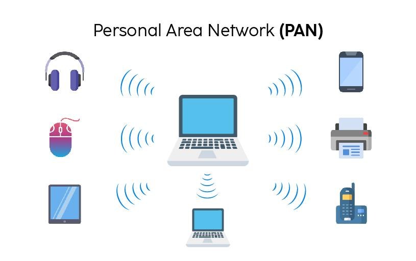

A tecnologia **Bluetooth** é bastante utilizada nesse tipo de rede, mas não é a única:
- Temos **Zigbee**, **Infravermelho (IR)**, **NFC**, **Wi-Fi adhoc** e outras.

**Características**:

- Pequena área de cobertura (até alguns metros de distância).
- Baixo consumo energético (o que é otimo para dispositivos móveis, fones de ouvido, IoT, etc).
- Pode utilizar tecnologias cabeadas ou sem fio.

## 2.2. LAN - Local Area Network

Uma LAN (rede de área local) é uma rede que conecta dispositivos em uma área geográfica limitada, como:

- Uma residência.
- Um laboratório de informática.
- Um escritório.
- Um andar de um edifício.
- Uma escola.

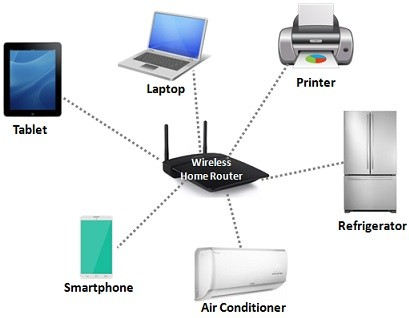

Normalmente, uma LAN é administrada por uma única organização ou pessoa. Exemplos:
- IFBA
- UNEB
- UFBA
- Uma empresa privada

As tecnologias **Ethernet** e **Wi-Fi** são amplamente utilizadas para construir redes locais.

**Características**:

- Área geográfica relativamente pequena (< 1 km).
- Alta capacidade de transmissão (<= 10 Gbps).
- Baixa latência em condições normais (<= 1 ms).
- Administração relativamente centralizada (uma única organização ou pessoa).
- Compartilhamento de recursos e serviços (arquivos, impressoras, etc.).

**Exemplo**:

Um laboratório de informática possui:

- 30 computadores.
- Um switch.
- Um servidor.
- Uma impressora de rede.
- Um roteador para acesso à Internet.

Todos esses dispositivos podem integrar uma mesma LAN.

## 2.3. WLAN — Wireless Local Area Network

Uma WLAN (rede local sem fio) é uma rede local que utiliza comunicação sem fio, geralmente por meio da tecnologia Wi-Fi (mas não exclusivamente - podemos utilizar outras tecnologias também).

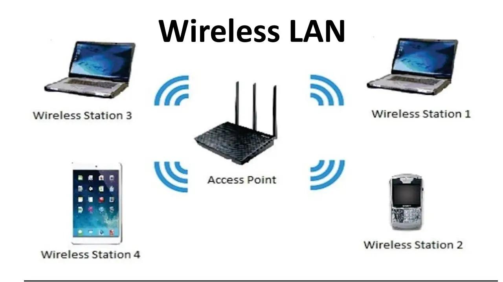

Em uma WLAN, os dispositivos se comunicam por meio de sinais de radio, normalmente utilizando um **access point (AP)**.
- **AP**: é um dispositivo que atua como **ponto de acesso à rede sem fio**, permitindo que os dispositivos se conectem a ela.
- Um AP **envia e recebe sinais de rádio**, convertendo-os em sinais digitais que podem ser processados pelos dispositivos conectados via cabo (metálico, fibra óptica, etc).

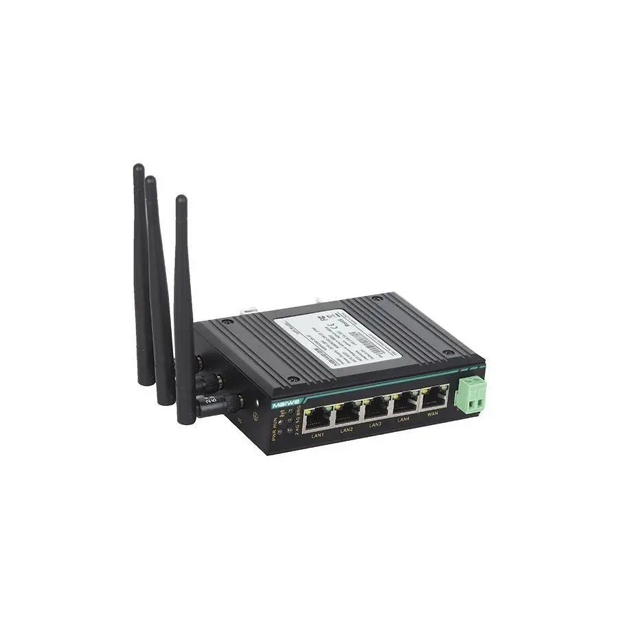

**Exemplos**:

- Wi-Fi de uma residência.
- Wi-Fi de uma universidade.
- Rede sem fio de um restaurante.
- Rede de visitantes de uma empresa.

**Características**:

- Mobilidade dos dispositivos.
- Menor necessidade de cabeamento até os dispositivos finais.
- Possibilidade de interferências eletromagnéticas.
- Compartilhamento de um meio de transmissão sem fio.
- Necessidade de mecanismos de segurança e autenticação.

Uma WLAN é, portanto, uma modalidade de LAN. A diferença principal está no meio de transmissão utilizado (meio sem fio).

## 2.4. MAN — Metropolitan Area Network

Uma MAN (rede metropolitana) interconecta redes em uma região metropolitana, podendo abranger diferentes bairros ou municípios próximos.

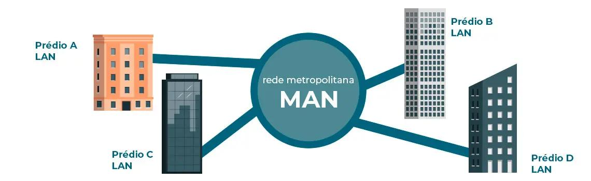

Imagine uma universidade que possui três campi (tres locais diferentes) em diferentes regiões de uma cidade.
- Cada campus possui sua própria LAN, mas as três redes são interligadas por uma infraestrutura de comunicação de maior abrangência (uma rede MAN).

**Características**:

- Abrangência maior que uma LAN (até alguns quilômetros).
- Interconexão de diferentes redes locais.
- Utilização frequente de fibra óptica.
- Pode ser operada por uma organização ou por provedores de telecomunicações (operadoras - como a TIM, Claro, Vivo, etc).

## 2.5. WAN — Wide Area Network

Uma WAN (rede de longa distância) conecta **redes geograficamente distantes**, podendo abranger países e continentes.

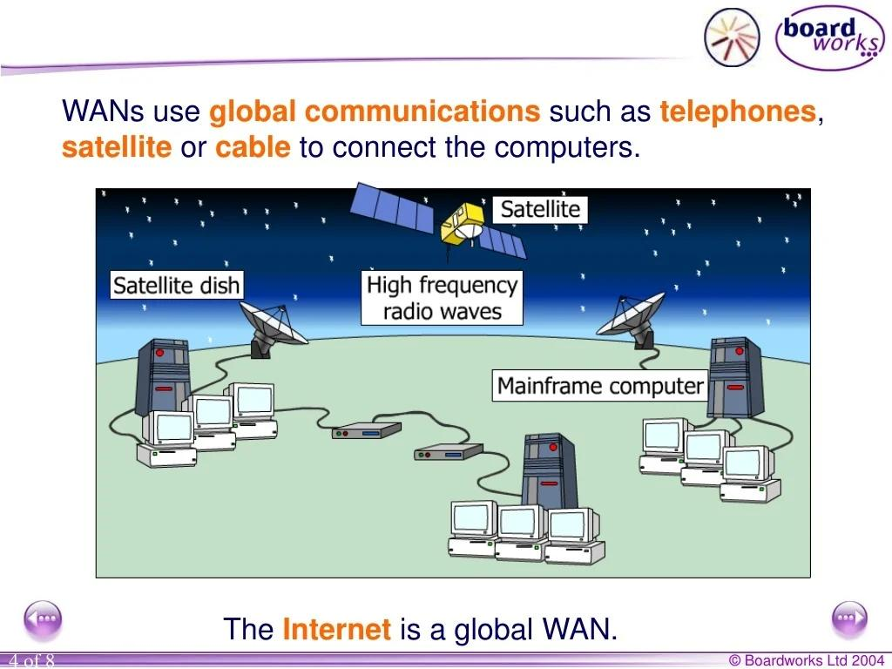

Imagine uma empresa com filiais em Salvador, São Paulo, Lisboa e Nova York.
- Cada filial possui sua própria LAN,
- Mas todas precisam acessar sistemas corporativos centralizados.
- Uma WAN permite interligar essas redes.

As tecnologias utilizadas podem incluir:

- Fibra óptica de longa distância.
- Links dedicados.
- Redes de operadoras.
- Satélites.
- Infraestrutura pública da Internet.

**A Internet é o exemplo mais conhecido de uma rede  de alcance mundial**, embora tecnicamente seja uma interconexão global de inúmeras redes independentes.
- Isto é, a **Internet é um conjunto de redes WAN**, que conecta redes de diferentes organizações, governos e indivíduos em todo o mundo.

## 2.6. Comparação entre os tipos de redes

| Tipo | Abrangência típica | Distância típica | Exemplo                            |
| ---- | ------------------ | ---------------- | ---------------------------------- |
| PAN  | Pessoal            | < 10 metros      | Smartphone e smartwatch            |
| LAN  | Local              | < 100 m          | Rede de uma escola                 |
| WLAN | Local sem fio      | < 100 m          | Wi-Fi residencial                  |
| MAN  | Metropolitana      | < 100 km         | Redes de campi de uma universidade |
| WAN  | Grandes distâncias | >= 100 km        | Rede entre filiais internacionais  |

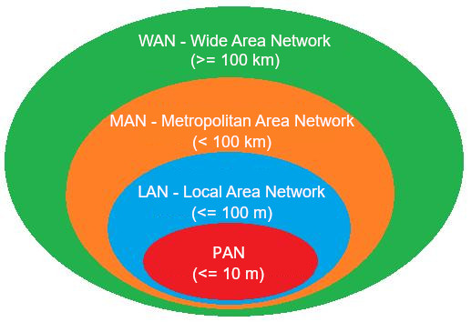

**Importante**: essas classificações são conceituais e **não possuem limites geográficos rígidos** (apesar das distâncias típicas acima). 
- Uma rede não deixa de ser LAN simplesmente porque ocupa um edifício relativamente grande. 
- **O critério principal é a abrangência e a arquitetura** da infraestrutura.

## 2.7. Redes cabeadas e redes sem fio

Outra forma de classificar as redes considera o meio físico utilizado para transmitir informações.

### 2.7.1. Redes cabeadas (wired networks)

São redes nas quais os dispositivos utilizam cabos físicos para estabelecer a comunicação.

Os meios mais comuns são:

- Cabos de par trançado (Ethernet).
- Cabos coaxiais.
- Cabos de fibra óptica.

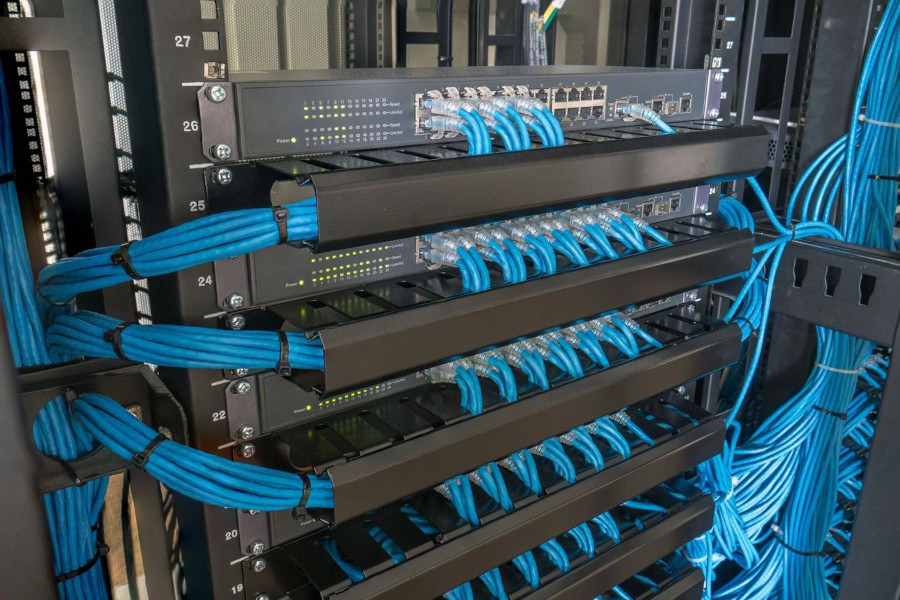

**Vantagens**:

- Maior previsibilidade da comunicação 
  - Sinais enviados atraves de cabos sao mais estáveis (são menos suscetíveis a ruídos e interferencias).
- Geralmente oferecem baixa latência (atraso na transmissão de dados de um dispositivo a outro).
- Menor suscetibilidade a interferências de radiofrequência.
- Boa capacidade de transmissão (velocidade de dados).
- Maior facilidade para estabelecer conexões físicas controladas.

**Desvantagens**:

- Necessidade de infraestrutura de cabeamento (passar cabos por paredes, pisos e teto).
- Menor mobilidade dos dispositivos (o cabo limita o movimento do dispositivo).
- Custos de instalação em determinados ambientes.
- Limitações de distância impostas pelo meio físico e pelos padrões utilizados.

### 2.7.2. Redes sem fio (wireless networks)

São redes que **utilizam ondas eletromagnéticas para transmitir informações**, dispensando a necessidade de um cabo físico entre os dispositivos que se comunicam.

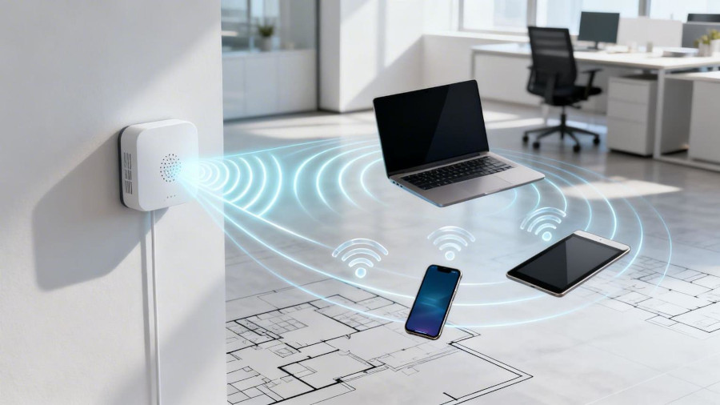

As tecnologias mais conhecidas incluem:

- Wi-Fi.
- Bluetooth.
- Redes celulares (4G e 5G).
- Comunicação via satélite.

**Vantagens**:

- Mobilidade (dispositivos nao estao limitados ao comprimento do cabo).
- Facilidade para adicionar dispositivos (não é necessário instalar um cabo para cada dispositivo).
- Flexibilidade de implantação (não é necessário planejar a instalação de cabos).

**Desvantagens**:

- Suscetibilidade a interferências 
  - As ondas eletromagnéticas podem ser afetadas por obstáculos (paredes, pessoas, dispositivos, árvores, etc) e variáveis ambientais (temperatura, umidade, etc).
- Compartilhamento do meio de transmissão.
  - Como o meio é compartilhado, a comunicação pode ser afetada por congestionamento e colisões de sinais.
  - Isto é, varias dispositivos podem tentar transmitir ao mesmo tempo, causando perda de pacotes e atrasos.
  - **Analogia**: várias pessoas tentando falar ao mesmo tempo em uma sala, o que dificulta a compreensão da mensagem falada.
  - **Solucao**: controlar quem fala, e quando fala (através de protocolos de acesso ao meio, como CSMA, RTS/CTS, etc).
- Possíveis limitações de cobertura.
  - Ondas de radio podem ter alcance limitado, dependendo da potência do transmissor, da frequência utilizada e das condições ambientais.
  - Equipamentos devem ficar perto do AP ou do roteador para garantir boa qualidade de sinal.

### 2.7.3. Comparação entre Redes Cabeadas e Wireless

| Característica                   | Cabeada                            | Sem fio                  |
| -------------------------------- | ---------------------------------- | ------------------------ |
| Meio de transmissão              | Cabos                              | Ondas eletromagnéticas   |
| Mobilidade                       | Limitada                           | Elevada                  |
| Interferências de rádio          | Nao há                             | Alta                     |
| Instalação                       | Exige cabeamento                   | Exige cobertura wireless |
| Latência (atraso na comunicacao) | Geralmente menor e mais previsível | Pode variar mais         |

**Importante**: redes cabeadas não são necessariamente mais rápidas que todas as redes sem fio. 
- Por exemplo, uma rede Wi-Fi moderna pode apresentar taxas superiores às de uma conexão Ethernet antiga. 
- A comparação depende dos padrões, equipamentos, condições de operação e tecnologias empregados.

## 2.8. Redes ponto a ponto (P2P) e cliente-servidor

Além da abrangência geográfica e do meio de transmissão, as redes podem ser **classificadas de acordo com a arquitetura de comunicação** utilizada e o compartilhamento de recursos.

Duas arquiteturas importantes são ponto a ponto (**peer-to-peer** ou **P2P**) e cliente-servidor.

### 2.8.1. Arquitetura cliente-servidor

Na arquitetura cliente-servidor, determinados dispositivos disponibilizam serviços para outros dispositivos.
- **Cliente**: computador que solicita um serviço. 
- **Servidor**: computador ou sistema que disponibiliza um serviço.

**Exemplo**: o **servidor** do Google oferece o serviço Web de busca de informações (usando protocolo HTTP),
- Todos que acessam o Google solicitam esse serviço (sao **clientes**).

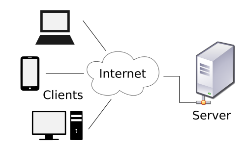

Considere uma escola que utiliza um sistema acadêmico.

- Os computadores dos funcionários executam o navegador (Google Chrome, Firefox, etc).
- O navegador solicita informações ao servidor.
- O servidor processa as solicitações.
- O servidor consulta o banco de dados.
- O resultado é enviado de volta ao navegador.

Nesse exemplo, os computadores dos funcionários atuam como **clientes** e o **servidor** disponibiliza o sistema acadêmico.

**Vantagens**:

- Administração centralizada (todos os serviços estão no mesmo servidor).
- Maior facilidade para implementar políticas de segurança (servidor controla quem tem acesso a qual serviço ou recurso).

**Desvantagens**:

- Custo de implantação e manutenção dos servidores (
  - comprar hardware do servidor, 
  - instalar e configurar software, 
  - fazer manutenção diária.
- Dependência da disponibilidade dos serviços centralizados.
  - Se o servidor ficar indisponível, os clientes não conseguem acessar os serviços.
  - Isto é um servidor é um **ponto único de falha** (**single point of failure**).
- Possibilidade de sobrecarga dos servidores.
  - Muitos clientes podem solicitar serviços simultaneamente, o que pode causar lentidão ou indisponibilidade.
  - **Solucao**: utilizar balanceamento de carga (distribuição de carga entre múltiplos servidores), 
    - **Problema**: Mais servidores  = Maior custo de implementação e manutenção (mais maquinas para instalar, configurar e dar manutencao).

### 2.8.2. Arquitetura ponto a ponto (Peer-to-Peer — P2P)

Em uma rede ponto a ponto, vieram para sanar os problemas de sobrecarga dos servidores.

Em redes P2P, **qualquer dispositivo pode compartilhar dados diretamente com outros dispositivos**, sem depender necessariamente de um servidor.
- Isto é, cada computador pode **atuar simultaneamente como cliente e servidor**.

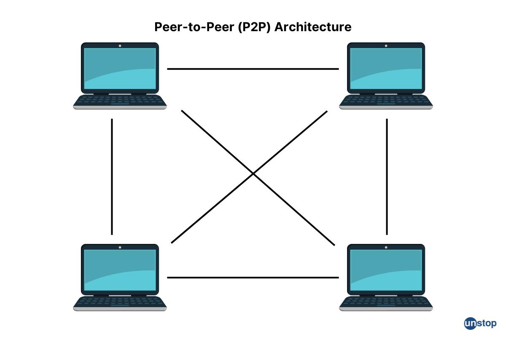

Imagine três computadores conectados à mesma rede:

- Computador A compartilha uma pasta.
- Computador B compartilha uma impressora.
- Computador C compartilha arquivos de mídia.

Os computadores podem acessar os recursos compartilhados pelos demais, desde que tenham as permissões necessárias.

**Exemplo**: redes BitTorrent utilizam arquitetura P2P para compartilhar arquivos entre os usuários, sem depender de um servidor central.

**Vantagens**:

- Não exige um servidor dedicado.
- Compartilhamento direto de recursos entre maquinas.
- Menor custo inicial (não há necessidade de comprar e configurar servidores).

**Desvantagens**:

- Dificuldade de administração em ambientes grandes.
  - Cada computador precisa ser configurado individualmente, para funcionar corretamente.
- Menor centralização de segurança.
  - Cada computador precisa gerenciar suas próprias permissões e políticas de segurança.
- Dificuldade de realizar backups e aplicar políticas uniformes.
  - Cada computador precisa ser gerenciado individualmente, o que pode ser trabalhoso e propenso a erros.

### 2.8.3. Comparação P2P x Cliente-servidor

| Característica    | P2P                                                                                | Cliente-servidor                                                                |
| ----------------- | ---------------------------------------------------------------------------------- | ------------------------------------------------------------------------------- |
| Organização       | Descentralizada (qualquer computador fornece serviços)                             | Centralizada (servidores)                                                       |
| Servidor dedicado | Não é obrigatório                                                                  | Obrigatório                                                                     |
| Administração     | Distribuída (cada computador com sua configuracao)                                 | Centralizada (um ou mais servidores, com mesma configuracao)                    |
| Segurança         | Mais difícil de padronizar                                                         | Mais fácil de centralizar                                                       |
| Custo inicial     | Geralmente menor                                                                   | Geralmente maior                                                                |
| Escalabilidade    | Maior (qualquer computador pode ser servidor, nao dependendo de um único servidor) | Menor (servidores podem ficar sobrecarregados se muitos clientes se conectarem) |

**Atenção**: cliente-servidor não significa necessariamente que exista apenas um servidor. 
- Uma infraestrutura pode possuir vários servidores, cada um responsável por determinado serviço, como DNS, DHCP, arquivos, autenticação e aplicações.
- Podemos tambem ter vários servidores redundantes, que atuam como backup de outros servidores (se um servidor falhar, outro pode assumir o papel de servidor).
- Tambem podemos configurar servidores em **load balancing**, que distribuem a carga de trabalho (evitando sobrecarga em um único servidor atendendo diversos clientes).

Também é possível que o mesmo computador atue como cliente em uma comunicação e servidor em outra.
- **Exemplo**: um computador pode acessar um servidor de arquivos (atuando como cliente) e, ao mesmo tempo, compartilhar uma impressora (atuando como servidor).

# 3. Topologias de redes

Topologia é a **maneira como os dispositivos e os enlaces de comunicação estão organizados** em uma rede.
- Ela descreve como os equipamentos estão interconectados e como a comunicação pode ocorrer entre eles.

Existem duas perspectivas importantes:

- **Topologia física**: representa a disposição física dos equipamentos e dos meios de transmissão.
- **Topologia lógica**: representa como os dados circulam entre os dispositivos, independentemente de como os cabos estão fisicamente organizados.

Essas duas perspectivas não são necessariamente iguais.

Por exemplo, uma rede Ethernet pode possuir **topologia física em estrela**, com todos os computadores conectados a um hub, 
- Mas todos os dispostivos se comunicam uns com os outros (comunicação lógica do **tipo barramento**)
- Isto é, todos os computadores estao, internamente, ligados ao mesmo cabo de metal (o barramento lógico), mesmo que pareçam ter cabos diferentes (topologia física em estrela).
- Veja imagem de exemplo abaixo:

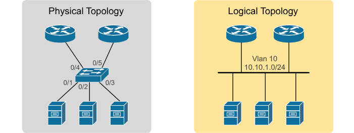

## 3.1. Topologia em barramento (Bus)

Na topologia em barramento, todos os **dispositivos são conectados a um mesmo meio** físico compartilhado, por exemplo:
- Mesmo cabo coaxial,
- Mesmo cabo de par trançado (Ethernet),
- Mesmo canal de rádio (ondas de radio de mesma frequencia de comunicacao, em redes sem fio).
 

Quando um dispositivo transmite informações, o **sinal percorre o meio compartilhado e é recebido por TODOS** os dispositivos conectados.

**Características**:

- Meio físico compartilhado.
- Todos os dispositivos utilizam o mesmo canal de comunicação (todos recebem os mesmos dados / pacotes).

**Vantagens**:

- Simplicidade de implementação (um cabo ja é suficiente - ou um comutador do tipo **hub**).
- Menor quantidade de cabos em comparação com algumas outras topologias.

**Desvantagens**:

- Uma falha no cabo principal pode comprometer toda a rede.
- Dificuldade de identificar problemas
  - quem esta tentando enviar? 
  - quem tentou receber?
  - quem esta com defeito?
- Meio de transmissão compartilhado gera congestionamentos (muitos dispositivos podem tentar enviar dados simultaneamente).

Atualmente, essa topologia é pouco utilizada, pois tem desempenho (velocidade, atraso, confiabilidade) inferior em comparação com outras topologias mais modernas.

## 3.2. Topologia em estrela (Star)

Na topologia em estrela, todos os dispositivos são conectados a um equipamento central (**switch**).

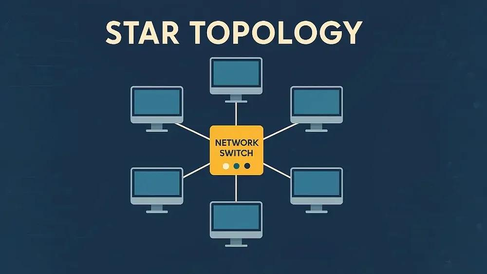

Cada computador possui um enlace próprio (cabo, fibra óptica ou outro tipo de conexão) até o equipamento central.

Quando um computador deseja transmitir informações para outro, os dados são enviados pelo switch, que realiza o encaminhamento para o dispsitivo de destino correto.
- Para isso, o switch descobre quem esta conectado a qual **porta**, para entao enviar os dados por esta porta.
- Isso é feito usando uma **tabela de endereços MAC**, que associa cada dispositivo a uma porta específica do switch.
- **Analogia**: 
  - Endereço MAC = CPF do dispositivo (nao muda, definido quando ele é fabricado)
  - Porta do switch = endereço da casa do dispositivo
  - Switch = Carteiro que sabe qual endereço corresponde a qual pessoa (CPF), e entrega a correspondência (pacote de dados) no local correto.

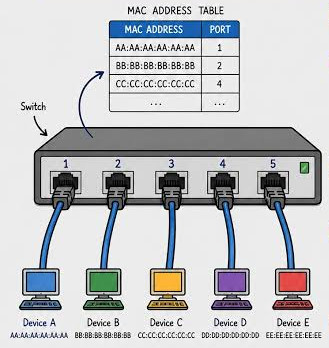

**Vantagens**:

- Facilidade de instalação (um switch envia dados para vários dispositivos, cada um com seu próprio cabo).
- Facilidade de identificar falhas nos enlaces (cada cabo é independente e pode ser testado separadamente).
- Adição e remoção de dispositivos sem comprometer os demais enlaces (basta adicionar mais um cabo).
- Boa escalabilidade.
- Uma falha em um cabo normalmente afeta apenas o dispositivo conectado a ele.

**Desvantagens**:

- Dependência do equipamento central.
  - Falha no switch pode comprometer toda a rede.
- Necessidade de maior quantidade de cabos.
  - Um cabo para cada dispositivo conectado ao switch.
- Custo associado ao switch e à infraestrutura.
  - Cada switch tem custo, e a instalação dos cabos em si tambem tem custo (materiais e mão de obra).

**A topologia em estrela é uma das mais utilizadas** em redes modernas.

## 3.3. Topologia em anel (Ring)

Na topologia em anel, **cada dispositivo é conectado a outros dois dispositivos**, formando um circulo (circuito fechado).

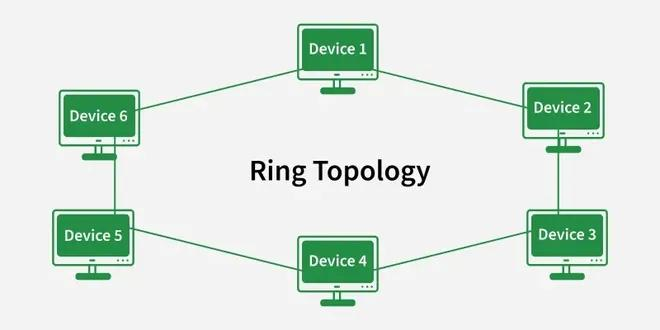

Os dados circulam pelo anel até alcançar o dispositivo de destino.

Dependendo da tecnologia utilizada, a transmissão pode ocorrer em uma ou nas duas direções (para a esquerda ou direita).

**Vantagens**:

- Nao precisa de um equipamento central para gerenciar a comunicação (switch).
- Possibilidade de controlar a ordem de transmissão (qual dispositivo enviara dados primeiro, e qual enviara dados depois).

**Desvantagens**:

- Uma falha em um enlace ou dispositivo pode interromper a comunicação.
  - Se uma rede permite transmissão em apenas uma direção (para a direita), a falha de um único dispositivo pode interromper toda a comunicação.
  - **Exemplo**: se o computador 1 estiver com defeito, os computadores 2 e 3 não conseguem se comunicar.
- Alterações na estrutura podem ser mais complexas.
  - Adicionar ou remover um dispositivo pode exigir a interrupção temporária da rede.

Atualmente, essa topologia é pouco utilizada, pois tem maior propenabilidade a falhas e maior complexidade de gerenciamento.

## 3.4. Topologia em malha (Mesh)

Na topologia em malha, os dispositivos possuem múltiplas conexões entre si (cada dispositivo pode estar conectado a mais de um outro dispositivo).

Existem dois modelos principais:

- **Malha completa (*full mesh*)**: cada dispositivo está conectado diretamente a TODOS os demais.
- **Malha parcial (*parcial mesh*)**: apenas determinados dispositivos possuem múltiplas conexões.

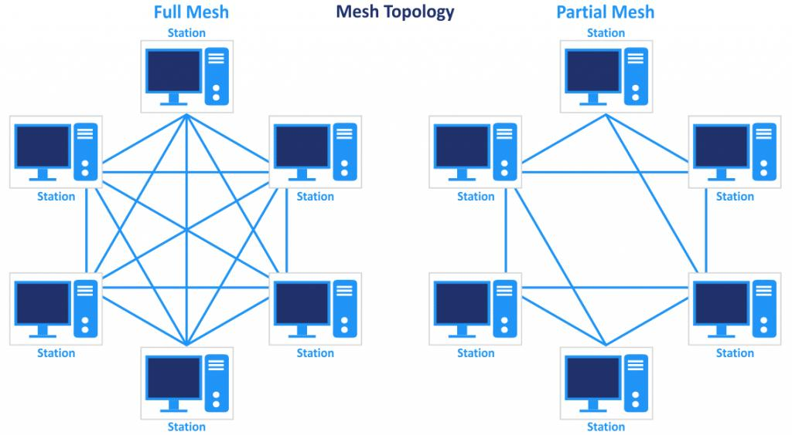

Imagine quatro roteadores interconectados.
- Se um dos enlaces apresentar falha, os dados podem ser encaminhados por outro caminho (desde que exista esse caminho alternativo).

**Vantagens**:

- Maior tolerância a falhas, devido a redundância de caminhos.
  - Caso um caminho falhe, os dados podem ser encaminhados por outro caminho / rota.
- Possibilidade de melhorar a disponibilidade.
  - Com múltiplos caminhos, a rede pode continuar funcionando mesmo com falhas em alguns enlaces.

**Desvantagens**:

- Maior custo de implantação.
  - Mais cabos entre os dispositivos, mais interfaces de rede (NICs), mais equipamentos.
- Maior complexidade de configuração e gerenciamento.
  - Cada dispositivo precisa conhecer os caminhos alternativos, como encaminhar os dados por eles, e gerenciar essas conexões.

Uma **malha completa** com $n$ dispositivos exige $E$ enlaces, onde $E$ é calculado pela fórmula:

$$
E(n) = \frac{n(n-1)}{2} 
$$

Onde:

- $E$ representa a quantidade de enlaces.
- $n$ representa a quantidade de dispositivos.

Por exemplo, para interligar 5 dispositivos entre si (de formar que todos possma se comunicar diretamente uns com os outros), precisariamos de 10 enlaces (cabos e interfaces de rede):

$$ E(5) = \frac{5(5-1)}{2} = 10 $$

## 3.5. Topologia em árvore (Tree)

A topologia em árvore organiza os dispositivos de forma hierárquica (veja exemplo abaixo), com um nó raiz e nós filhos (organizados em níveis hierárquicos).

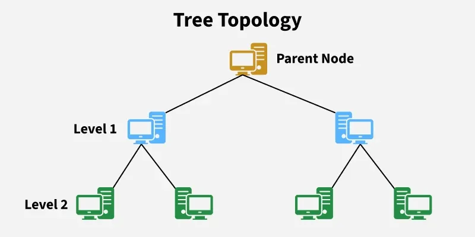

É comum encontrar essa estrutura em redes corporativas.

**Por exemplo**:

- Um switch central conecta os switches de diferentes setores.
- Cada switch de setor conecta os computadores daquele departamento.
- Dentro de cada departamento, os switches podem conectar impressoras, access points, computadores e outros dispositivos.

**Vantagens**:

- Boa escalabilidade (facil de expandir).
- Facilidade para dividir a infraestrutura por setores (departamento de computacao, química, física, etc).
- Possibilidade de implementar políticas de segurança em diferentes níveis (computacao tem acesso a computadores dos laboratórios, quimica nao tem, e assim por diante).

**Desvantagens**:

- Dependência dos equipamentos superiores na hierarquia.
  - Se o switch central falhar, todos os setores conectados a ele ficam sem comunicação.
- Maior complexidade de administração.
  - Cada nível da hierarquia precisa ser configurado e gerenciado.

## 3.6. Comparação das topologias de rede

| Topologia  | Característica principal         | Principal limitação                             |
| ---------- | -------------------------------- | ----------------------------------------------- |
| Barramento | Meio físico compartilhado        | Falha no cabo principal                         |
| Estrela    | Equipamento central              | Dependência do equipamento central              |
| Anel       | Dispositivos em circuito fechado | Falha em um dos enlaces pode interromper o anel |
| Malha      | Múltiplos caminhos               | Custo e complexidade                            |
| Árvore     | Organização hierárquica          | Dependência dos níveis superiores               |

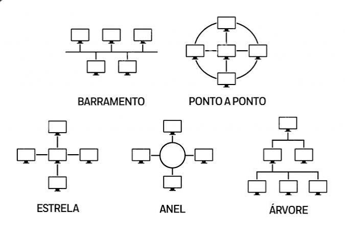

# 4. Exercícios de fixação 

Os exercícios a seguir foram elaborados para verificar se você compreendeu os conceitos apresentados. 

Procure responder sem consultar o texto e, posteriormente, retorne às seções em que encontrar dificuldades.

## Parte A — Questões conceituais

1\. O que é uma rede de computadores? Apresente pelo menos quatro benefícios proporcionados pela utilização de redes.

2\. Explique por que dois computadores precisam utilizar protocolos de comunicação para trocar informações.

3\. Diferencie LAN, MAN e WAN. Apresente um exemplo prático de utilização para cada uma.

4\. Qual é a diferença entre LAN e WLAN? Uma WLAN também pode ser considerada uma LAN? Justifique.

5\. Explique as principais diferenças entre uma rede cabeada e uma rede sem fio, considerando desempenho, mobilidade e interferências.

6\. Em uma rede ponto a ponto, é obrigatório existir um servidor dedicado? Justifique.

7\. Explique como funciona a arquitetura cliente-servidor e apresente três exemplos de serviços que utilizam esse modelo.

8\. Qual é a diferença entre topologia física e topologia lógica?

9\. Descreva as principais características das topologias em barramento, estrela, anel, malha e árvore.

10\. Por que a topologia em estrela é amplamente utilizada nas redes Ethernet modernas?

# 5. Atividades práticas 

As atividades a seguir foram elaboradas para que você possa aplicar os conceitos apresentados, no laboratório de informática durante as aulas.

## Atividade 1 — Identificação de topologias no Packet Tracer

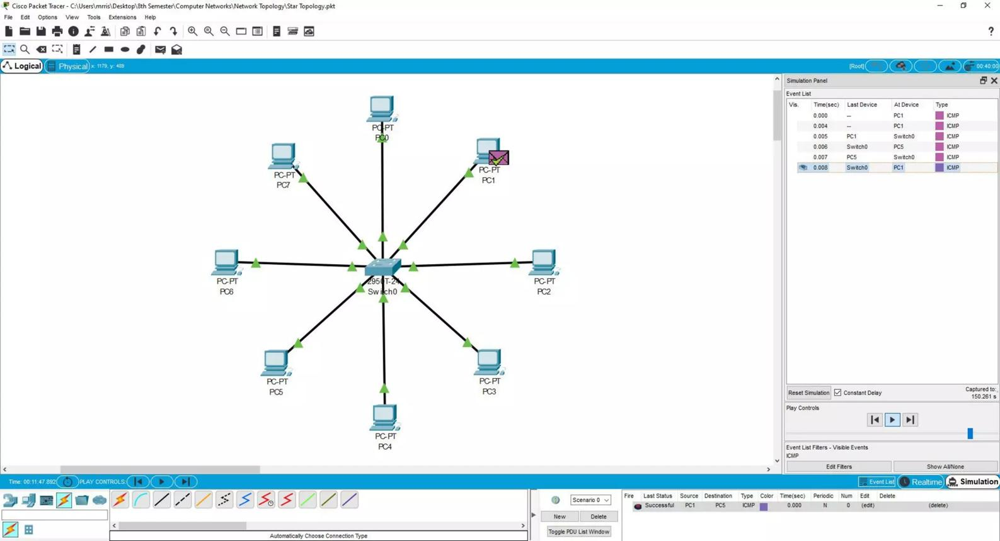

Utilize o Cisco Packet Tracer para construir as redes abaixo:

1. Uma rede em estrela.
2. Uma rede em árvore.
3. Uma rede em barramento.

Para cada rede:

- Desenhe a topologia.
- Identifique os equipamentos.
- Explique como os dispositivos estão interconectados.
- Identifique possíveis pontos únicos de falha.
- Explique como a comunicação ocorre entre os dispositivos (passo a passo, desde a origem até o destino).

