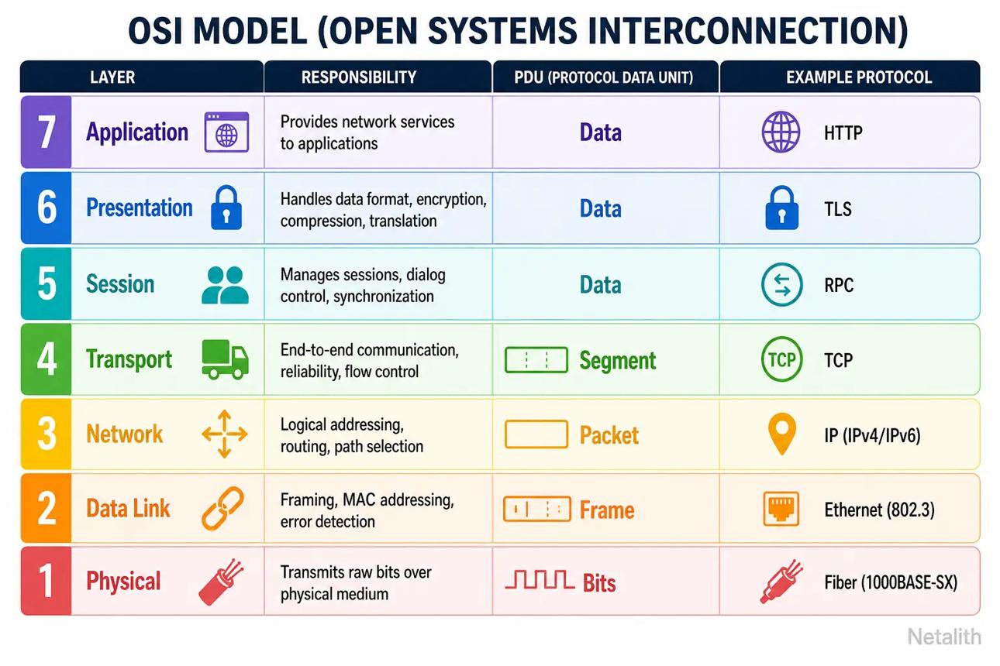
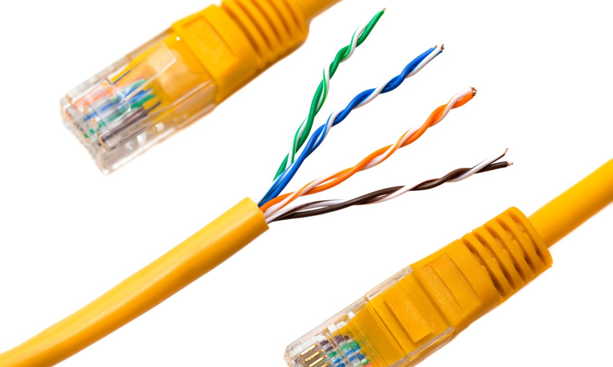
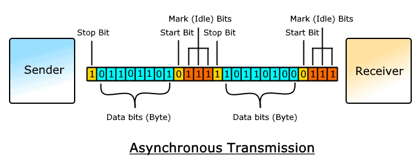
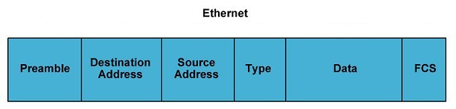
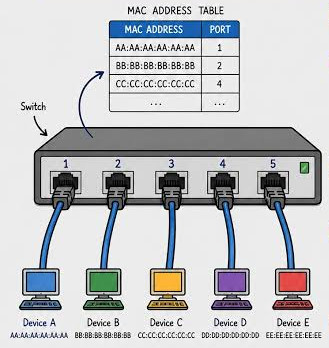
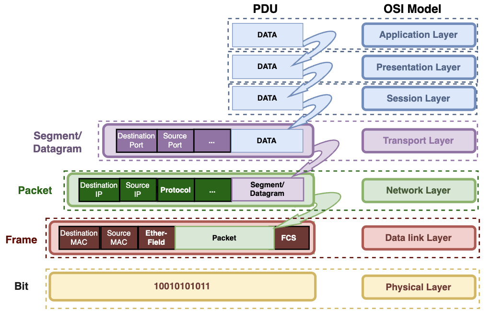
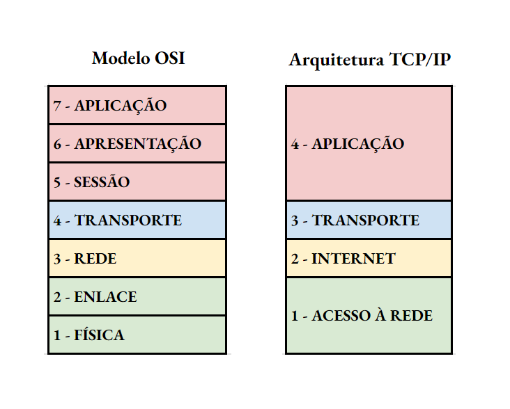
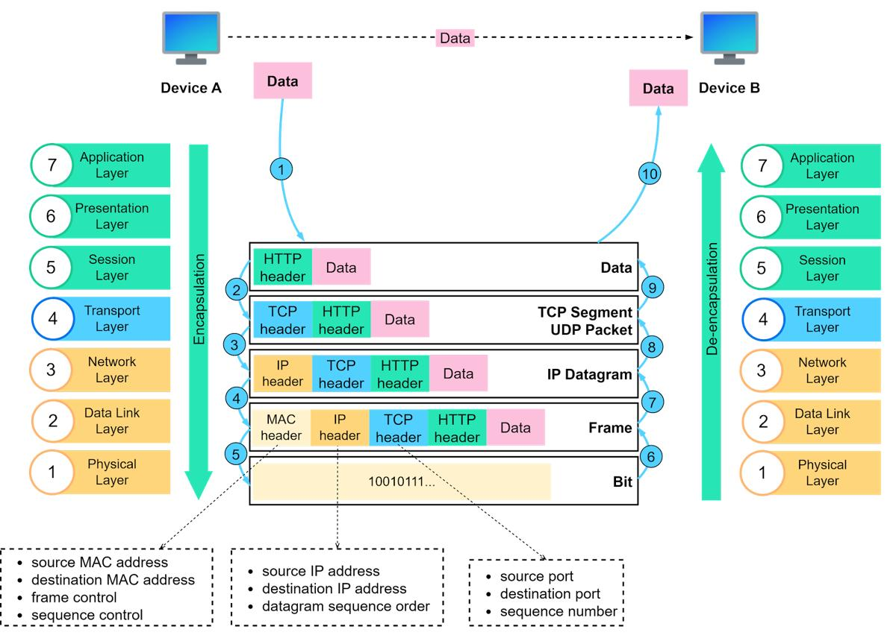
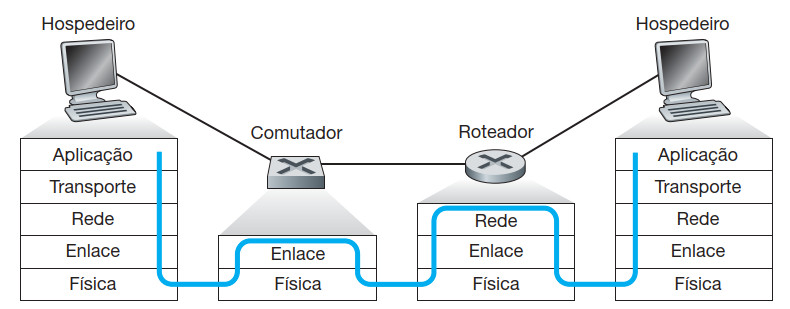
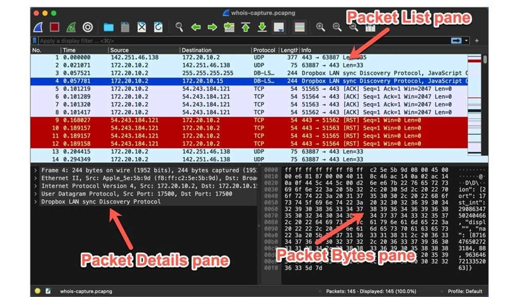

# Fundamentos de Redes de Computadores - Parte 2

**Sumário**:
- [Fundamentos de Redes de Computadores - Parte 2](#fundamentos-de-redes-de-computadores---parte-2)
- [1. Modelos de referência para redes](#1-modelos-de-referência-para-redes)
  - [1.1. Por que precisamos de modelos de referência?](#11-por-que-precisamos-de-modelos-de-referência)
  - [1.2. Modelo OSI](#12-modelo-osi)
    - [Camada 1 — Física (Physical)](#camada-1--física-physical)
    - [Camada 2 — Enlace (Data Link)](#camada-2--enlace-data-link)
    - [Camada 3 — Rede (Network)](#camada-3--rede-network)
    - [Camada 4 — Transporte (Transport)](#camada-4--transporte-transport)
    - [Camada 5 — Sessão (Session)](#camada-5--sessão-session)
    - [Camada 6 — Apresentação (Presentation)](#camada-6--apresentação-presentation)
    - [Camada 7 — Aplicação (Application)](#camada-7--aplicação-application)
    - [Resumo das 7 camadas do modelo OSI (e dos seus PDUs)](#resumo-das-7-camadas-do-modelo-osi-e-dos-seus-pdus)
  - [4.3. Modelo TCP/IP](#43-modelo-tcpip)
    - [Camada 1 -- Acesso à rede (Network Access)](#camada-1----acesso-à-rede-network-access)
    - [Camada 2 -- Camada de Internet (Internet)](#camada-2----camada-de-internet-internet)
    - [Camada 3 -- Camada de transporte (Transport)](#camada-3----camada-de-transporte-transport)
    - [Camada 4 -- Camada de aplicação (Application)](#camada-4----camada-de-aplicação-application)
- [5. Encapsulamento e desencapsulamento](#5-encapsulamento-e-desencapsulamento)
  - [5.1. O que é encapsulamento?](#51-o-que-é-encapsulamento)
  - [5.2. Como funciona o encapsulamento?](#52-como-funciona-o-encapsulamento)
  - [5.3. O que acontece no destino? Desencapsulamento!](#53-o-que-acontece-no-destino-desencapsulamento)
  - [5.4. Por que o encapsulamento é importante?](#54-por-que-o-encapsulamento-é-importante)
  - [5.5 PDU — Protocol Data Unit](#55-pdu--protocol-data-unit)
- [6. Exercicios de fixacao](#6-exercicios-de-fixacao)
  - [Parte A — Modelos OSI e TCP/IP](#parte-a--modelos-osi-e-tcpip)
  - [Parte B — Encapsulamento](#parte-b--encapsulamento)
- [7. Atividades Praticas](#7-atividades-praticas)
  - [Atividade 1 — Análise de protocolos com Wireshark](#atividade-1--análise-de-protocolos-com-wireshark)

# 1. Modelos de referência para redes

## 1.1. Por que precisamos de modelos de referência?

Imagine que você esteja utilizando um aplicativo de mensagens no smartphone para enviar uma mensagem a alguém em outro país.

Essa operação aparentemente simples envolve diversas tecnologias:

1. O aplicativo prepara a mensagem.
2. A mensagem é organizada para transmissão.
3. Os dados são transportados por protocolos.
4. O dispositivo utiliza sua interface Wi-Fi ou celular.
5. Os dados percorrem diversos equipamentos de rede.
6. O dispositivo destinatário recebe os dados.
7. O aplicativo interpreta a mensagem.

Como existem muitos componentes e protocolos envolvidos, seria difícil desenvolver e administrar redes se todos os mecanismos fossem tratados como um único processo.

Para resolver esse problema, foram desenvolvidos modelos de referência que organizam as funções da comunicação em diferentes camadas.

Os modelos mais importantes são:

- Modelo OSI.
- Modelo TCP/IP.

Eles permitem compreender, estudar, desenvolver e diagnosticar redes de computadores de maneira organizada.

## 1.2. Modelo OSI

O modelo OSI (Open Systems Interconnection) foi desenvolvido pela ISO (International Organization for Standardization).

Seu objetivo é fornecer uma referência conceitual para compreender a comunicação entre sistemas computacionais.

O modelo OSI possui sete camadas:
- Camada 7 — Aplicação (Application)
- Camada 6 — Apresentação (Presentation)
- Camada 5 — Sessão (Session)
- Camada 4 — Transporte (Transport)
- Camada 3 — Rede (Network)
- Camada 2 — Enlace de dados (Data Link)
- Camada 1 — Física (Physical)



Cada camada possui responsabilidades específicas e interage com as camadas adjacentes.

### Camada 1 — Física (Physical)

A camada física é responsável pela **transmissão dos bits através do meio** físico.
- *"Como enviar dados (bits) em um cabo metálico, fibra optica, etc?"*

Ela trata das características elétricas, ópticas, mecânicas e de sinalização necessárias para transmitir informações.

Entre suas responsabilidades estão:

- Características dos cabos.
- Conectores.
- Sinalização elétrica e óptica.
- Frequências e modulação.
  - **Modulacao**: quantos bits podem ser transmitidos simultaneamente.
- Taxas de transmissão.
  - **Taxa de transmissão**: quantos bits podem ser transmitidos por segundo.
- Temporização dos sinais.
- Transmissão e recepção de bits.

Muitos desses assuntos são abordados em disciplinas de física, eletrônica e telecomunicações.
- Logo, nao iremos entrar em detalhes sobre esses assuntos aqui.

**Exemplo de uso**:

- Quando um computador envia dados por um **cabo Ethernet**, a camada física é responsável por transformar os bits em sinais elétricos apropriados para transmissão pelo cabo metalico de pares trançados (veja imagem abaixo).



**Unidade de dados**: bits.
- A camada física **transmite uma sequencia de bits**, ate terminar a mensagem enviada (que chamamos de **frame** ou **quadro**).
- Para isso sao usados bits de sincronizacao, que permitem ao receptor identificar o inicio (**start bit**) e o fim da mensagem (**stop bit**).
- Veja imagem ilustrativa abaixo.



### Camada 2 — Enlace (Data Link)

A camada de enlace é responsável pela comunicação entre dispositivos diretamente conectados por um enlace (link - formado por cabos, fibra óptica, etc que estao ligado entre placas de rede).
- Para isso, a camada de enlace organiza os dados em **quadros** (**frames**).
- **Quadro**: Menor unidade de dados tratada pela camada de enlace. É uma sequencia de bits que contem informacoes de controle (protocolos) e dados da aplicacao (**carga útil** ou **payload**).
  - Os protocolos sao armazenados no **cabecalho** do quadro, que contem informacoes de controle, como enderecos MAC de origem e destino, tipo do protocolo transportado, etc (veja imagem abaixo).



Entre suas funções estão:

- Enquadramento dos dados (divisão dos dados em quadros).
- Endereçamento físico (endereço MAC, em redes baseadas em Ethernet).
  - Como identificar cada dispositivo na rede local?
    - Usando identificadores únicos para cada placa de rede!
    - Em redes Ethernet, usamos endereços MAC (Media Access Control).
- Controle de acesso ao meio.
  - Quem pode acessar e quando?
- Detecção de erros em quadros.
  - Como identificar se o quadro foi corrompido durante a transmissão?
  - Como corrigir o erro?

**Exemplo**:

Um computador deseja enviar um **quadro** Ethernet para outro dispositivo conectado à mesma rede local.

O **quadro** contém, entre outras informações, o endereço MAC de origem e o endereço MAC de destino.

O **switch** (ou **access point**) utiliza essas informações para decidir por qual porta encaminhar o quadro (usando a **tabela de endereços MAC**), conforme figura abaixo:



Protocolos associados:
- Ethernet (IEEE 802.3).
- Wi-Fi (IEEE 802.11).

**Unidade de dados (PDU)**: quadro (frame).

### Camada 3 — Rede (Network)

A camada de rede é responsável pelo endereçamento lógico e pelo encaminhamento de pacotes entre redes diferentes.

Seu principal protocolo na Internet é o IP.

Entre suas funções estão:

- Endereçamento lógico.
- Encaminhamento de pacotes.
- Roteamento.
- Seleção de caminhos entre redes.

**Exemplo**:

Um computador na rede de uma escola deseja acessar um servidor localizado na Internet.

O pacote IP contém o endereço IP de origem e o endereço IP de destino.

Os roteadores utilizam informações de roteamento para encaminhar o pacote até a rede de destino.

**Unidade de dados (PDU)**: pacote (packet).

### Camada 4 — Transporte (Transport)

A camada de transporte é responsável pela comunicação entre **aplicações executadas em diferentes dispositivos**.

Ela permite identificar quais aplicações devem receber os dados e oferece diferentes mecanismos de transporte.

Os dois principais protocolos são **TCP** e **UDP**.

**TCP**:

- Estabelece uma conexão lógica (através do **3-way handshake**).
  - O cliente envia um **SYN** para o servidor.
  - O servidor responde com um **SYN-ACK**.
  - O cliente envia um **ACK** para o servidor.
  - A conexão está estabelecida e os dados podem ser transmitidos de forma confiável.
- Oferece entrega confiável e ordenada de bytes.
  - Os pacotes são numerados (possuem um número de **sequência**) e confirmados (usando pacotes **ACK**), garantindo que cheguem na ordem correta.
- Implementa mecanismos de controle de fluxo.
  - O receptor informa ao transmissor a quantidade de dados que pode receber, evitando sobrecarga da rede.
  - Isto é, se o receptor consegue processar ate 100 pacotes por vez, o transmissor nao deve enviar mais do que isso, para evitar congestionamento (excesso de pacotes sendo enviados, o que poderia gerar **perdas de pacotes** na rede).
- Implementa mecanismos de controle de congestionamento.
  - O transmissor ajusta a taxa de envio de pacotes com base na capacidade da rede, evitando sobrecarga e perda de pacotes.
  - A capacidade da rede é estimada com base no tempo de resposta dos pacotes enviados (**RTT**) e na quantidade de pacotes perdidos (**packet drop**).
- Ao final da comunicação, a conexão precisa ser encerrada (usando o **4-way handshake**).
  - O cliente envia um **FIN** para o servidor.
  - O servidor responde com um **ACK**.
  - O servidor envia um **FIN** para o cliente.
  - O cliente responde com um **ACK**.
  - A conexão é encerrada e os recursos alocados para a comunicação são liberados.

**UDP**:

- Não estabelece conexão antes de transmitir.
- Não garante entrega.
- Não garante ordenação.
- Possui menor sobrecarga de protocolo.
  - Isso significa que o cabeçalho do UDP é menor do que o cabeçalho do TCP, resultando em menos bytes de controle sendo transmitidos.
  - Logo, a **velocidade de transmissão pode ser maior** (pois temos menos dados pra enviar), 
  - Alem disso, como ele nao oferece nenhum serviço de confiabilidade, ele exige menos processamento (CPU, memoria, etc) para enviar e receber dados.
- É utilizado por **aplicações que podem se beneficiar de menor latência** ou de mecanismos próprios de recuperação.

**Exemplo**:

Um navegador pode utilizar TCP para estabelecer uma comunicação HTTPS tradicional com um servidor.

Já aplicações de comunicação em tempo real podem utilizar UDP, dependendo de sua arquitetura.

**Exemplo**:

Um sistema de streaming de vídeo pode utilizar UDP para transmitir dados em tempo real, mesmo que haja perdas de pacotes, pois a latência é mais crítica do que a confiabilidade.

Já um sistema de transferência de arquivos pode utilizar TCP, garantindo que todos os dados sejam entregues corretamente e na ordem correta.

**Unidade de dados (PDU)**: segmento (para o caso do TCP) ou datagrama (no UDP).

### Camada 5 — Sessão (Session)

A camada de sessão é responsável pelo estabelecimento, gerenciamento e encerramento de sessões de comunicação entre aplicações.

Entre suas funções conceituais estão:

- Estabelecimento de sessões.
- Controle de diálogos.
- Sincronização.
- Recuperação de determinados pontos de comunicação.

**Exemplo**:

Imagine uma aplicação que estabelece uma sessão de comunicação com outro sistema e precisa controlar o andamento dessa interação.

A camada de sessão fornece o modelo conceitual para organizar esse tipo de funcionalidade.

É importante observar que, na arquitetura TCP/IP moderna, essas funções frequentemente são implementadas pelas próprias aplicações ou por bibliotecas e protocolos de outras camadas.
- **Não existe necessariamente um protocolo independente para cada camada OSI**.
- Isto porque a Internet usa um modelo OSI reduzido (**modelo IP**), com menos camadas (possui 5 camadas apenas).
- **Nesse modelo IP, nao ha camada de sessão, nem camada de apresentação**. As funcionalidades dessas camadas sao implementadas por protocolos de outras camadas ou diretamente pelas aplicações.

### Camada 6 — Apresentação (Presentation)

A camada de apresentação está relacionada à representação e interpretação dos dados.

Entre suas responsabilidades conceituais estão:

- Conversão de formatos.
- Codificação de caracteres.
- Serialização.
- Compressão.
- Criptografia e descriptografia.

**Exemplo**:

Um sistema precisa transmitir uma informação textual utilizando uma codificação compreendida pelo destinatário.

Outro exemplo é a utilização de mecanismos criptográficos para proteger os dados transmitidos.

Assim como ocorre com a camada de sessão, **essas funcionalidades podem ser implementadas em diferentes pontos da arquitetura** TCP/IP.
- No **modelo IP nao há a camada de apresentação**, mas as funcionalidades podem ser implementadas em protocolos de outras camadas ou diretamente pelas aplicações.

### Camada 7 — Aplicação (Application)

A camada de aplicação fornece serviços de comunicação utilizados diretamente pelos programas.

Ela permite que aplicações utilizem os recursos da rede sem precisar implementar todos os mecanismos de transmissão.

**Exemplos**:

- HTTP e HTTPS.
- DHCP.
- DNS.
- SMTP.
- FTP.
- SSH.

**Exemplo**:

Quando um usuário digita o endereço de um site no navegador, a aplicação utiliza serviços e protocolos de rede para localizar o servidor e solicitar o conteúdo.
- O servidor entao envia a pagina da Web usando o protocolo HTTP (Hypertext Transfer Protocol).

**Unidade de dados**: carga útil (payload).

### Resumo das 7 camadas do modelo OSI (e dos seus PDUs)

| Camada | Nome         | Principal responsabilidade              | PDU                                                   |
| ------ | ------------ | --------------------------------------- | ----------------------------------------------------- |
| 7      | Aplicação    | Serviços utilizados pelas aplicações    | carga útil (payload ou data)                          |
| 6      | Apresentação | Representação e transformação dos dados | -                                                     |
| 5      | Sessão       | Gerenciamento das sessões               | -                                                     |
| 4      | Transporte   | Comunicação entre aplicações            | segmento (segment - TCP) / datagrama (datagram - UDP) |
| 3      | Rede         | Endereçamento lógico e roteamento       | pacote (packet)                                       |
| 2      | Enlace       | Comunicação por enlaces e quadros       | quadro (frame)                                        |
| 1      | Física       | Transmissão de bits                     | bits                                                  |



Uma maneira de memorizar a sequência é começar pela camada física, responsável por transportar os bits, e avançar até a camada de aplicação, que oferece os serviços utilizados pelos programas.

## 4.3. Modelo TCP/IP

O modelo TCP/IP representa a arquitetura de comunicação utilizada na Internet.

Diferentemente do modelo OSI, que possui 7 camadas, a representação tradicional do modelo TCP/IP possui 5 camadas.



### Camada 1 -- Acesso à rede (Network Access)

É responsável pela:
- **comunicação no enlace** (link) entre dispositivos,
- **transmissão dos dados** (meio físico).

Inclui funcionalidades relacionadas às camadas física e de enlace do modelo OSI.

**Exemplos**:

- Ethernet.
- Wi-Fi.
- Interfaces de rede (NICs).
- Comunicação por fibra óptica.

### Camada 2 -- Camada de Internet (Internet)

É responsável pelo endereçamento lógico e pelo encaminhamento dos pacotes entre redes.

Seu principal protocolo é o IP.

**Exemplos**:

- IPv4 (IP versao 4 - endereços IP tem 32 bits).
- IPv6 (IP versao 6 - endereços IP tem 128 bits).
- ICMP (Internet Control Message Protocol - usado para diagnostico de redes, como no comando ``ping``).

### Camada 3 -- Camada de transporte (Transport)

Responsável pela comunicação entre aplicações, usando **portas TCP** ou **UDP**.

Exemplos:
- TCP/80 (HTTP).
- TCP/443 (HTTPS).
- UDP/53 (DNS).

### Camada 4 -- Camada de aplicação (Application)

Disponibiliza serviços fornecidos pelas aplicações (contem a mensagens da aplicação, na forma de **carga útil**, tambem chamada de **payload**).

**Exemplos**:

- HTTP (payload: página web).
- DNS (payload: consulta de nome).
- DHCP (payload: solicitação de endereço IP).
- FTP (payload: arquivo transferido).

# 5. Encapsulamento e desencapsulamento

## 5.1. O que é encapsulamento?

Encapsulamento é o **processo pelo qual cada camada da arquitetura de rede adiciona informações de controle** aos dados recebidos da camada superior.
- Essas informações adicionais são chamadas de **cabeçalhos (headers)**.

O objetivo é permitir que os dados sejam transmitidos e interpretados corretamente pelo dispositivo de destino.

**Exemplo**: Imagine que você deseja enviar uma mensagem de um computador A para outro computador B conectado à Internet.
- A mensagem não é simplesmente enviada como um bloco de texto. 
- Ela passa por diferentes protocolos, que adicionam informações necessárias para a comunicação.
  - **Protocolo de Enlace (Ethernet)**: adiciona endereços MAC de origem e destino 
    - **MAC de origem**: endereço físico da NIC da máquina que enviou a mensagem.
    - **MAC de destino**: endereço físico da NIC da máquina que deve receber a mensagem.
  - **Protocolo de Rede (IP)**: adiciona endereços IP de origem e destino.
    - **IP de origem**: endereço de rede da máquina que enviou a mensagem.
    - **IP de destino**: endereço de rede da máquina que deve receber a mensagem.
  - **Protocolo de Transporte (TCP/UDP)**: adiciona números de porta de origem e destino.
    - **Porta de origem**: identifica a aplicação que enviou a mensagem. Ex: TCP/1234.
    - **Porta de destino**: identifica a aplicação que deve receber a mensagem. Ex: TCP/80 (servidor HTTP).
  - **Protocolo de Aplicação (HTTP)**: adiciona informações específicas da aplicação.
    - **Ex**: método HTTP (GET, POST), cabeçalhos HTTP, corpo da mensagem.

## 5.2. Como funciona o encapsulamento?

Considere uma aplicação que deseja enviar uma mensagem utilizando TCP/IP sobre Ethernet.

O processo simplificado é:

**1\. Camada de aplicação**

A aplicação produz os dados que deseja transmitir.

Exemplo: uma requisição HTTP, como abaixo:

`GET /index.html HTTP/1.1`

Nosso pacote esta com a seguinte estrutura (ate agora):
```text
------------------
|      Dados     |
------------------
| Cabeçalho HTTP |
------------------
```

**2\. Camada de transporte**

O TCP recebe os dados e adiciona seu cabeçalho.

Esse cabeçalho contém informações como:

- Porta de origem.
- Porta de destino.
- Número de sequência.
- Outros detalhes do protocolo.

**Segmento TCP** (ate o momento ele ainda nao é um pacote, pois pra virar pacote ele precisa ser encapsulado na camada de rede):
```text
------------------
|      Dados     |
------------------
| Cabeçalho HTTP |
------------------
| Cabeçalho TCP  |
------------------
```

**3\. Camada de rede**

O IP recebe o segmento TCP e adiciona seu cabeçalho.

Entre as informações incluídas estão:

- Endereço IP de origem.
- Endereço IP de destino.
- Outras informacoes do protocolo IP.

**Pacote IP** (agora temos um pacote de fato):
```text
------------------
|      Dados     |
------------------
| Cabeçalho HTTP |
------------------
| Cabeçalho TCP  |
------------------
| Cabeçalho IP   |
------------------
```

**4\. Camada de enlace**

A Ethernet recebe o pacote IP e adiciona informações para a transmissão no enlace.

Entre essas informações estão:

- Endereço MAC de origem.
- Endereço MAC de destino.
- Outras informacoes do protocolo.

**Quadro Ethernet** (agora temos um quadro, pronto para ser transmitido pelo meio físico):
```text
----------------------
|        Dados       |
----------------------
|    Cabeçalho HTTP  |
----------------------
|    Cabeçalho TCP   |
----------------------
| Cabeçalho Ethernet |
----------------------
```

**5\. Camada física**

O quadro Ethernet é convertido em sinais e transmitido pelo meio físico, na forma de:
- Eletricidade (cabos métalicos), 
- Luz (fibra óptica), 
- Ondas de rádio (Wi-Fi), 
- etc

**Visao geral do processo de encapsulamento**:



## 5.3. O que acontece no destino? Desencapsulamento!

No dispositivo de destino ocorre o processo inverso, chamado **desencapsulamento**.

Cada camada interpreta e remove as informações de controle que lhe correspondem, entregando os dados à camada superior.

A sequência é:

1. A camada física recebe os sinais.
2. A camada de enlace reconstrói e verifica o quadro a procura de erros.
3. A camada de rede interpreta o pacote IP.
4. A camada de transporte processa o segmento TCP ou datagrama UDP.
5. A camada de aplicação recebe os dados.

Assim, a mensagem chega ao programa que deve interpretá-la.


## 5.4. Por que o encapsulamento é importante?

O encapsulamento permite que diferentes tecnologias e protocolos trabalhem conjuntamente.

Por exemplo, um servidor pode receber uma requisição HTTP sem precisar conhecer os detalhes elétricos do cabo utilizado na comunicação.

Da mesma maneira, a camada Ethernet não precisa compreender o conteúdo da mensagem HTTP para transportar os dados.

Cada camada executa suas próprias responsabilidades.

## 5.5 PDU — Protocol Data Unit

Para esse processo de encapsulamento e desencapsulamento funcionar, cada camada precisa definir uma unidade de dados que deseja manipular.
- Essa unidade de dados é chamada **PDU (Protocol Data Unit)**.
- Assim, cada camada trabalha com sua própria PDU.

A nomenclatura tradicional é:

| Camada     | Unidade de dados                                 |
| ---------- | ------------------------------------------------ |
| Aplicação  | Dados (payload)                                  |
| Transporte | Segmento (se for TCP), ou Datagrama (se for UDP) |
| Rede       | Pacote (packet)                                  |
| Enlace     | Quadro (frame)                                   |
| Física     | Bits                                             |

**Importante**: os roteadores e switches também realizam desencapsulamento e encapsulamento.
- Para saber por onde o pacote deve ser encaminhado, o roteador precisa analisar o cabeçalho IP (ou seja, **desencapsular o frame**).
- Depois, ele precisa encapsular o pacote em um novo quadro Ethernet para enviá-lo à próxima etapa do caminho.
- De forma parecida um switch precisa analisar o cabeçalho Ethernet para decidir por qual porta encaminhar o quadro, e depois encapsular o quadro em outro quadro Ethernet para enviá-lo à próxima etapa do caminho.
- Veja exemplo abaixo:



**Importante**: o endereço MAC de origem e destino do quadro normalmente muda a cada salto, enquanto os endereços IP de origem e destino geralmente permanecem os mesmos durante o encaminhamento (exceto quando ha um operacao de NAT envolvida - veremos isso mais a frente).
- Isto é, quando um pacote IP atravessa vários roteadores, o endereço MAC de origem muda para representar o MAC do equipamento que esta enviando o quadro.
- De forma parecida, o endereço MAC de destino do quadro Ethernet muda tambem, para que este quadro possa ser encaminhado corretamente para o proximo salto.
- Veremos isso acontecendo no simulador Cisco Packet Tracer, para entender melhor como funciona o processo de encaminhamento de pacotes em uma rede.

Isso explica por que os endereços MAC e IP possuem finalidades diferentes.
- O MAC é usado para marcar quem enviou e quem recebera o quadro em um enlace local.
- O IP é usado para marcar a origem (real, quem de fato iniciou a comunicacao - ou seja, quem criou o pacote) o destino final do pacote, que pode atravessar várias redes e dispositivos intermediários.

# 6. Exercicios de fixacao

## Parte A — Modelos OSI e TCP/IP

1. Qual é o objetivo do modelo OSI? Quantas camadas ele possui?
2. Explique a responsabilidade de cada uma das sete camadas do modelo OSI.
3. Em qual camada do modelo OSI são tratados os endereços MAC? E os endereços IP?
4. Qual é a principal diferença entre as camadas de rede e transporte?
5. Em qual camada do modelo OSI estão associados os protocolos HTTP, DNS e DHCP?
6. Quantas camadas possui o modelo TCP/IP tradicional? Quais são elas?
7. Qual é a relação entre os modelos OSI e TCP/IP?
8. Um computador está conectado fisicamente a um switch, mas não consegue alcançar dispositivos de outras redes. Identifique possíveis camadas envolvidas no problema e explique sua resposta.

## Parte B — Encapsulamento

9. Explique o processo de encapsulamento e desencapsulamento.
10.  Qual é a finalidade dos cabeçalhos adicionados durante o encapsulamento?
11.  Diferencie segmento, pacote, quadro e bits.
12.  Por que um roteador precisa reconstruir o quadro recebido antes de encaminhar o pacote por outra interface?
13.  Qual é a diferença entre os endereços MAC e IP? Por que ambos são necessários?

# 7. Atividades Praticas

## Atividade 1 — Análise de protocolos com Wireshark

Utilize o Wireshark para observar a comunicação do seu computador.



Procedimento:

1. Instale e abra o Wireshark.
2. Selecione a interface de rede utilizada.
3. Inicie a captura.
4. Acesse um site.
5. Interrompa a captura.
6. Identifique os protocolos presentes.

Procure observar:

- Ethernet.
- IPv4 ou IPv6.
- TCP ou UDP.
- DNS.
- HTTP ou HTTPS.

Responda:

1. Quais endereços MAC aparecem na comunicação?
2. Quais endereços IP aparecem?
3. Quais protocolos estão sendo utilizados?
4. Quais portas TCP ou UDP aparecem?
5. Essas portas sao usadas por quais aplicações (HTTP, HTTPS, DNS, etc)?
6. É possível identificar informações de diferentes camadas do modelo OSI?

**Observação**: em HTTPS, o conteúdo da aplicação normalmente está criptografado. 
- Isso não impede a observação dos cabeçalhos de diversos protocolos envolvidos na comunicação.
- Somente o conteúdo da aplicação (mensagens, páginas web, etc) não é visível.
  