# Fundamentos de Redes de Computadores - Parte 3

**Sumário**:
- [Fundamentos de Redes de Computadores - Parte 3](#fundamentos-de-redes-de-computadores---parte-3)
- [1. Formas de comunicação (Unicast, Broadcast e Multicast)](#1-formas-de-comunicação-unicast-broadcast-e-multicast)
  - [1.1. Unicast (comunicacao 1-1)](#11-unicast-comunicacao-1-1)
  - [1.2. Broadcast (1-para-todos)](#12-broadcast-1-para-todos)
  - [1.3. Multicast (1-para-grupo)](#13-multicast-1-para-grupo)
  - [1.4. Comparação entre as modalidades](#14-comparação-entre-as-modalidades)
- [2. Modos de transmissão (Simplex, Half-Duplex, Full-Duplex)](#2-modos-de-transmissão-simplex-half-duplex-full-duplex)
  - [2.1. Simplex (uma direcao apenas)](#21-simplex-uma-direcao-apenas)
  - [2.2. Half-Duplex (duas direcoes, alternadas)](#22-half-duplex-duas-direcoes-alternadas)
  - [2.3. Full-Duplex (duas direcoes, simultaneas)](#23-full-duplex-duas-direcoes-simultaneas)
  - [3.4. Comparação](#34-comparação)
  - [3.5. Modo de transmissao x Desempenho das redes](#35-modo-de-transmissao-x-desempenho-das-redes)
- [4. Métricas de desempenho de redes](#4-métricas-de-desempenho-de-redes)
  - [4.1. Largura de banda (Bandwidth)](#41-largura-de-banda-bandwidth)
  - [4.2. Throughput (vazão efetiva)](#42-throughput-vazão-efetiva)
    - [Exemplo de cálculo de Throughput](#exemplo-de-cálculo-de-throughput)
  - [4.3. Latência (Latency)](#43-latência-latency)
  - [4.4. Jitter (variação da latência)](#44-jitter-variação-da-latência)
  - [4.5. Perda de pacotes (Packet Loss)](#45-perda-de-pacotes-packet-loss)
  - [4.6. Comparação das métricas de desempenho](#46-comparação-das-métricas-de-desempenho)
  - [4.7. Qual métrica é mais importante?](#47-qual-métrica-é-mais-importante)
- [5. Exercicios de fixacao](#5-exercicios-de-fixacao)
  - [Parte A — Comunicacao e modos de transmissão](#parte-a--comunicacao-e-modos-de-transmissão)
  - [Parte B — Métricas de desempenho](#parte-b--métricas-de-desempenho)
  - [Parte C — Situações-problema](#parte-c--situações-problema)
- [6. Atividades Praticas](#6-atividades-praticas)
  - [Atividade 1 — Análise de protocolos com Wireshark](#atividade-1--análise-de-protocolos-com-wireshark)
  - [Atividade 2 — Investigação do desempenho da rede](#atividade-2--investigação-do-desempenho-da-rede)

# 1. Formas de comunicação (Unicast, Broadcast e Multicast)

Os dispositivos de uma rede podem transmitir informações utilizando diferentes formas de endereçamento e distribuição.

As três modalidades fundamentais são:
- unicast, 
- broadcast,
- multicast.

## 1.1. Unicast (comunicacao 1-1)

Unicast é a comunicação em que **um emissor transmite informações para um destinatário** específico.

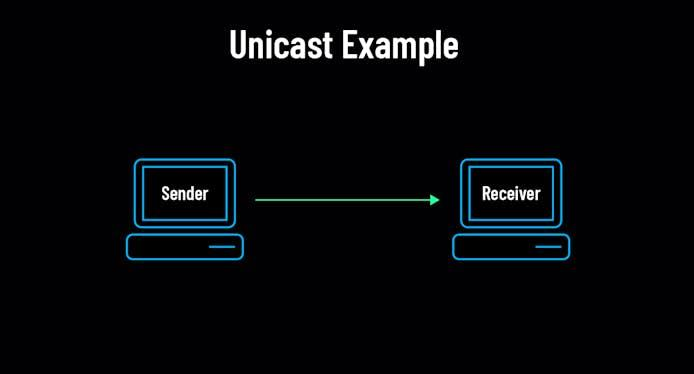

**Características**:

- Um emissor.
- Um destinatário.
- Comunicação direcionada.
- É a modalidade predominante em muitas aplicações da Internet.

**Exemplos**:

- Acessar um site.
- Transferir um arquivo para um servidor.
- Conectar-se por SSH a outro computador.

## 1.2. Broadcast (1-para-todos)

Broadcast é a comunicação em que **um dispositivo transmite uma informação para TODOS** os dispositivos pertencentes a determinado **domínio de broadcast**.
- **Domínio broadcast**: é o conjunto de dispositivos dentro de uma mesma rede.
- Normalmente, um **domínio de broadcast é delimitado por roteadores**, que não encaminham broadcasts entre redes diferentes.
- Isto é, cada rede tem seu proprio domínio de broadcast.
- Para enviar um pacote para o domínio de broadcast usamos o **endereço IP de broadcast da rede**.

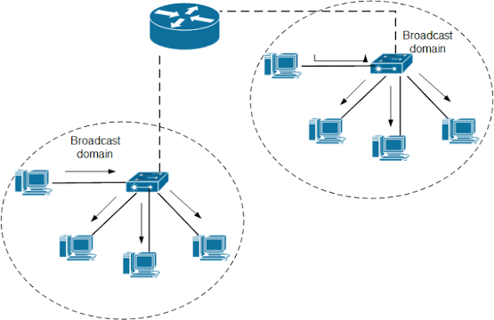

O IP de broadcast da rede depende de:
- endereço IP de rede 
- máscara de subrede

**Exemplo**:

Considere uma rede `192.168.10.0/24`.
- Seu endereço de broadcast é `192.168.10.255` (que é o último endereço da rede).

Quando um dispositivo transmite um pacote com este endereço de broadcast, acontece o seguinte:
1. os switches recebem o quadro
2. encaminham o quadro para as outras portas do switch (exceto pela porta de entrada)

**Exemplos de utilização**:

- Descoberta de dispositivos e serviços em redes locais.
  - **Exemplos**:
    - Quem tem um endereço IP `192.168.10.1`? (protocolo ARP é quem responde isso).    
- Solicitações DHCP iniciais, em determinados cenários.
  - DHCP é um protocolo usado para configurar IPs automaticamente (veremos isso mais adiante)
  - Ele funciona através de broadcast, quando um dispositivo ainda não tem IP configurado.

**Limitações**:

- Todos os dispositivos do domínio de broadcast recebem o quadro.
  - Pode gerar tráfego desnecessário.
  - Gerar congestionamentos na rede.
- Broadcast excessivo pode prejudicar o desempenho da rede.
  - Muitos dispositivos conversando entre si, enviando broadcasts, podem gerar um **tempestade de broadcast** (**broadcast storm**).
  - **Broadcast storm**: ninguem consegue se comunicar, porque todos os dispositivos estão ocupados processando broadcasts.

## 1.3. Multicast (1-para-grupo)

Multicast é a comunicação em que **um emissor envia informações destinadas a um grupo específico** de destinatários.

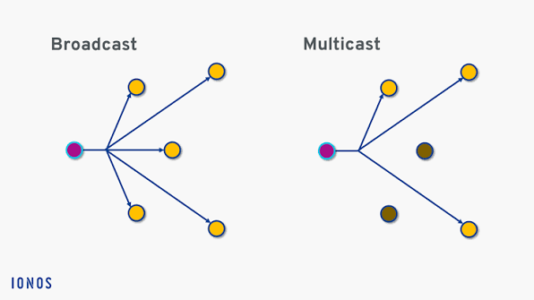

Imagine uma instituição transmitindo uma aula ao vivo para um grupo de computadores.

Se a aplicação utilizar multicast, o emissor poderá transmitir um único fluxo destinado ao grupo multicast, e a infraestrutura poderá replicar os dados conforme necessário para alcançar os participantes.
- Isso é mais rapido do que enviar um pacote individual para cada destinatário (unicast) 
- Tambem costuma ser melhor do que enviar o mesmo pacote para todos os dispositivos do domínio (broadcast)
  - Podem existir dispositivos que não estão interessados na transmissão, e que não precisam receber os pacotes.

**Características**:

- Um emissor pode transmitir para vários destinatários simultaneamente.
  - O **mesmo pacote é replicado** pelos equipamentos de rede (switches, roteadores, etc) para atingir todos os destinatários do grupo.
- Os destinatários pertencem a um grupo multicast.

**Exemplos**:

- Distribuição de vídeo em redes.
  - **Ex**: uma universidade transmitindo uma aula ao vivo para um grupo de alunos.
  - **Ex**: uma empresa transmitindo uma reunião corporativa para um grupo de funcionários.
- Transmissão de determinados fluxos de áudio e vídeo.
  - **Ex**: reuniões de videoconferência, transmissões de rádio e TV digital (copa do mundo, Olimpíadas, etc).
- Alguns protocolos de descoberta e gerenciamento.
  - **Ex**: DHCP, IGMP, etc

## 1.4. Comparação entre as modalidades

| Característica | Unicast                       | Broadcast                              | Multicast                                             |
| -------------- | ----------------------------- | -------------------------------------- | ----------------------------------------------------- |
| Destinatários  | 1                             | Todos                                  | Grupo                                                 |
| Replicação     | Somente no caminho do destino | Distribuída por todo domínio broadcast | Conforme grupo multicast                              |
| Uso típico     | Navegação Web                 | Descoberta de rede                     | Distribuição de conteudo comum a um grupo de usuários |

**Atenção**: broadcast e multicast não são a mesma coisa. 
- No broadcast, **TODOS** os dispositivos do domínio recebem a transmissão. 
- No multicast, **somente os dispositivos interessados**, que pertencem ao grupo multicast recebem a transmissao.

# 2. Modos de transmissão (Simplex, Half-Duplex, Full-Duplex)

Os modos de transmissão descrevem como os dispositivos podem transmitir e receber informações em relação à:
- direção (enviar ou receber)
- simultaneidade da comunicação (podem transmitir e receber ao mesmo tempo ou não)

## 2.1. Simplex (uma direcao apenas)

No modo simplex, a comunicação acontece em **apenas uma direção**.
- Nao é possivel enviar e receber ao mesmo tempo (não há comunicação bidirecional).
- Um dispositivo **somente** transmite, e o outro **somente** recebe.

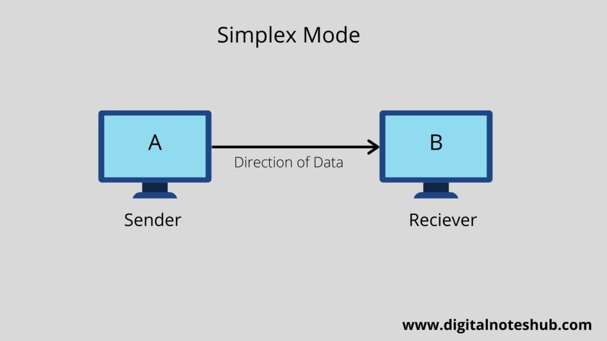

**Exemplos**:

- Transmissão de rádio.
- Transmissão de televisão.

## 2.2. Half-Duplex (duas direcoes, alternadas)

No modo half-duplex, os dispositivos podem transmitir e receber informações, mas não simultaneamente no mesmo canal.
- Um dispositivo transmite enquanto o outro recebe, e vice-versa.

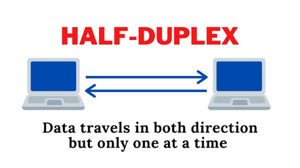

**Exemplo**: Walkie-talkie
- Quando uma pessoa está falando, a outra precisa aguardar para falar.
- Ambas podem transmitir e receber, mas não ao mesmo tempo.

**Exemplo 2**: Ponto de acesso Wi-Fi
- O ponto de acesso Wi-Fi pode transmitir dados para um dispositivo, mas enquanto isso, o dispositivo não consegue transmitir dados para o ponto de acesso.
- Isso ocorre porque o ponto de acesso e o dispositivo compartilham o mesmo canal de comunicação (frequencia de ondas de radio).
- O ponto de acesso pode criar um outro canal (frequencia de radio) para se comunicar com outro dispositivo, mas cada canal é half-duplex (ou transmite, ou recebe dados).
- Veja exemplo abaixo:

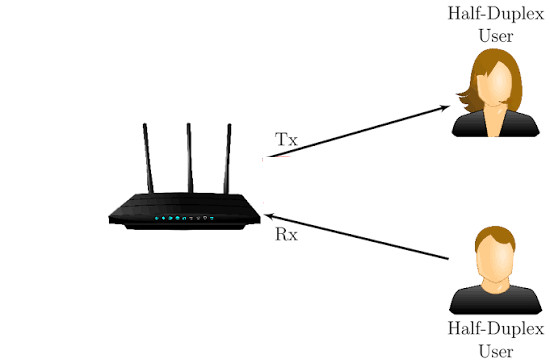

**Características**:

- Comunicação bidirecional (porem nao simultanea).
- Transmissão alternada (envia, depois recebe, depois envia, e assim por diante).
- Não permite transmitir e receber simultaneamente pelo mesmo canal (mesmo frequencia de onda).

A razao de nao permitir o envio pela mesmo canal (frequencia de onda) é que, se ambos os dispositivos transmitirem ao mesmo tempo, os sinais podem se sobrepor e gerar interferência.
- Interferencia faz com que os sinais se misturem, e o receptor nao consegue decodificar corretamente a informação (pacote se torna ilegível - vira ruido).
- Mesma logica de uma sala cheia de pessoas conversando ao mesmo tempo, onde ninguem consegue entender o que o outro esta falando.
- Veja exemplo abaixo:

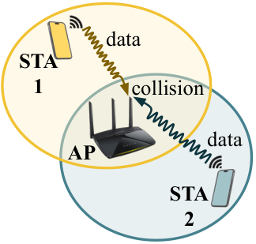

Alem da colisao, ondas de radio podem interagir, se destruindo mutuamente, e tornando a comunicacao impossivel:
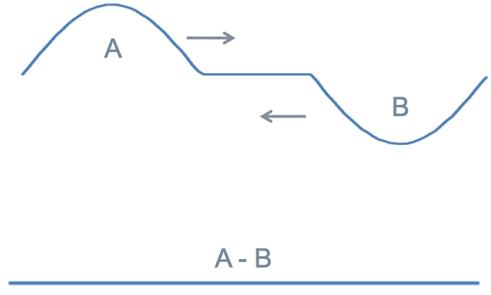

## 2.3. Full-Duplex (duas direcoes, simultaneas)

No modo full-duplex, os dispositivos conseguem **transmitir e receber dados simultaneamente**.

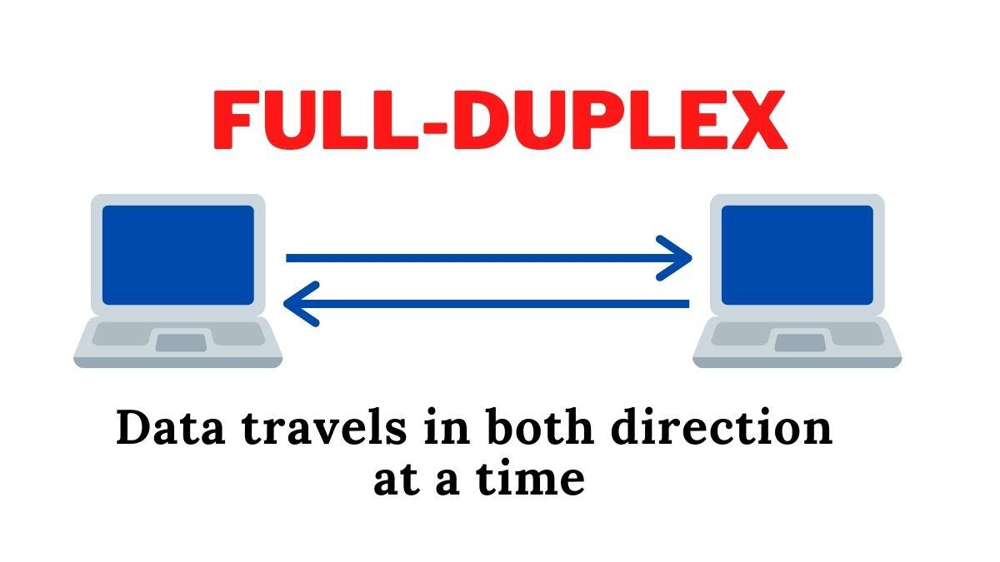

**Exemplo**: Chamada telefonica
- uma pessoa pode falar enquanto escuta a outra (comunicação bidirecional).
- Ambas as partes podem enviar e receber dados ao mesmo tempo.

A maioria das redes Ethernet modernas permitem conexões full-duplex.

**Características**:

- Comunicação bidirecional.
- Transmissão simultânea.
- Não existe disputa pelo meio entre os dois sentidos de comunicação da mesma forma que ocorre no half-duplex compartilhado.

## 3.4. Comparação

| Modo        | Simultaneidade           | Exemplo              |
| ----------- | ------------------------ | -------------------- |
| Simplex     | 1 direção                | Rádio, TV            |
| Half-duplex | 2 direções (alternadas)  | Walkie-talkie, Wi-Fi |
| Full-duplex | 2 direções (simultâneas) | Ethernet moderna     |

## 3.5. Modo de transmissao x Desempenho das redes

Considere uma conexão com capacidade de transmissão de $100\ Mbps$ em cada direção.

Em uma conexão **full-duplex**, é possível simultaneamente:
- transmitir 100 Mbps
- receber 100 Mbps 

Isso não significa que a conexão tenha uma capacidade de 200 Mbps. 
- A capacidade de transmissão é de 100 Mbps, e é considerada separadamente para cada sentido (100 Mbps para enviar, e 100 Mbps para receber).

Em uma conexao **half-duplex**, a capacidade de transmissão é compartilhada entre os dois sentidos.
- Se um dispositivo estiver transmitindo, o outro não consegue transmitir ao mesmo tempo.
- Portanto, a capacidade de transmissão é de 100 Mbps, mas **não é possível utilizar os dois sentidos ao mesmo tempo**.

O tempo para enviar um pacote de 1 MB (megabyte) em uma conexão de 100 Mbps será o mesmo, independente do modo de transmissão (half-duplex ou full-duplex).
- Isto é, a capacidade de transmissão é a mesma (100 Mbps) para ambos os casos.

# 4. Métricas de desempenho de redes

Uma rede pode estar funcionando corretamente e, ainda assim, apresentar desempenho ruim.

Imagine que um computador consiga acessar um site, mas precise esperar vários minutos para receber uma resposta. 
- Embora exista conectividade, a experiência do usuário não é satisfatória.

Para avaliar a qualidade de uma rede, utilizamos diferentes métricas.

As principais são:

1. Largura de banda (*Bandwidth*).
2. Vazão efetiva (*Throughput*).
3. Latência (*Latency*).
4. Variação da latência (*Jitter*).
5. Perda de pacotes (*Packet Loss*).

Essas métricas são complementares:
- Uma rede pode apresentar **alta largura de banda** e, ao mesmo tempo, possuir **latência elevada** ou **perda de pacotes**.

## 4.1. Largura de banda (Bandwidth)

Largura de banda é uma **medida da capacidade de transmissão de dados** de um enlace de comunicação.

Nas redes de computadores, normalmente é **expressa em bits por segundo (bps)**.

**Unidades comuns**:

| Unidade | Equivalência          |
| ------- | --------------------- |
| 1 Kbps  | 1.000 bps             |
| 1 Mbps  | 1.000.000 bps         |
| 1 Gbps  | 1.000.000.000 bps     |
| 1 Tbps  | 1.000.000.000.000 bps |

**Exemplo**:

Imagine uma conexão Ethernet full-duplex com capacidade nominal de $100\ Mbps$.

Isso significa que o enlace possui uma capacidade de transmissão de até 100 milhões de bits por segundo em cada direção.

**É importante não confundir bits e bytes**.

- **bit**: unidade básica de informação (0 ou 1).
- **byte**: conjunto de 8 bits.

**Arquivos são normalmente medidos em bytes**, enquanto a **largura de banda é expressa em bits** por segundo.

Portanto, para calcular a taxa de transferência de arquivos, é necessário converter bits para bytes.

Considerando uma conexão de $100\ Mbps$, isso corresponde (teoricamente) a:
$$
\frac{100\ Mbps}{8\ \text{bits / byte}}=12,5\text{ MB/s} 
$$

Ou seja, 12,5 megabytes por segundo.

**Atenção**: esse valor é teórico, pois **redes tem várias limitacoes e problemas que podem reduzir a taxa de transferência** de dados, tais como: 
- Cabeçalhos dos protocolos (ocupam espaço do pacote), 
- Confirmações (pacotes ACK de protocolos como TCP), 
- Retransmissões (quando pacotes são perdidos e precisam ser reenviados), 
- E outros problemas e limitações das redes.

## 4.2. Throughput (vazão efetiva)

Throughput é a quantidade de dados efetivamente transmitida com sucesso por unidade de tempo.

Enquanto a largura de banda representa a capacidade de transmissão, o throughput representa o desempenho efetivamente observado.
- Isto é, o throughput é a taxa de transmissão de dados que o usuário realmente consegue alcançar, considerando as limitações e problemas da rede.

**Exemplo**:

Imagine um enlace com capacidade nominal (largura de banda) de 100 Mbps.

Durante uma transferência, o usuário observa uma taxa de 72 Mbps.

Nesse caso:

- **Largura de banda nominal**: 100 Mbps.
- **Throughput observado**: 72 Mbps.

Essa diferença pode ser explicada por:
- Cabeçalhos dos protocolos.
- Perdas de pacotes e Retransmissões.
- Congestionamento.
- Compartilhamento do enlace.
- Limitações dos dispositivos.
- Limitações da aplicação.
- Placas de rede, cabos, interferências, etc.

Uma métrica relacionada é o **goodput**, que representa a taxa de entrega dos dados úteis à aplicação, **excluindo as informações de controle** e protocolo.
- Isto é removendo os cabeçalhos dos protocolos, retransmissões e outros dados que não são úteis para a aplicação.

Digamos que dos 72 Mbps de throughput, apenas 60 Mbps sejam dados úteis para a aplicação.

Logo, temos:
- **Bandwidth** (largura de banda): 100 Mbps.
- **Throughput**: 72 Mbps.
- **Goodput**: 60 Mbps.

### Exemplo de cálculo de Throughput

Considere que um arquivo de 120 MB seja transferido em 20 segundos.

Calcule o throughput aproximado da transferência.

**Solucao:**

O throughput aproximado ($T$) será:

$$
\begin{align}
T &= \frac{120\text{ MB} \times 8\ \text{bits a cada byte}}{20 \ \text{s}} \\
 &= \frac{960\text{ Mb}}{20\text{ s}} \\
 &= 48\text{ Mbps} 
\end{align}
$$

**Observe**: o arquivo foi medido em megabytes (MB), enquanto o throughput é expresso em megabits por segundo (Mbps).

## 4.3. Latência (Latency)

Latência é o **tempo necessário para que uma informação percorra um determinado caminho** entre dois pontos da rede.

Normalmente, é expressa em milissegundos ($ms$).

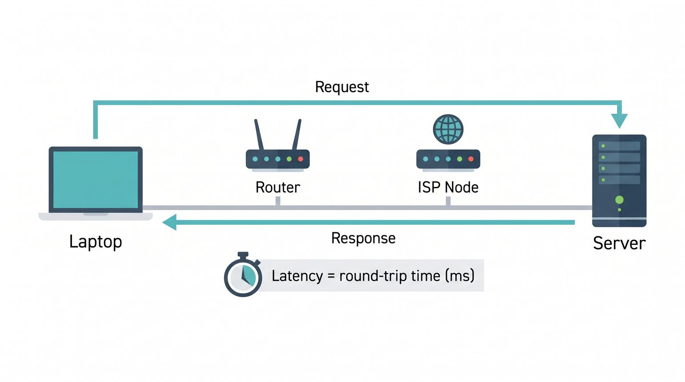

Considere o exemplo acima, no qual um laptop envia uma mensagem para um servidor e receba uma resposta após $30\ ms$.
- Esse tempo corresponde ao **RTT (Round-Trip Time)**
- **RTT**: tempo necessario para um pacote ir e voltar ao seu remetente (emissor).

É importante diferenciar:

- **Latência unidirecional**: tempo necessário para um pacote ir da origem ao destino.
- **RTT**: tempo necessário para a comunicação de ida e volta.

**Normalmente, se mede apenas o RTT**, pois é mais fácil de medir e representa a qualidade da conexão de um usuário.

A latência pode ser influenciada por:

- Distância geográfica 
  - se o cliente estiver muito longe do servidor, a latência será alta.
- Velocidade de propagação do sinal 
  - quanto menos cabo for utilizado para conectar dispositivos, mais rapido o sinal se propagará entre eles.
- Processamento nos equipamentos.
  - Cada equipamento (roteador, switch, firewall, etc) precisa processar os pacotes que passam por ele.
  - Quanto mais equipamentos houver no caminho entre um cliente e servidor, maior será a latência.
- Filas nos roteadores e switches.
  - Se houver congestionamento, os pacotes podem ser colocados em filas de espera, aumentando a latência.
- Congestionamento.
  - Se houver muitos pacotes trafegando em um mesmo enlace, a latência tende a aumentar (devido as filas que discutimos acima).
- Tecnologia utilizada no meio de transmissão.

**IMPORTANTE**: Latência não é velocidade de download.
- Uma conexão pode apresentar:
  - Download de 500 Mbps.
  - Latência de 100 ms.

Isso significa que ela possui grande capacidade de transmissão, mas pode apresentar demora significativa para iniciar ou concluir determinadas interações.
- Conseguimos baixar arquivos rapido, mas nao conseguimos interagir com o servidor rapidamente 
- A experiencia do usuário em jogos online, videoconferências, chamadas de audio, etc provavelmente sera ruim.

## 4.4. Jitter (variação da latência)

Jitter é a **variação do atraso observado** na entrega dos pacotes.

Imagine que um computador envie quatro pacotes para um servidor e obtenha os seguintes tempos de resposta:

| Pacote | RTT   |
| ------ | ----- |
| 1      | 20 ms |
| 2      | 21 ms |
| 3      | 80 ms |
| 4      | 22 ms |

Observe que o terceiro pacote apresentou um atraso muito superior aos demais.

Essa variação pode prejudicar aplicações que dependem da entrega regular dos dados.
- Ex: Chamadas VoIP, videoconferências, streaming de áudio e vídeo, jogos online, etc.

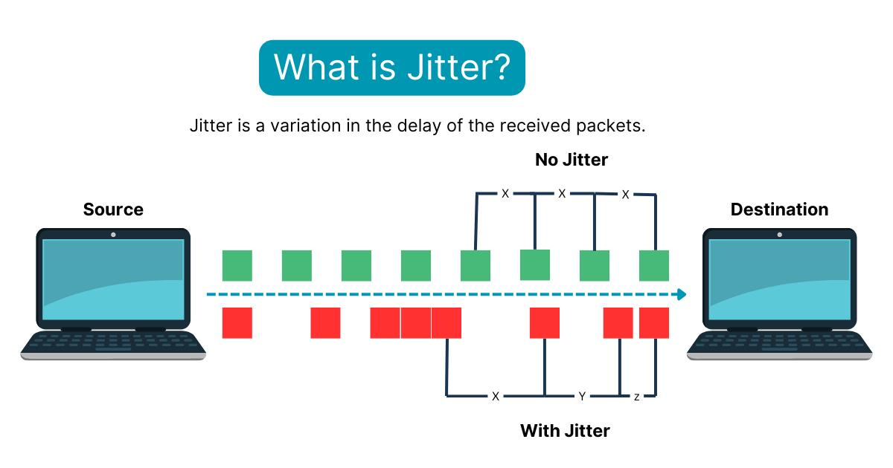

Para compensar variações no atraso, algumas aplicações utilizam buffers de reprodução (**jitter buffers**).
- Esses buffers armazenam temporariamente os pacotes para tentar reproduzir áudio e vídeo de maneira mais regular.
- Quando a conexao "fica mais lenta" (há jitter), o buffer consegue manter a reprodução do vídeo, audio, etc sem interrupções.
- **Ex**: buffer do YouTube, buffer do Spotify

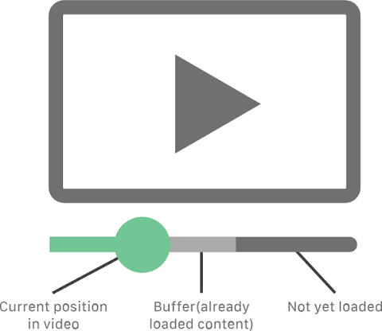

**Importante**: jitter não significa simplesmente latência elevada. 
- Uma conexão pode apresentar latência elevada, mas ser relativamente estável (jitter baixo). 
- Do mesmo modo, uma conexão pode ter latência baixa, mas ser instável (jitter alto).

## 4.5. Perda de pacotes (Packet Loss)

Perda de pacotes **ocorre quando pacotes transmitidos não chegam ao destino** esperado.
- Pacotes podem ser perdidos por varias razoes:
  - Corrupcao de dados (colisao na rede ou interferencia), 
  - Foram descartados (devido a congestionamento, filas cheias, etc),
  - Um enlace de rede pode ter sido desconectado (ou rompido / cortado - **ex**: cabo de fibra optica rompido),
  - Outras falhas de rede.

Imagine que um computador transmita 1.000 pacotes, mas apenas 980 sejam recebidos.

A quantidade de pacotes perdidos será de:

$$
1000\text{ pkts enviados} - 980\text{ recebidos} = 20\text{ pkts perdidos}
$$

A taxa de perda ($L$), em percentual, será:

$$
\begin{align}
L &= \frac{20}{1000}\times100 \\
      &= 2\%
\end{align}
$$

As causas podem incluir:

- Congestionamento.
- Falhas físicas.
- Interferências wireless.
- Problemas de configuração.
- Descarte de pacotes em filas.
- Sobrecarga de equipamentos.

Os efeitos que a perda de pacotes terao em uma aplicacao dependem muito da sua sensibilidade a perdas, e do protocolo de transporte utilizado (TCP ou UDP).
- **Em TCP**: perdas podem provocar retransmissões, aumentando o tempo de transferência e reduzindo o desempenho.
  - O protocolo TCP tenta enviar os pacotes perdidos de novo, ate que sejam recebidos com sucesso.
- **Em UDP**: não existe retransmissão automática pelo próprio protocolo. 
  - A aplicação pode simplesmente receber dados incompletos, a menos que implemente mecanismos próprios de recuperação 
  - Isto é, **no UDP, a responsabilidade de detectar a perda, e pedir a retransmissao é do aplicativo**.

## 4.6. Comparação das métricas de desempenho

| Métrica     | O que representa               | Unidade                |
| ----------- | ------------------------------ | ---------------------- |
| Bandwidth   | Capacidade do enlace           | bps (bits por segundo) |
| Throughput  | Taxa efetivamente transmitida  | bps (bits por segundo) |
| Goodput     | Taxa de dados úteis entregues  | bps (bits por segundo) |
| Latência    | Tempo de comunicação           | ms                     |
| Jitter      | Variação do atraso             | ms                     |
| Packet Loss | Percentual de pacotes perdidos | %                      |

## 4.7. Qual métrica é mais importante?

Depende da aplicação. Considere os três cenários abaixo:

| Aplicação                    | Métricas mais importantes           |
| ---------------------------- | ----------------------------------- |
| Download de arquivos grandes | Throughput                          |
| Jogos online                 | Latência, jitter, perda             |
| Videoconferência             | Latência, jitter, perda, throughput |
| Navegação Web                | Latência, throughput, perda         |
| Backup em nuvem              | Throughput, perda                   |

Por exemplo, um jogador pode preferir uma conexão de 100 Mbps com 15 ms de latência a outra de 500 Mbps com 120 ms de latência.

Isso acontece porque, para jogos interativos, a capacidade de transmissão não é o único fator determinante.
- Latencia e jitter podem prejudicar muito a experiência do jogador, mesmo que a conexão possua grande capacidade de transmissão.

# 5. Exercicios de fixacao

## Parte A — Comunicacao e modos de transmissão

1. Diferencie unicast, broadcast e multicast. Apresente um exemplo de utilização para cada modalidade.
2. Um computador transmite uma mensagem de broadcast IPv4. Todos os computadores conectados à Internet receberão essa mensagem? Explique.
3. Explique as diferenças entre simplex, half-duplex e full-duplex.
4. Uma conexão Ethernet full-duplex possui capacidade de 100 Mbps. Qual é a capacidade máxima de transmissão simultânea nos dois sentidos?

## Parte B — Métricas de desempenho

5. Qual é a diferença entre largura de banda e throughput?
6. Uma conexão possui capacidade de 200 Mbps, mas apresenta throughput de 120 Mbps. Cite três possíveis causas para essa diferença.
7. Uma conexão apresenta RTT de 40 ms. O que esse valor representa?
8. Qual é a diferença entre latência e jitter?
9. Por que o jitter pode prejudicar uma videoconferência?
10. Um computador transmitiu 5.000 pacotes, dos quais 4.850 chegaram ao destino. Calcule a taxa de perda de pacotes.
11. Uma conexão A possui largura de banda de 200 Mbps, e latência de 200 ms. Outra conexao B possui largura de banda de 50 Mbps e latência de 50 ms. Qual conexão pode ser mais adequada para jogos online? Justifique.

## Parte C — Situações-problema

12. Durante uma videoconferência, os participantes percebem interrupções no áudio, mesmo possuindo uma conexão com largura de banda elevada. Quais métricas de desempenho devem ser investigadas?
13. Em uma rede do Instituto Federal, um computador apresenta perda de pacotes de 5% ao acessar um servidor remoto. Quais podem ser as causas dessa perda? Cite pelo menos três.
14. Um usuário relata que, ao acessar um site, a página demora para carregar, mesmo possuindo uma latencia de 20 ms. Quais métricas de desempenho devem ser analisadas para identificar o problema? Justifique.

# 6. Atividades Praticas

## Atividade 1 — Análise de protocolos com Wireshark

Utilize o Wireshark para observar a comunicação do seu computador.

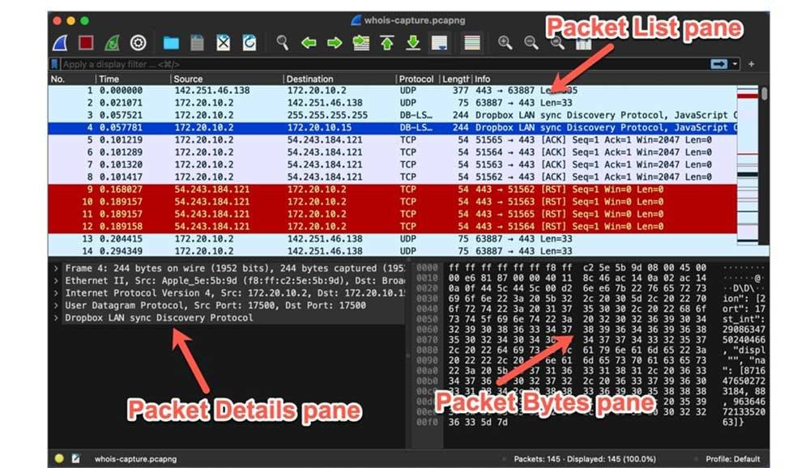

Procedimento:

1. Instale e abra o Wireshark.
2. Selecione a interface de rede utilizada.
3. Inicie a captura.
4. Acesse um site.
5. Interrompa a captura.
6. Identifique os protocolos presentes.

Procure observar:

- Ethernet.
- IPv4 ou IPv6.
- TCP ou UDP.
- DNS.
- HTTP ou HTTPS.

Responda:

- Quais endereços MAC aparecem na comunicação?
- Quais endereços IP aparecem?
- Quais protocolos estão sendo utilizados?
- Quais portas TCP ou UDP aparecem?
- É possível identificar informações de diferentes camadas do modelo OSI?

**Observação**: em HTTPS, o conteúdo da aplicação normalmente está criptografado. 
- Isso não impede a observação dos cabeçalhos de diversos protocolos envolvidos na comunicação.
- Somente o conteúdo da aplicação (mensagens, páginas web, etc) não é visível.
  
## Atividade 2 — Investigação do desempenho da rede

Utilize o terminal do Windows ou Linux.

Execute:

```bash
ping 8.8.8.8
```

Observe:

- Tempo de resposta.
- Variação dos tempos.
- Quantidade de pacotes enviados.
- Quantidade de pacotes recebidos.
- Perda de pacotes.

Depois, execute no prompt de comandos (``cmd``) do Windows:

```pwsh
tracert 8.8.8.8
```

No Linux, utilize:

```bash
traceroute 8.8.8.8
```

Investigue:

- Quantos saltos existem até o destino?
- Qual é o tempo de resposta de cada salto?
- Existem saltos sem resposta?
- Por que o caminho até o destino pode passar por vários roteadores?

**Importante**: um salto sem resposta não significa necessariamente falha no roteamento. 
- Alguns roteadores limitam ou bloqueiam respostas às mensagens utilizadas pelo ``traceroute``.

Para fazer essa atividade, pesquise como usar o comando `ping` e `traceroute` no seu sistema operacional.