# Equipamentos de Rede 

**Sumário**:
- [Equipamentos de Rede](#equipamentos-de-rede)
- [1. Placas de rede (NIC)](#1-placas-de-rede-nic)
  - [1.1. Principais funções de uma NIC](#11-principais-funções-de-uma-nic)
  - [1.2. Endereço MAC da NIC](#12-endereço-mac-da-nic)
  - [1.3. Velocidades das placas de rede](#13-velocidades-das-placas-de-rede)
  - [1.4. Placas de rede cabeadas e wireless](#14-placas-de-rede-cabeadas-e-wireless)
    - [1.4.1. NIC Cabeada](#141-nic-cabeada)
    - [1.4.2. NIC Wireless](#142-nic-wireless)
- [2. Hubs](#2-hubs)
  - [2.1. Como funciona um hub?](#21-como-funciona-um-hub)
  - [2.2. Características dos hubs](#22-características-dos-hubs)
  - [2.3. Colisões em redes com hubs (mecanismos de prevenção CSMA/CD x CSMA/CA)](#23-colisões-em-redes-com-hubs-mecanismos-de-prevenção-csmacd-x-csmaca)
  - [2.4. Por que os hubs praticamente desapareceram?](#24-por-que-os-hubs-praticamente-desapareceram)
- [3. Switches](#3-switches)
  - [3.1. Como funciona um switch?](#31-como-funciona-um-switch)
  - [3.2. Principais funções dos switches](#32-principais-funções-dos-switches)
  - [3.3. Switches Não Gerenciáveis x Gerenciáveis](#33-switches-não-gerenciáveis-x-gerenciáveis)
    - [3.3.1. Switch não gerenciável (Unmanaged)](#331-switch-não-gerenciável-unmanaged)
    - [3.3.2. Switch gerenciável (Managed)](#332-switch-gerenciável-managed)
  - [3.4. Switches PoE](#34-switches-poe)
- [4. Roteadores](#4-roteadores)
  - [4.1. Como funciona o roteamento?](#41-como-funciona-o-roteamento)
  - [4.2. Gateway padrão](#42-gateway-padrão)
  - [4.3. Exemplo no Cisco Packet Tracer](#43-exemplo-no-cisco-packet-tracer)
  - [4.4. Tabela de roteamento](#44-tabela-de-roteamento)
  - [4.5 Roteador residencial (SOHO - Small Office/Home Office)](#45-roteador-residencial-soho---small-officehome-office)
  - [4.6. Diferença entre switch e roteador](#46-diferença-entre-switch-e-roteador)
- [5. Access points (pontos de acesso)](#5-access-points-pontos-de-acesso)
  - [5.1. Como funciona um access point?](#51-como-funciona-um-access-point)
  - [5.2. SSID e BSSID](#52-ssid-e-bssid)
  - [5.3. Access Point X Roteador Wireless](#53-access-point-x-roteador-wireless)
    - [5.3.1. Comparação AP x Roteador Wireless](#531-comparação-ap-x-roteador-wireless)
- [6. Modems e ONUs](#6-modems-e-onus)
  - [6.1. Optical Network Unit (ONU)](#61-optical-network-unit-onu)
- [7. Firewalls](#7-firewalls)
  - [7.1. Como funciona um firewall?](#71-como-funciona-um-firewall)
  - [7.2. Firewall de rede X Firewall de host](#72-firewall-de-rede-x-firewall-de-host)
  - [7.3. Firewall não é antivírus!](#73-firewall-não-é-antivírus)
- [8. Exercícios de fixação e avaliação](#8-exercícios-de-fixação-e-avaliação)
  - [Parte A — Equipamentos de rede](#parte-a--equipamentos-de-rede)
- [9. Atividades práticas](#9-atividades-práticas)
  - [9.1. Atividade 1 - Configurando Roteadores no Cisco Packet Tracer](#91-atividade-1---configurando-roteadores-no-cisco-packet-tracer)


# 1. Placas de rede (NIC)

Uma placa de rede, também chamada de **NIC (Network Interface Card)**, é o componente responsável por permitir que um dispositivo se conecte a uma rede de computadores.

Ela estabelece a interface entre o sistema computacional e o meio de comunicação.


Uma NIC pode estar presente em diferentes formatos:

- Integrada à placa-mãe.
- Instalada em um slot PCI Express ou PCI comum (como na figura).
- Conectada por USB.

E cada NIC pode ser projetada para diferentes tipos de redes, como:
- Redes cabeadas (Ethernet).
- Redes sem fio (Wi-Fi, Bluetooth, Zigbee, etc).
- Outras tecnologias de comunicação (como redes ópticas, etc).

A placa de rede possui componentes eletrônicos responsáveis por:
- processar os sinais (elétricos, ópticos, ondas eletromagnéticas, etc) 
- executar funcionalidades relacionadas à comunicação (veja exemplos a seguir).

## 1.1. Principais funções de uma NIC

Entre suas funções estão:

- Transmitir e receber dados.
- Converter informações digitais em sinais apropriados ao meio de transmissão (sinais elétricos, sinais ópticos, ondas eletromagnéticas).
- Processar quadros Ethernet.
- Identificar a interface de rede (placa de rede - NIC) por meio de um endereço MAC.  
- Escolher **encaminhar** (*forward*) ou **descartar** (*drop*) quadros recebidos, com base no endereço MAC de destino.
- Realizar verificações de integridade dos quadros (algoritmos CRC).
- Evitar colisões em redes half-duplex, utilizando o protocolo CSMA.
- Implementar funcionalidades de aceleração de processamento, dependendo do hardware.

## 1.2. Endereço MAC da NIC

Uma **placa de rede (NIC)** normalmente **possui um endereço associado** à sua interface.
- Esse **endereço é utilizado na comunicação de camada 2** (veremos o que significa cada camada de rede mais adiante).

No caso de **placas de rede cabeadas Ethernet, se usam endereços MAC**, como o que segue abaixo:

`A4:5E:60:12:AB:CD`

Um endereço MAC tradicional possui **48 bits**, representados por **12 dígitos hexadecimais**.

Os primeiros 6 dígitos representam o **identificador do fabricante** (Organizationally Unique Identifier - OUI), enquanto os últimos 6 dígitos representam o **identificador único da interface**. No exemplo acima, temos:
- `A4:5E:60` → OUI do fabricante.
- `12:AB:CD` → Identificador único da interface.

Assim placas de mesmo fabricante possuem o mesmo OUI, mas cada placa possui um identificador único.

É importante lembrar que um endereço MAC identifica uma interface no contexto do fabricante. Porem, apesar de considerarmos que toda NIC tem um MAC único e bem definido, esse identificador físico nao é imutável do ponto de vista do sistema operacional: 
- **sistemas operacionais podem permitir sua alteração lógica** (MAC spoofing ou MAC randomization).
- Essa alteração é usada para varias finalidades, porem uma das mais comuns é a preservação da privacidade do usuário, evitando rastreamento de dispositivos em redes sem fio.
  - Dispositivos Android e iOS, por exemplo, podem gerar endereços MAC aleatórios para cada rede Wi-Fi que o dispositivo se conecta (faça o teste, verifique se o seu aparelho esta configurado para ter essa funcionalidade - abra o menu de configurações da rede Wi-Fi e observe se há a opção de "endereços MAC aleatórios").
- Outro uso possível é para interceptar pacotes de uma rede, fingindo ser outro dispositivo (ataque de spoofing, chamado de ``MAC spoofing``).
  - **Spoof** = fingir, imitar, falsificar.

## 1.3. Velocidades das placas de rede

As placas de rede podem operar em diferentes velocidades.

| Tecnologia           | Velocidade |
| -------------------- | ---------- |
| Fast Ethernet        | 100 Mbps   |
| Gigabit Ethernet     | 1 Gbps     |
| 2.5 Gigabit Ethernet | 2,5 Gbps   |
| 5 Gigabit Ethernet   | 5 Gbps     |
| 10 Gigabit Ethernet  | 10 Gbps    |
| 25 Gigabit Ethernet  | 25 Gbps    |
| 40 Gigabit Ethernet  | 40 Gbps    |

A **velocidade efetiva de comunicação depende de todos os componentes** do enlace (dispositivos, cabos, switches, etc).
- Isto é, **a velocidade de transmissão (vazão, também chamada de throughput) será limitada pelo componente mais lento** do caminho.
- Por exemplo, se um computador possui uma placa de rede de 1 Gbps e está conectado a um switch de 100 Mbps, a comunicação ficará limitada a 100 Mbps.
- Do mesmo modo, se eu tiver um cabo de rede de 100 Mbps, mesmo que a placa de rede e o switch suportem 1 Gbps, a comunicação será limitada a 100 Mbps.

Isso acontece porque **a conexão precisa negociar uma velocidade compatível com os dois lados**.
- Esse processo de negociação é representada no Cisco Packet Tracer pela **"bola laranja"** que aparece na interface de rede quando a conexão está sendo estabelecida (quando conectamos os dispositivos através de cabos, conforme imagem abaixo).

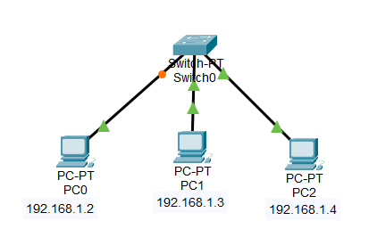

## 1.4. Placas de rede cabeadas e wireless

### 1.4.1. NIC Cabeada


Utiliza uma interface física para conectar o dispositivo a um cabo de rede.

É comum encontrar portas Ethernet de 1 Gbps em computadores convencionais.
- Em computadores empresariais ou servidores, é possível encontrar placas de rede com velocidades superiores, como 10 Gbps até 40 Gbps.

### 1.4.2. NIC Wireless

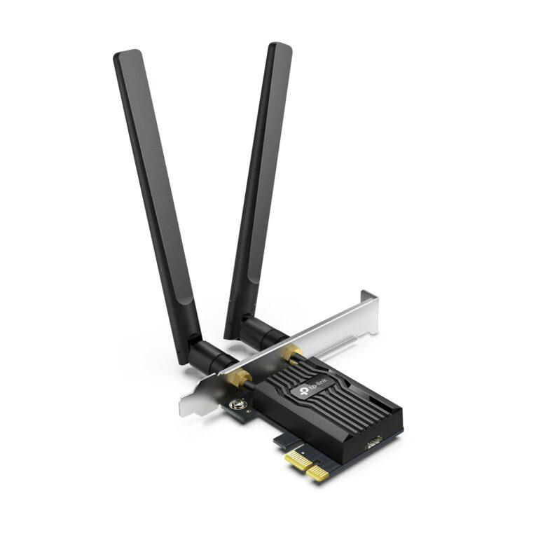

Utiliza comunicação por radiofrequência (ondas de radio, transmitidas através do ar).

Pode incluir antenas internas ou externas e suporta diferentes padrões, como o ``IEEE 802.11`` (que conhecemos como Wi-Fi).

Alguns dispositivos possuem placas combinadas que oferecem várias tecnologias simultaneamente, como Wi-Fi e Bluetooth.
- Maioria dos notebooks modernos possuem placas de rede integradas que suportam Wi-Fi e Bluetooth.

# 2. Hubs

Um hub é um equipamento utilizado para conectar vários dispositivos em uma rede local.

Ele **funciona como um repetidor multiporta**, recebendo sinais em uma porta de entrada e reproduzindo-os nas demais portas.

Diferentemente de um switch, o **hub não analisa os endereços MAC** dos quadros para decidir qual porta deve receber os dados.
- Ele simplesmente repete os sinais recebidos para todas as portas (exceto a de entrada).
- Isto é, **Hubs operam na camada física (L1)** do modelo OSI, enquanto switches operam na camada de enlace (camada 2).


## 2.1. Como funciona um hub?

Imagine 4 computadores conectados a 1 hub, como no exemplo abaixo.


Quando o computador A transmite dados para o computador B:

1. O hub recebe os sinais na porta de entrada.
2. O hub repete os sinais para TODAS as demais portas.
3. Todos os computadores conectados recebem fisicamente a transmissão (sinais elétricos no fio, neste exemplo).
4. O computador cujo endereço corresponde ao destinatário processa o quadro.
5. Os demais computadores descartam o quadro quando não são seus destinatários (veja exemplo abaixo).


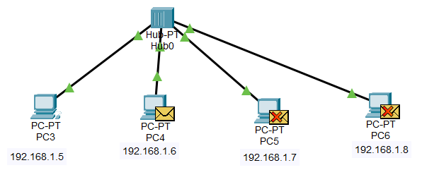

Observe que o hub não sabe qual computador é o destinatário. Essa decisão é tomada pelas interfaces de rede dos dispositivos.
- No Cisco Packet Tracer, vemos isso acontecendo quando cada computador descarta o pacote que não é destinado a ele (representado pelo ícone de **"X" vermelho** - veja exemplo abaixo).

Encare um hub como sendo um "fio de rede compartilhado" entre todos os dispositivos conectados a ele.
- Todos os dispositivos conectados a um hub **compartilham o mesmo meio de transmissão** (o mesmo cabo).
- Logo, se dois dispositivos transmitirem simultaneamente, ocorrerá uma colisão de sinais.
- Isto é, **todos tem o mesmo domínio de colisão**, e a comunicação precisa ser coordenada para evitar que os sinais se sobreponham (causem interferência, ou colisão).

## 2.2. Características dos hubs

- Operam na **camada física** do modelo OSI.
- Não possuem tabela de endereços MAC.
- Não realizam encaminhamento seletivo de quadros.
- Repetem os sinais recebidos para as demais portas.
- Compartilham o meio de transmissão.
- Todos os dispositivos conectados pertencem ao **mesmo domínio de colisão**.
  - Isto significa que se dois dispositivos transmitirem simultaneamente, ocorrerá uma colisão de sinais, pois compartilham o mesmo meio de comunicação (o mesmo fio, neste exemplo).

## 2.3. Colisões em redes com hubs (mecanismos de prevenção CSMA/CD x CSMA/CA)

Imagine que dois computadores transmitam simultaneamente utilizando o mesmo hub.
- Como todos compartilham o mesmo meio de transmissão, os sinais podem colidir.

Para evitar isso, redes Ethernet half-duplex utilizavam o mecanismo **CSMA/CD (Carrier Sense Multiple Access with Collision Detection)** para lidar com colisões.

O funcionamento simplificado do **CSMA/CD** é:

1. O dispositivo verifica se o meio está livre.
2. Se estiver livre, inicia a transmissão.
3. Durante a transmissão, monitora o meio.
4. Se detectar uma colisão, interrompe a transmissão.
5. Aguarda um intervalo de tempo aleatório.
6. Tenta transmitir novamente.

A ideia por trás do intervalo de tempo aleatório é evitar que os dispositivos colidam novamente ao tentar retransmitir.
> - *Nao sabemos quando cada dispositivo vai tentar transmitir dados, e nem quanto tempo ele passará enviando informações.*
> - *Logo, esperamos um tempo aleatório antes de tentar novamente, para que a chance de colisão seja menor.*

As redes modernas utilizam switches e comunicação full-duplex, eliminando a necessidade do CSMA/CD.
- CSMA ainda é utilizado em redes sem fio, mas com algumas diferenças em relação ao CSMA/CD.
- Nas redes sem fio, o **CSMA/CA (Carrier Sense Multiple Access with Collision Avoidance)** é utilizado para evitar colisões, pois a detecção de colisões é mais difícil em ambientes wireless.

O **CSMA/CA** funciona da seguinte forma:
1. O dispositivo verifica se o meio está livre.
2. Se estiver livre, aguarda um intervalo de tempo aleatório antes de iniciar a transmissão.
3. Durante a transmissão, o dispositivo não consegue detectar colisões diretamente, então ele depende de confirmações (pacotes **ACK**) do destinatário para saber se a transmissão foi bem-sucedida.
4. Se não receber a confirmação, o dispositivo assume que ocorreu uma colisão e tenta retransmitir após outro intervalo de tempo aleatório.

**IMPORTANTE**: O Cisco Packet Tracer não executa os protocolos de prevenção/detecção de colisões (CSMA) em redes com hubs. 
- Por isso aparecem as colisões (*"fogo na mensagem"*) no Packet Tracer.
- Mas podemos observar o funcionamento do CSMA/CD e CSMA/CA em redes reais.
- Inclusive, redes Wi-Fi utilizam o CSMA/CA, para terem melhor desempenho.

## 2.4. Por que os hubs praticamente desapareceram?

Os hubs foram substituídos pelos switches porque os switches oferecem vantagens importantes:

- Encaminhamento seletivo de quadros.
  - Envia os dados apenas para o dispositivo de destino, em vez de enviar uma copia do pacote para todos os equipamentos ligados na rede.
  - **Analogia**: Imagine que você está em uma sala com várias pessoas e deseja entregar uma mensagem a uma pessoa específica. 
    - Se você usar um hub, seria como gritar a mensagem para todos na sala, esperando que a pessoa certa ouça e responda.
    - Se você usar um switch, seria como entregar a mensagem diretamente à pessoa certa (uma vez que o switch ja aprendeu o endereço MAC da pessoa), sem incomodar os outros.
- Separação dos domínios de colisão por porta.
  - **Domínio de colisão**: uma área da rede onde os dispositivos compartilham o mesmo meio de transmissão. 
  - Nessa área pacotes podem colidir (*"fogo na mensagem no Packet Tracer"*) ao transmitir dados simultaneamente, como acontece com Hubs.
  - No switch, cada porta/interface funciona como um **domínio de colisão separado**, permitindo que os dispositivos conectados a portas diferentes transmitam e recebam dados simultaneamente, sem interferência.
- Melhor utilização da largura de banda.
  - So quem precisa receber os dados, recebe os dados. Diferentemente do hub, que envia os dados para todos os dispositivos conectados.
- Suporte a comunicação full-duplex.
  - Permite que os dispositivos transmitam e recebam dados simultaneamente, sem colisões (como aconteceria no caso do Hub), aumentando a eficiência da comunicação.
  - Isto é, cada porta do switch tem um **domínio de colisão separado**.
- Maior escalabilidade.
- Melhor desempenho geral.

Atualmente, hubs são importantes principalmente para compreender a evolução das redes Ethernet. 
- **Quase todas as redes modernas utilizam switches**, que são mais eficientes e oferecem melhor desempenho.

# 3. Switches

Um switch é um equipamento utilizado para interconectar dispositivos em uma rede local (de forma parecida ao hub, porem com melhor desempenho).

Diferentemente de um hub, o **switch analisa informações dos quadros** Ethernet e **utiliza os endereços MAC para encaminhar** os dados pela porta apropriada.

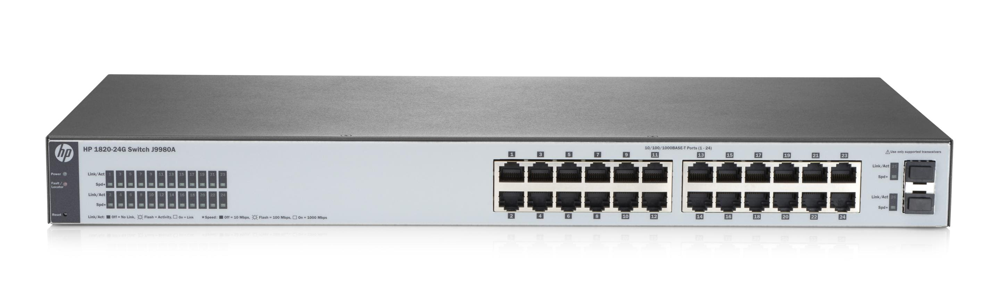

Os switches são amplamente utilizados em:

- Residências.
- Laboratórios de informática.
- Escolas.
- Escritórios.
- Data centers.
- Redes industriais.

## 3.1. Como funciona um switch?

Imagine uma rede com quatro computadores conectados a um switch.

Cada computador possui um endereço MAC diferente.

O switch aprende quais endereços MAC estão associados às suas portas e utiliza essas informações para encaminhar os quadros.
- Para isso, ele usa uma **tabela de endereços MAC**, também chamada de **CAM table (Content Addressable Memory)**.
- Essa tabela vincula o endereço MAC de cada dispositivo à porta do switch correspondente, na qual o dispositivo está conectado.


Considere o exemplo de tabela de endereços MAC abaixo:

| Computador | Endereço MAC      | Porta |
| ---------- | ----------------- | ----- |
| A          | AA:AA:AA:AA:AA:AA | 1     |
| B          | BB:BB:BB:BB:BB:BB | 2     |
| C          | CC:CC:CC:CC:CC:CC | 3     |
| D          | DD:DD:DD:DD:DD:DD | 4     |

Se o computador ``A`` enviar um quadro destinado ao computador ``C``, o switch verificará sua tabela MAC e encaminhará o quadro pela porta 3.
- Os computadores ``B`` e ``D`` não precisam receber esse quadro.
- Essa é uma das principais vantagens dos switches em relação aos hubs.
- Caso o switch ainda nao conheça o endereço MAC de destino, ele encaminhará o quadro para todas as portas (exceto a de entrada), até que aprenda o endereço MAC do dispositivo de destino.
  
## 3.2. Principais funções dos switches

Os switches podem oferecer diferentes funcionalidades:

- Encaminhamento de quadros Ethernet.
- Aprendizado de endereços MAC.
- Filtragem de quadros.
- Criação de VLANs (veremos isso mais adiante).
- Controle de tráfego.
- Priorização de pacotes (QoS).
- Agregação de enlaces.
- Spanning Tree Protocol (STP - veremos mais adiante).
- Monitoramento de portas.
- Alimentação de dispositivos por Ethernet (PoE), em modelos compatíveis.

Nem todos os switches oferecem todas essas funcionalidades.
- Alguns switches são **simples e não gerenciáveis**, enquanto outros são **gerenciáveis e oferecem recursos avançados**.
- Switches domésticos geralmente são não gerenciáveis, enquanto switches corporativos costumam ser gerenciáveis.

## 3.3. Switches Não Gerenciáveis x Gerenciáveis

### 3.3.1. Switch não gerenciável (Unmanaged)


É um equipamento que normalmente funciona sem exigir modificações de configuração.
- Basta conectar os dispositivos para que a comunicação seja estabelecida.
- Switches domésticos e de pequenas empresas geralmente são não gerenciáveis.

Características:

- Configuração automática (plug and play - ligou, funcionou).
- Baixo custo.
- Facilidade de utilização.
- Recursos administrativos limitados (nao possui interface de gerenciamento, VLANs, e recursos avançados).

### 3.3.2. Switch gerenciável (Managed)


Permite configurar e administrar funcionalidades da rede.
- É possível configurar o switch, seja por:
  - uma interface web (página web, como fazemos nos roteadores domésticos),
  - linha de comando (comandos em um terminal),
  - protocolo específico
- Para isso, precisamos nos conectar ao switch, utilizando:
  - Cabo de rede (Ethernet) 
  - Ou uma conexão serial (que vem identificado no equipamento como **porta COM** ou **USB**).

No Cisco Packet Tracer, podemos simular a configuração de switches gerenciáveis utilizando a interface de linha de comando (CLI):
1. Clique em um switch gerenciável (ex: switch **2960**).
2. Clique na aba **CLI**.
3. Digite os comandos para configurar o switch, como atribuir endereços IP, criar VLANs, configurar portas, etc.
4. Veja figura abaixo.

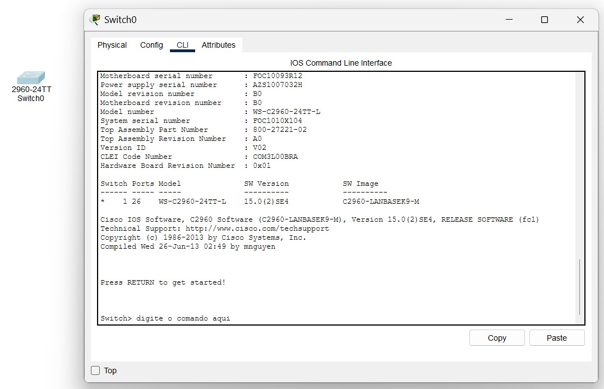

Entre os recursos possíveis estão:

- Definição de VLANs.
- Protocolo STP (Spanning Tree).
- Protocolo SNMP.
- Monitoramento de portas.
- Controle de acesso.

É amplamente utilizado em redes corporativas e institucionais.

## 3.4. Switches PoE

PoE significa **Power over Ethernet** (potência sobre Ethernet, em português).
- Ethernet é uma das tecnologias de comunicação utilizadas em redes locais cabeadas.
- O cabo Ethernet possui cor azul, normalmente, e conexões RJ-45 em suas extremidades (como veremos mais adiante no curso).

É uma tecnologia que **permite transmitir energia elétrica pelo próprio cabo de rede Ethernet**, além dos dados. 

Isso permite alimentar equipamentos como:
- Access points.
- Câmeras IP.
- Telefones IP.
- Determinados dispositivos IoT.

A principal vantagem dessa tecnologia PoE é **reduzir a necessidade de fontes de alimentação separadas** para cada dispositivo.
- No entanto, é preciso verificar qual a potencia máxima suportada pelo switch, para verificar quantos dispositivos podem ser conectados (e alimentados) por ele.
- **Exemplo**:
  - Um switch PoE de 24 portas, por exemplo, pode ter uma potência total de 370W. 
  - Se cada access point consome 15W, então o switch poderia alimentar até 24 APs (15W x 24 = 360W < 370W). 
  - No entanto, se cada câmera IP consome 30W, então o mesmo switch poderia alimentar apenas 12 câmeras (30W x 12 = 360W < 370W).

# 4. Roteadores

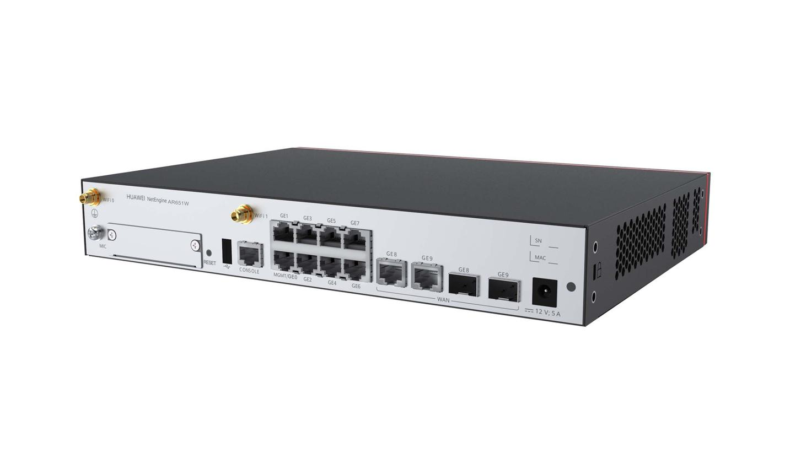

Fisicamente, um roteador pode se parecer com um switch, mas internamente ele possui funcionalidades diferentes.

Um roteador é um equipamento responsável por encaminhar pacotes IP **entre diferentes redes**.
- Um **switch conecta dispositivos dentro de uma mesma rede**.
- Um **roteador** permite a **comunicação entre redes distintas**.

Imagine duas redes:

- Rede A: `192.168.1.0/24`.
- Rede B: `10.0.0.0/8`.

Os dispositivos pertencentes à rede ``A`` não conseguem alcançar diretamente os dispositivos da rede ``B``.
- É necessário um equipamento que  **interconecte eles, através de seus endereços IP, na camada 3**.
- O roteador realiza essa função.

## 4.1. Como funciona o roteamento?

Considere a seguinte infraestrutura:

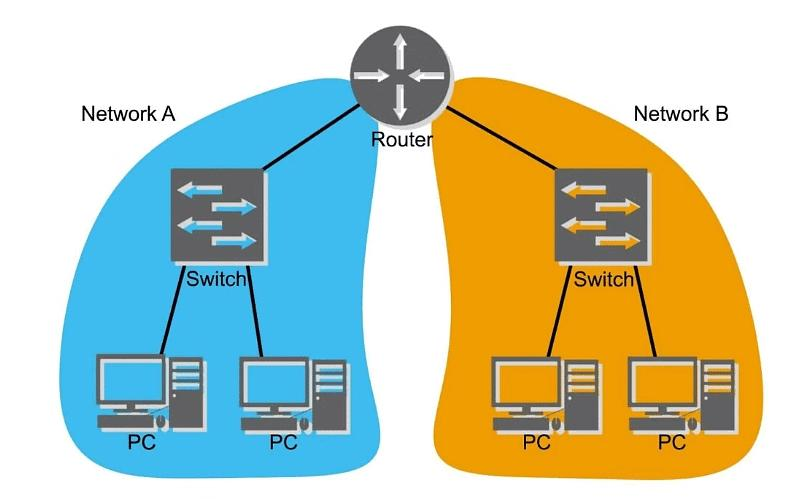

O roteador possui interfaces conectadas às duas redes.

**Exemplo**: Considere que o roteador da figura acima tem tabela de roteamento:

| Portas do roteador | Endereço IP    |
| ------------------ | -------------- |
| Porta A            | 192.168.1.0/24 |
| Porta B            | 10.0.0.0/8     |

Um computador da rede ``A``, com endereço `192.168.1.2`, deseja enviar dados para um servidor da rede ``B``, com endereço `10.0.0.3`.

O processo simplificado é:

1. O computador identifica que o destino está em outra rede.
   1. Para isso, ele consulta o **IP de rede** e a **máscara de sub-rede**.
   2. Se o endereço IP de destino não pertencer à mesma rede, ele sabe que precisa encaminhar o pacote para fora da rede local (*"enviar o pacote para alguma interface/porta do roteador"*).
2. Encaminha o pacote para um dispositivo chamado de **gateway padrão** (que costuma ser o roteador).
   1. **IMPORTANTE**: 
      1. O gateway padrão é o dispositivo que irá encaminhar os pacotes para fora da rede local.
      2. Toda porta do roteador possui um endereço IP, e o gateway padrão é o endereço IP da porta do roteador que está conectada à rede local.
3. O roteador recebe o quadro Ethernet.
4. Desencapsula o quadro Ethernet (*"abre o quadro"*), até chegar na camada de rede (camada 3).
5. Analisa o endereço IP de destino.
6. Consulta sua **tabela de roteamento** (que mapeia endereços IP para portas de saída / interfaces).
7. Identifica a interface de saída (também chamada de porta de saída).
8. Encaminha o pacote para a rede de destino (neste exemplo, rede ``B``).

O roteador não precisa conhecer o endereço MAC do servidor `10.0.0.3`, como acontece com switches. 
- Isto é, roteadores nao precisam aprender endereços MAC de dispositivos conectados a redes diferentes, pois eles operam na camada 3 (camada de rede) do modelo OSI.
- Ele utiliza o IP para descobrir por qual enlace de saída (também chamado de **porta de saída** ou **interface**) encaminhar o pacote.
- Esse processo de encaminhamento é chamado de **roteamento**.

## 4.2. Gateway padrão

O gateway padrão é o endereço IP do equipamento para o qual um dispositivo envia pacotes destinados a redes que não estão diretamente conectadas a ele.
- Exemplo:
  - Roteador.
  - Outro dispositivo que possua endereço IP e desempenhe a função de encaminhamento de pacotes (como um firewall, ou ate mesmo um computador).

**ATENÇÃO**: Qualquer dispositivo capaz de encaminhar pacotes usando endereços IP, desempenha o papel de roteador na rede. 
- Logo, esse dispositivo atua como gateway padrão da rede.

**IMPORTANTE**: Switches convencionais (L2) não podem ser gateways padrão, pois não possuem a capacidade de encaminhar pacotes entre redes diferentes.
- Switches nao tem IP, e nao operam na camada 3 (camada de rede - L3) do modelo OSI, portanto nao podem desempenhar a função de **roteamento**.
- Switches encaminham pacotes usando a técnica de **repasse** de quadros Ethernet, utilizando endereços MAC (camada 2 - L2) e aprendizado de endereços MAC.
- Muitos switches nao sao configuráveis, eles aprendem os endereços MAC através da técnica de **inundação de quadros (flooding)**. Ja a maioria dos roteadores sao configuráveis (definimos o IP da rede e mascara de sub-rede para cada interface).

**Exemplo**:

Um computador possui:

```
Endereço IP:       192.168.1.10
Máscara:           255.255.255.0
Gateway padrão:    192.168.1.1
```

Quando o computador deseja acessar um servidor na rede `10.0.0.0/8`, ele encaminha os pacotes ao gateway padrão.
- O gateway padrão **normalmente é a interface de um roteador** na rede, mas pode ser outro equipamento que desempenhe a função de encaminhamento de camada 3.

## 4.3. Exemplo no Cisco Packet Tracer

No Cisco Packet Tracer, considere que temos a seguinte topologia de redes:
- **Rede A**: `192.168.1.0/24`
- **Rede B**: `10.0.0.0/8`


Note que cada porta do roteador possui um endereço IP diferente, correspondente à rede à qual está conectada.
- **Porta GigabitEthernet0 (gig0)**: `192.168.1.1` (conectada à rede A)
- **Porta GigabitEthernet1 (gig1)**: `10.0.0.1` (conectada à rede B)
- Além disso, precisamos também ligar a interface do roteador (ativar a porta).

Para configurar o roteador:
1. Abra o roteador no Cisco Packet Tracer.
2. Clique na aba **Config**
3. Clique na interface desejada (ex: `GigabitEthernet0`).
4. Ative a interface (clicando em `Port Status` -> `ON`).
5. Configure o IP de gateway padrão da rede ligada a porta (ex: `192.168.1.1` para a porta `GigabitEthernet0`).
6. Configure a **Mascara de Sub-rede** também (nesse caso, a rede A é definida por ``192.168.1.0/24``, logo a mascara é `255.255.255.0`).
   1. Se estiver em dúvida como calcular a máscara de sub-rede, pesquise sobre conversão de CIDR para máscara de sub-rede.

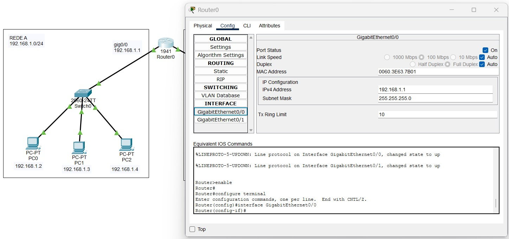

## 4.4. Tabela de roteamento

Um roteador utiliza uma tabela de roteamento para determinar por onde os pacotes devem ser encaminhados.

Exemplo simplificado:

| Rede de destino | Próximo salto/interface |
| --------------- | ----------------------- |
| 192.168.1.0/24  | Porta 1                 |
| 192.168.2.0/24  | Porta 2                 |

## 4.5 Roteador residencial (SOHO - Small Office/Home Office)


Um roteador residencial (SOHO) normalmente **reúne diversas funcionalidades em um único equipamento** (ele nao é apenas um roteador, como foi originalmente proposto pela teoria de redes de computadores, mas sim um equipamento multifuncional):

- Roteamento IP.
- Switch Ethernet integrado (*"portas LAN"*).
- Wi-Fi.
- Protocolo DHCP (usado para atribuir automaticamente endereços IP aos dispositivos da rede).
- Protocolo DNS (usado para dar nomes às hosts, associando o nome aos endereços IP).
- Recurso de NAT (veremos mais a frente).
- Outros recursos, dependendo do fabricante e modelo.

Seria como se tivéssemos um equipamento só que equivale a múltiplos outros. 
- Veja a comparação abaixo no Cisco Packet Tracer.
- Do lado esquerdo temos um roteador SOHO, do lado direito temos uma rede equivalente, se cada funcionalidade do SOHO fosse implementada como previsto pela teoria de redes de computadores (um equipamento por função).

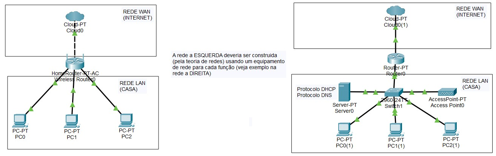

Note que DHCP e DNS sao protocolos que rodam em cima do IP, portanto eles nao deveriam ser implementados dentro de equipamentos de rede (que pela teoria de redes, podem operar apenas com protocolos das camadas L2 e L3).
- Isto é, eles são programas que fornecem **serviços de rede**.
  - **Exemplo de programas**: 
    - Dnsmasq (fornece DNS e DHCP), 
    - Bind (fornece DNS), 
    - ISC DHCP Server (fornece DHCP).
- Portanto, **esses programas rodam em cima de um sistema operacional** (Windows, Linux, MacOS), que pode ter vários programas em execução.
- Cada programa pode fornecer um serviço diferente, como por exemplo:
  - Servidor web (HTTP).
  - Servidor de email (SMTP, POP3).
  - Servidor de arquivos (FTP, SMB).
- Quando um pacote chega em um PC, o sistema operacional envia ele para um desses programas em execução no PC, usando para isso a **porta de destino** do pacote (ex: porta 80 para HTTP, porta 53 para DNS, porta 67 para DHCP, etc).
  - **Analogia**: 
    - O **pacote é entregue pelo carteiro (switch ou roteador)** no **prédio (PC, smartphone, tablet, etc)**,
    - O **porteiro (sistema operacional)** entrega o pacote para o **apartamento correto (programa em execução no PC)**, de acordo com o **número do apartamento (porta de destino do pacote)**.
  - **Onde cada peça dessa se encaixa na comunicação**:
    - O conteúdo do pacote, que é o que o programa está interessado, está contido dentro da camada L7 no modelo OSI,
      - **Lembre-se**: Apesar do modelo OSI separar as camadas L5-L7, na pratica, as redes IP uniram essas camadas em uma única camada maior, chamada de **camada de aplicação** (L4).      
      - É nessa única **camada de aplicação** do modelo IP, que os programas de diferentes PCs colocam os dados para serem enviados e recebidos entre si.
    - A porta de destino (número do apartamento) esta dentro da camada L4 (camada de transporte),
    - O endereço IP do pacote (endereço do prédio) esta dentro da camada L3 (camada de rede),
    - O endereço MAC do quadro (número de inscrição do prédio - IPTU) esta dentro da camada L2 (camada de enlace) do modelo OSI.
- Logo, todo programa em execução em um PC, precisa de um **protocolo de transporte (TCP ou UDP)** para se comunicar com outros programas.
- Assim, **todo protocolo que roda dentro de um programa de computador**, (como o DHCP e DNS) é um **protocolo de aplicação** (camada de aplicação, que no modelo IP é implementada pelas camadas L5-L7 do OSI).

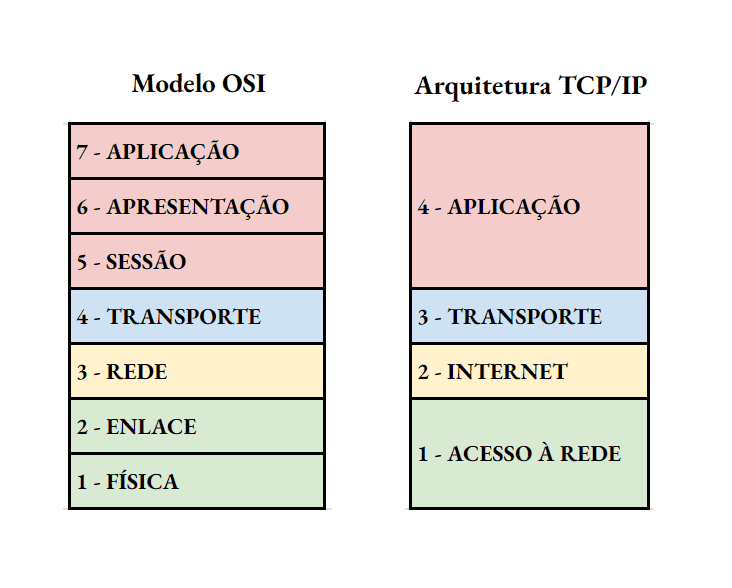

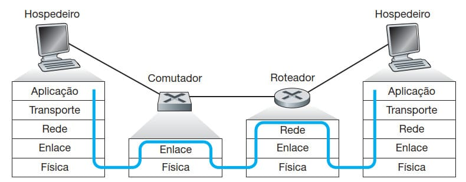

## 4.6. Diferença entre switch e roteador

| Característica           | Switch                                             | Roteador                                        |
| ------------------------ | -------------------------------------------------- | ----------------------------------------------- |
| Camada principal         | Camada L2                                          | Camada L3                                       |
| Endereçamento            | MAC                                                | IP                                              |
| Encaminhamento (PDU)     | Quadros (frames)                                   | Pacotes (packets)                               |
| Finalidade               | Interligar dispositivos dentro de UMA MESMA rede   | Interligar redes DIFERENTES                     |
| Tabela de encaminhamento | CAM (tabela de endereços MAC)                      | Tabela de roteamento                            |
| Envio de Broadcast       | Encaminha para todos os dispositivos na mesma rede | Não encaminha broadcasts entre redes diferentes |

# 5. Access points (pontos de acesso)

Um access point (AP), ou ponto de acesso, é um **equipamento que permite que dispositivos sem fio se conectem a uma rede** local.

Ele estabelece a comunicação entre dispositivos wireless e a infraestrutura de rede, que normalmente é cabeada (ex: Ethernet, ou outra tecnologia de redes cabeadas).

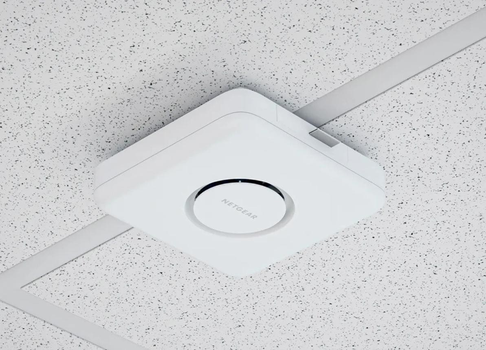

Por exemplo, um notebook pode se conectar ao access point por Wi-Fi e acessar um servidor conectado a um switch via cabo Ethernet.

O access point funciona como uma **ponte entre os meios sem fio e cabeado**.

## 5.1. Como funciona um access point?

Considere a seguinte infraestrutura:

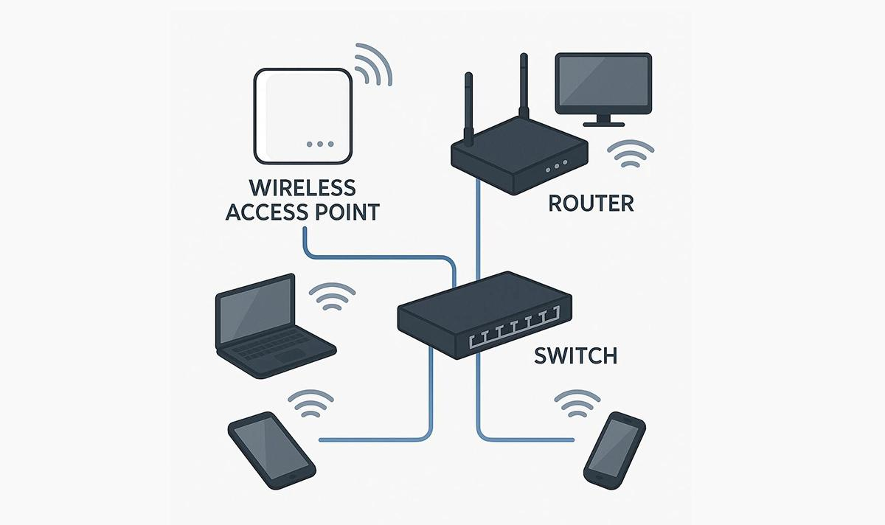

O funcionamento simplificado é:

1. O access point (AP) anuncia que existe uma rede wireless (*SSID broadcast* - **SSID** é o nome da rede).
2. O dispositivo Wi-Fi (ex: smartphone, notebook) procura por redes disponíveis.
3. O usuário seleciona o **SSID** da rede que deseja se conectar (ex: ``IFBA-Alunos``).
4. O dispositivo realiza o processo de autenticação (ex: pede pela senha da rede).
5. O dispositivo estabelece a associação com o access point.
6. Os quadros são transmitidos entre o dispositivo wireless e a rede cabeada.

## 5.2. SSID e BSSID

**SSID (Service Set Identifier)**: é o nome utilizado para identificar uma rede Wi-Fi.
- **Exemplo**: `IFBA-Alunos`

**BSSID (Basic Service Set Identifier)**: identifica um access point específico, normalmente utilizando o endereço MAC da sua interface wireless.
- **Exemplo**: `00:11:22:33:44:55`

Uma mesma rede pode possuir **vários SSIDs**, por exemplo:
- ``IFBA-Alunos``.
- ``IFBA-Professores``.
- ``IFBA-Visitantes``.

Esses SSIDs podem ser associados a diferentes  políticas de segurança, para controlar o acesso a recursos e maquinas da rede.

Além disso, uma mesma rede pode ter **vários access points**, cada um com seu próprio **BSSID**.
- Geralmente, se usam vários access points para **aumentar a cobertura da rede sem fio**, especialmente em ambientes grandes (ex: escritórios, escolas, hospitais, centros comerciais).
- **É possível ter vários access points com mesmo SSID**, porem eles ainda terão BSSID diferentes.
  - Nesse caso, o dispositivo Wi-Fi irá se conectar ao access point que tiver o sinal mais forte (medido em ``dBm`` ou ``dB``).
  - Consideremos ``0dB`` como o nível de referência (potência máxima). **Quanto mais negativo for o valor, mais fraco é o sinal**.
    - Exemplo: -30dBm é um sinal muito forte, enquanto -90dBm é um sinal muito fraco.
  - Sinais abaixo de ``-70dB`` podem apresentar problemas de conexão, como lentidão ou desconexão.

## 5.3. Access Point X Roteador Wireless

Um access point **não precisa necessariamente executar roteamento**.
- Sua função principal é permitir o acesso wireless à rede.

Já um roteador wireless residencial normalmente reúne:
- Roteador IP.
- Access point.
- Switch Ethernet.
- Servidor DHCP.
- NAT.
- Firewall.

Isto é, ele é um dispositivo multifuncional que desempenha diversas funções de rede, **incluindo a função de access point**.


### 5.3.1. Comparação AP x Roteador Wireless

| Característica                  | Access point | Roteador wireless |
| ------------------------------- | ------------ | ----------------- |
| Disponibiliza Wi-Fi             | Sim          | Sim               |
| Interconecta Wi-Fi com Ethernet | Sim          | Sim               |
| Roteia entre redes IP           | Não          | Sim               |
| Executa NAT                     | Não          | Geralmente sim    |
| Servidor DHCP                   | Não          | Geralmente sim    |
| Firewall                        | Não          | Geralmente sim    |

# 6. Modems e ONUs

Modem é um equipamento utilizado para **realizar modulação e demodulação de sinais**.
- **Modulação**: é o processo de converter sinais digitais em sinais analógicos.
- **Demodulação**: é o processo de converter sinais analógicos em sinais digitais.
- **Exemplo**: Um modem pode converter sinais digitais de um computador em sinais analógicos que podem ser transmitidos por uma linha telefônica, cabo coaxial, fibra óptica, etc.

O nome vem de **modulator-demodulator**.

Historicamente, os modems eram utilizados para transmitir informações digitais por linhas telefônicas analógicas.
> Famosa Internet discada (dial-up / DSL) dos anos 2000.


O equipamento convertia os dados digitais em sinais apropriados ao meio de transmissão (cabo metálico, fibra óptica, etc) 
- Também realizava o processo inverso (demodulação) para receber dados da Internet (na forma de sinais analógicos).

Atualmente, o termo **modem é utilizado também em equipamentos de acesso à Internet por diferentes tecnologias**, nao apenas para linhas telefônicas.

Exemplos:

- Modem DSL.
- Modem a cabo.
- Modem celular.
- Modem via satélite.
- Modem óptico (em redes de fibra óptica - chamado de ONU).

## 6.1. Optical Network Unit (ONU)


ONU (Optical Network Unit) é um equipamento utilizado em redes de acesso por fibra óptica.
- Recebe sinais ópticos (luz visível) e realiza a conversão necessária para sinais digitais (números binários 0s e 1s).
- Os sinais digitais sao então usados pela rede para prover conectividade (Internet) a computadores, notebooks, smartphones, televisores, etc.

Em redes **FTTH (Fiber to the Home)**, a **fibra óptica chega até a residência** ou estabelecimento do assinante.

A ONU pode disponibilizar interfaces (portas de rede) como:
- Ethernet.
- Telefonia.
- Wi-Fi, em modelos integrados.
- Outras interfaces específicas do equipamento.

**IMPORTANTE**: ONU também pode ser chamada de **Optical Network Terminal (ONT)**
- **ONT (Optical Network Terminal)**: é um tipo de unidade óptica instalada no lado do assinante, muito similar a ONU.
- Na prática comercial, ONU e ONT são **termos frequentemente utilizados de maneira intercambiável**, embora existam distinções técnicas dependendo da arquitetura e do contexto de implantação.

# 7. Firewalls

Firewall é um **mecanismo de segurança utilizado para controlar o tráfego de rede** de acordo com regras estabelecidas.
- Serve para *"proteger"* uma rede ou dispositivo, permitindo apenas comunicações autorizadas e bloqueando acessos não permitidos.

Ele pode permitir, bloquear ou restringir comunicações com base em informações como:
- Endereço IP de origem.
- Endereço IP de destino.
- Porta de origem.
- Porta de destino.
- Protocolo (TCP, UDP, ICMP, etc).
- Aplicação (HTTP, HTTPS, FTP, etc).


Imagine uma empresa que deseja permitir que seus funcionários acessem a Internet, mas impedir conexões externas não autorizadas aos servidores internos.
- O firewall pode aplicar regras para controlar essas comunicações.

## 7.1. Como funciona um firewall?

Um firewall analisa o tráfego que passa por ele e compara as informações com suas regras de segurança.

Exemplo de política:

| Origem              | Destino       | Porta    | Ação     |
| ------------------- | ------------- | -------- | -------- |
| Rede interna        | Internet      | 443/TCP  | Permitir |
| Internet            | Servidor Web  | 443/TCP  | Permitir |
| Internet            | PCs de máximo | Qualquer | Bloquear |
| Rede administrativa | Servidores    | 22/TCP   | Permitir |

Essa tabela é apenas um exemplo didático. A implementação real exige regras mais precisas, incluindo controle de estado, interfaces e políticas de exceção.

## 7.2. Firewall de rede X Firewall de host

Um firewall pode proteger **toda uma rede ou apenas um dispositivo**.
- **Firewall de rede**: instalado em um ponto de interconexão de vários computadores (hosts), controlando o tráfego entre diferentes máquinas, e possivelmente entre diferentes redes.
- **Firewall de host**: executado **no próprio computador ou servidor**.

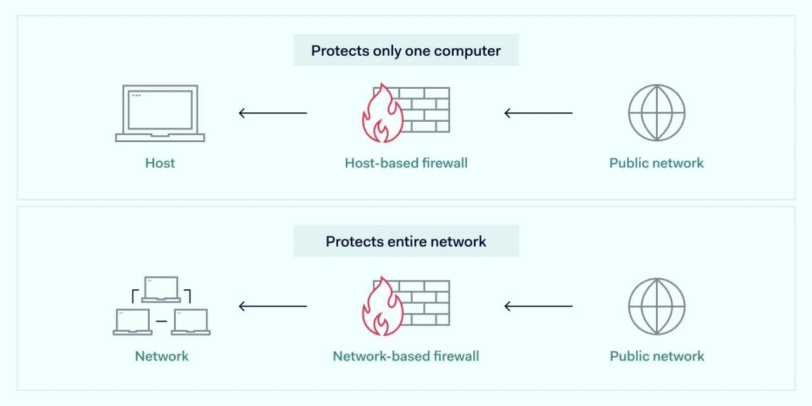

**Exemplos**:
- **Firewall de rede**: equipamento de rede dedicado, ou firewall dentro de um computador do Linux (que atua como um firewall de rede).
- **Firewall de host**: ``Windows Defender Firewall`` ou ``nftables`` no Linux.

## 7.3. Firewall não é antivírus!

Um firewall controla comunicações de rede.

Um antivírus procura identificar e tratar códigos maliciosos (programas) e outras ameaças no dispositivo.

**Eles possuem objetivos diferentes** e complementares.
- Evitar que um malware se propague pela rede é uma função do firewall.
- Detectar e remover o malware do dispositivo é uma função do antivírus.

# 8. Exercícios de fixação e avaliação

Procure resolver as questões sem consultar o material. Elas foram organizadas para avaliar tanto a memorização dos conceitos quanto a capacidade de aplicá-los em situações reais.

## Parte A — Equipamentos de rede

1. O que é uma NIC e quais são suas principais funções?
2. Qual é a finalidade do endereço MAC?
3. Explique como funciona um hub.
4. Qual é a principal diferença entre um hub e um switch?
5. O que é um switch gerenciável? Cite três funcionalidades que podem ser configuradas nele.
6. O que significa PoE? Cite três equipamentos que podem ser alimentados por essa tecnologia.
7. Qual é a função de um roteador?
8. O que é gateway padrão?
9. Qual é a finalidade de uma tabela de roteamento?
10. Explique a diferença entre um access point e um roteador wireless.
11. Quais funcionalidades típicas de um roteador SOHO? 
    1.  Há diferença entre roteador SOHO e roteador comum, previsto pela teoria de redes? Justifique.
12. O que significam SSID e BSSID?
13. O que é um modem e uma ONU?
14. Qual é a finalidade de um firewall?
17. Explique a diferença entre firewall e antivírus. 

# 9. Atividades práticas

## 9.1. Atividade 1 - Configurando Roteadores no Cisco Packet Tracer


1. Abra o Cisco Packet Tracer.
2. Monte as redes `A` e `B`, conforme a figura acima.
3. Configure os endereços IP das interfaces do roteador e dos computadores.
4. Verifique se os computadores da rede ``A`` e ``B`` conseguem se comunicar entre si.
5. Teste a conectividade utilizando o comando ``ping``.
   1. Abra um PC 
   2. Va na aba ``Desktop`` -> `Command Prompt`
   3. Digite o comando ``ping <endereço IP do outro PC>``.
   4. **IMPORTANTE**: Se o comando travar, ou nao funcionar, pressione ``Ctrl + C`` para interromper a execução do comando.
   5. Veja se há resposta (``Reply``) ou se o ping falha (``Request timed out``).
   6. Qual o tempo de resposta médio (latência média) entre os computadores?
6. Teste quantos saltos (equipamentos intermediários) existem entre os computadores utilizando o comando ``tracert <endereço IP do outro PC>``.
   1. **IMPORTANTE**: Se o comando travar, ou nao funcionar, pressione ``Ctrl + C`` para interromper a execução do comando.
