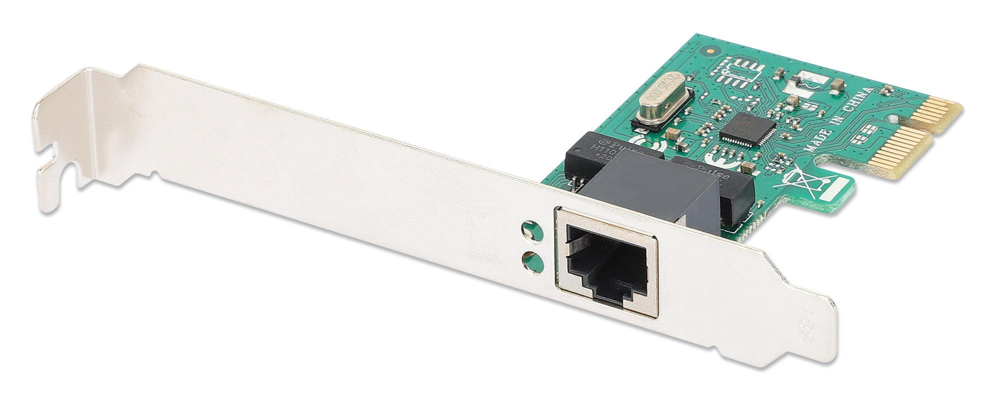
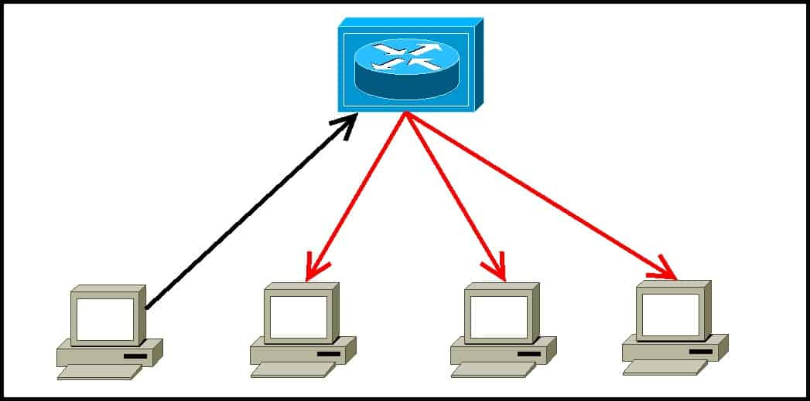
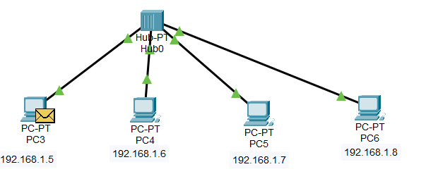
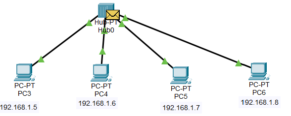
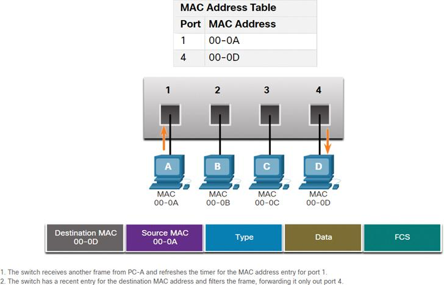
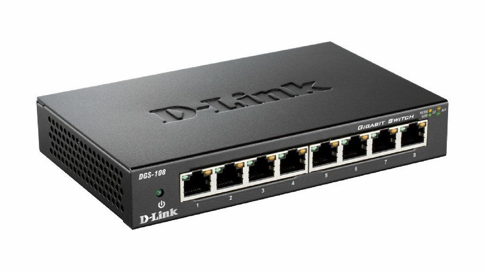
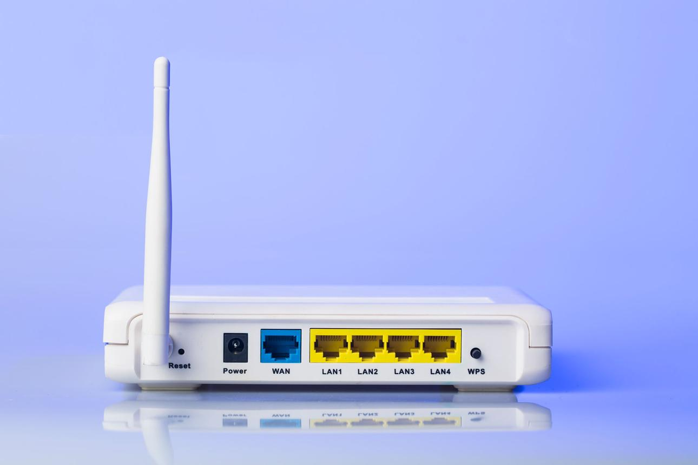
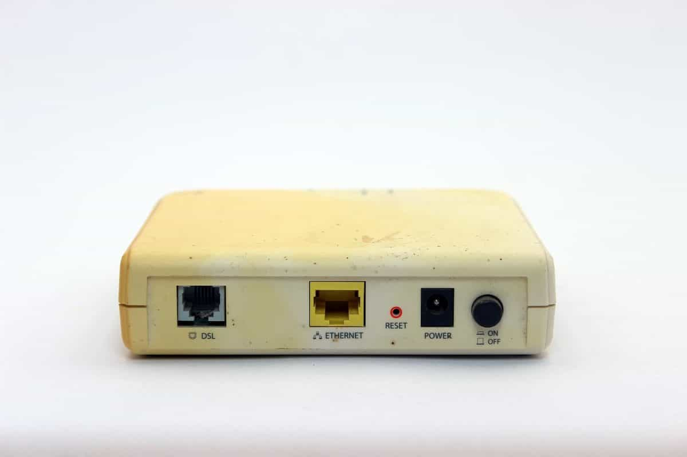
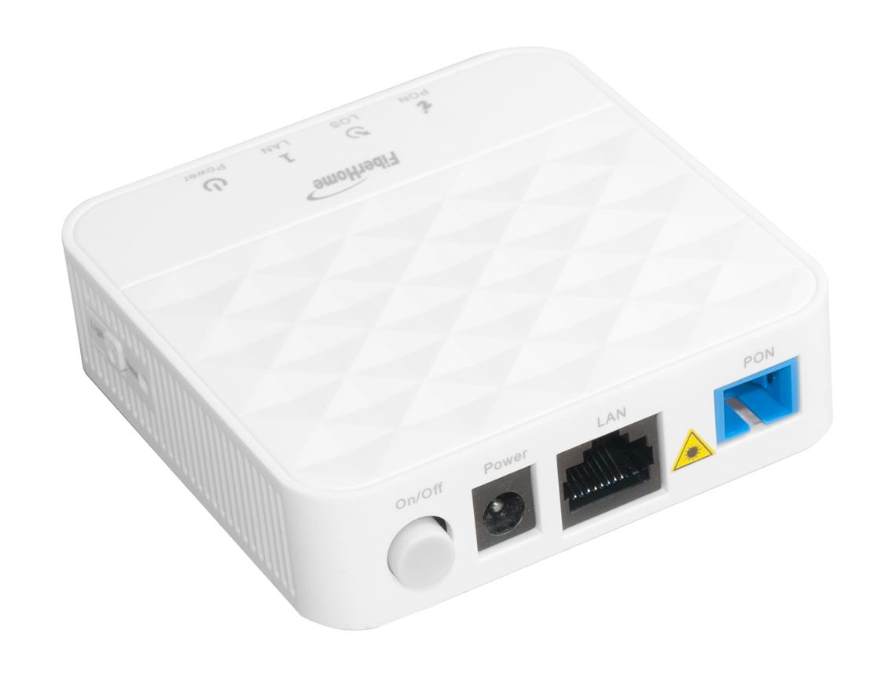
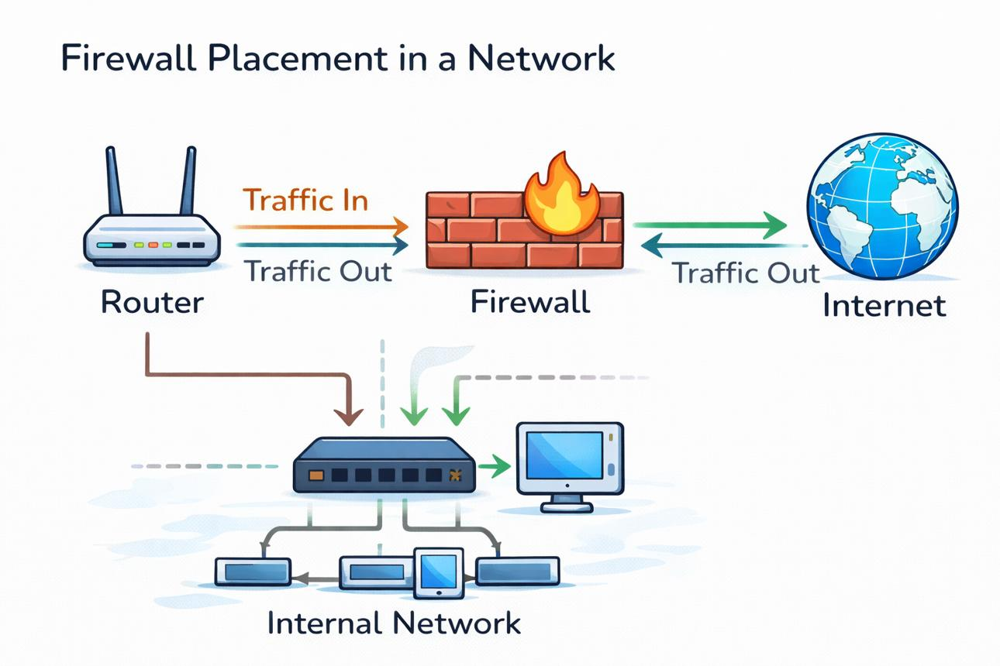

# Equipamentos de Rede 

**Sumário**:
- [Equipamentos de Rede](#equipamentos-de-rede)
- [1. Placas de rede (NIC)](#1-placas-de-rede-nic)
  - [1.1. Principais funções de uma NIC](#11-principais-funções-de-uma-nic)
  - [1.2. Endereço MAC da NIC](#12-endereço-mac-da-nic)
  - [1.3. Velocidades das placas de rede](#13-velocidades-das-placas-de-rede)
  - [1.4. Placas de rede cabeadas e wireless](#14-placas-de-rede-cabeadas-e-wireless)
    - [1.4.1. NIC Cabeada](#141-nic-cabeada)
    - [1.4.2. NIC Wireless](#142-nic-wireless)
- [2. Hubs](#2-hubs)
  - [2.1. Como funciona um hub?](#21-como-funciona-um-hub)
  - [2.2. Características dos hubs](#22-características-dos-hubs)
  - [2.3. Colisões em redes com hubs (mecanismos de prevenção CSMA/CD x CSMA/CA)](#23-colisões-em-redes-com-hubs-mecanismos-de-prevenção-csmacd-x-csmaca)
  - [2.4. Por que os hubs praticamente desapareceram?](#24-por-que-os-hubs-praticamente-desapareceram)
- [3. Switches](#3-switches)
  - [3.1. Como funciona um switch?](#31-como-funciona-um-switch)
  - [3.2. Principais funções dos switches](#32-principais-funções-dos-switches)
  - [3.3. Switches Não Gerenciáveis x Gerenciáveis](#33-switches-não-gerenciáveis-x-gerenciáveis)
    - [3.3.1. Switch não gerenciável (Unmanaged)](#331-switch-não-gerenciável-unmanaged)
    - [3.3.2. Switch gerenciável (Managed)](#332-switch-gerenciável-managed)
  - [3.4. Switches PoE](#34-switches-poe)
- [4. Roteadores](#4-roteadores)
  - [4.1. Como funciona o roteamento?](#41-como-funciona-o-roteamento)
  - [4.2. Gateway padrão](#42-gateway-padrão)
  - [4.3. Tabela de roteamento](#43-tabela-de-roteamento)
  - [4.4. Roteador residencial](#44-roteador-residencial)
  - [4.5. Diferença entre switch e roteador](#45-diferença-entre-switch-e-roteador)
- [5. Access points (pontos de acesso)](#5-access-points-pontos-de-acesso)
  - [5.1. Como funciona um access point?](#51-como-funciona-um-access-point)
  - [5.2. SSID e BSSID](#52-ssid-e-bssid)
  - [5.3. Access Point X Roteador Wireless](#53-access-point-x-roteador-wireless)
    - [5.3.1. Comparação AP x Roteador Wireless](#531-comparação-ap-x-roteador-wireless)
- [6. Modems e ONUs](#6-modems-e-onus)
  - [6.1. Optical Network Unit (ONU)](#61-optical-network-unit-onu)
- [7. Firewalls](#7-firewalls)
  - [7.1. Como funciona um firewall?](#71-como-funciona-um-firewall)
  - [7.2. Firewall de rede X Firewall de host](#72-firewall-de-rede-x-firewall-de-host)
  - [7.3. Firewall não é antivírus!](#73-firewall-não-é-antivírus)
- [8. Exercícios de fixação e avaliação](#8-exercícios-de-fixação-e-avaliação)
  - [Parte A — Equipamentos de rede](#parte-a--equipamentos-de-rede)
- [9. Situações-problema](#9-situações-problema)
  - [9.1. Problemas com o switch](#91-problemas-com-o-switch)
  - [9.2. Escolha de equipamentos](#92-escolha-de-equipamentos)
  - [9.3. Diagnóstico de conectividade](#93-diagnóstico-de-conectividade)


# 1. Placas de rede (NIC)

Uma placa de rede, também chamada de **NIC (Network Interface Card)**, é o componente responsável por permitir que um dispositivo se conecte a uma rede de computadores.

Ela estabelece a interface entre o sistema computacional e o meio de comunicação.



Uma NIC pode estar presente em diferentes formatos:

- Integrada à placa-mãe.
- Instalada em um slot PCI Express ou PCI comum (como na figura).
- Conectada por USB.

E cada NIC pode ser projetada para diferentes tipos de redes, como:
- Redes cabeadas (Ethernet).
- Redes sem fio (Wi-Fi, Bluetooth, Zigbee, etc).
- Outras tecnologias de comunicação (como redes ópticas, etc).

A placa de rede possui componentes eletrônicos responsáveis por:
- processar os sinais (elétricos, ópticos, ondas eletromagnéticas, etc) 
- executar funcionalidades relacionadas à comunicação (veja exemplos a seguir).

## 1.1. Principais funções de uma NIC

Entre suas funções estão:

- Transmitir e receber dados.
- Converter informações digitais em sinais apropriados ao meio de transmissão (sinais elétricos, sinais ópticos, ondas eletromagnéticas).
- Processar quadros Ethernet.
- Identificar a interface de rede (placa de rede - NIC) por meio de um endereço MAC.  
- Escolher **encaminhar** (*forward*) ou **descartar** (*drop*) quadros recebidos, com base no endereço MAC de destino.
- Realizar verificações de integridade dos quadros (algoritmos CRC).
- Evitar colisoes em redes half-duplex, utilizando o protocolo CSMA.
- Implementar funcionalidades de aceleração de processamento, dependendo do hardware.

## 1.2. Endereço MAC da NIC

Uma **placa de rede (NIC)** normalmente **possui um endereço associado** à sua interface.
- Esse **endereço é utilizado na comunicação de camada 2** (veremos o que significa cada camada de rede mais adiante).

No caso de **placas de rede cabeadas Ethernet, se usam endereços MAC**, como o que segue abaixo:

`A4:5E:60:12:AB:CD`

Um endereço MAC tradicional possui **48 bits**, representados por **12 dígitos hexadecimais**.

Os primeiros 6 dígitos representam o **identificador do fabricante** (Organizationally Unique Identifier - OUI), enquanto os últimos 6 dígitos representam o **identificador único da interface**. No exemplo acima, temos:
- `A4:5E:60` → OUI do fabricante.
- `12:AB:CD` → Identificador único da interface.

Assim placas de mesmo fabricante possuem o mesmo OUI, mas cada placa possui um identificador único.

É importante lembrar que um endereço MAC identifica uma interface no contexto do fabricante. Porem, apesar de considerarmos que toda NIC tem um MAC único e bem definido, esse identificador físico nao é imutável do ponto de vista do sistema operacional: 
- **sistemas operacionais podem permitir sua alteração lógica** (MAC spoofing ou MAC randomization).
- Essa alteracao é usada para varias finalidades, porem uma das mais comuns é a preservacao da privacidade do usuario, evitando rastreamento de dispositivos em redes sem fio.
  - Dispositivos Android e iOS, por exemplo, podem gerar endereços MAC aleatórios para cada rede Wi-Fi que o dispositivo se conecta (faça o teste, verifique se o seu aparelho esta configurado para ter essa funcionalidade - abra o menu de configurações da rede Wi-Fi e observe se há a opção de "endereços MAC aleatórios").
- Outro uso possivel é para interceptar pacotes de uma rede, fingindo ser outro dispositivo (ataque de spoofing, chamado de ``MAC spoofing``).
  - **Spoof** = fingir, imitar, falsificar.

## 1.3. Velocidades das placas de rede

As placas de rede podem operar em diferentes velocidades.

| Tecnologia           | Velocidade |
| -------------------- | ---------- |
| Fast Ethernet        | 100 Mbps   |
| Gigabit Ethernet     | 1 Gbps     |
| 2.5 Gigabit Ethernet | 2,5 Gbps   |
| 5 Gigabit Ethernet   | 5 Gbps     |
| 10 Gigabit Ethernet  | 10 Gbps    |
| 25 Gigabit Ethernet  | 25 Gbps    |
| 40 Gigabit Ethernet  | 40 Gbps    |

A **velocidade efetiva de comunicação depende de todos os componentes** do enlace (dispositivos, cabos, switches, etc).
- Isto é, **a velocidade de transmissão será limitada pelo componente mais lento** do caminho.
- Por exemplo, se um computador possui uma placa de rede de 1 Gbps e está conectado a um switch de 100 Mbps, a comunicação ficará limitada a 100 Mbps.

Isso acontece porque a conexão precisa negociar uma velocidade compatível com os dois lados.
- Esse processo de negociação é representada no Cisco Packet Tracer pela **"bola laranja"** que aparece na interface de rede quando a conexão está sendo estabelecida (quando conectamos os dispositivos através de cabos, conforme imagem abaixo).


## 1.4. Placas de rede cabeadas e wireless

### 1.4.1. NIC Cabeada


Utiliza uma interface física para conectar o dispositivo a um cabo de rede.

É comum encontrar portas Ethernet de 1 Gbps em computadores convencionais.
- Em computadores empresariais ou servidores, é possível encontrar placas de rede com velocidades superiores, como 10 Gbps até 40 Gbps.

### 1.4.2. NIC Wireless


Utiliza comunicação por radiofrequência (ondas de radio, transmitidas através do ar).

Pode incluir antenas internas ou externas e suporta diferentes padrões, como o ``IEEE 802.11`` (que conhecemos como Wi-Fi).

Alguns dispositivos possuem placas combinadas que oferecem várias tecnologias simultaneamente, como Wi-Fi e Bluetooth.
- Maioria dos notebooks modernos possuem placas de rede integradas que suportam Wi-Fi e Bluetooth.

# 2. Hubs

Um hub é um equipamento utilizado para conectar vários dispositivos em uma rede local.

Ele **funciona como um repetidor multiporta**, recebendo sinais em uma porta de entrada e reproduzindo-os nas demais portas.

Diferentemente de um switch, o **hub não analisa os endereços MAC** dos quadros para decidir qual porta deve receber os dados.
- Ele simplesmente repete os sinais recebidos para todas as portas (exceto a de entrada).



## 2.1. Como funciona um hub?

Imagine 4 computadores conectados a 1 hub, como no exemplo abaixo.


Quando o computador A transmite dados para o computador B:

1. O hub recebe os sinais na porta de entrada.
2. O hub repete os sinais para TODAS as demais portas.
3. Todos os computadores conectados recebem fisicamente a transmissão (sinais eletricos no fio, neste exemplo).
4. O computador cujo endereço corresponde ao destinatário processa o quadro.
5. Os demais computadores descartam o quadro quando não são seus destinatários (veja exemplo abaixo).






Observe que o hub não sabe qual computador é o destinatário. Essa decisão é tomada pelas interfaces de rede dos dispositivos.
- No Cisco Packet Tracer, vemos isso acontecendo quando cada computador descarta o pacote que não é destinado a ele (representado pelo ícone de **"X" vermelho** - veja exemplo abaixo).

Encare um hub como sendo um "fio de rede compartilhado" entre todos os dispositivos conectados a ele.
- Todos os dispositivos conectados a um hub **compartilham o mesmo meio de transmissão** (o mesmo cabo).
- Logo, se dois dispositivos transmitirem simultaneamente, ocorrerá uma colisão de sinais.
- Isto é, **todos tem o mesmo domínio de colisão**, e a comunicação precisa ser coordenada para evitar que os sinais se sobreponham (causem interferência, ou colisao).

## 2.2. Características dos hubs

- Operam na **camada física** do modelo OSI.
- Não possuem tabela de endereços MAC.
- Não realizam encaminhamento seletivo de quadros.
- Repetem os sinais recebidos para as demais portas.
- Compartilham o meio de transmissão.
- Todos os dispositivos conectados pertencem ao **mesmo domínio de colisão**.
  - Isto significa que se dois dispositivos transmitirem simultaneamente, ocorrerá uma colisão de sinais, pois compartilham o mesmo meio de comunicação (o mesmo fio, neste exemplo).

## 2.3. Colisões em redes com hubs (mecanismos de prevenção CSMA/CD x CSMA/CA)

Imagine que dois computadores transmitam simultaneamente utilizando o mesmo hub.
- Como todos compartilham o mesmo meio de transmissão, os sinais podem colidir.

Para evitar isso, redes Ethernet half-duplex utilizavam o mecanismo **CSMA/CD (Carrier Sense Multiple Access with Collision Detection)** para lidar com colisões.

O funcionamento simplificado do **CSMA/CD** é:

1. O dispositivo verifica se o meio está livre.
2. Se estiver livre, inicia a transmissão.
3. Durante a transmissão, monitora o meio.
4. Se detectar uma colisão, interrompe a transmissão.
5. Aguarda um intervalo de tempo aleatório.
6. Tenta transmitir novamente.

A ideia por tras do intervalo de tempo aleatório é evitar que os dispositivos colidam novamente ao tentar retransmitir.
> - *Nao sabemos quando cada dispositivo vai tentar transmitir dados, e nem quanto tempo ele passará enviando informacoes.*
> - *Logo, esperamos um tempo aleatorio antes de tentar novamente, para que a chance de colisao seja menor.*

As redes modernas utilizam switches e comunicação full-duplex, eliminando a necessidade do CSMA/CD.
- CSMA ainda é utilizado em redes sem fio, mas com algumas diferenças em relação ao CSMA/CD.
- Nas redes sem fio, o **CSMA/CA (Carrier Sense Multiple Access with Collision Avoidance)** é utilizado para evitar colisões, pois a detecção de colisões é mais difícil em ambientes wireless.

O **CSMA/CA** funciona da seguinte forma:
1. O dispositivo verifica se o meio está livre.
2. Se estiver livre, aguarda um intervalo de tempo aleatório antes de iniciar a transmissão.
3. Durante a transmissão, o dispositivo não consegue detectar colisões diretamente, então ele depende de confirmações (pacotes **ACK**) do destinatário para saber se a transmissão foi bem-sucedida.
4. Se não receber a confirmação, o dispositivo assume que ocorreu uma colisão e tenta retransmitir após outro intervalo de tempo aleatório.

## 2.4. Por que os hubs praticamente desapareceram?

Os hubs foram substituídos pelos switches porque os switches oferecem vantagens importantes:

- Encaminhamento seletivo de quadros.
- Separação dos domínios de colisão por porta.
- Melhor utilização da largura de banda.
- Suporte a comunicação full-duplex.
- Maior escalabilidade.
- Melhor desempenho geral.

Atualmente, hubs são importantes principalmente para compreender a evolução das redes Ethernet. 
- Quase todas as redes modernas utilizam switches, que são mais eficientes e oferecem melhor desempenho.

# 3. Switches

Um switch é um equipamento utilizado para interconectar dispositivos em uma rede local (de forma parecida ao hub, porem com melhor desempenho).

Diferentemente de um hub, o **switch analisa informações dos quadros** Ethernet e **utiliza os endereços MAC para encaminhar** os dados pela porta apropriada.


Os switches são amplamente utilizados em:

- Residências.
- Laboratórios de informática.
- Escolas.
- Escritórios.
- Data centers.
- Redes industriais.

## 3.1. Como funciona um switch?

Imagine uma rede com quatro computadores conectados a um switch.

Cada computador possui um endereço MAC diferente.

O switch aprende quais endereços MAC estão associados às suas portas e utiliza essas informações para encaminhar os quadros.
- Para isso, ele usa uma **tabela de endereços MAC**, também chamada de **CAM table (Content Addressable Memory)**.
- Essa tabela vincula o endereço MAC de cada dispositivo à porta do switch correspondente, na qual o dispositivo está conectado.



Considere o exemplo de tabela de endereços MAC abaixo:

| Computador | Endereço MAC      | Porta |
| ---------- | ----------------- | ----- |
| A          | AA:AA:AA:AA:AA:AA | 1     |
| B          | BB:BB:BB:BB:BB:BB | 2     |
| C          | CC:CC:CC:CC:CC:CC | 3     |
| D          | DD:DD:DD:DD:DD:DD | 4     |

Se o computador ``A`` enviar um quadro destinado ao computador ``C``, o switch verificará sua tabela MAC e encaminhará o quadro pela porta 3.
- Os computadores ``B`` e ``D`` não precisam receber esse quadro.
- Essa é uma das principais vantagens dos switches em relação aos hubs.
- Caso o switch ainda nao conheça o endereço MAC de destino, ele encaminhará o quadro para todas as portas (exceto a de entrada), até que aprenda o endereço MAC do dispositivo de destino.

Esse processo de aprendizado será visto em detalhes mais adiante na seção [10. Funcionamento interno dos switches](#10-funcionamento-interno-dos-switches).
  
## 3.2. Principais funções dos switches

Os switches podem oferecer diferentes funcionalidades:

- Encaminhamento de quadros Ethernet.
- Aprendizado de endereços MAC.
- Filtragem de quadros.
- Criação de VLANs (veremos isso mais adiante).
- Controle de tráfego.
- Priorização de pacotes (QoS).
- Agregação de enlaces.
- Spanning Tree Protocol (STP - veremos mais adiante).
- Monitoramento de portas.
- Alimentação de dispositivos por Ethernet (PoE), em modelos compatíveis.

Nem todos os switches oferecem todas essas funcionalidades.
- Alguns switches são **simples e não gerenciáveis**, enquanto outros são **gerenciáveis e oferecem recursos avançados**.
- Switches domesticos geralmente são não gerenciáveis, enquanto switches corporativos costumam ser gerenciáveis.

## 3.3. Switches Não Gerenciáveis x Gerenciáveis

### 3.3.1. Switch não gerenciável (Unmanaged)



É um equipamento que normalmente funciona sem exigir modificações de configuração.
- Basta conectar os dispositivos para que a comunicação seja estabelecida.
- Switches domesticos e de pequenas empresas geralmente são não gerenciáveis.

Características:

- Configuração automática (plug and play - ligou, funcionou).
- Baixo custo.
- Facilidade de utilização.
- Recursos administrativos limitados (nao possui interface de gerenciamento, VLANs, e recursos avançados).

### 3.3.2. Switch gerenciável (Managed)


Permite configurar e administrar funcionalidades da rede.

Entre os recursos possíveis estão:

- VLANs.
- Spanning Tree (STP).
- Port Security.
- QoS.
- Link Aggregation.
- SNMP.
- Monitoramento de portas.
- Controle de acesso administrativo.

É amplamente utilizado em redes corporativas e institucionais.

## 3.4. Switches PoE

PoE significa **Power over Ethernet** (potência sobre Ethernet, em português).
- Ethernet é uma das tecnologias de comunicação utilizadas em redes locais cabeadas.
- O cabo Ethernet possui cor azul, normalmente, e conexões RJ-45 em suas extremidades (como veremos mais adiante no curso).

É uma tecnologia que **permite transmitir energia elétrica pelo próprio cabo de rede Ethernet**, além dos dados. 

Isso permite alimentar equipamentos como:
- Access points.
- Câmeras IP.
- Telefones IP.
- Determinados dispositivos IoT.

A principal vantagem dessa tecnologia PoE é **reduzir a necessidade de fontes de alimentação separadas** para cada dispositivo.
- No entanto, é preciso verificar qual a potencia máxima suportada pelo switch, para verificar quantos dispositivos podem ser conectados (e alimentados) por ele.
- **Exemplo**:
  - Um switch PoE de 24 portas, por exemplo, pode ter uma potência total de 370W. 
  - Se cada access point consome 15W, então o switch poderia alimentar até 24 APs (15W x 24 = 360W < 370W). 
  - No entanto, se cada câmera IP consome 30W, então o mesmo switch poderia alimentar apenas 12 câmeras (30W x 12 = 360W < 370W).

# 4. Roteadores


Fisicamente, um roteador pode se parecer com um switch, mas internamente ele possui funcionalidades diferentes.

Um roteador é um equipamento responsável por encaminhar pacotes IP **entre diferentes redes**.
- Um **switch conecta dispositivos dentro de uma mesma rede**.
- Um **roteador** permite a **comunicação entre redes distintas**.

Imagine duas redes:

- Rede A: `192.168.1.0/24`.
- Rede B: `192.168.2.0/24`.

Os dispositivos pertencentes à primeira rede não conseguem alcançar diretamente os dispositivos da segunda rede utilizando apenas a comunicação local Ethernet.
- É necessário um mecanismo de **interconexão de camada 3**.
- O roteador realiza essa função.
- Veremos isso mais detalhadamente no decorrer da disciplina.

## 4.1. Como funciona o roteamento?

Considere a seguinte infraestrutura:


O roteador possui interfaces conectadas às duas redes.

**Exemplo**: Considere que o roteador da figura acima tem tabela de roteamento:

| Portas do roteador | Endereço IP    |
| ------------------ | -------------- |
| Porta A            | 192.168.1.1/24 |
| Porta B            | 192.168.2.1/24 |

Um computador da rede ``A``, com endereço `192.168.1.10`, deseja enviar dados para um servidor da rede ``B``, com endereço `192.168.2.20`.

O processo simplificado é:

1. O computador identifica que o destino está em outra rede.
2. Encaminha o pacote para um dispositivo chamado de **gateway padrão** (que nesse caso é o roteador).
3. O roteador recebe o quadro Ethernet.
4. Analisa o endereço IP de destino.
5. Consulta sua **tabela de roteamento** (que mapeia endereços IP para portas de saída / interfaces).
6. Identifica a interface de saída (tambem chamada de porta de saída).
7. Encaminha o pacote para a rede ``B``.

O roteador não precisa conhecer o endereço MAC do servidor `192.168.2.20` em todas as redes. 
- Ele utiliza o IP para descobrir por qual enlace de saída encaminhar o pacote.
- Esse processo de encaminhamento é chamado de **roteamento**.

## 4.2. Gateway padrão

O gateway padrão é o endereço IP do equipamento para o qual um dispositivo envia pacotes destinados a redes que não estão diretamente conectadas a ele.
- Exemplo:
  - Roteador.
  - Outro dispositivo que possua endereço IP e desempenhe a função de encaminhamento de pacotes (como um firewall).
  
**IMPORTANTE**: Switches convencionais (L2) não podem ser gateways padrão, pois não possuem a capacidade de encaminhar pacotes entre redes diferentes.

**Exemplo**:

Um computador possui:

```
Endereço IP:       192.168.1.10
Máscara:           255.255.255.0
Gateway padrão:    192.168.1.1
```

Quando o computador deseja acessar um servidor na rede `10.0.0.0/8`, ele encaminha os pacotes ao gateway padrão.
- O gateway padrão **normalmente é a interface de um roteador** na rede, mas pode ser outro equipamento que desempenhe a função de encaminhamento de camada 3.

## 4.3. Tabela de roteamento

Um roteador utiliza uma tabela de roteamento para determinar por onde os pacotes devem ser encaminhados.

Exemplo simplificado:

| Rede de destino | Próximo salto/interface |
| --------------- | ----------------------- |
| 192.168.1.0/24  | Porta 1                 |
| 192.168.2.0/24  | Porta 2                 |

## 4.4. Roteador residencial



Um roteador residencial normalmente reúne diversas funcionalidades em um único equipamento (ele nao é apenas um roteador, como foi originalmente proposto pela teoria de redes de computadores, mas sim um equipamento multifuncional):

- Roteamento IP.
- NAT.
- Firewall.
- DHCP.
- Wi-Fi.
- Switch Ethernet integrado (*"portas LAN"*).

**Atenção**: roteamento, comutação, firewall e acesso wireless são funções diferentes, mesmo quando estão presentes no mesmo dispositivo.
- Isto é, estes equipamentos, apesar de chamados de roteadores, sao na verdade **equipamentos multifuncionais** que reúnem diversas funções de rede em um único dispositivo.
- Ser "roteador" é apenas uma das funções que ele desempenha, mas não é a única.

## 4.5. Diferença entre switch e roteador

| Característica           | Switch                                             | Roteador                                        |
| ------------------------ | -------------------------------------------------- | ----------------------------------------------- |
| Camada principal         | Camada 2                                           | Camada 3                                        |
| Endereçamento            | MAC                                                | IP                                              |
| Encaminhamento           | Quadros (frames)                                   | Pacotes (packets)                               |
| Finalidade               | Interligar dispositivos dentro de UMA MESMA rede   | Interligar redes DIFERENTES                     |
| Tabela de encaminhamento | CAM (tabela de endereços MAC)                      | Tabela de roteamento                            |
| Envio de Broadcast       | Encaminha para todos os dispositivos na mesma rede | Não encaminha broadcasts entre redes diferentes |

# 5. Access points (pontos de acesso)

Um access point (AP), ou ponto de acesso, é um **equipamento que permite que dispositivos sem fio se conectem a uma rede** local.

Ele estabelece a comunicação entre dispositivos wireless e a infraestrutura de rede, que normalmente é cabeada (ex: Ethernet, ou outra tecnologia de redes cabeadas).


Por exemplo, um notebook pode se conectar ao access point por Wi-Fi e acessar um servidor conectado a um switch via cabo Ethernet.

O access point funciona como uma **ponte entre os meios sem fio e cabeado**.

## 5.1. Como funciona um access point?

Considere a seguinte infraestrutura:


O funcionamento simplificado é:

1. O access point (AP) anuncia que existe uma rede wireless (*SSID broadcast* - **SSID** é o nome da rede).
2. O dispositivo Wi-Fi (ex: smartphone, notebook) procura por redes disponíveis.
3. O usuário seleciona o **SSID** da rede que deseja se conectar (ex: ``IFBA-Alunos``).
4. O dispositivo realiza o processo de autenticação (ex: pede pela senha da rede).
5. O dispositivo estabelece a associação com o access point.
6. Os quadros são transmitidos entre o dispositivo wireless e a rede cabeada.

## 5.2. SSID e BSSID

**SSID (Service Set Identifier)**: é o nome utilizado para identificar uma rede Wi-Fi.
- **Exemplo**: `IFBA-Alunos`

**BSSID (Basic Service Set Identifier)**: identifica um access point específico, normalmente utilizando o endereço MAC da sua interface wireless.
- **Exemplo**: `00:11:22:33:44:55`

Uma mesma rede pode possuir **vários SSIDs**, por exemplo:
- ``IFBA-Alunos``.
- ``IFBA-Professores``.
- ``IFBA-Visitantes``.

Esses SSIDs podem ser associados a diferentes  políticas de segurança, para controlar o acesso a recursos e maquinas da rede.

Além disso, uma mesma rede pode ter **vários access points**, cada um com seu próprio **BSSID**.
- Geralmente, se usam varios access points para **aumentar a cobertura da rede sem fio**, especialmente em ambientes grandes (ex: escritórios, escolas, hospitais, centros comerciais).
- **É possivel ter vários access points com mesmo SSID**, porem eles ainda terao BSSID diferentes.
  - Nesse caso, o dispositivo Wi-Fi irá se conectar ao access point que tiver o sinal mais forte (medido em ``dBm`` ou ``dB``).
  - Consideremos ``0dB`` como o nível de referência (potência máxima). **Quanto mais negativo for o valor, mais fraco é o sinal**.
    - Exemplo: -30dBm é um sinal muito forte, enquanto -90dBm é um sinal muito fraco.
  - Sinais abaixo de ``-70dB`` podem apresentar problemas de conexão, como lentidão ou desconexão.

## 5.3. Access Point X Roteador Wireless

Um access point **não precisa necessariamente executar roteamento**.
- Sua função principal é permitir o acesso wireless à rede.

Já um roteador wireless residencial normalmente reúne:
- Roteador IP.
- Access point.
- Switch Ethernet.
- Servidor DHCP.
- NAT.
- Firewall.

Isto é, ele é um dispositivo multifuncional que desempenha diversas funções de rede, **incluindo a função de access point**.


### 5.3.1. Comparação AP x Roteador Wireless

| Característica                  | Access point | Roteador wireless |
| ------------------------------- | ------------ | ----------------- |
| Disponibiliza Wi-Fi             | Sim          | Sim               |
| Interconecta Wi-Fi com Ethernet | Sim          | Sim               |
| Roteia entre redes IP           | Não          | Sim               |
| Executa NAT                     | Não          | Geralmente sim    |
| Servidor DHCP                   | Não          | Geralmente sim    |
| Firewall                        | Não          | Geralmente sim    |

# 6. Modems e ONUs

Modem é um equipamento utilizado para **realizar modulação e demodulação de sinais**.
- **Modulação**: é o processo de converter sinais digitais em sinais analógicos.
- **Demodulação**: é o processo de converter sinais analógicos em sinais digitais.
- **Exemplo**: Um modem pode converter sinais digitais de um computador em sinais analógicos que podem ser transmitidos por uma linha telefônica, cabo coaxial, fibra optica, etc.

O nome vem de **modulator-demodulator**.

Historicamente, os modems eram utilizados para transmitir informações digitais por linhas telefônicas analógicas.
> Famosa Internet discada (dial-up / DSL) dos anos 2000.



O equipamento convertia os dados digitais em sinais apropriados ao meio de transmissão (cabo metálico, fibra optica, etc) 
- Tambem realizava o processo inverso (demodulação) para receber dados da Internet (na forma de sinais analógicos).

Atualmente, o termo **modem é utilizado também em equipamentos de acesso à Internet por diferentes tecnologias**, nao apenas para linhas telefonicas.

Exemplos:

- Modem DSL.
- Modem a cabo.
- Modem celular.
- Modem via satélite.
- Modem óptico (em redes de fibra óptica - chamado de ONU).

## 6.1. Optical Network Unit (ONU)



ONU (Optical Network Unit) é um equipamento utilizado em redes de acesso por fibra óptica.
- Recebe sinais ópticos (luz visível) e realiza a conversão necessária para sinais digitais (números binários 0s e 1s).
- Os sinais digitais sao entao usados pela rede para prover conectividade (Internet) a computadores, notebooks, smartphones, televisores, etc.

Em redes **FTTH (Fiber to the Home)**, a **fibra óptica chega até a residência** ou estabelecimento do assinante.

A ONU pode disponibilizar interfaces (portas de rede) como:
- Ethernet.
- Telefonia.
- Wi-Fi, em modelos integrados.
- Outras interfaces específicas do equipamento.

**IMPORTANTE**: ONU tambem pode ser chamada de **Optical Network Terminal (ONT)**
- **ONT (Optical Network Terminal)**: é um tipo de unidade óptica instalada no lado do assinante, muito similar a ONU.
- Na prática comercial, ONU e ONT são **termos frequentemente utilizados de maneira intercambiável**, embora existam distinções técnicas dependendo da arquitetura e do contexto de implantação.

# 7. Firewalls

Firewall é um **mecanismo de segurança utilizado para controlar o tráfego de rede** de acordo com regras estabelecidas.
- Serve para *"proteger"* uma rede ou dispositivo, permitindo apenas comunicações autorizadas e bloqueando acessos não permitidos.

Ele pode permitir, bloquear ou restringir comunicações com base em informações como:
- Endereço IP de origem.
- Endereço IP de destino.
- Porta de origem.
- Porta de destino.
- Protocolo (TCP, UDP, ICMP, etc).
- Aplicação (HTTP, HTTPS, FTP, etc).



Imagine uma empresa que deseja permitir que seus funcionários acessem a Internet, mas impedir conexões externas não autorizadas aos servidores internos.
- O firewall pode aplicar regras para controlar essas comunicações.

## 7.1. Como funciona um firewall?

Um firewall analisa o tráfego que passa por ele e compara as informações com suas regras de segurança.

Exemplo de política:

| Origem              | Destino         | Porta    | Ação     |
| ------------------- | --------------- | -------- | -------- |
| Rede interna        | Internet        | 443/TCP  | Permitir |
| Internet            | Servidor Web    | 443/TCP  | Permitir |
| Internet            | PCs de usuários | Qualquer | Bloquear |
| Rede administrativa | Servidores      | 22/TCP   | Permitir |

Essa tabela é apenas um exemplo didático. A implementação real exige regras mais precisas, incluindo controle de estado, interfaces e políticas de exceção.

## 7.2. Firewall de rede X Firewall de host

Um firewall pode proteger **toda uma rede ou apenas um dispositivo**.
- **Firewall de rede**: instalado em um ponto de interconexão de vários computadores (hosts), controlando o tráfego entre diferentes máquinas, e possivelmente entre diferentes redes.
- **Firewall de host**: executado **no próprio computador ou servidor**.


**Exemplos**:
- **Firewall de rede**: equipamento de rede dedicado, ou firewall dentro de um computador do Linux (que atua como um firewall de rede).
- **Firewall de host**: ``Windows Defender Firewall`` ou ``nftables`` no Linux.

## 7.3. Firewall não é antivírus!

Um firewall controla comunicações de rede.

Um antivírus procura identificar e tratar códigos maliciosos (programas) e outras ameaças no dispositivo.

**Eles possuem objetivos diferentes** e complementares.
- Evitar que um malware se propague pela rede é uma função do firewall.
- Detectar e remover o malware do dispositivo é uma função do antivírus.

# 8. Exercícios de fixação e avaliação

Procure resolver as questões sem consultar o material. Elas foram organizadas para avaliar tanto a memorização dos conceitos quanto a capacidade de aplicá-los em situações reais.

## Parte A — Equipamentos de rede

1. O que é uma NIC e quais são suas principais funções?
2. Qual é a finalidade do endereço MAC?
3. Explique como funciona um hub.
4. Qual é a principal diferença entre um hub e um switch?
5. O que é um switch gerenciável? Cite três funcionalidades que podem ser configuradas nele.
6. O que significa PoE? Cite três equipamentos que podem ser alimentados por essa tecnologia.
7. Qual é a função de um roteador?
8. O que é gateway padrão?
9. Qual é a finalidade de uma tabela de roteamento?
10. Explique a diferença entre um access point e um roteador wireless.
11. O que significam SSID e BSSID?
12. O que é um modem e uma ONU?
13. Qual é a finalidade de um firewall?
14. Diferencie firewall de rede e firewall de host. 
15. Cite um firewall de host e um firewall de rede usados em ambientes corporativos.
16. Explique a diferença entre firewall e antivírus. 
17. Cite uma situação em que um firewall poderia impedir a propagação de um malware em uma rede corporativa.

# 9. Situações-problema

As situações abaixo simulam problemas que podem ocorrer durante a instalação e manutenção de redes.

## 9.1. Problemas com o switch

Uma rede possui 20 computadores conectados a um switch.

Quando um computador transmite dados para outro, todos os dispositivos recebem fisicamente os quadros.

Qual equipamento poderia estar sendo utilizado no lugar de um switch? Explique.

Como corrigir o problema para que apenas o computador de destino receba os quadros?

## 9.2. Escolha de equipamentos

Uma escola precisa adquirir equipamentos para um laboratório com 30 computadores, uma impressora de rede e um access point.

Especifique quais equipamentos seriam necessários e justifique suas escolhas.
- Inclua nessa analise a quantidade de portas, velocidade e tipo de switch, além do tipo de access point.
- Busque por produtos reais no mercado, e descreva suas características.
- Faça uma cotação de preços (planilha Excel, Google Sheets, etc), considerando os valores médios encontrados em lojas online.

## 9.3. Diagnóstico de conectividade

Um computador está conectado a um switch, mas não consegue se comunicar com nenhum outro dispositivo.

Descreva uma sequência de verificações físicas e lógicas que você realizaria para diagnosticar o problema.
