# Domínios de Colisão e Broadcast, e Encaminhamento de Quadros

**Sumário**:
- [Domínios de Colisão e Broadcast, e Encaminhamento de Quadros](#domínios-de-colisão-e-broadcast-e-encaminhamento-de-quadros)
- [1. Domínio de colisão](#1-domínio-de-colisão)
  - [1.1. Domínios de colisão em hubs](#11-domínios-de-colisão-em-hubs)
  - [1.2. Domínios de colisão em switches](#12-domínios-de-colisão-em-switches)
- [2. Domínio de broadcast](#2-domínio-de-broadcast)
  - [2.1. Roteadores e domínios de broadcast](#21-roteadores-e-domínios-de-broadcast)
  - [2.2. VLANs em Switches e domínios de broadcast](#22-vlans-em-switches-e-domínios-de-broadcast)
  - [2.3. Comparação hub x switch sem VLAN x switch com VLAN x roteador](#23-comparação-hub-x-switch-sem-vlan-x-switch-com-vlan-x-roteador)
- [3. Funcionamento interno dos switches](#3-funcionamento-interno-dos-switches)
  - [3.1. Como um switch aprende os endereços MAC?](#31-como-um-switch-aprende-os-endereços-mac)
    - [3.2. Exemplo passo a passo](#32-exemplo-passo-a-passo)
  - [3.3. E se o switch nao conhecer a porta do PC de destino?](#33-e-se-o-switch-nao-conhecer-a-porta-do-pc-de-destino)
  - [3.4. Tabela CAM de Switches](#34-tabela-cam-de-switches)
    - [3.5. Envelhecimento de entradas MAC](#35-envelhecimento-de-entradas-mac)
  - [3.6. O que acontece quando um computador muda de porta?](#36-o-que-acontece-quando-um-computador-muda-de-porta)
  - [3.7. Modos de encaminhamento de quadros](#37-modos-de-encaminhamento-de-quadros)
    - [3.7.1. Store-and-Forward (armazena-e-repassa)](#371-store-and-forward-armazena-e-repassa)
    - [3.7.2. Cut-Through (encaminhamento imediato)](#372-cut-through-encaminhamento-imediato)
- [4. Exercícios de fixação e avaliação](#4-exercícios-de-fixação-e-avaliação)
- [5. Situações-problema](#5-situações-problema)
  - [5.1. Problema de domínio de broadcast](#51-problema-de-domínio-de-broadcast)
  - [5.2. Problema de encaminhamento em switch](#52-problema-de-encaminhamento-em-switch)
- [6. Atividades práticas complementares](#6-atividades-práticas-complementares)
  - [Atividade 1 — Análise da tabela MAC](#atividade-1--análise-da-tabela-mac)
  - [Atividade 2 — Análise de domínios de broadcast](#atividade-2--análise-de-domínios-de-broadcast)

# 1. Domínio de colisão

Um **domínio de colisão é uma região da rede na qual transmissões simultâneas podem provocar colisões**, em tecnologias que utilizam um meio compartilhado com esse comportamento.
- **Exemplo**: hubs, meios sem fio (wireless) disponibilizados por access points

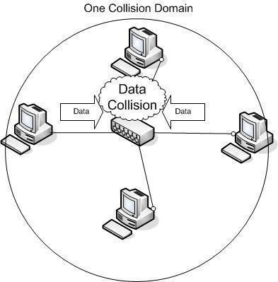

## 1.1. Domínios de colisão em hubs

Imagine 4 computadores conectados ao mesmo hub (figura acima).
- Todos compartilham o mesmo meio físico.
- Se dois computadores transmitirem simultaneamente, poderá ocorrer uma colisão.
- Portanto, **todos pertencem ao mesmo domínio de colisão**.

## 1.2. Domínios de colisão em switches

Um switch cria **domínios de colisão separados por porta**.

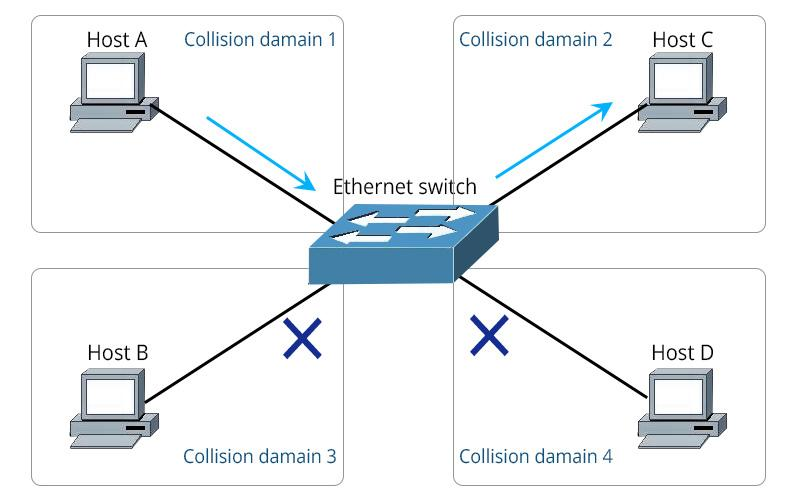

Imagine 4 computadores conectados a quatro portas de um switch.
- Cada enlace representa um domínio de colisão separado.
- Como as conexões da maioria dos switches operam em full-duplex, não existem colisões Ethernet nesse enlace, pois os sentidos de transmissão e recepção são separados.

Isso permite que cada dispositivo utilize o enlace sem disputar o meio com os demais dispositivos conectados às outras portas.
- O que é mais uma vantagem dos switches em relação aos hubs.

# 2. Domínio de broadcast

Um domínio de broadcast é a **região da rede na qual um quadro Ethernet de broadcast pode ser distribuído**.
- Em uma rede com switches convencionais, os dispositivos pertencentes ao mesmo domínio de broadcast (se eles se encontram na mesma VLAN - por enquanto considere que todos estao na mesma VLAN).

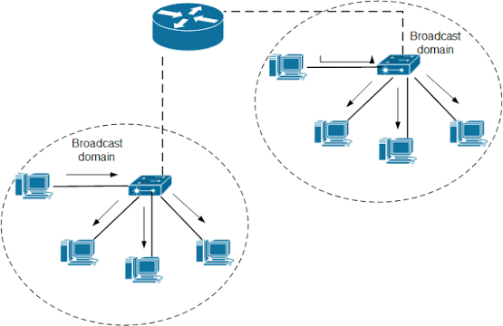

Note que o domínio de broadcast é diferente do domínio de colisão.
- Um domínio de colisão é uma região da rede na qual transmissões simultâneas podem provocar colisões.
- Um domínio de broadcast é uma região da rede na qual um quadro de broadcast pode ser distribuído.

Observe tambem que:
- O domínio de broadcast é **igual ou maior que o domínio de colisão**.
  - Um domínio de colisão é limitado a um enlace físico (um cabo, ou um par de cabos), enquanto o domínio de broadcast pode abranger vários enlaces e dispositivos conectados a um switch.
- **Roteadores separam domínios de broadcast**, pois não encaminham broadcasts entre interfaces (portas).
- Veja imagem abaixo.

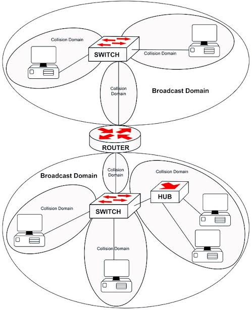

## 2.1. Roteadores e domínios de broadcast


Considere um roteador interligando duas redes:

- LAN A: `192.168.1.0/24`.
- LAN B: `192.168.2.0/24`.

**Cada rede constitui um domínio de broadcast separado**.

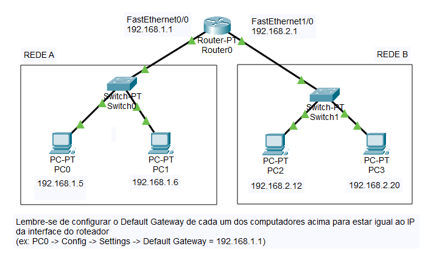

Um broadcast enviado na LAN ``A`` não será automaticamente encaminhado para a LAN ``B`` pelo roteador.
- Assim, roteadores controlam a propagação de broadcasts e a comunicação entre diferentes redes.
- Isso é importante para evitar congestionamento de rede (muitos pacotes transitando na rede) e melhorar a eficiência da comunicação.
- Tambem serve como mecanismo de segurança, pois impede que broadcasts de uma rede alcancem outra rede sem autorização.

## 2.2. VLANs em Switches e domínios de broadcast

As VLANs permitem **dividir um switch físico em diferentes redes lógicas** de camada 2.
- Pense nisso como se cada VLAN fosse uma diferente, independente e isolada das demais.
- Isto é, cada VLAN constitui um **domínio de broadcast separado**.
- As **máquinas de uma VLAN não conseguem se comunicar** diretamente **com máquinas de outra VLAN**.

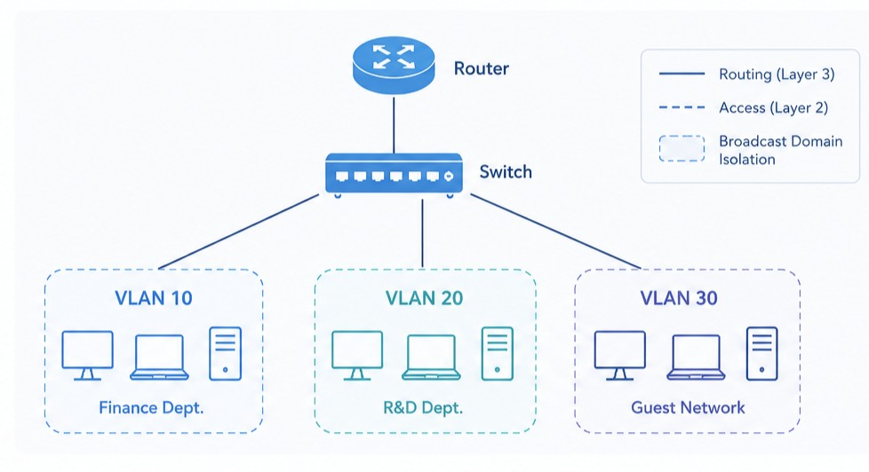

Imagine 1 switch com 9 computadores.

- 3 computadores pertencem à VLAN 10.
- 3 computadores pertencem à VLAN 20.
- 3 computadores pertencem à VLAN 30.

Mesmo conectados ao mesmo switch físico, eles pertencem a domínios de broadcast distintos.

Considere o seguinte exemplo no Packet Tracer com 6 PCs conectados a um switch, divididos em duas VLANs:
- **VLAN 10**: PC0, PC1, PC2
- **VLAN 20**: PC3, PC4, PC5
- Veja figura abaixo:

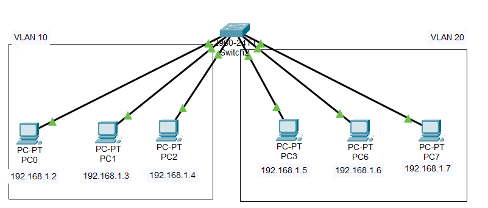

Para configurar VLANs em um switch, faça o seguinte:
1. Clique no switch (use o switch ``2960`` ao inves do ``switch-PT``).
2. Aguarde ele iniciar (isso pode levar alguns segundos - voce pode acompanhar o progresso na aba ``CLI``).
   1. Enquanto ele nao inciar, voce nao conseguirá acessar a aba ``Config`` (seja paciente).
3. Clique na aba ``Config``.
4. Clique em ``VLAN Database`` (veja figura abaixo).
   
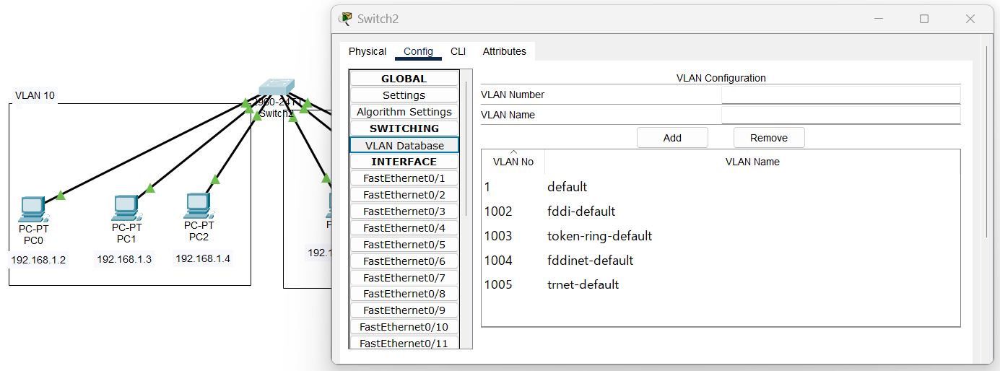

5. Crie as VLANs desejadas:
   1. Defina o número,
   2. Defina o nome (o nome nao pode conter espaços - ele nao afeta o funcionamento da VLAN, mas ajuda na identificação),
   3. Clique em ``Add`` para adicionar a VLAN.
6. Atribua as portas do switch às VLANs correspondentes (abra cada interface `FastEthernet` e configure a VLAN):
   1. Selecione a VLAN à qual a porta deve pertencer.
7. Teste a comunicação entre os computadores de cada VLAN.
   1. PCs da mesma VLAN devem conseguir se comunicar.
   2. PCs de VLANs diferentes **não** devem conseguir se comunicar.
   3. Use o modo ``Simulation`` do Packet Tracer para observar o comportamento dos pacotes.
   4. Use a ferramenta `Add Simple PDU` (imagem de carta) para enviar pacotes entre os computadores.
   5. Clique em ``Play`` para iniciar a simulação.

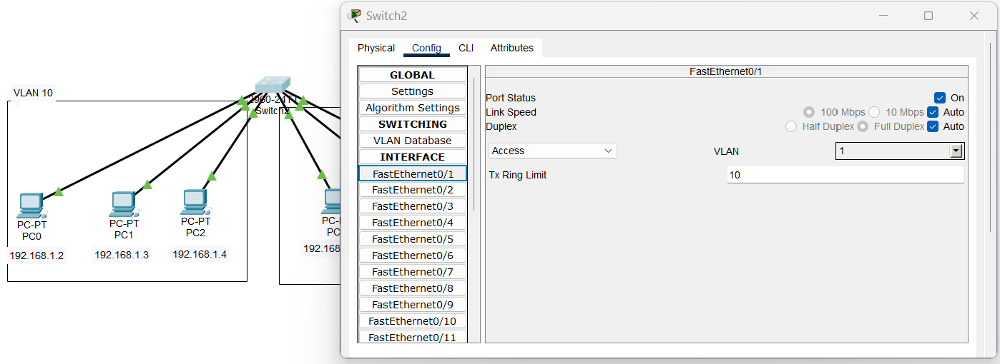

## 2.3. Comparação hub x switch sem VLAN x switch com VLAN x roteador

| Equipamento         | Domínios de colisão                                    | Domínios de broadcast                                                     |
| ------------------- | ------------------------------------------------------ | ------------------------------------------------------------------------- |
| Hub                 | 1 somente (para todas as portas)                       | 1 somente                                                                 |
| Switch L2 sem VLANs | 1 por porta física (N domínios em switch com N portas) | 1 somente                                                                 |
| Switch L2 com VLANs | 1 por porta física (N domínios em switch com N portas) | 1 por VLAN (se ha N VLANs, ha N domínios broadcast)                       |
| Roteador            | Não encaminha broadcast                                | 1 domínio para cada interface de rede (N interfaces, N domínios brodcast) |

# 3. Funcionamento interno dos switches

## 3.1. Como um switch aprende os endereços MAC?

Um switch Ethernet precisa **saber em qual porta está conectado cada dispositivo** para encaminhar os quadros corretamente.
- Para isso, utiliza um mecanismo chamado **aprendizado de endereços MAC (*MAC Learning*)**.

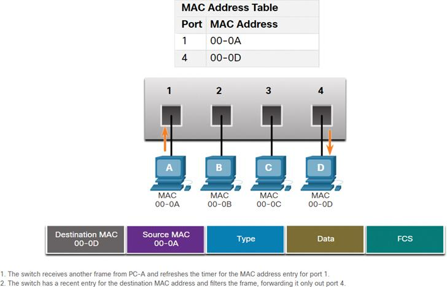

O aprendizado ocorre quando o switch recebe um quadro Ethernet.
1. Ele abre o quadro,
2. Analise o endereço MAC de origem,
3. Associa esse endereço à porta pela qual o quadro foi recebido.

### 3.2. Exemplo passo a passo

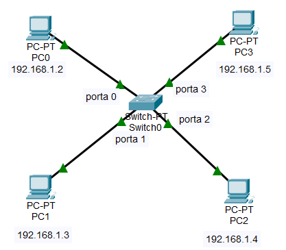

Considere o cenário acima, com 4 computadores:

| Computador | Endereço MAC      | Porta |
| ---------- | ----------------- | ----- |
| PC0        | AA:AA:AA:AA:AA:AA | ?     |
| PC1        | BB:BB:BB:BB:BB:BB | ?     |
| PC2        | CC:CC:CC:CC:CC:CC | ?     |
| PC3        | DD:DD:DD:DD:DD:DD | ?     |

Inicialmente, o switch não conhece a localização desses endereços.

Considere que o computador ``PC0`` transmite um quadro para algum outro computador (`PC1` por exemplo).
- O quadro chega pela **porta 0**.

O switch aprende:

```text
AA:AA:AA:AA:AA:AA → Porta 0
```

Segundo momento: computador ``PC1`` transmite um quadro (que chega pela **porta 1**).

O switch aprende:

```
BB:BB:BB:BB:BB:BB → Porta 1
```

E assim por diante, à medida que os computadores vão transmitindo quadros.
- Em algum momento, o switch terá aprendido todos os endereços MAC e suas respectivas portas.
- Quando isso acontecer, a tabela passa a conter:

| Computador | Endereço MAC      | Porta |
| ---------- | ----------------- | ----- |
| PC0        | AA:AA:AA:AA:AA:AA | 0     |
| PC1        | BB:BB:BB:BB:BB:BB | 1     |
| PC2        | CC:CC:CC:CC:CC:CC | 2     |
| PC3        | DD:DD:DD:DD:DD:DD | 3     |

Agora o switch tem como encaminhar os quadros corretamente, para a porta certa.

## 3.3. E se o switch nao conhecer a porta do PC de destino?

Imagine que ``PC0`` envie um quadro destinado ao MAC de um computador que ainda não aparece na tabela do switch (`PC3`, por exemplo).
- Isto é, temos a tabela de endereços MAC incompleta, e o switch não sabe em qual porta o destinatário está conectado.
- Veja um exemplo abaixo:

| Computador | Endereço MAC      | Porta |
| ---------- | ----------------- | ----- |
| PC0        | AA:AA:AA:AA:AA:AA | 0     |
| PC1        | BB:BB:BB:BB:BB:BB | 1     |
| PC2        | CC:CC:CC:CC:CC:CC | 2     |
| PC3        | DD:DD:DD:DD:DD:DD | ???   |

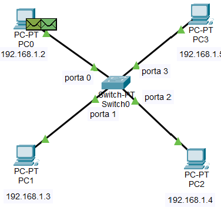

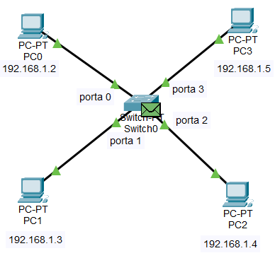

O switch não sabe em qual porta o destinatário está conectado.
- Nesse caso, ele envia o pacote para todos as portas (exceto a porta de entrada), pra tentar descobrir a porta correta. 
  - Este procedimento é chamado de **unknown unicast flooding**.

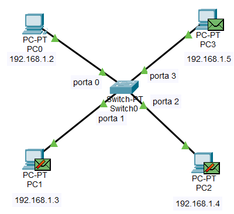

Quando o dispositivo de destino responder, o switch poderá aprender seu endereço MAC e a respectiva porta.
  - Ja este procedimento é chamado de **MAC address learning** (tambem chamado de **aprendizado de endereços MAC**).


No Cisco Packet Tracer, podemos ver a tabela de endereços MAC do switch da seguinte forma:
1. Clique na ferramenta ``Ispect`` (imagem de uma lupa).
2. Clique no switch.
3. Clique no menu ``MAC Table``.
   
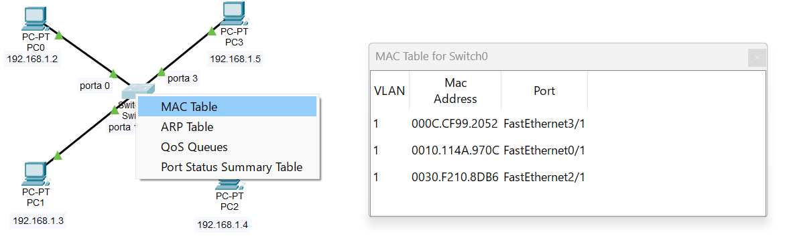

Nessa figura acima, o switch ja aprendeu os endereços MAC dos computadores conectados às portas 0 (``PC0``), 2 (`PC2`) e 3 (``PC3``).

**IMPORTANTE:** Os dois procedimentos andam juntos: 
  - o **flooding** (enviar pacote para todas as portas, exceto a de entrada) é necessário para descobrir a porta correta, 
  - o **aprendizado de endereços MAC** é necessário para que o switch saiba a porta correta no futuro.

É importante diferenciar os **procedimentos de encaminhamento de pacotes** que podem ocorrer em um switch:

- **Broadcast**: quadro destinado a todos os dispositivos do domínio de broadcast.
  - O switch encaminha o quadro para todas as portas, exceto a de entrada.
- **Unknown unicast**: quadro unicast cujo endereço MAC de destino ainda não é conhecido pelo switch.
  - O switch tambem envia o quadro para todas as portas, exceto a de entrada, **POREM** ele faz isso SOMENTE para tentar descobrir a porta correta (e aprender o endereço MAC).
- **Known unicast**: quadro cujo endereço MAC de destino está presente na tabela.
  - O switch encaminha o quadro **apenas** para a porta correta, sem enviar para todas as portas.

## 3.4. Tabela CAM de Switches

**CAM (Content Addressable Memory)** é uma tecnologia de memória que permite pesquisar informações pelo conteúdo armazenado (MAC, por exemplo).
- Nos switches, a expressão **tabela CAM** é frequentemente utilizada para designar a estrutura que armazena associações entre endereços MAC e portas (essa estrutura tambem pode ser chamada de **tabela de endereços MAC**).

Uma entrada típica contém:
- Endereço MAC.
- VLAN associada.
- Porta.

Veja exemplo no Packet Tracer abaixo:


### 3.5. Envelhecimento de entradas MAC

As associações aprendidas pelo switch não precisam permanecer indefinidamente.
- **Se um dispositivo ficar muito tempo sem transmitir, sua entrada pode ser removida automaticamente**.
- Nesse caso, a linha da tabela MAC correspondente ao endereço MAC do dispositivo pode ser apagada.
- Esse processo é chamado de **MAC address aging**.

Quando o dispositivo voltar a transmitir, o switch poderá aprender novamente sua localização.

Isso é importante porque computadores podem ser desconectados, mudar de porta ou ser substituídos.

## 3.6. O que acontece quando um computador muda de porta?

Imagine que um computador inicialmente conectado à **porta 1** seja transferido para a **porta 5**.

Quando ele transmitir um novo quadro:

1. O switch recebe o quadro pela porta 5.
2. Identifica o MAC de origem.
3. Atualiza a associação na tabela.
4. Passa a encaminhar os quadros destinados àquele MAC pela porta 5.

Assim, a tabela MAC acompanha mudanças na topologia da rede.

## 3.7. Modos de encaminhamento de quadros

Os switches podem utilizar diferentes estratégias para encaminhar quadros.

### 3.7.1. Store-and-Forward (armazena-e-repassa)

**Como funciona**:
1. O switch recebe o **quadro completo**,
2. So depois disso, ele verifica sua integridade (se houve erros de transmissão / corrupcao de dados),
3. E, se tudo estiver certo, ele o encaminha.

**Vantagens**:

- Permite verificar erros.
- Descarta quadros inválidos.

Atualmente, **store-and-forward** é a estratégia mais comumemente usada em switches modernos.

### 3.7.2. Cut-Through (encaminhamento imediato)

O switch **começa a encaminhar o quadro ANTES de receber todos os seus dados**.
- Conforme o switch recebe os primeiros bytes do quadro, ele já inicia o encaminhamento para a porta de destino.
- Para isso, ele precisa apenas ler o endereço MAC de destino (que está nos primeiros bytes do quadro).
  
**Vantagem**:
- Pode apresentar menor latência de encaminhamento.

**Limitação**:
- Pode encaminhar quadros com erros (corrompidos) ou ate mesmo inválidos (com problemas nos cabeçalhos).


# 4. Exercícios de fixação e avaliação

Procure resolver as questões sem consultar o material. Elas foram organizadas para avaliar tanto a memorização dos conceitos quanto a capacidade de aplicá-los em situações reais.

1.  Quantos domínios de colisão existem em um hub convencional?
2.  Quantos domínios de colisão existem em um switch com 8 portas Ethernet?
3.  Qual a diferença entre um domínio de colisão e um domínio de broadcast?
4.  Por que um roteador separa domínios de broadcast?
5.  Qual é a relação entre VLANs e domínios de broadcast?
6.  Como um switch aprende os endereços MAC dos dispositivos?
7.  O que acontece quando um switch recebe um quadro destinado a um endereço MAC desconhecido?
8.  Porque o flooding é necessario para o funcionamento correto de um switch?
9.  Qual é a finalidade da tabela CAM?
10. Explique a diferença entre Store-and-Forward e Cut-Through.

# 5. Situações-problema

As situações abaixo simulam problemas que podem ocorrer durante a instalação e manutenção de redes.

## 5.1. Problema de domínio de broadcast

Uma empresa possui 100 computadores conectados a uma mesma VLAN.

A equipe de TI percebe um volume elevado de tráfego de broadcast.

Que alternativas de projeto poderiam ser utilizadas para reduzir a propagação desse tráfego?

Quais seriam as consequencias de cada alternativa?

## 5.2. Problema de encaminhamento em switch

Um switch acabou de ser instalado para conectar 4 computadores. A sua tabela MAC está atualmente vazia.

O computador A envia um quadro para o computador D.

1. Como o switch encaminha esse primeiro quadro?
2. Qual endereço MAC o switch aprende, e qual porta ele associa? Como esse aprendizado ocorre?
3. Se A enviar outro quadro para D depois dessa troca, como o switch deverá encaminhá-lo?
4. E se A tentar encaminhar um quadro para C, como o switch deverá encaminhá-lo?

# 6. Atividades práticas complementares

As atividades seguintes foram elaboradas para que você desenvolva habilidades de instalação, identificação, configuração e diagnóstico de equipamentos de rede.

## Atividade 1 — Análise da tabela MAC

Conecte **4 laptops** ao **1 switch-PT** no Packet Tracer, e configure endereços IP válidos para cada um deles:
- `192.168.1.2`, 
- `192.168.1.3`, 
- `192.168.1.4`, 
- `192.168.1.5`

1. **Antes de enviar quaisquer pacotes**, abra a tabela MAC do switch e observe as suas entradas.
2. Em seguida, tente enviar pacotes do ``Laptop0`` para o ``Laptop1``.
3. Observe a tabela MAC novamente e identifique se houve alguma mudança.
   1. Anote o endereço MAC do ``Laptop0`` e a porta associada.
   2. Verique que a porta associada é definida quando você conectou o ``Laptop0`` ao switch (na ferramenta de conexao de cabo `Copper Staight Through`).
   3. Se voce usar a ferramenta de conexao automática (que tem uma imagem de raio), o switch atribui automaticamente a porta de acordo com a ordem de conexão dos dispositivos 
      1. o primeiro conectado recebe a porta 0, 
      2. o segundo recebe a porta 1, 
      3. e assim por diante.
4. Agora envie um pacote do ``Laptop2`` para o ``Laptop3``.
   1. Verifique a tabela MAC novamente, 
   2. Observe se houve alguma mudança.
5. Tente enviar um pacote de ``Laptop0`` para ``Laptop3``.
   1. O pacote foi enviado por broadcast ou unicast?
   2. Houve mudança na tabela MAC do switch? Explique.
6. Desconecte o ``Laptop1`` do switch
   1. Observe a tabela MAC do switch e verifique se houve alguma mudança
7. Reconecte o ``Laptop1`` a uma porta diferente.
   1. Envie um pacote do ``Laptop1`` para o ``Laptop0``.
   2. Observe a tabela MAC do switch e verifique se houve alguma mudança.
   3. Explique o que aconteceu.

## Atividade 2 — Análise de domínios de broadcast


Construa a rede acima contendo:

- 1 roteador.
- 6 computadores.

Faça os seguintes testes:

1. Conecte os 6 computadores ao mesmo switch (**nao configure as VLANs ainda**).
2. Observe o domínio de broadcast.
   1. Quantos domínios de broadcast existem inicialmente?
   2. O que ocorre quando PC0 envia um pacote para PC3? O pacote é enviado por broadcast ou unicast? Simule no Packet Tracer e observe o comportamento.
3. Configure duas VLANs (10 e 20, conforme imagem).
4. Coloque 3 computadores em cada VLAN.
5. Observe a separação dos domínios de broadcast.
   1. O aprendizado de MAC funciona da mesma forma em VLANs diferentes?
   2. O pacote broadcast emitido de uma VLAN passa por outra VLAN? Justifique.
   3. Se PC0 tentar se comunicar com PC3, o que acontece? Simule e explique.
   4. Porque segmentar a rede em VLANs pode ser vantajoso? Cite pelo menos 2 motivos.
