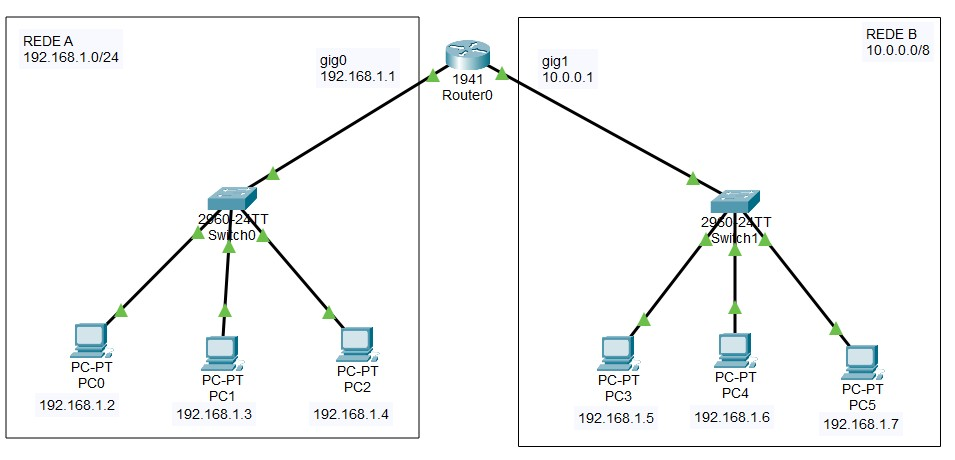
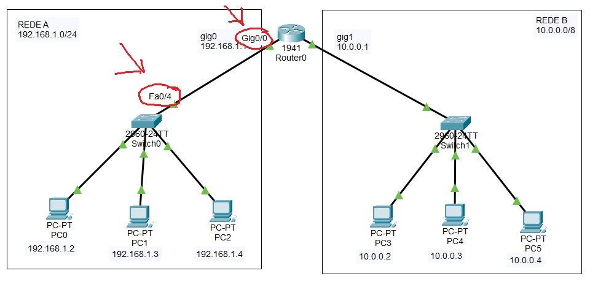
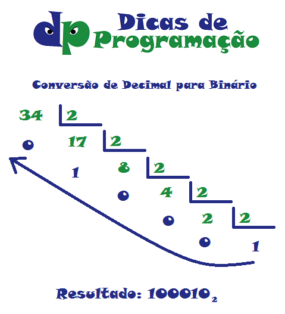
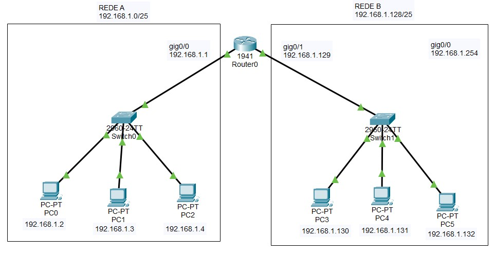
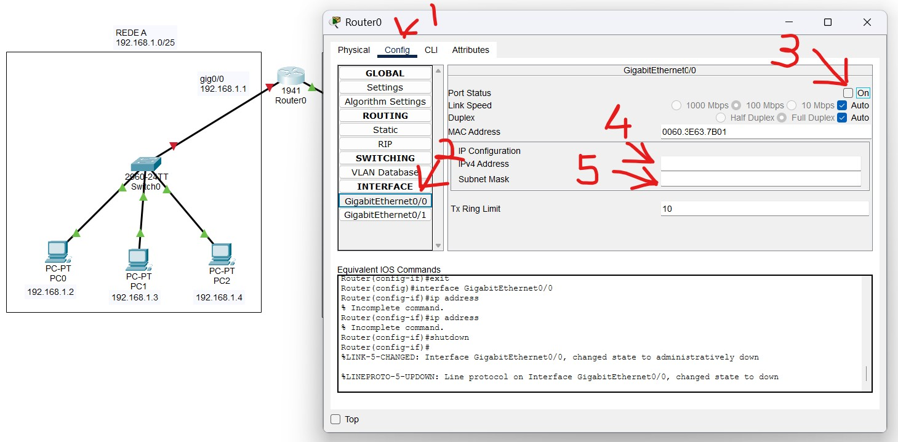
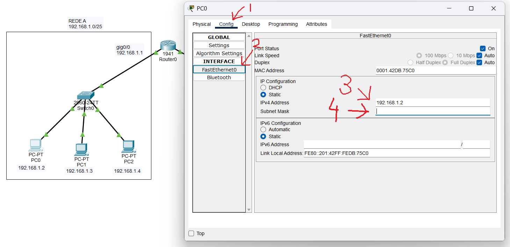
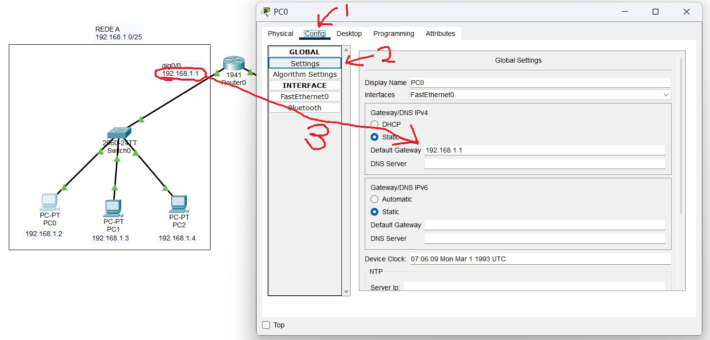
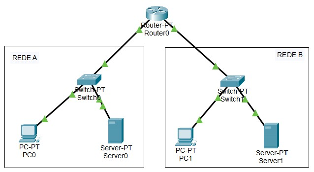

# Endereçamento IPv4 e Sub-redes (subnetting)

**Sumário**:
- [Endereçamento IPv4 e Sub-redes (subnetting)](#endereçamento-ipv4-e-sub-redes-subnetting)
- [1. O que é um endereço IP?](#1-o-que-é-um-endereço-ip)
- [2. Estrutura de um endereço IPv4](#2-estrutura-de-um-endereço-ipv4)
  - [2.1. Conversão de binário para decimal](#21-conversão-de-binário-para-decimal)
  - [2.2. Conversão de decimal para binário](#22-conversão-de-decimal-para-binário)
- [3. Máscara de sub-rede](#3-máscara-de-sub-rede)
  - [3.1. CIDR (Classless Inter-Domain Routing)](#31-cidr-classless-inter-domain-routing)
  - [3.2. Quantidade de bits de host](#32-quantidade-de-bits-de-host)
  - [3.3. Quantidade de endereços IP disponíveis](#33-quantidade-de-endereços-ip-disponíveis)
  - [3.4. Quantidade de redes disponíveis](#34-quantidade-de-redes-disponíveis)
  - [3.5. Como converter prefixo CIDR em máscara?](#35-como-converter-prefixo-cidr-em-máscara)
- [4. Como calcular o endereço de rede e o broadcast](#4-como-calcular-o-endereço-de-rede-e-o-broadcast)
- [5. Classes de endereços IPv4](#5-classes-de-endereços-ipv4)
- [6. Subnetting: divisão de uma rede em sub-redes](#6-subnetting-divisão-de-uma-rede-em-sub-redes)
  - [6.1. Como calcular a quantidade de sub-redes?](#61-como-calcular-a-quantidade-de-sub-redes)
  - [6.2. Distribuição das sub-redes](#62-distribuição-das-sub-redes)
  - [6.3. Exemplo de divisão de uma rede /24](#63-exemplo-de-divisão-de-uma-rede-24)
- [6.4. Como escolher a máscara adequada?](#64-como-escolher-a-máscara-adequada)
- [7. Endereços IPv4 públicos e privados](#7-endereços-ipv4-públicos-e-privados)
  - [7.1. IPs públicos](#71-ips-públicos)
  - [7.2. Endereços privados](#72-endereços-privados)
  - [7.3. NAT: tradução de endereços](#73-nat-tradução-de-endereços)
- [8. Exercícios de fixação](#8-exercícios-de-fixação)
- [9. Atividades práticas](#9-atividades-práticas)
  - [9.1. Atividade prática 1 - Conectando e Configurando Sub-redes no Packet Tracer](#91-atividade-prática-1---conectando-e-configurando-sub-redes-no-packet-tracer)
  - [9.2. Atividade prática 2 - Sub-redes](#92-atividade-prática-2---sub-redes)

O endereçamento IP é um dos fundamentos das redes de computadores. Enquanto os equipamentos de camada 2, como switches, permitem a comunicação entre dispositivos de uma mesma rede local, o protocolo IP possibilita a comunicação entre redes diferentes.
- **Lembrete**: 
  - O protocolo IP é um **protocolo de camada L3 (camada de rede do modelo OSI)**, responsável pelo endereçamento e roteamento de pacotes entre redes.
  - Switches enviam **quadros** usando **endereços MAC (camada L2)**, enquanto **roteadores** enviam **pacotes** usando **endereços IP (camada L3)**.

Para compreender o funcionamento de uma rede, **não basta** saber que um computador possui um endereço IP. É necessário entender:

- Como um endereço IPv4 é estruturado;
- Como identificar a parte de rede e a parte de host;
- Qual é a função da máscara de sub-rede;
- Como determinar o IP de rede e o IP de broadcast;
- Como calcular a quantidade de hosts e sub-redes;
- Como dividir uma rede em sub-redes menores (subnetting);
- Como utilizar máscaras de tamanho variável (CIDR);
- Como planejar a distribuição de endereços IP em uma organização;
- Como configurar endereços IP e testar a comunicação;

# 1. O que é um endereço IP?

Um endereço IP (Internet Protocol Address) é um **identificador lógico (endereço)** atribuído a uma **interface de rede (porta de rede)** para permitir sua identificação e comunicação em uma rede que utiliza o protocolo IP.

Imagine uma instituição de ensino com vários computadores, impressoras e servidores. 
- Para que esses dispositivos possam trocar informações utilizando o protocolo IP, cada interface de rede precisa possuir um endereço IP **diferente**.

**Exemplo**:

No exemplo abaixo, todos os dispositivos da rede A pertencem a faixa de endereços definida por 192.168.1.0/24.
- Essa faixa vai do IP ``192.168.1.0`` ao IP ``192.168.1.255`` (veremos depois porque).

Observe que os dispositivos que estão na mesma rede (por exemplo, a rede A) possuem **endereços IP diferentes**, mas compartilham a mesma rede lógica.
- Isto é, todos os endereços IP da rede A pertencem à mesma faixa de endereços.
- Todos podem se comunicar entre si usando somente o switch (endereços MAC), sem a necessidade de um roteador.



Ja a rede B pertence a faixa de endereços definida por 10.0.0.0/8.
- Essa faixa vai do IP ``10.0.0.0`` ao IP ``10.255.255.255``.

Se um PC da rede ``A`` tentar se comunicar com outro PC da rede ``B``, ele não conseguirá fazer isso diretamente, pois estão em redes diferentes. 
- Nesse caso, será necessário enviar o pacote para um roteador, que encaminhará ele para a rede correta (interface de saída correta).
- Nesse caso, o roteador receberá o pacote da rede ``A`` pela porta ``gig0/0``, e encaminhará para a rede ``B`` pela porta ``gig0/1``.

**ATENÇÃO**:
- Note que `gig` é o tipo de placa de rede (NIC) do roteador (Gigabit Ethernet), que é uma placa de rede capaz de enviar e receber dados a **1 Gbps**. 
- Se fosse uma placa do tipo ``fa`` (Fast Ethernet) seria uma placa de rede capaz de enviar e receber dados a **100 Mbps**. 
- O número após a barra indica o número da porta.
  - **Exemplo**: `gig0/1` significa que é a **porta 1** da placa de rede **GigabitEthernet0** do roteador.
  - Assim, uma **interface de rede é identificada pelo tipo de placa e pelo número da porta** (ex: `gig0/1`, `fa1/3`, etc).
  - Isto é, roteadores, PCs e demais equipamentos de rede podem possuir **mais de uma interface de rede**.
  - **Cada interface possui um endereço IP diferente** (exceto switches e hubs, que nao trabalham na camada 3, ou seja, que nao utilizam endereços IP).

**IMPORTANTE**: Para descobrir a qual porta cada cabo esta conectado no roteador, dentro do Packet Tracer, basta colocar o **mouse em cima do cabo**.
- O Packet Tracer irá exibir a porta para você (veja imagem abaixo).




O endereço IP é diferente do endereço MAC:

| Endereço MAC                                                                                  | Endereço IP                                                  |
| --------------------------------------------------------------------------------------------- | ------------------------------------------------------------ |
| Identificador de camada 2 (enlace)                                                            | Endereço lógico de camada 3 (rede)                           |
| Associado à interface de rede (MAC)                                                           | Configurado na interface (IP)                                |
| Usado na comunicação dentro do enlace local (de uma máquina para outra, no mesmo cabo/enlace) | Usado para comunicação entre redes (passando por roteadores) |
| Exemplo: `00:1A:2B:3C:4D:5E`                                                                  | Exemplo: `192.168.1.10`                                      |

Um computador pode **manter o mesmo endereço MAC** (que é definido pelo fabricante da placa de rede) **ao se conectar a redes distintas**.
- Contudo, ele pode **receber endereços IP diferentes**, para cada uma das redes às quais se conecta.

**Importante**: um equipamento pode ter mais de uma interface de rede e, consequentemente, mais de um endereço IP. 

# 2. Estrutura de um endereço IPv4

O **IPv4** utiliza endereços de **32 bits**.
- Isso significa que **cada endereço é composto por 32 dígitos binários**, sendo cada dígito um bit, que pode assumir os valores 0 ou 1.

**Exemplo**:

```
11000000  10101000  00000001  00001010
```

Para facilitar a leitura humana, **esses 32 bits são divididos em 4 grupos de 8 bits**, chamados de **octetos**.
- Cada octeto é convertido para decimal e os quatro valores são separados por pontos.

**Exemplo**: 
- **Endereço IPv4**: 192.168.1.10
- **Representação binária**: 11000000 . 10101000 . 00000001 . 00001010 (veremos como fazer essa conversão de decimal para binário adiante).

4 octetos × 8 bits = 32 bits.

Cada octeto possui 8 bits. Portanto, seu valor decimal pode variar de **0 a 255**.

- Menor valor: `00000000` = 0.
- Maior valor: `11111111` = 255.

Assim, cada octeto pode representar **256 valores diferentes**.

Exemplos de endereços IPv4:
- `10.0.0.1`
- `74.123.45.67`
- `172.16.5.20`
- `192.168.1.100`
- `8.8.8.8`

Existem ao todo $2^{32}$ = **4.294.967.296 endereços IPv4 possíveis**.
- Do IP `0.0.0.0` ao IP `255.255.255.255`.
- Isso é suficiente?

Se considerarmos que existem pelo menos 8 bilhões de pessoas no mundo, e que cada pessoa possui pelo menos 1 dispositivo conectado à internet (computador, celular, tablet, etc), **não temos IPs suficientes para todo mundo**.
- **Solução**: o IPv6, que utiliza endereços de 128 bits, permitindo $2^{128}$ endereços possíveis.
- Se for feito o calculo, $2^{128}$ é um número tão grande que é praticamente impossível de imaginar.
- Esse número é tão grande que, **se cada átomo do universo tivesse um endereço IPv6, todos os átomos do universo teriam um endereço IPv6 e ainda sobrariam endereços** disponíveis.

Contudo, a mesma teoria que aprenderemos sobre endereçamento IPv4 também se aplica ao IPv6, com algumas poucas diferenças.
- Por isso, é importante aprender o IPv4 primeiro, antes de estudar o IPv6.

## 2.1. Conversão de binário para decimal

Para trabalharmos com IPs, precisaremos entender como converter números binários em decimais e vice-versa.

Para facilitar diferenciar um número binário de um decimal, podemos utilizar o **subscrito** para **indicar a base** do número.
- **Exemplo**: $1100\ 0000_2$ = $192_{10}$
  - Isto é, o número binário ``1100 0000`` é equivalente ao número decimal ``192``.
- **Exemplo**: $1010\ 1000_2$ = $168_{10}$
  - Isto é, o número binário ``1010 1000`` é equivalente ao número decimal ``168``.

Para converter um número binário em decimal, devemos considerar o **valor posicional de cada bit (índice)**.
- Para encontrar o índice de cada bit, **contamos da direita para a esquerda, começando do 0**.

**Exemplo**:

Seja o número binário $1100\ 0000_2$. Para convertê-lo em decimal, devemos **somar os valores das posições que possuem bit 1**, usando os índices de cada posição.

```text
Índice: 7 6 5 4 3 2 1 0
   Bit: 1 1 0 0 0 0 0 0
```

Agora executamos a soma dos pesos das posições:

$$
\begin{align*}
1100\ 0000_2 &= 1 \cdot 2^7 + 1 \cdot 2^6 + 0 \cdot 2^5 + 0 \cdot 2^4 + \cdots + 0 \cdot 2^0 \\
          &= 128_{10} + 64_{10} + 0 + 0 + \cdots + 0\\
          &= 192_{10}
\end{align*}
$$

**Outro exemplo**: Seja o número binário ``10101000``, calcule seu valor em decimal.

```
Índice: 7 6 5 4 3 2 1 0
   Bit: 1 0 1 0 1 0 0 0
```

Agora somamos os valores de cada bit, conforme os seus pesos (definidos pelos índices):

$$
\begin{align*}
1010\ 1000_2 &= 1 \cdot 2^7 + 0 \cdot 2^6 + 1 \cdot 2^5 + 0 \cdot 2^4 + 1 \cdot 2^3 + 0 \cdot 2^2 + 0 \cdot 2^1 + 0 \cdot 2^0 \\
          &= 128_{10} + 0 + 32_{10} + 0 + 8_{10} + 0 + 0 + 0\\
          &= 168_{10}
\end{align*}
$$

Assim a fórmula geral para converter um número binário em decimal é:

$$
\text{Decimal} = b_i \cdot 2^i + b_{i-1} \cdot 2^{i-1} + \cdots + b_0 \cdot 2^0
$$

, onde 
- $i$ é o iésimo bit do número binário
- $b_i$ é o valor do iésimo bit (que pode ser 0 ou 1).
- $2^i$ é o peso do iésimo bit (2 é a base, $i$ é o índice).

Como $b_i$ pode ser 0 ou 1 (no caso de números binários), apenas os bits que possuem valor 1 contribuem para a soma final.
- Isto é, somamos os pesos das posições que possuem bit 1, e ignoramos as posições que possuem bit 0.
- Considere como peso de cada posição o valor de $2^i$, em que $i$ é o índice da posição do bit, contando da direita para a esquerda, começando do 0.

## 2.2. Conversão de decimal para binário

Para converter um número decimal em binário, **dividimos o número decimal sucessivamente o número por 2** até alcançar um quociente que nao possa ser mais dividido (quando o quociente for 0 ou 1).
- Quando alcançamos o quociente 0 ou 1, **fazemos a leitura da direita para a esquerda**, pegando o último quociente (0 ou 1) e todos os restos 0 ou 1.

**Exemplo**: converter o número decimal 26 para binário.

```text
 26 |_2
-26   13 |_2
  0  -12   6 |_2
       1  -6   3 |_2
           0  -3   1 (paramos aqui, pois nao faz sentido continuar dividindo por 2)
               1

<---------------------
(vamos ler o número da direita pra esquerda)
```

Lendo o ultimo quociente e os restos de da direita para a esquerda, obtemos o número binário:

$$
26_{10} = 11010_2
$$

Como estamos trabalhando com octetos (8 bits), precisamos completar o número binário com zeros à esquerda, até que ele possua 8 bits:

$$
26_{10} = 0001\ 1010_2
$$

**Outro exemplo**: Converta o número decimal 34 para binário.



**Resultado**:

$$
\begin{align}
34_{10} &= \ \ \ \ 10\ 0010_2 \\
        &= 0010\ 0010_2
\end{align}
$$

**LEMBRE-SE**: Preenchemos com zeros à esquerda para que o número binário possua 8 bits, pois estamos trabalhando com octetos.

# 3. Máscara de sub-rede

Vimos a representação binária na seção anterior, porque números binários são fundamentais para o cálculo de sub-redes!

A **máscara de sub-rede** determina:
- **qual parte de um endereço IPv4 identifica a rede**,
- **qual parte identifica o host**.

A mascara de sub-rede possui **32 bits**, assim como o endereço IPv4.

Na máscara:

- **Bits 1** indicam a parte de rede.
- **Bits 0** indicam a parte de host.

**Exemplo**: Seja um ``PC0`` configurado com o seguinte IP e máscara: 

```text
Endereço IP:
192.168.1.10

Máscara:
255.255.255.0
```

Representação binária:

```text
IP:
11000000.10101000.00000001.00001010

Máscara:
11111111.11111111.11111111.00000000
```

Observe que os **primeiros 24 bits são 1**. 
- Portanto, os primeiros 24 bits identificam a rede, enquanto os últimos 8 identificam o host.

Isto é, cada dispositivo que pertence a rede deve ter um IP diferente dos demais, e parte do IP que mudará será somente aquela que tem os bits 0 da mascara de sub-rede.
- No exemplo anterior, somente o final do IP (último octeto) poderá variar, pois os primeiros 3 octetos são fixos (bits 1 da máscara).
- Os IPs abaixo todos pertencem à mesma rede, pois possuem os mesmos 24 bits iniciais (os bits 1 da máscara):
  - ``192.168.1.0``
  - ``192.168.1.1``
  - ``192.168.1.2``
  - $\cdots$
  - `192.168.1.255`

## 3.1. CIDR (Classless Inter-Domain Routing)

Escrever uma máscara de sub-rede em decimal é útil, mas não é a forma mais prática de representar uma rede.
- Uma mascara na forma binária é mais fácil de interpretar (conseguimos ver que parte do IP é de rede e qual parte é de host), mas não é prática para escrever (tem muitos números binários pra escrever).
- **Solução**: a notação **CIDR (Classless Inter-Domain Routing)**, que é uma forma de representar redes IP utilizando barras e **prefixos**.

**Exemplo**: Seja uma rede definida por

```
IP: 
192.168.1.0

Máscara: 
255.255.255.0

Em binário teríamos:

IP:
11000000.10101000.00000001.00000000

Máscara:
11111111.11111111.11111111.00000000
```

A mesma rede pode ser representada pela notação CIDR da seguinte forma:
```
192.168.1.0/24
```

O `/24` indica que **os primeiros 24 bits da máscara sao bits 1**.
- Logo, os **primeiros 24 bits** de um endereço IP definem a **parte de rede**.
- Isto é, é possível ter $2^{24}$ redes diferentes.
- Como esses 24 bits estão nos 3 primeiros octetos, cada rede será representada pelos números que aparecerem nesses 3 octetos.
  - **Ex**: 
    - `192.168.1.0/24` define uma rede,
    - `192.168.2.0/24` é outra rede,
    - `192.168.3.0/24` também é outra rede,
    - $\cdots$
    - `192.168.255.0/24` é outra rede,
    - O proximo IP começa no octeto seguinte:
    - `192.169.0.0/24` é outra rede,
    - `192.169.1.0/24` é outra rede,
    - $\cdots$
    - `192.169.255.0/24` é outra rede,
    - `192.170.0.0/24` é outra rede,
    - E assim continua até 
    - `192.255.0.0/24` (outra rede)
    - `193.0.0.0/24` (outra rede)
    - `193.0.1.0/24` (outra rede)
    - `193.0.2.0/24` (outra rede)
    - $\cdots$
    - `255.255.255.0/24` (última rede possível com máscara /24).
    
Os **últimos 8 bits da máscara sao bits 0**.
- Logo, esses **8 bits** definem a **parte de host** (servem para fornecer endereços IP diferentes para cada PC, tablet, smartphone e outros dispositivos da rede).
- **Ex**: Seja uma rede `192.168.1.0/24`, todos os IPs abaixo pertencem à mesma rede, pois possuem os mesmos 24 bits iniciais (os bits 1 da máscara):
  - `192.168.1.1`
  - `192.168.1.2`
  - `192.168.1.3`
  - $\cdots$
  - `192.168.1.255`

## 3.2. Quantidade de bits de host

Para calcular quantos IPs temos disponíveis para cada host (PC, notebook, tablet, etc), precisamos saber **quantos bits da máscara são 0**.
- Calcular isso é simples, pois **todo IPv4 tem 32 bits**.
- Se eu sei o CIDR da rede, eu sei quantos bits 1 tem na máscara (qual parte do IP pertence a rede).
- Logo, eu posso calcular a quantidade de bits de host subtraindo o CIDR de 32.

O número de bits de host é calculado por:

$$
 h = 32 - CIDR 
$$

Em que:

- $h$ = quantidade de bits de host;
- $CIDR$ = prefixo da rede (CIDR, que vem logo apos a /).

**Exemplo**: Seja uma rede com CIDR `/24`, calcule a quantidade de bits de host.

$$
h = 32 - 24 = 8\ bits
$$

**Exemplo**: Seja uma rede com CIDR `/26`, calcule a quantidade de bits de host.

$$
h = 32 - 26 = 6\ bits
$$

Quanto maior o prefixo CIDR, menor a quantidade de bits disponíveis para hosts.

## 3.3. Quantidade de endereços IP disponíveis

Agora que sabemos calcular a quantidade de bits de host, podemos calcular quantos endereços IP diferentes podemos ter em uma rede.
- Isto é, quantos dispositivos diferentes (PCs, laptops, smartphones, etc) podemos conectar em uma rede.

Para isso, basta ver quantas combinações diferentes podemos formar com os bits de host disponíveis, usando a fórmula abaixo:

$$
H = 2^h - 2
$$

Em que:

- $h$ = quantidade de bits de host;
- $H$ = quantidade total de endereços IP disponíveis.

O `-2` na fórmula é porque **dois endereços IP são reservados** (tem uma finalidade especial dentro de uma rede IPv4, e nao podem ser utilizados por hosts):
1. O **endereço de rede** (define onde começa a rede - ou seja, o primeiro endereço IP da rede);
   1. O **endereço de rede** é o primeiro endereço da rede, e tem **todos os bits de host iguais a 0**.
2. O **endereço de broadcast** (define um endereço que podemos usar para enviar pacotes para TODOS OS HOSTS da rede, em broadcast)
   1. O **endereço de broadcast** é o último endereço da rede, e tem **todos os bits de host iguais a 1**.

**Exemplo**: Seja uma rede com prefixo ``/24``, quantos endereços IP estão disponíveis para hosts?

$$
\begin{align}
h &= 32 - 24 \\
  &= 8\text{ bits de host} \\
\\
H &= 2^8 - 2 \\
   &= 256 - 2 \\
   &= 254\text{ IPs utilizáveis}
\end{align}
$$


**Exemplo**: Seja uma rede com prefixo ``/26``, quantos endereços IP estão disponíveis para hosts?

$$
\begin{align}
h &= 32 - 26 \\
  &= 6\text{ bits de host} \\
\\
H &= 2^6 - 2 \\
   &= 64 - 2 \\
   &= 62\text{ IPs utilizáveis}
\end{align}
$$

**IMPORTANTE**: Redes com prefixo `/31` ou `/32` são especiais, e não podem ser utilizadas para endereçar hosts, pois **não há endereços disponíveis (utilizáveis)**. 
- Veja o porque no calculo abaixo.

**Exemplo**: Seja uma rede com prefixo `/31`, quantos endereços IP estão disponíveis para hosts?

$$
\begin{align}
h &= 32 - 31 \\
  &= 1\text{ bit de host} \\
\\
H &= 2^1 - 2 \\
   &= 2 - 2 \\
   &= 0\text{ IPs utilizáveis}
\end{align}
$$

Logo, nao seria possível conectar nenhum host nessa rede, pois nao há endereços IP disponíveis.
- Logo essa rede nao tem uso real (pois ninguém pode se conectar nela).
- Mesmo raciocínio se aplica na rede `/32` (vide exemplo abaixo).

**Exemplo**: Seja uma rede com prefixo `/32`, quantos endereços IP estão disponíveis para hosts?

$$
\begin{align}
h &= 32 - 32 \\
  &= 0\text{ bits de host} \\
\\
H &= 2^0 - 2 \\
   &= 1 - 2 \\
   &= -1\text{ IPs utilizáveis}
\end{align}
$$

Nesse caso do prefixo `/32`, nao seria nem possível construir a rede, pois temos um valor negativo de endereços IP disponíveis para hosts.

## 3.4. Quantidade de redes disponíveis

De forma parecida, podemos calcular a quantidade de redes que podemos construir, usando a **quantidade de bits de rede** (CIDR).

$$
R = 2^{CIDR}
$$

**Exemplo**: Em uma rede com prefixo ``/24``, quantas redes é possível construir?

$$
\begin{align}
   R &= 2^{24} \\
     &= 16.777.216\text{ redes} 
\end{align}
$$

E dentro de cada rede dessa, podemos colocar até 254 hosts diferentes (veja calculo abaixo).

$$
\begin{align}
h &= 32 - 24 \\
  &= 8\text{ bits de host}\\
\\
H &= 2^8 - 2 \\
   &= 256 - 2 \\
   &= 254\text{ IPs utilizáveis}
\end{align}
$$

## 3.5. Como converter prefixo CIDR em máscara?

Para converter o prefixo CIDR em máscara, devemos:
1. colocar a quantidade de bits 1 equivalente ao CIDR no início da máscara,
2.  completar os bits restantes com 0.

**Exemplo**: Seja uma rede com CIDR `/7`, converta para máscara de sub-rede.

Colocamos os 7 bits 1 no início da máscara, e completamos com 0:
```
Máscara de sub-rede:
1111 1110 . 0000 0000 . 0000 0000 . 0000 0000
```

Convertendo os octetos para decimal, temos:

```
254.0.0.0
```

Para facilitar o calculo de binário para decimal, você pode dividir os octetos, um em cada linha, e fazer o calculo deles separadamente.
- Isto é, colocamos os 7 bits 1 no início da máscara, e completamos com 0:

```
1111 1110.    
0000 0000.  = 
0000 0000.    
0000 0000     
```

Agora fazemos a conversão binária em decimal de cada octeto:

```
1111 1110.    2^7 + 2^6 + 2^5 + 2^4 + 2^3 + 2^2 + 2^1 + 0*2^0 
0000 0000.  = 0
0000 0000.    0
0000 0000     0
```

Teremos o seguinte resultado:

```
1111 1110.    254
0000 0000.  = 0
0000 0000.    0
0000 0000     0

Logo a máscara de sub-rede é:
254.0.0.0
```

**Outro exemplo**: Seja uma rede com prefixo `/10`, calcule a máscara de sub-rede.

Colocamos os 10 bits 1 no início da máscara, e completamos com 0:
```
1111 1111.
1100 0000.  = 
0000 0000.
0000 0000
```

Convertendo de binário pra decimal:

```
1111 1111.      2^7 + 2^6 + 2^5 + 2^4 + 2^3 + 2^2 + 2^1 + 0*2^0 
1100 0000.  =   2^7 + 2^6 
0000 0000.      0
0000 0000       0
```

Resultado:

```
1111 1111.      255 
1100 0000.  =   192
0000 0000.      0
0000 0000       0

Logo a máscara de rede é:
255.192.0.0
```

**IMPORTANTE**: O Packet Tracer (assim como todo software de rede) é, normalmente, configurado usando a máscara de sub-rede em decimal, e não o CIDR.
- Por isso que precisamos saber como converter entre CIDR e máscara de sub-rede, e vice-versa.

# 4. Como calcular o endereço de rede e o broadcast

Esta é uma das partes mais importantes do subnetting.
- **Endereço de rede**: identifica a sub-rede à qual pertence um endereço IP (e é o primeiro IP da sub-rede).
- **Endereço de broadcast** permite enviar pacotes para todos os hosts daquela sub-rede (e é o último endereço da sub-rede).

TODO: mostrar calculo aqui

# 5. Classes de endereços IPv4

Historicamente, os endereços IPv4 nao possuíam CIDR.
- Eles eram distribuídos por um sistema chamado **endereçamento baseado em classes (classful)**.

Nesse modelo, os endereços eram divididos em **classes A, B, C, D e E**.
- **Classes A, B e C**: eram utilizadas para endereçamento unicast, 
- **Classe D**: destinada ao multicast,
- **Classe E**: reservada para uso experimental.

Atualmente, o sistema de classes foi **substituído pelo CIDR (Classless Inter-Domain Routing)**

Mesmo assim, conhecer as classes históricas ajuda a compreender a evolução do endereçamento IP.

| Classe | CIDR | Máscara de sub-rede | Uso            |
| ------ | ---- | ------------------- | -------------- |
| A      | /8   | 255.0.0.0           | Redes grandes  |
| B      | /16  | 255.255.0.0         | Redes médias   |
| C      | /24  | 255.255.255.0       | Redes pequenas |

**Observações**:

- O endereço `127.0.0.0/8` é reservado para **loopback**.
  - Isto é, é um IP usado quando precisamos manda um pacote **de um programa dentro de um PC para outro, dentro do mesmo PC** 
  - *loop* = volta 
  - *back* = retorno
- O bloco `0.0.0.0/8` é um IP especial, reservado, que nao pode ser usado.
- A classes D e E não podem ser usadas para identificar hosts em uma rede IP, por isso sao classes especiais.

**Porque usar CIDR?**
- Permite uma melhor utilização dos recursos de endereçamento IP, evitando desperdício de endereços.
- Isto é, temos poucos endereços IPv4.
- O CIDR permite controlar quantos IPs usamos para cada rede (IPs disponíveis para hosts, para cada rede), e quantas redes podemos criar.

# 6. Subnetting: divisão de uma rede em sub-redes

Subnetting é o processo de **dividir uma rede IP em redes menores**.
- Isso é feito aumentando o prefixo CIDR de rede (utilizando parte dos bits que anteriormente eram destinados aos hosts).
- **Ex**: de uma rede `/24`, podemos criar :
  - 2 redes `/25`, 
  - 4 redes `/26`, 
  - 8 redes `/27`, 
  - e assim por diante.

Imagine uma empresa que possui a rede:

```
192.168.1.0/24
```

Ela possui **254 endereços utilizáveis** (ja que o endereço de rede e o de broadcast não são utilizáveis).

Entretanto, a empresa deseja separar seus dispositivos em 4 redes:

- Administração;
- Professores;
- Laboratórios;
- Visitantes.

Em vez de manter todos os dispositivos na mesma rede, podemos dividi-la em quatro sub-redes.

## 6.1. Como calcular a quantidade de sub-redes?

A quantidade de sub-redes criadas depende do número de bits emprestados ($n$) da parte de host.

O número de sub-redes é calculado por:

$$
N = 2^{n}
$$

Em que:
- $N$ = quantidade de sub-redes;
- $n$ = quantidade de bits emprestados da parte de host.

**Exemplo**:

Desejamos dividir uma rede `/24` em 4 sub-redes.

Precisamos encontrar quantos bits permitem gerar pelo menos 4 sub-redes.

$$
2^n \geq 4 \\
2^2=4 
$$

Portanto, precisamos **pegar emprestado 2 bits**.

Logo, o novo prefixo CIDR será:

$$
24+2=26 
$$

Cada sub-rede conseguirá comportar até:

$$
\begin{align}
h &= 32-26\\
  &= 6\text{ bits de host} \\
\\
H &= 2^6-2 \\
  &= 62\text{ IPs utilizáveis} 
\end{align}
$$

Cada sub-rede poderá possuir 62 hosts utilizáveis.

## 6.2. Distribuição das sub-redes

Continuando o exemplo anterior, vamos dividir a rede ``192.168.1.0/24`` em 4 redes com CIDR `/26`.

| Sub-rede | Endereço de rede | Primeiro host | Último host | Broadcast |
| -------- | ---------------- | ------------- | ----------- | --------- |
| 1        | 192.168.1.0      | .1            | .62         | .63       |
| 2        | 192.168.1.64     | .65           | .126        | .127      |
| 3        | 192.168.1.128    | .129          | .190        | .191      |
| 4        | 192.168.1.192    | .193          | .254        | .255      |

Note que:
- Cada sub-rede começa no endereço de rede 
  - **Ex**: ``192.168.1.0``
- E termina no endereço de broadcast
  - **Ex**: ``192.168.1.63``
- Logo temos uma faixa de endereços que compõem a sub-rede, que vai do IP de rede ate o de broadcast.
  - **Ex**: ``192.168.1.0`` a ``192.168.1.63`` 
    - Podemos escrever como uma faixa de IPs `192.168.1.0 - 63`
    - Ou então usando o CIDR da sub-rede `192.168.1.0/26`
- E a proxima rede começa no próximo endereço, logo depois do endereço de broadcast.
  - **Ex**: ``192.168.1.64``

Assim, a divisão de uma rede ``/24`` em quatro redes ``/26`` resulta nas seguintes sub-redes (faixas de endereços):
- **Sub-rede 1**: ``192.168.1.0 – 63``
- **Sub-rede 2**: ``192.168.1.64 – 127``
- **Sub-rede 3**: ``192.168.1.128 – 191``
- **Sub-rede 4**: ``192.168.1.192 – 255``

Cada sub-rede contém **64 endereços**, dos quais **62 são utilizáveis** para hosts.
- **LEMBRE-SE**: 
  - Consideramos o endereço com final ``.0`` nessa conta.
    - **Ex**: Entre ``192.168.1.0`` e ``192.168.1.63`` tem 64 endereços.
  - Contudo, o primeiro endereço da sub-rede (``.0``) é reservado para o **endereço de rede**, e o último endereço da sub-rede (``.63``) é reservado para o **endereço de broadcast**.
  - Logo a faixa de endereços utilizáveis para hosts vai de ``.1`` a ``.62``, totalizando **62 endereços utilizáveis**.

## 6.3. Exemplo de divisão de uma rede /24

Considerando uma rede `/24`, podemos criar as seguintes sub-redes:

| Nova máscara | Bits emprestados | Sub-redes | Hosts por sub-rede |
| ------------ | ---------------- | --------- | ------------------ |
| /25          | 1                | 2         | 126                |
| /26          | 2                | 4         | 62                 |
| /27          | 3                | 8         | 30                 |
| /28          | 4                | 16        | 14                 |
| /29          | 5                | 32        | 6                  |
| /30          | 6                | 64        | 2                  |

**Observe a relação inversa**:
- Quanto mais sub-redes criamos, menos hosts cabem em cada uma.
- Quanto menos sub-redes criamos, mais hosts cabem em cada uma.

# 6.4. Como escolher a máscara adequada?

Em um planejamento de rede, normalmente **conhecemos a quantidade de dispositivos que cada sub-rede deverá suportar**.

Nosso objetivo é **encontrar a menor quantidade de bits de host capaz de atender à necessidade**.

**Exemplo**:

Uma sala de laboratório precisa conectar **25 computadores**. 
- Além disso, haverá: 
  - uma interface de gerenciamento do switch (1 IP para o switch), 
  - uma interface de roteador (1 IP para o roteador).

Portanto, precisamos de **pelo menos 27 endereços** para dispositivos.

Vamos avaliar as opções:

| Prefixo | Hosts utilizáveis | Atende 27 dispositivos? |
| ------- | ----------------- | ----------------------- |
| /28     | 14                | Não                     |
| /27     | 30                | Sim                     |
| /26     | 62                | Sim                     |
| /25     | 126               | Sim                     |

A menor sub-rede que atende à necessidade é `/27`.

Isso significa que **devemos escolher o prefixo mais longo** que ainda comporta a quantidade necessária de hosts (nesse caso, seria o `/27` e nao o `/26` ou `/25`).

Matematicamente, procuramos o menor $h$ que satisfaça:

$$
2^h-2\geq N
$$

Em que $N$ é a quantidade de endereços necessários para dispositivos.
- No nosso exemplo, $N=27$.

**Atenção**: ao calcular a necessidade, inclua todos os equipamentos que precisam de endereçamento IP naquela sub-rede, e não apenas os computadores dos máximo.
- Roteadores precisam de IPs, por exemplo, e switches gerenciáveis também.
- Servidores, assim como PCs, também precisam de IPs.

# 7. Endereços IPv4 públicos e privados

Devido a quantidade de endereços IPv4 limitada, foi necessário criar uma forma de **reutilizar endereços IP**.
- Para isso, foram divididos os endereços em duas categorias: 
  - IPs públicos,
  - IPs privados.

## 7.1. IPs públicos

São endereços únicos na Internet, que permitem que qualquer host possa se comunicar entre si através da Internet, em qualquer lugar do planeta.

Normalmente, são utilizados em interfaces de roteadores conectadas à Internet e em servidores que precisam ser acessados externamente.

**Exemplos**:

- `8.8.8.8`
- `1.1.1.1`

Quando acessamos um site, estamos acessando um IP público, que é o endereço do servidor que hospeda o site.
- Quando a solicitação chega ao servidor, ele responde usando o protocolo de aplicação Web HTTP ou HTTPS.

## 7.2. Endereços privados

Os endereços privados são destinados à **utilização em redes internas**, como residências, empresas, escolas e laboratórios.
- Eles não são alcançáveis diretamente pela Internet pública.
- Isto é, mesmo que alguém conheça seu IP privado, ele nao conseguirá se comunicar com sua maquina através da Internet, sem que haja uma configuração especial para isso (chamada de NAT).

Uma entidade internacional controla quais endereços IP podem ser utilizados como privados e quais devem ser públicos.
- O nome dessa entidade é **IANA (Internet Assigned Numbers Authority)**.
- A IANA usa documentos, criados pela comunidade de pesquisadores de rede, para definir esses endereços privados e públicos.
- Esses documentos sao chamados de **RFC (Request for Comments)**.

A RFC 1918 define três blocos privados:

| Bloco privado    | Máscara     | Quantidade de IPs disponíveis para hosts |
| ---------------- | ----------- | ---------------------------------------- |
| `10.0.0.0/8`     | 255.0.0.0   | 16.777.216                               |
| `172.16.0.0/12`  | 255.240.0.0 | 1.048.576                                |
| `192.168.0.0/16` | 255.255.0.0 | 65.536                                   |

Exemplos de endereços privados:

```
10.0.0.10
172.16.10.20
192.168.1.100
```

Um computador doméstico pode possuir o endereço privado `192.168.1.100`, enquanto o roteador possui um endereço público na interface conectada à Internet.
- Se houver necessidade do computador doméstico se comunicar com a Internet, o roteador fará a tradução do endereço privado para o endereço público, usando um recurso chamado de **NAT (Network Address Translation)**.

## 7.3. NAT: tradução de endereços

Para permitir que dispositivos com endereços privados acessem a Internet, normalmente utiliza-se **NAT (Network Address Translation)**.
- O NAT permite que um roteador **traduza endereços privados em um endereço público**.

**Funcionamento do NAT**:
1. Um dispositivo na rede interna (com endereço privado) envia um pacote para a Internet.
2. O roteador recebe o pacote e substitui o endereço de origem privado pelo seu próprio endereço público.
3. O roteador mantém uma tabela de tradução, associando o endereço privado ao endereço público.
4. Quando o servidor na Internet responde, o roteador consulta a tabela de tradução e encaminha a resposta de volta para o dispositivo correto na rede interna.

**Porque usar NAT, se temos o IPv6?**
- O IPv6 foi criado para resolver o problema da escassez de endereços IPv4, mas a transição para o IPv6 tem sido lenta.
- Muitos dispositivos e redes ainda utilizam IPv4, e a implementação do IPv6 exige atualizações de hardware e software.
- Portanto, o NAT continua sendo utilizado, e continuar sendo necessário até que a transição para o IPv6 seja finalizada.

# 8. Exercícios de fixação

1. Qual a estrutura de um endereço IPv4? 
   1. O que seria um octeto?
   2. Quantos bits há em um IPv4?
2. Como definir uma rede IPv4? Qual o papel do IP de rede e máscara de sub-rede nisso?
   1. O que é um endereço de rede?
   2. O que é um endereço de broadcast?
3. Seja uma rede com CIDR `/19`, quantos endereços IP estão disponíveis para hosts?
   1. E quantas redes podemos construir com esse prefixo?
4. Qual o CIDR de uma rede com máscara `255.255.240.0`?
5. Qual a faixa de endereços de uma rede IPv4 `192.168.1.0/27`?
   1. Dessa faixa, quais IPs sao utilizáveis para hosts?
   2. Quais sao IPs de rede e broadcast?
   3. Se dividirmos essa rede em duas sub-redes, qual será a faixa de endereços de cada uma?
   4. E qual o prefixo CIDR de cada sub-rede?
6.  O que é NAT e qual a sua função?
7.  Porque o NAT ainda é utilizado?

# 9. Atividades práticas

## 9.1. Atividade prática 1 - Conectando e Configurando Sub-redes no Packet Tracer



Monte e configure a topologia acima, com 2 sub-redes interligadas por um roteador, seguindo os passos abaixo:
1. Calcule a mascara de sub-rede equivalente ao CIDR `/25`.
2. Abra o roteador, e configure as interfaces com os IPs e máscaras corretas.
   1. Abra o roteador, e clique na aba `Config` -> `GigabitEthernet0/0`.
   2. Configure o IP e a máscara de sub-rede da interface do roteador, e habilite a interface clicando em `Port Status` -> `On` (veja imagem abaixo).
   3. Repita o processo para a outra interface do roteador (`GigabitEthernet0/1`).
   4. **LEMBRETE**: O IP que será usado no roteador tem que ser um IP válido dentro da faixa de endereços de cada sub-rede configurada.
      1. **Nao pode ser IP de rede ou broadcast**.



3. Configure os IPs e Mascaras nos PCs (veja imagem abaixo).
   


4. Configure também o gateway padrão de cada PC, que deve ser igual ao IP do roteador na sub-rede onde o PC está inserido (veja imagem abaixo).


   
5. Teste a comunicação entre os PCs de redes diferentes (ex: ``PC0`` e ``PC3``), usando a ferramenta de mensagem (simbolo de carta fechada) do Packet Tracer, no modo ``Simulation``.
6. O que ocorre?
   1. O switch envia uma mensagem broadcast de ARP para descobrir o MAC address do destino?
   2. Ela atravessa para a outra rede?
   3. Quem responde à ela?
   4. Depois da resposta ao ARP, o que ocorre?
   5. O roteador também faz ARP para descobrir o MAC address do destino?
   6. Porque precisamos configurar o gateway padrão nos PCs?
   7. O que significa o roteador ser o gateway padrão de uma rede?
   8. Quantos IPs no total podem existir em cada rede configurada?
   9. Quantos dispositivos podem ser conectados nas redes configuradas?
   10. Qual o IP de rede e de broadcast de cada rede configurada?
   11. Qual a faixa de endereços IP utilizáveis para hosts em cada rede configurada?
7. Agora, modifique o seguinte:
   1. Configure o IP da interface `gig0/1` do roteador para ``192.168.1.128``
   2. O Cisco aceitou essa configuração acima? O que aconteceu? Explique.
   3. O que o IP `192.168.1.128` representa na rede `B`?
   4. E se você tentar configurar o IP `192.168.1.128` em um dos PCs da rede `B`? O que acontece? Explique.
      1. Agora tente com o IP `192.168.1.255`. O que acontece? Explique.

## 9.2. Atividade prática 2 - Sub-redes

Monte a topologia em árvore abaixo, com:
- 1 roteador,
- 2 sub-redes, 
- cada uma com 1 PC e 1 servidor, ambos conectados a um switch.
- Os servidores devem rodar o protocolo HTTP, para que seja possível acessar o servidor via navegador do PC.



Escolha o maior prefixo CIDR que consiga comportar os 2 PCs em cada sub-rede.

1. Teste a comunicação entre o PC e servidor da mesma sub-rede.
   1. Use a ferramenta de carta do Packet Tracer, no modo ``Simulation``
   2. Em seguida, use o comando `ping` na aba ``Desktop`` -> ``Command Prompt`` do PC.  
2. Teste a comunicação entre os PCs de sub-redes diferentes (do mesmo jeito que foi feito no passo anterior).
3. Teste se o PC de uma rede consegue acessar o servidor da outra rede, usando o navegador do PC (aba ``Desktop`` -> ``Web Browser``).
4. O que ocorre?
   1. O que acontece quando o PC tenta acessar o servidor da outra rede?
   2. O que o roteador faz para permitir a comunicação entre as redes?
   3. Qual mascara de sub-rede foi configurada? Ela é a mesma para as duas redes? Por que?
   4. O que acontece se você tentar configurar o mesmo IP em dois dispositivos diferentes da mesma rede? Teste e explique.
   5. E se tentar configurar um IP que nao pertence à rede do dispositivo? O que acontece? Teste e explique.
   6. E se tentar conectar mais dispositivos do que o suportado pela mascara de sub-rede? O que acontece? Teste e explique.
