# Cabeamento e Meios de Comunicacao

**Sumário**:
- [Cabeamento e Meios de Comunicacao](#cabeamento-e-meios-de-comunicacao)
- [1. Meios de transmissão](#1-meios-de-transmissão)
  - [1.1. O que são meios de transmissão?](#11-o-que-são-meios-de-transmissão)
  - [1.2. Como os dados são transmitidos?](#12-como-os-dados-são-transmitidos)
- [2. Cabos de par trançado](#2-cabos-de-par-trançado)
    - [2.1. Por que os fios são trançados?](#21-por-que-os-fios-são-trançados)
  - [2.2. Tipos de cabos de par trançado (UTP e STP)](#22-tipos-de-cabos-de-par-trançado-utp-e-stp)
- [2.3. Categorias de cabos Ethernet](#23-categorias-de-cabos-ethernet)
- [3. Fibra óptica](#3-fibra-óptica)
  - [3.1. Como funciona a transmissão?](#31-como-funciona-a-transmissão)
- [4. Comunicação sem fio](#4-comunicação-sem-fio)
  - [4.1. Frequência e comprimento de onda](#41-frequência-e-comprimento-de-onda)
  - [4.2. Bandas de frequência e Canais](#42-bandas-de-frequência-e-canais)
    - [4.2.1. Banda de 2,4 GHz](#421-banda-de-24-ghz)
    - [4.2.2. Banda de 5 GHz](#422-banda-de-5-ghz)
    - [4.2.3. Banda de 6 GHz](#423-banda-de-6-ghz)
  - [4.3. Interferência em redes sem fio](#43-interferência-em-redes-sem-fio)
  - [4.4. Segurança em redes sem fio](#44-segurança-em-redes-sem-fio)
- [5. Conectores e padrões de cabeamento](#5-conectores-e-padrões-de-cabeamento)
  - [5.1. Conector RJ-45](#51-conector-rj-45)
  - [5.2. Padrões T568A e T568B](#52-padrões-t568a-e-t568b)
  - [5.3. Cabo direto (Straight-through)](#53-cabo-direto-straight-through)
  - [5.4. Cabo cruzado (Crossover)](#54-cabo-cruzado-crossover)
    - [5.5. Qual cabo é usado em redes modernas?](#55-qual-cabo-é-usado-em-redes-modernas)
- [6. Montagem e certificação de cabos](#6-montagem-e-certificação-de-cabos)
  - [6.1. Ferramentas necessárias](#61-ferramentas-necessárias)
  - [6.2. Processo de montagem](#62-processo-de-montagem)
    - [Etapa 1 — Preparação](#etapa-1--preparação)
    - [Etapa 2 — Organização dos pares](#etapa-2--organização-dos-pares)
    - [Etapa 3 — Alinhamento](#etapa-3--alinhamento)
    - [Etapa 4 — Inserção no conector](#etapa-4--inserção-no-conector)
    - [Etapa 5 — Crimpagem](#etapa-5--crimpagem)
    - [Etapa 6 — Teste](#etapa-6--teste)
  - [6.3. Erros comuns na montagem](#63-erros-comuns-na-montagem)
- [7. Exercícios de fixação e avaliação](#7-exercícios-de-fixação-e-avaliação)
  - [Parte A — Meios de transmissão](#parte-a--meios-de-transmissão)
  - [Parte B — Categorias de cabos](#parte-b--categorias-de-cabos)
  - [Parte C — Fibra óptica e comunicação sem fio](#parte-c--fibra-óptica-e-comunicação-sem-fio)
  - [Parte D — Conectores e montagem](#parte-d--conectores-e-montagem)
- [8. Situações-problema](#8-situações-problema)
  - [8.1. Falha de comunicação](#81-falha-de-comunicação)
  - [8.2. Interferência eletromagnética](#82-interferência-eletromagnética)
  - [8.3. Interligação entre edifícios](#83-interligação-entre-edifícios)
- [9. Atividades práticas complementares](#9-atividades-práticas-complementares)
  - [Atividade 1 — Simulação de hubs e switches no Packet Tracer](#atividade-1--simulação-de-hubs-e-switches-no-packet-tracer)
  - [Atividade 2 — Análise de redes Wi-Fi usando aplicativos móveis](#atividade-2--análise-de-redes-wi-fi-usando-aplicativos-móveis)

# 1. Meios de transmissão

## 1.1. O que são meios de transmissão?

Meios de transmissão são os **caminhos utilizados para transportar informações** entre dispositivos de uma rede.

Quando um computador envia dados para outro, essas informações precisam ser **convertidas em sinais que possam percorrer algum meio físico** ou ambiente de propagação.
- **Ex**: cabos de cobre, fibra óptica, ondas de rádio, micro-ondas, etc.

Existem duas grandes categorias de meios de transmissão:
- **Meios guiados**: utilizam um **caminho físico bem definido** para conduzir os sinais.
  - Exemplos:
    - Cabos de par trançado.
    - Cabos coaxiais.
    - Fibra óptica.
- **Meios não guiados**: utilizam ondas eletromagnéticas que se propagam pelo espaço, **sem um caminho bem definido** (sinal pode se propagar em várias direções), e sem depender de um cabo físico entre os dispositivos.
  - Exemplos:
    - Wi-Fi.
    - Bluetooth.
    - Redes celulares.
    - Comunicação via satélite.

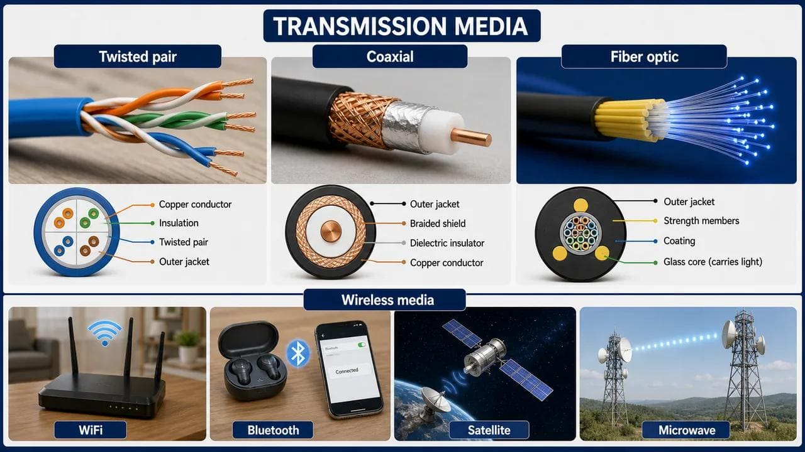

A escolha do meio de transmissão que sera usado em uma rede depende de diversos fatores:
- Distância entre os dispositivos.
- Taxa de transmissão desejada.
- Custo de instalação.
- Resistência a interferências.
- Condições ambientais.
- Necessidade de mobilidade.
- Segurança física.
- Facilidade de manutenção.

Por exemplo, em um laboratório de informática, pode ser interessante utilizar cabos Ethernet para conectar os computadores aos switches.
- A razão é que o cabeamento estruturado oferece **maior confiabilidade e desempenho** para a transmissão de dados.

Já em uma residência, o Wi-Fi pode ser mais conveniente para conectar smartphones e notebooks.
- A razão é que o Wi-Fi oferece **mobilidade e facilidade de uso**, mesmo que a taxa de transmissão possa ser menor e o meio seja mais suscetível a interferências.
- **Interferencia**: é a influência de sinais indesejados que podem degradar a qualidade da comunicação.
  - Ex: micro-ondas, telefones sem fio, outros dispositivos eletrônicos, paredes e obstáculos físicos.

## 1.2. Como os dados são transmitidos?

Os computadores trabalham internamente com informações digitais, representadas por bits (0 e 1).
- Entretanto, esses bits precisam ser **representados fisicamente** para que possam percorrer um meio de transmissão.

Dependendo da tecnologia utilizada, podem ser empregados:
- Sinais elétricos (corrente elétrica dentro de um cabo metálico).
- Pulsos luminosos (variação de intensidade da luz dentro de uma fibra óptica).
- Ondas eletromagnéticas (variação de campo elétrico e magnético no espaço - ou no meio ar).

**Transmissão por sinais elétricos**:
- Nos cabos de cobre, os dados são transmitidos por meio de sinais elétricos.
  - Podem ser representados por variações de tensão ou corrente elétrica.
  - **Ex**: 0v representa o bit 0 e 5v representa o bit 1.
- As interfaces de rede codificam as informações em sinais apropriados para o padrão Ethernet utilizado.

**Transmissão por sinais luminosos**:
- Na fibra óptica, os dados são transmitidos por meio de **pulsos de luz** que percorrem um filamento de vidro ou plástico.
- Uma mesma fibra pode **transportar múltiplos sinais de luz em diferentes comprimentos de onda**, permitindo maior capacidade de transmissão.

**Transmissão por ondas eletromagnéticas**:
- Nas redes sem fio, os dados são transmitidos utilizando **ondas eletromagnéticas**, geralmente em determinadas faixas de radiofrequência.
- As informações são codificadas em variações de amplitude, frequência ou fase das ondas.
- **Ex**: 2.4 GHz, 5 GHz, 6 GHz, etc. sao exemplos de frequência utilizadas em redes Wi-Fi.

É importante compreender que o meio físico não transporta diretamente conceitos como arquivos, imagens ou mensagens. 
- **O meio transporta sinais** que representam os dados codificados pelos equipamentos de comunicação.
- Esses sinais são interpretados pelos equipamentos (computadore, smartphones, etc) como imagens, vídeos, textos ou qualquer outro tipo de informação digital.

# 2. Cabos de par trançado

Os cabos de par trançado são amplamente utilizados em redes locais Ethernet.
- Eles são formados por **pares de fios de cobre entrelaçados** entre si.

Um cabo Ethernet convencional de quatro pares possui oito condutores, organizados em quatro pares trançados (veja a figura abaixo).

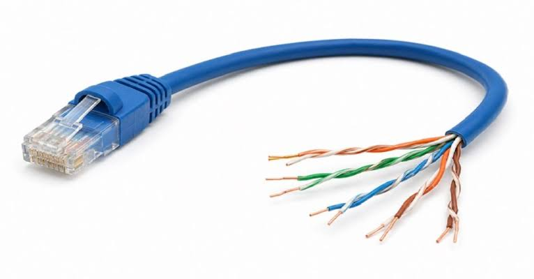

### 2.1. Por que os fios são trançados?

Quando dois fios são colocados próximos um do outro e transportam sinais elétricos, podem sofrer **interferências provenientes de campos eletromagnéticos** externos.

Assim, o **entrelaçamento dos fios tem finalidades** importantes: 
- reduzir os efeitos de interferências eletromagnéticas 
- reduzir a interferência entre os próprios pares do cabo, conhecida como **diafonia (crosstalk)**.
- Diafonia ocorre pois **cabos com corrente elétrica geram campos magnéticos que podem induzir sinais indesejados** em condutores próximos.
- Quando entrelacamos os fios, a corrente eletrica que circula em um fio é compensada pela corrente que circula no outro fio do par, reduzindo a interferência (veja figura abaixo).

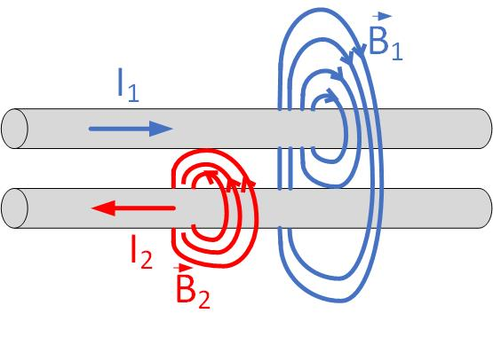

Por conta dessas questoes, **é importante preservar o trançamento dos pares o máximo possível** durante a montagem dos conectores. 
- Destrançar excessivamente os condutores pode prejudicar o desempenho elétrico do cabo.

## 2.2. Tipos de cabos de par trançado (UTP e STP)

Os cabos de par trançado podem possuir diferentes **estruturas de blindagem**:
- **UTP (Unshielded Twisted Pair)**: par trançado sem blindagem metálica.
  - Menor custo.
  - Simples de instalar.
  - Amplamente utilizado em residências, escolas e escritórios.
  - Pouca proteção contra interferências eletromagnéticas (comparado a cabos blindados).
  - Pode apresentar problemas quando instalado próximo a fontes intensas de interferência.
- **STP (Shielded Twisted Pair)**: par trançado com blindagem metálica.
  - Blindagem pode envolver individualmente os pares ou o conjunto de pares.
  - Maior proteção contra interferências eletromagnéticas.
  - Mais adequado para ambientes industriais (onde há maior presença de fontes de interferência).
  - Maior custo.
  - Instalação mais exigente (exige aterramento, conectores e componentes compatíveis).
  
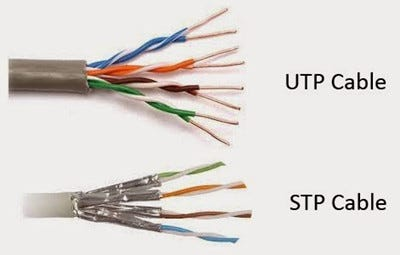

**Atenção**: a blindagem não elimina todas as interferências. 
- Mesmo blindados, cabos STP podem sofrer interferências se instalados próximos a fontes de ruído intenso, mesmo se a instalação for correta.
- Se a instalação for incorreta, ai a imunidade ao ruído pode ser consideravemente comprometida, afetando o funcionamento e até introduzindo problemas elétricos.

**Comparação entre UTP e STP**:

| Característica      | UTP                                                        | STP                                              |
| ------------------- | ---------------------------------------------------------- | ------------------------------------------------ |
| Blindagem metálica  | Não                                                        | Sim                                              |
| Custo               | Menor                                                      | Maior                                            |
| Instalação          | Menos complexa                                             | Mais complexa                                    |
| Proteção contra EMI | Depende do trançamento e da construção (qualidade do cabo) | Maior, quando corretamente projetado e instalado |
| Uso típico          | Escritórios, escolas e residências                         | Ambientes industriais e específicos              |

# 2.3. Categorias de cabos Ethernet

Os cabos de par trançado são **classificados em categorias**, que definem características de desempenho elétrico e frequência de operação, tais como:
- Largura de banda do canal.
- Diafonia (crosstalk).
- Impedância.
- Desempenho (frequências de transmissao e recepção).

**Principais categorias de cabos Ethernet**:
| Categoria | Frequência | Velocidade máxima | Distancia máxima                  |
| --------- | ---------- | ----------------- | --------------------------------- |
| Cat5e     | 100 MHz    | 1 Gbps            | 100m                              |
| Cat6      | 250 MHz    | 1 Gbps / 10 Gbps  | 37-55m (10 Gbps) ou 100m (1 Gbps) |
| Cat6A     | 500 MHz    | 10 Gigabit        | 100m                              |
| Cat7      | 600 MHz    | 10 Gbps           | 100m                              |
| Cat7A     | 1.000 MHz  | 10 Gbps           | 100m                              |
| Cat8      | 2.000 MHz  | 25 a 40 Gbps      | 30 m                              |

**A categoria do cabo não determina, sozinha, a velocidade da conexão**.
- A velocidade depende também das interfaces de rede, dos equipamentos intermediários, do comprimento do enlace e das condições da instalação.
- É o conjunto que determina o desempenho final da rede.

**Utilizar sempre o cabo de maior categoria NAO é sempre a melhor decisão**.
- A escolha deve considerar **a necessidade real** da infraestrutura (custo, desempenho, e compatibilidade entre equipamentos).
- Um laboratório com computadores que possuem **interfaces Gigabit Ethernet** provavelmente não terá benefícios relevantes ao substituir todos os cabos Cat5e por Cat8.
  - Isto porque a velocidade final continuará limitada pelas interfaces de rede (NICs) de cada computador.
- Além disso, cabos de categorias superiores podem apresentar:
  - Maior custo.
  - Maior espessura.
  - Menor flexibilidade.
  - Maior dificuldade de instalação.
  - Necessidade de componentes compatíveis (hubs, switches, roteadores, etc).

**Cada categoria de cabo possui uma distância máxima de transmissão (vide tabela acima)**, que é a distância máxima que o sinal pode percorrer sem perda significativa de qualidade.
- Exceder essa distância pode resultar em perda de pacotes, redução da taxa de transmissão e instabilidade da conexão.
- Quando a **distância é maior, se utilizam equipamentos intermediários**, tais como switches, repetidores, ou até mesmo a **substituição do meio de transmissão** (ex: fibra óptica - que tem maior alcance do que o Ethernet).

# 3. Fibra óptica

Fibra óptica é um **meio de transmissão que utiliza luz** para transportar informações.
- Diferentemente dos cabos de cobre, que transmitem sinais elétricos, a fibra utiliza pulsos luminosos que percorrem filamentos de vidro ou plástico (que chamamos de **cabos de fibra óptica**).

Uma fibra óptica convencional é composta por:
1. **Núcleo (Core)**: região central por onde a luz se propaga.
2. **Casca (Cladding)**: camada que possui índice de refração adequado para confinar a luz no núcleo.
3. **Capa protetora / Revestimento primário (Coating)**: camada protetora do vidro.
4. **Elementos de proteção**: estruturas adicionais que protegem a fibra contra esforços mecânicos e condições ambientais (ex: revestimentos, armaduras, kevlar, pvc, aço, etc.).

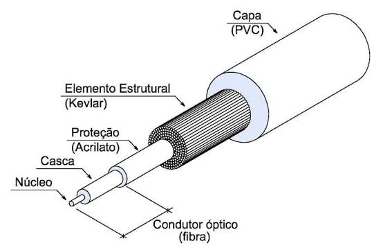

**Detalhe**: uma fibra óptica é extremamente fina, com diâmetro do núcleo da ordem de **micrômetros (µm)**.
- É do tamanho aproximado de um **fio de cabelo humano**, ou até menor.
- O resto do diâmetro da fibra é ocupado pela casca, revestimento e elementos de proteção.

A propagação da luz ocorre devido às propriedades ópticas do núcleo e da casca, permitindo que a **energia luminosa permaneça guiada ao longo da fibra**.
- Isto é, a luz nao escapa do núcleo, mesmo quando a fibra é dobrada dentro de limites aceitáveis (veja imagem abaixo).
- Por isso que a fibra óptica é tão eficiente em transmitir dados em longas distâncias, em altíssimas velocidades.

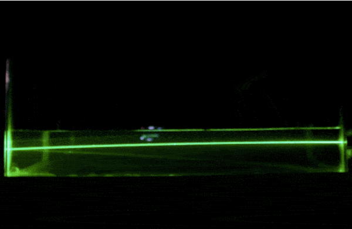

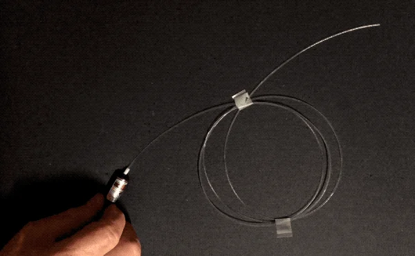

Para interligar equipamentos, a fibra óptica utiliza **conectores e transceptores ópticos (ONUs)** que realizam a conversão entre sinais elétricos e sinais luminosos.

**Exemplo de Conectores ópticos**:
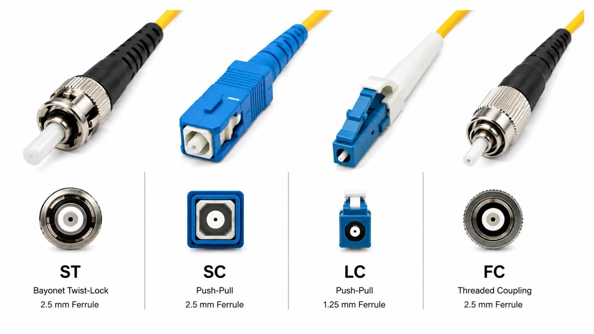

**Exemplo de ONU (Optical Network Unit)**:
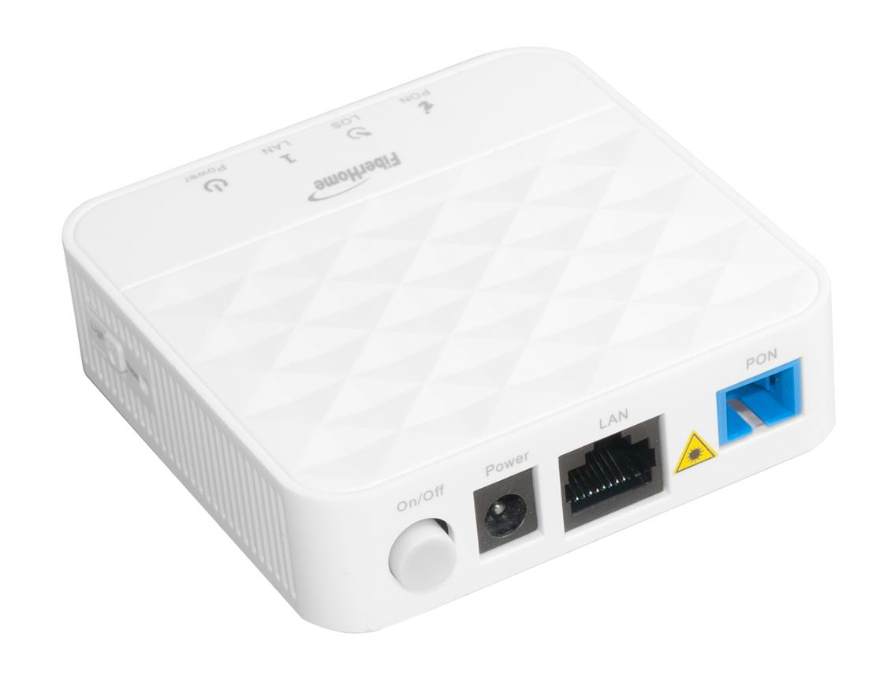

## 3.1. Como funciona a transmissão?

Imagine que um computador precise transmitir dados por meio de uma fibra óptica.

O processo simplificado é:
1. O equipamento codifica os dados (sequencia de bits).
2. Um transmissor óptico converte os sinais elétricos em sinais luminosos (usando LEDs ou lasers).
3. A luz percorre a fibra.
4. Um receptor óptico detecta os sinais luminosos.
5. O equipamento converte novamente esses sinais em informações digitais.

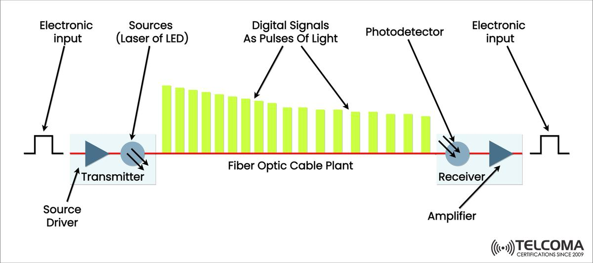

**Vantagens (fibra óptica x fios de cobre)**:
- Elevada capacidade de transmissão (até 100 Gbps).
- Possibilidade de comunicação em grandes distâncias (até alguns km).
- Imunidade a interferências eletromagnéticas (luz nao é afetada por campos eletromagnéticos, como cabos sao).
- Isolamento elétrico entre os equipamentos conectados (não há risco de curto-circuito, ou choque elétrico).
- Menor atenuação em muitas aplicações de longa distância (luz perde pouca potencia durante a transmissão, comparada a sinais eletricos em fios de cobre).
- Menor suscetibilidade a interferências elétricas externas (luz não é afetada por variações de tensão ou corrente, como os sinais elétricos em fios de cobre).

**Desvantagens (fibra óptica x fios de cobre)**
- Alto custo dos equipamentos ópticos.
- Maior complexidade para manutenção e instalacao (conectores, ferramentas e treinamento especializado).
- Fragilidade relativa do filamento de vidro (pode quebrar facilmente, nao dobra tao bem quanto os fios de cobre - limite de angulo de flexão).
- Dificuldade de diagnóstico sem instrumentos apropriados (multímetros, testadores de fibra, etc).

# 4. Comunicação sem fio

As redes sem fio utilizam **ondas eletromagnéticas** para transportar informações.
- Em vez de utilizar um cabo entre os dispositivos, a comunicação acontece através do espaço (ar, vácuo, etc).
- A transmissão utiliza **antenas** para emitir e receber sinais eletromagnéticos (ondas).

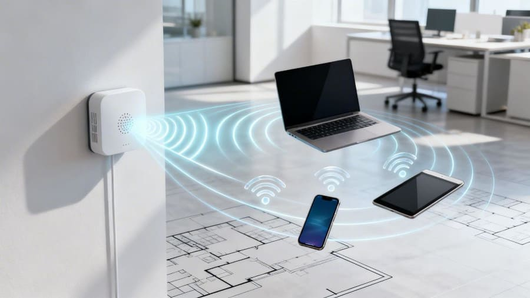

As ondas eletromagneticas, que transportam informações, trafegam pelo espaço através de **campos elétricos e magnéticos variáveis**.
- Horas o campo elétrico ($E$) é mais intenso, 
- Horas é o campo magnético ($B$) aquele que está mais intenso.
- Veja animacao abaixo:

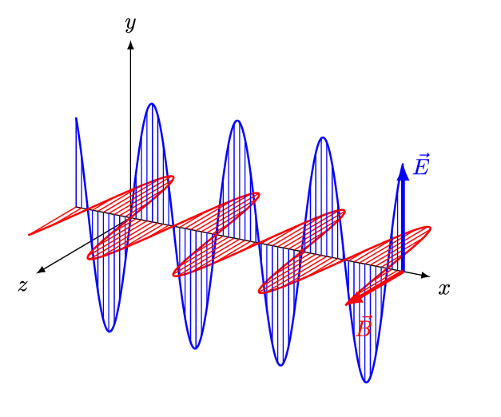

Entre as tecnologias mais conhecidas estão:
- Wi-Fi.
- Bluetooth.
- Redes celulares (4G, 5G, 6G, etc).
- Comunicação via satélite.
- NFC (pagamento por aproximacao no celular/cartao).
- RFID (identificação por radiofrequência, rastreamento de produtos, etc).

## 4.1. Frequência e comprimento de onda

As ondas eletromagnéticas podem ser caracterizadas pela **frequência** e pelo **comprimento de onda**.
- **Frequência**: indica quantas **oscilações** ocorrem por segundo e é medida em **Hertz (Hz)**.
- **Comprimento de onda**: representa a distância entre vales ou cristas de um ciclo da onda.

Voces verao esses conceitos com mais detalhes nas disciplinas de física, mas é importante compreender que **quanto maior a frequência ($f$), menor o comprimento de onda ($\lambda$)**:

$$
\lambda = \frac{c}{f} 
$$

Onde:

- $\lambda$ é o comprimento de onda (em **metros**).
- $c$ é a velocidade de propagação da onda (em **m/s**).
- $f$ é a frequência (em **Hz**).

## 4.2. Bandas de frequência e Canais 

As redes Wi-Fi modernas podem **operar em diferentes faixas de frequência**:

| Banda   | Características gerais                                                       |
| ------- | ---------------------------------------------------------------------------- |
| 2,4 GHz | Maior alcance em muitos ambientes, mas maior congestionamento                |
| 5 GHz   | Maior quantidade de canais (veja definicao abaixo) e capacidade (velocidade) |
| 6 GHz   | Mais canais que 2,4 GHz e 5 GHz, e maior capacidade (velocidade)             |

**Canais**: Cada faixa de frequência é dividida em canais, que são faixas específicas de frequência utilizadas para a transmissão de dados.
- Uma **mesma banda pode ter múltiplos canais**, 
- Isso permite que **diferentes redes Wi-Fi operem simultaneamente** sem interferir umas nas outras.
- Isto é, sem causar perda de pacotes, corrupcao, ou interferencia entre elas.
- **Analogia**: Imagine uma estrada com várias faixas. 
  - Cada faixa representa um canal, e os carros representam os sinais de dados. 
  - Se muitas redes Wi-Fi estiverem usando o mesmo canal (faixa), é como se todos os carros estivessem tentando usar a mesma faixa da estrada ao mesmo tempo, causando congestionamento e atrasos.

**Exemplo de canais Wi-Fi na faixa de 2,4 GHz**:

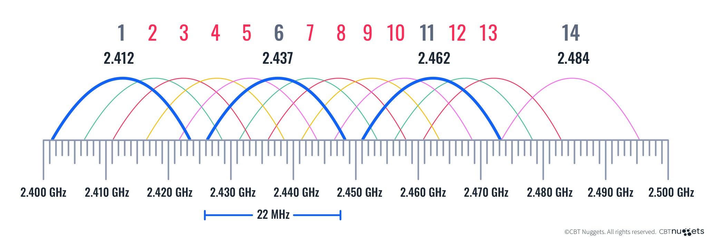

- Note que no exemplo acima, os canais 1, 6 e 11 são **não sobrepostos**.
  - *"um nao passa para o lado do outro"*
  - Logo, eles nao interferem entre si.
  - Os demais canais (2, 3, 4, 5, 7, 8, 9, 10) **sobrepõem-se** com os canais vizinhos (*"um passa por cima do outro"*).
- Observe também que cada canal tem uma **largura de banda** de **22 MHz**.
  - **Largura de banda**: representa o tamanho do canal (em frequência).
  - Ou seja, é quanto da frequencia disponível um canal ocupa para transmitir dados.
  - Veja que nesse exemplo uma rede 2,4 GHz pode usar ondas eletromagnéticas de 2,400 GHz até 2,500 GHz. 
  - Mas note que **cada canal ocupa apenas 22 MHz** dessa faixa.

**IMPORTANTE**: Quanto mais largo o canal (mais MHz), maior a capacidade de transmissão (maior velocidade), mas também maior a chance de interferência com outros canais próximos.
- **Exemplo**: 
  - Um canal de 40 MHz na faixa de 2,4 GHz pode interferir com vários canais próximos.
  - Enquanto um canal de 20 MHz tem menos chance de causar interferências.

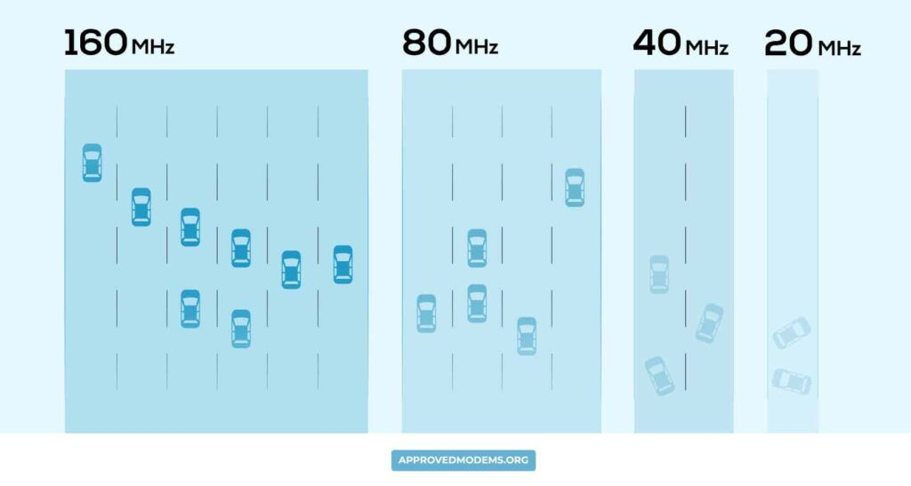

**Experimento**: Faça o seguinte teste, abra um aplicativo de scanner de Wi-Fi no seu celular (por exemplo, o "WiFi Analyzer" ou outro similar) 
- Observe as redes Wi-Fi disponíveis.
- Há muitas redes na faixa de 2,4 GHz?
- Quais canais estão sendo utilizados?
- Tem canais se sobrepondo com outros?
- E no 5 GHz, quais canais estão sendo utilizados? (veja se seu celular suporta 5 GHz, caso contrario, ele nao vai mostrar redes nessa faixa).
- Voce deve ver algo similar a imagem de exemplo abaixo:

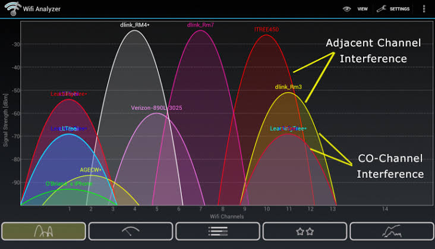

### 4.2.1. Banda de 2,4 GHz

É uma faixa bastante utilizada em equipamentos Wi-Fi e Bluetooth, que oferece:
- Boa propagação em muitos ambientes.
- Maior compatibilidade com dispositivos antigos.
- Melhor cobertura (sofre menos atenuação ao atravessar obstáculos).

Essa faixa de frequencia é a usada por tecnologias mais antigas, como o **Wi-Fi 4 (802.11n)** e **Wi-Fi 5 (802.11ac)**.
- Contudo, ainda é amplamente utilizada em redes domésticas e comerciais (principalmente para redes de internet das coisas - IoT).

**Desvantagens do 2,4 GHz**:

- Maior quantidade de equipamentos concorrendo pela faixa de frequencia (2,4 GHz).
  - Isso pode gerar **congestionamento e interferência** (muitos dispositivos querendo se comunicar ao mesmo tempo)
  - **Analogia**: sala de aula cheia, com muitos alunos falando ao mesmo tempo, ninguem se escuta (chega ruido e ninguem se entende),
  - **Ruido = Pacotes corrompidos** consequencia de interferencias no meio (ar, espaco, etc)
  - **Consequencia**: é preciso enviar a informacao que se perdeu de novo (**retransmissao**) ou esperar o meio ficar livre (**contencao**), o que gera:
    - Aumento da latencia (demora para receber a resposta)
    - Redução da taxa de transmissão (menos bits transmitidos por segundo)
- Menor disponibilidade de canais não sobrepostos (isto é, canais que não interferem entre si).
- Maior possibilidade de interferência.
- **Interferencia faz com que o desempenho da rede seja prejudicado**, mesmo que a taxa de transmissão seja relativamente alta.
  - **Cada vez que um pacote é corrompido (ou perdido), ele precisa ser retransmitido**, o que reduz a eficiência da comunicação.
  - Mesmo se o pacote nao for corrompido ou perdido, cada dispositivo de rede precisa esperar sua vez de transmitir (a rede tem **alta contenção**)
  - **A contencao aumenta a latencia e reduz a taxa de transmissão** efetiva.

### 4.2.2. Banda de 5 GHz

Surgiu para resolver alguns problemas da banda de 2,4 GHz:
- Melhor capacidade (maior taxa de transmissão)
- Menor interferência (menos dispositivos utilizando essa faixa = menos congestionamento e contencao)
- Maior quantidade de canais disponíveis (mais opções de canais não sobrepostos = menos interferência entre redes Wi-Fi próximas)
- Alcance limitado (sinais de 5 GHz sofrem mais atenuação ao atravessar obstáculos, como paredes e móveis, comparado a 2,4 GHz).
  - O que pode ser algo positivo em ambientes com muitas redes Wi-Fi próximas, pois reduz a interferência entre elas.
  - *"Se minha rede Wi-Fi 5 GHz nao atinge o vizinho (pois nao consegue atravessar os obstáculos, como paredes e móveis), ela nao interfere na rede do vizinho, e vice-versa (a rede dele nao me afeta)."*
  - Por outro lado, a cobertura da rede Wi-Fi 5 GHz é menor. 
  - Logo, para cobrir uma casa grande, por exemplo, será preciso usar **vários pontos de acesso (APs)** para cobrir a mesma área que uma rede Wi-Fi 2,4 GHz consegue cobrir.

### 4.2.3. Banda de 6 GHz

A banda de 6 GHz amplia o espectro disponível (*"a quantidade de frequências disponíveis"*) para Wi-Fi, sendo utilizada por tecnologias mais modernas como **Wi-Fi 6 (802.11ax)** e **Wi-Fi 7 (802.11be)**.

**Vantagens**:

- Maior disponibilidade de espectro.
- Menor interferência de dispositivos Wi-Fi antigos que não operam nessa faixa.
- Possibilidade de canais largos (até 160 MHz).

**Desvantagens**:

- Exige equipamentos compatíveis.
- Pode apresentar limitações de alcance em determinadas condições.
- A disponibilidade e os canais permitidos dependem da regulamentação de cada país.

## 4.3. Interferência em redes sem fio

A **comunicação sem fio pode sofrer interferências** provenientes de diferentes fontes.

**Exemplos**:
- Outros roteadores Wi-Fi.
- Dispositivos Bluetooth.
- Fornos de micro-ondas.
- Equipamentos industriais.
- Obstáculos físicos.
- Estruturas metálicas.

Esses fatores podem provocar:
- Redução da taxa de transmissão.
- Aumento de retransmissões.
- Maior latência.
- Perda de pacotes.
- Instabilidade da conexão.

## 4.4. Segurança em redes sem fio

Como o sinal Wi-Fi se propaga pelo ambiente (ar, paredes, mobília, etc), **dispositivos próximos podem tentar se conectar à rede**. 
- Isto inclui **pessoas não autorizadas** (vizinhos, pessoas na rua, empresas vizinhas, etc), que podem tentar acessar a rede para roubar informações, invadir dispositivos ou utilizar a conexão de internet sem permissão.

A segurança da rede sem fio ajuda a impedir acessos não autorizados e a proteger os dados transmitidos.
- Para isso, é importante utilizar **protocolos de segurança adequados**.
- **Protocolo**: é o conjunto de regras que define como a comunicação deve ocorrer entre os dispositivos.

**Protocolos de segurança**:
- **WPA3** é a opção mais moderna e segura, recomendada quando todos os equipamentos são compatíveis.
- **WPA2** continua sendo uma opção adequada quando WPA3 não está disponível.
- **WEP** e **WPA** são obsoletos e inseguros; **não devem ser utilizados**.

Em redes domésticas, o modo **Personal** usa uma senha compartilhada (**PSK**), que todos os usuários da rede devem conhecer para ter acesso. 
- **Vantagem**: é simples de configurar e não requer servidores (computadores ligados 24h por dia).
- **Desvantagem**: todos os usuários compartilham a mesma senha, o que dificulta o gerenciamento de acessos individuais.
  - Nao sabemos quem tem acesso, quem fez o que dentro da rede, ou se algum usuário está usando a rede de forma não autorizada (senha foi compartilhada com pessoas que não deveriam ter acesso).

Em redes de empresas e instituições, se usa o modo **Enterprise**, que pode autenticar cada usuário individualmente (com Usuario e Senha ou certificados digitais).
- Isso facilita o gerenciamento de acessos, permitindo que cada usuário tenha credenciais próprias e que o administrador da rede possa controlar quem tem permissão para se conectar.
- **Ex**: uma empresa pode revogar o acesso de um funcionário que saiu da empresa, sem precisar alterar a senha de todos os outros usuários.
- **Desvantagem**: requer um servidor de autenticação (ex: RADIUS) e configuração mais complexa.

**Boas práticas**
- Definir uma senha longa e exclusiva para o Wi-Fi e alterar a senha administrativa padrão do roteador.
  - Senha do roteador é aquela que usamos para acessar a interface de configuração do roteador (ex: `admin` / `admin` ou `admin` / `12345`).
- Manter o firmware do roteador atualizado.
  - **Firware**: é o software interno do roteador que controla seu funcionamento.
  - Atualizações podem corrigir falhas de segurança e melhorar o desempenho.
- Desativar o **WPS** se não for necessário.
  - **WPS (Wi-Fi Protected Setup)** é um recurso que permite conectar dispositivos à rede Wi-Fi de forma simplificada (sem senha), usando um código de acesso ou pressionando um botão.
  - **WPS é considerado inseguro**, pois pode ser explorado por invasores para obter acesso à rede.
- Criar uma **rede de visitantes separada da rede principal**, quando o roteador oferecer esse recurso.
  - Computadores e dispositivos conectados à rede de visitantes não terão acesso aos recursos da rede principal, aumentando a segurança.
- Em redes públicas, evitar operações sensíveis (acessar aplicativos de banco, por exemplo) e verificar se os sites utilizam HTTPS (protocolo que protege os dados que sao enviados pela rede).
- Usar **VPN (Virtual Private Network)** para proteger a comunicação em redes públicas.
  - **VPN cria um "túnel" criptografado** entre o dispositivo e um servidor remoto, protegendo os dados transmitidos de interceptações.
  - **Analogia**: é como enviar uma carta dentro de um envelope lacrado, em vez de enviar a carta aberta.

# 5. Conectores e padrões de cabeamento

## 5.1. Conector RJ-45

O conector popularmente chamado de **RJ-45** é amplamente **utilizado em cabos Ethernet** de par trançado.
- Ele possui **oito contatos metálicos** que fazem contato com os oito fios do cabo Ethernet.
- Os fios precisam ser organizados em uma ordem específica e inseridos até a posição adequada, para o conector funcionar corretamente.
- Isso é feito utilizando ferramentas apropriadas, como **alicates de crimpagem** (veremos o procedimento mais adiante).  

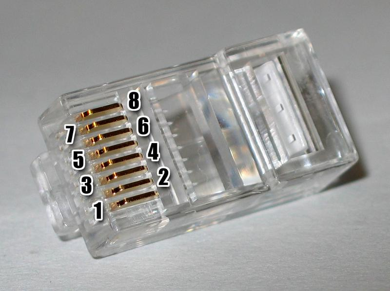

- **Como funciona**:
    - Organizamos os fios na ordem correta, um pra cada contato do conector.
    - Em seguida, colocamos o conector no alicate de crimpagem e pressionamos a alavanca.
    - Os contatos metálicos perfuram ou comprimem o isolamento dos condutores, estabelecendo a conexão elétrica.

## 5.2. Padrões T568A e T568B

Os padrões T568A e T568B definem a ordem dos condutores no conector Ethernet.
- Podemos utilizar qualquer um dos dois padrões, desde que **seja o mesmo em ambas as extremidades do cabo** (para cabos diretos - tambem chamados de cabos **Straight-Through**) ou **um padrão em cada extremidade** (para cabos cruzados - chamados de cabos **Crossover**).

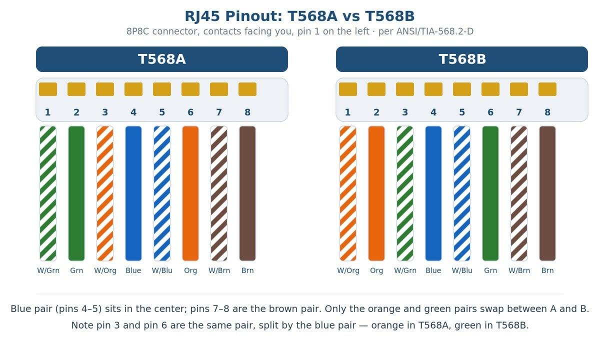

A ordem dos fios é:

| Pino | T568A          | T568B          |
| ---- | -------------- | -------------- |
| 1    | Branco/Verde   | Branco/Laranja |
| 2    | Verde          | Laranja        |
| 3    | Branco/Laranja | Branco/Verde   |
| 4    | Azul           | Azul           |
| 5    | Branco/Azul    | Branco/Azul    |
| 6    | Laranja        | Verde          |
| 7    | Branco/Marrom  | Branco/Marrom  |
| 8    | Marrom         | Marrom         |

É fundamental observar que a numeração dos pinos depende da posicao (orientação) do conector e da face dos contatos (veja imagem abaixo).

Uma inversão na orientação visual pode provocar erros na montagem (veremos mais adiante como testar o cabo).

## 5.3. Cabo direto (Straight-through)

Um cabo direto **utiliza o mesmo padrão de pinagem nas duas extremidades**.

**Exemplos**:

- **T568A - T568A** (em ambas as extremidades usamos T568A).
- **T568B - T568B** (em ambas as extremidades usamos T568B).

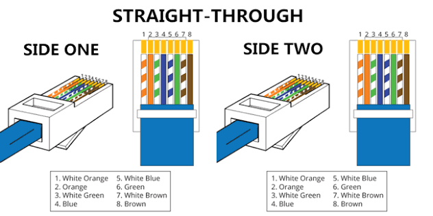

Historicamente, **cabos diretos eram utilizados para conectar dispositivos de tipos diferentes**, como:
- Computador e switch.
- Roteador e switch.
- Computador e roteador.

**ATENCAO**: Switch e hub são dispositivos de mesma categoria funcional (*"fazem a mesma coisa"*), portanto, **não se conectam diretamente com cabos diretos**.

## 5.4. Cabo cruzado (Crossover)

Um **cabo cruzado utiliza padrões diferentes** nas extremidades:
- **T568A** em uma ponta.
- **T568B** na outra.

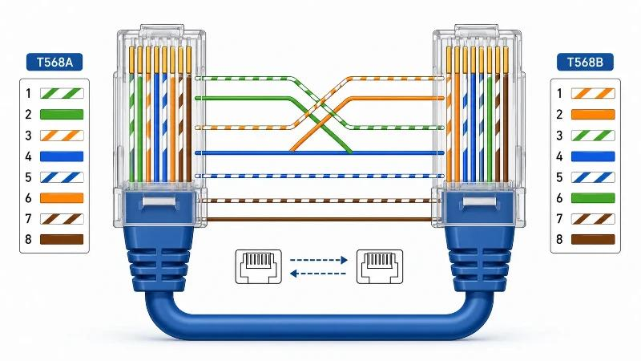

Historicamente, **era utilizado para conectar dispositivos de mesma categoria funcional**, como:
- Computador a computador.
- Switch a switch.
- Hub a hub.
- **Switch e hub.**
- Roteador a roteador.

### 5.5. Qual cabo é usado em redes modernas?

Muitos equipamentos atuais possuem suporte a **Auto MDI-X**.
- Essa funcionalidade permite **identificar automaticamente a configuração necessária para a comunicação**, 
- **Dispensa a utilização de cabos cruzados** em muitos cenários.
- Logo, atualmente, é comum **utilizar cabos diretos em praticamente todas as conexões Ethernet convencionais**, DESDE QUE os equipamentos ofereçam essa funcionalidade.

**Atenção**: o **cabo cruzado não é uma categoria de cabo**. É uma configuração de pinagem (T568A em uma ponta, e T568B na outra ponta).

ANDRE: PAREI AQUI

# 6. Montagem e certificação de cabos

## 6.1. Ferramentas necessárias

Para montar cabos Ethernet de par trançado, são necessárias algumas ferramentas e materiais.

Principais materiais:

- Cabo de par trançado.
- Conectores RJ45 adequados ao tipo de cabo.
- Alicate de crimpagem.
- Decapador de cabos.
- Testador de cabos.
- Tesoura ou alicate de corte.

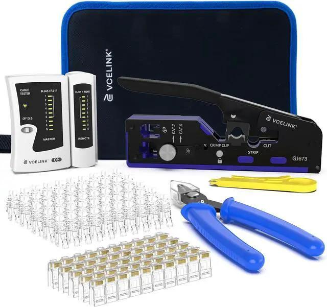

Em lojas online, é possível encontrar kits com a maioria dessas ferramentas para a montagem de cabos Ethernet.

## 6.2. Processo de montagem

A montagem de um cabo Ethernet envolve algumas etapas.

### Etapa 1 — Preparação

**Procedimento no decapador de fios**:
1. Posicione o cabo no decapador, ajustando a profundidade de corte.
2. Posicione o fio no local correto (veja o tamanho que deve ser removido da capa externa, para fazer a crimpagem do conector).
3. Gire o decapador ao redor do cabo para cortar a capa externa.
4. Puxe a capa externa para remover o isolamento, expondo os pares de fios internos.

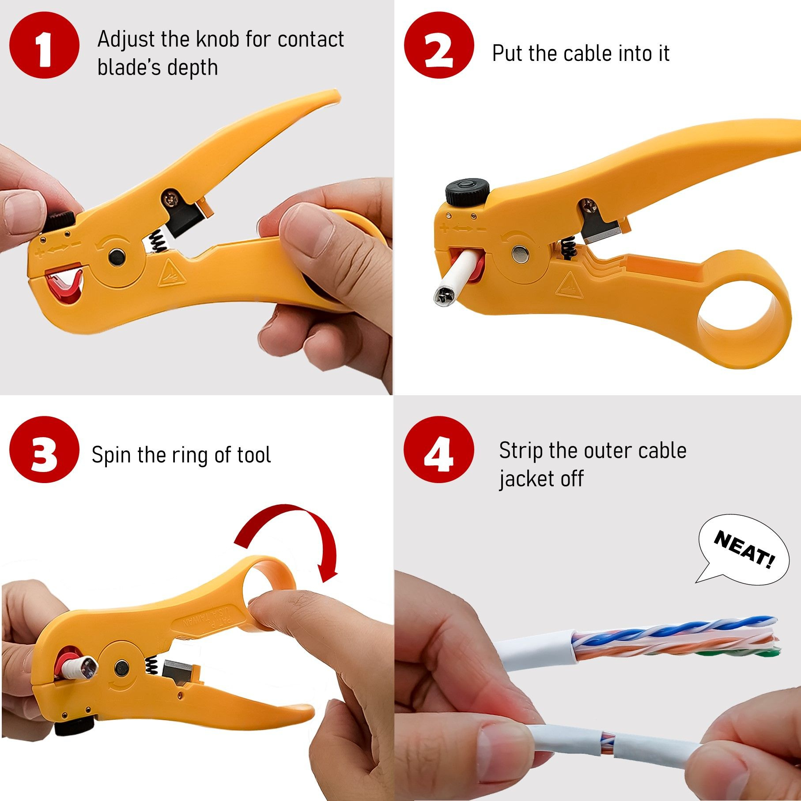

É possivel fazer isso com um estilete ou faca, mas é **recomendável utilizar um decapador de cabos**, que permite remover a capa sem danificar os fios internos.
- Estilete e faca podem ferir/cortar os fios internos, ou expor fios de maneira irregular (podem causar curto-circuitos), prejudicando a crimpagem e o desempenho do cabo.

### Etapa 2 — Organização dos pares

Separe os 4 pares e organize os fios de acordo com o padrão escolhido: **T568A** ou **T568B**.

### Etapa 3 — Alinhamento

Alinhe os 8 fios e corte suas extremidades para que tenham comprimentos semelhantes.

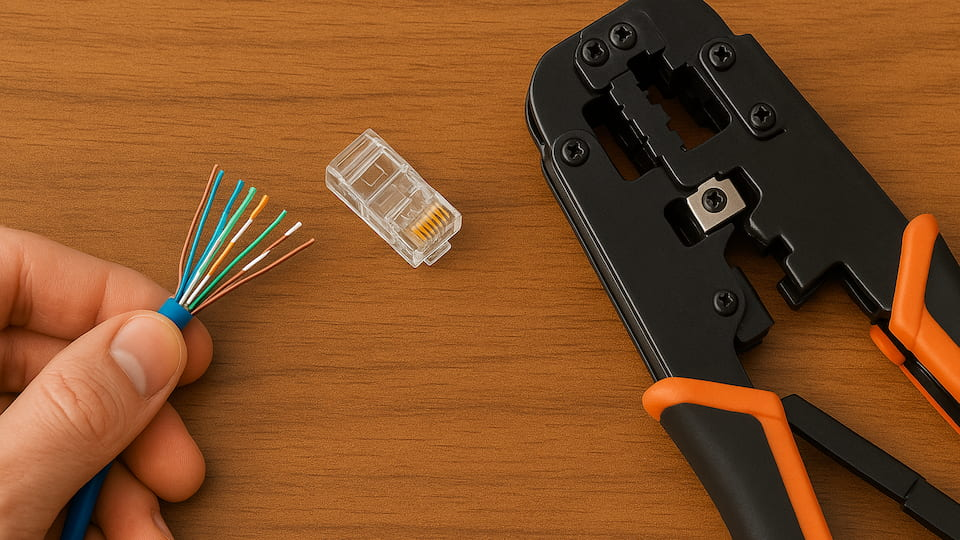

### Etapa 4 — Inserção no conector

Introduza os condutores no conector, verificando:
- Ordem correta.
- Inserção completa.
- Posicionamento correto da capa externa.
  - Capa externa do cabo devem entrar no conector, para que o isolamento seja fixado e o cabo não se solte facilmente.

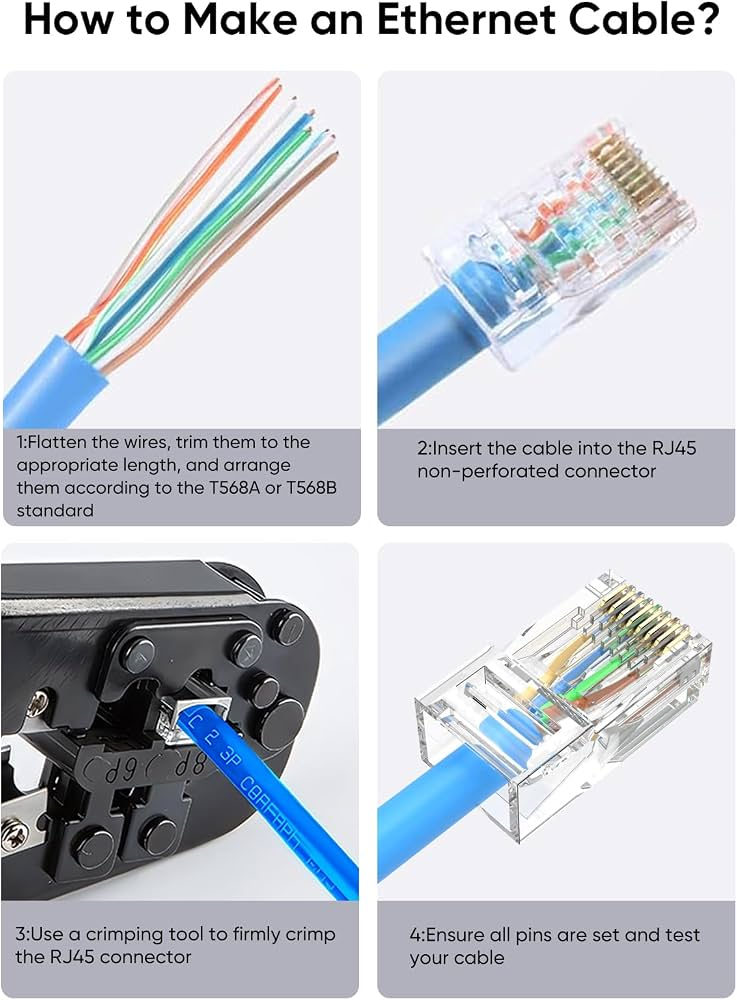

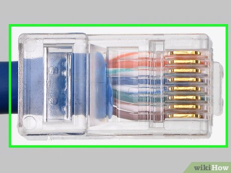

### Etapa 5 — Crimpagem

Utilize o alicate de crimpagem para fixar os contatos metálicos nos condutores.

**IMPORTANTE**: Cabos Ethernet usam conectores **RJ45**, que tambem sao chamados de **8P8C (*8 Position 8 Contact*)**, pois possuem 8 posições e 8 contatos metálicos.
- O alicate de crimpagem deve ser adequado para esse tipo de conector.

Cabos telefonicos usam conector RJ11, tambem chamado de **6P6C** (6 Position 6 Contact).
- Um mesmo alicate de crimpagem tipicamente pode clipar conectores RJ11 e RJ45.
- Se atente para o tamanho do conector, pois o **RJ11 é menor** que o RJ45.

### Etapa 6 — Teste

Utilize um testador para verificar a continuidade dos fios e se o padrao de crimpagem está correto (**Straight-Through** ou **Crossover**)
  - O testador deve indicar que todos os oito condutores estão conectados corretamente.
  - Deve acender uma luz ou indicar no display que todos os fios estão OK (veja animacao abaixo).
  - A ordem que os fios acendem no testador deve corresponder à ordem do padrão escolhido (**Straight-Through** ou **Crossover**).
    - **Relembrando**:
      - **Cabo direto (Straight-Through)**: mesmo padrão em ambas as extremidades.
      - **Cabo cruzado (Crossover)**: padrão T568A em uma ponta e T568B na outra ponta.

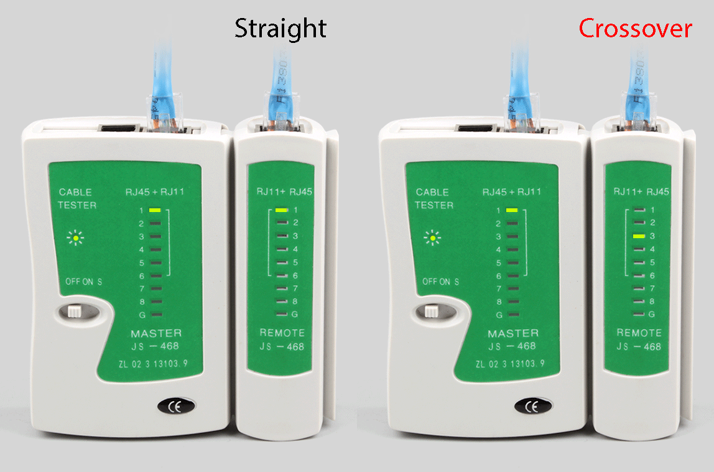

## 6.3. Erros comuns na montagem

Durante a montagem, existem alguns problemas recorrentes como:
- Ordem incorreta dos fios.
- Condutores mal inseridos.
- Crimpagem inadequada.
- Excesso de destrançamento.
- Utilização de conectores incompatíveis (RJ11 em vez de RJ45, por exemplo).
- Danos aos condutores durante a decapagem.
- Comprimento acima do especificado (100 metros para cabos UTP - veja tabela da categoria de cabos Ethernet na secao [2.3. Categoria de Cabos Ethernet](#23-categorias-de-cabos-ethernet)).
- Instalação próxima a fontes intensas de interferência (fontes de radiação eletromagnética, fontes de eletricidade, etc).
- Mistura inadequada de componentes blindados e não blindados (cabos blindados em equipamentos que nao tem suporte a eles).

# 7. Exercícios de fixação e avaliação

Procure resolver as questões sem consultar o material. Elas foram organizadas para avaliar tanto a memorização dos conceitos quanto a capacidade de aplicá-los em situações reais.

## Parte A — Meios de transmissão

1. O que são meios de transmissão? Diferencie meios guiados e não guiados.
2. Quais são as principais diferenças entre transmissão por sinais elétricos, luminosos e ondas eletromagnéticas?
3. Explique como funciona um cabo de par trançado e qual é a finalidade do trançamento dos condutores.
4. O que é diafonia (crosstalk)? Por que ela pode prejudicar o desempenho de uma rede?
5. Diferencie cabos UTP e STP. Em quais situações cada um pode ser utilizado?
6. O que é interferência eletromagnética (EMI)? Como ela pode afetar uma rede Ethernet?

## Parte B — Categorias de cabos

7. O que representam as categorias Cat5e, Cat6 e Cat6A?
8. Um cabo Cat6 suporta necessariamente 10 Gigabit Ethernet em 100 metros? Justifique.
9. Por que a categoria do cabo não determina isoladamente a velocidade da conexão?
10. Uma instalação possui cabos Cat7, e todos os computadores e switches possuem interfaces Gigabit Ethernet. Qual será a velocidade máxima nominal possível nesse cenário?
11. Qual é o comprimento máximo convencional de um canal Ethernet sobre par trançado em cabeamento estruturado? Como esse comprimento costuma ser dividido?

## Parte C — Fibra óptica e comunicação sem fio

12. Explique o funcionamento da transmissão de dados por fibra óptica.
13. Quais são os principais componentes de uma fibra óptica?
14. Quando usar fibra óptica em vez de cabos de par trançado?
15. Explique as diferenças entre as bandas Wi-Fi de 2,4 GHz, 5 GHz e 6 GHz.
16. O que é interferência em redes sem fio? Cite três possíveis fontes.
17. O que é canal em redes Wi-Fi? Por que é importante escolher canais não sobrepostos?
18. Quais os canais não sobrepostos na faixa de 2,4 GHz? 
19. Quais sao as vantagens e desvantagens de utilizar a banda de 2,4 GHz em redes Wi-Fi?
20. Quais sao as vantagens e desvantagens de utilizar a banda de 5 GHz em redes Wi-Fi?

## Parte D — Conectores e montagem

21. Explique as diferenças entre os padrões T568A e T568B.
22. Qual é a diferença entre um cabo direto e um cabo cruzado? O cabo é diferente ou é o mesmo cabo? O que muda?
23. Qual é a finalidade da funcionalidade **Auto MDI-X**?
24. Explique as etapas e ferramentas necessárias para realizar a crimpagem de um cabo de rede.

# 8. Situações-problema

As situações abaixo simulam problemas que podem ocorrer durante a instalação e manutenção de redes.

## 8.1. Falha de comunicação

Um computador está conectado a um switch por meio de um cabo Cat6. Entretanto, a interface estabelece conexão apenas a 100 Mbps, embora tanto o computador quanto o switch suportem 1 Gbps.

Apresente pelo menos 3 possíveis causas e explique como investigaria o problema.

## 8.2. Interferência eletromagnética

Uma empresa instalou cabos UTP próximos a equipamentos industriais que produzem fortes interferências eletromagnéticas.

Os usuários começaram a perceber instabilidade na rede.

Que medidas poderiam ser adotadas para resolver o problema?

## 8.3. Interligação entre edifícios

Uma instituição precisa conectar 2 edifícios separados por 300 metros.

Quais meios de transmissão poderiam ser utilizados? Qual deles seria mais indicado em uma infraestrutura corporativa convencional? Justifique.

# 9. Atividades práticas complementares

As atividades seguintes foram elaboradas para que você desenvolva habilidades de instalação, identificação, configuração e diagnóstico de equipamentos de rede.

## Atividade 1 — Simulação de hubs e switches no Packet Tracer

Utilize o Cisco Packet Tracer.

Crie uma rede contendo:

- 2 computadores.
- 1 hub.
- 1 switch.

Realize os seguintes experimentos:
- **Experimento A**: conecte os 2 computadores um ao outro.
  - Utilize cabos diretos (Straight-Through) para todas as conexões.
  - Teste a comunicação entre eles.
- **Experimento B**: conecte os um computador ao switch, o switch ao hub, e o hub ao outro computador.
  - Utilize Switch-PT e Hub-PT.
  - Utilize cabos diretos (Straight-Through) para todas as conexões.
  - Teste a comunicação entre eles.
- **Experimento C**: refaça o experimento B, mas substitua o hub-PT por outro switch-PT.
  - Utilize cabos diretos (Straight-Through) para todas as conexões.
  - Teste a comunicação entre eles.
- **Experimento D**: refaça o experimento B, mas substitua o switch-PT e o hub-PT por switches gerenciáveis comerciais **2960**.
  - Utilize cabos diretos (Straight-Through) para todas as conexões.
  - Teste a comunicação entre eles.

**Responda**:

1. Qual é a diferença de comportamento entre os experimentos A, B, C e D?
2. O que acontece quando um computador envia dados para outro computador em cada experimento?
3. A comunicação é bem-sucedida em todos os experimentos? Se não, explique o motivo.
4. Corrija os problemas de comunicação, se houver, e explique como você fez isso.

## Atividade 2 — Análise de redes Wi-Fi usando aplicativos móveis

1. Baixe e instale um aplicativo de análise de redes Wi-Fi no seu celular (por exemplo, "WiFi Analyzer" ou outro similar).
2. Abra o aplicativo e observe as redes Wi-Fi disponíveis.
3. Anote as seguintes informações para cada rede:
   - Nome da rede (SSID).
   - Banda de frequência (2,4 GHz ou 5 GHz).
   - Canal utilizado.
   - Intensidade do sinal recebido (RSSI).
   - Se ha ou nao sobreposição de canais com outras redes (e quais sao as redes afetadas).
4. Analise os resultados e responda:
   - Qual banda de frequência (2,4 GHz ou 5 GHz) apresenta maior intensidade de sinal na sua localização?
   - Quais redes estão utilizando canais sobrepostos?
   - Existe algum canal livre (sem sobreposição) na sua localização? Se sim, qual é?
   - Qual é a rede com melhor qualidade de sinal (maior intensidade - menor interferência, com menos sobreposições de canal)?
   - Se voce fosse configurar as redes que voce esta observando, quais canais voce escolheria para minimizar a interferência e melhorar a qualidade do sinal de todas elas?
     - Existe uma configuração ideal de canais que minimize a interferência entre todas as redes observadas? Se sim, qual é?
     - Se não, explique o motivo.
     - Se nao houver uma configuração ideal, explique como voce poderia melhorar a qualidade do sinal das redes observadas (ex: ajuste na banda de frequencia, posicao do roteador, potencia do sinal de cada access point, etc).
