# Serviços de rede e Protocolos Importantes

**Sumário**:
- [Serviços de rede e Protocolos Importantes](#serviços-de-rede-e-protocolos-importantes)
- [1. Serviços de rede](#1-serviços-de-rede)
  - [1.1. Arquitetura cliente-servidor](#11-arquitetura-cliente-servidor)
  - [1.2. Portas e serviços](#12-portas-e-serviços)
  - [1.3. O que é um servidor?](#13-o-que-é-um-servidor)
- [2. Protocolo DHCP (Dynamic Host Configuration Protocol)](#2-protocolo-dhcp-dynamic-host-configuration-protocol)
  - [2.1. Como funciona o DHCP?](#21-como-funciona-o-dhcp)
  - [2.2. Lease time (tempo de concessão do endereço)](#22-lease-time-tempo-de-concessão-do-endereço)
  - [2.3. Escopo DHCP](#23-escopo-dhcp)
  - [2.4. Configurando DHCP no Cisco Packet Tracer](#24-configurando-dhcp-no-cisco-packet-tracer)
- [3. DNS (Domain Name System)](#3-dns-domain-name-system)
  - [3.1. Testando a resolução DNS (no Windows)](#31-testando-a-resolução-dns-no-windows)
  - [3.2. Verificando a configuração de DNS do sistema operacional (no Windows)](#32-verificando-a-configuração-de-dns-do-sistema-operacional-no-windows)
  - [3.3. Como funciona a resolução DNS?](#33-como-funciona-a-resolução-dns)
  - [3.4. Hierarquia do DNS](#34-hierarquia-do-dns)
  - [3.5. DNS recursivo e DNS autoritativo](#35-dns-recursivo-e-dns-autoritativo)
  - [3.6. Registros DNS](#36-registros-dns)
  - [3.7. Configurando DNS no Cisco Packet Tracer](#37-configurando-dns-no-cisco-packet-tracer)
- [4. HTTP (Hypertext Transfer Protocol) e HTTPS (Hypertext Transfer Protocol Secure)](#4-http-hypertext-transfer-protocol-e-https-hypertext-transfer-protocol-secure)
  - [4.1. Como funciona o HTTP?](#41-como-funciona-o-http)
  - [4.2. Métodos HTTP (mais utilizados)](#42-métodos-http-mais-utilizados)
  - [4.3. Códigos de status HTTP](#43-códigos-de-status-http)
  - [4.4. Configuração do serviço HTTP no Cisco Packet Tracer](#44-configuração-do-serviço-http-no-cisco-packet-tracer)
- [5. Diagnóstico de problemas em serviços de rede](#5-diagnóstico-de-problemas-em-serviços-de-rede)
  - [5.1. Etapa 1 — Verificar cabeamento e conectividade física](#51-etapa-1--verificar-cabeamento-e-conectividade-física)
  - [5.2. Etapa 2 — Verificar a conectividade IP](#52-etapa-2--verificar-a-conectividade-ip)
  - [5.3. Etapa 3 — Verificar a resolução DNS](#53-etapa-3--verificar-a-resolução-dns)
- [6. Exercícios de fixação](#6-exercícios-de-fixação)
  - [Parte A — Conceitos](#parte-a--conceitos)
- [7. Atividades práticas](#7-atividades-práticas)
  - [Atividade 1 — Configuração de DNS no Packet Tracer](#atividade-1--configuração-de-dns-no-packet-tracer)
  - [Atividade 2 — Configuração de servidor HTTP, com DHCP + DNS no Packet Tracer](#atividade-2--configuração-de-servidor-http-com-dhcp--dns-no-packet-tracer)
  - [Atividade 3 — Configuração de HTTP + DHCP + DNS com Roteadores no Packet Tracer](#atividade-3--configuração-de-http--dhcp--dns-com-roteadores-no-packet-tracer)

# 1. Serviços de rede

Serviços de rede são **funcionalidades disponibilizadas por computadores e servidores** para **atender às necessidades** de outros dispositivos conectados à rede.
- **Ex**: Cada PC precisa de um IP pra se comunicar com outros dispositivos. 
  - O **serviço DHCP fornece esse IP automaticamente**.
- Quando precisamos **acessar um site** na internet, **usamos o nome do site**. 
  - Porem, **redes de computadores operam com endereços IP**, que sao números e nao nomes.
  - O **serviço DNS converte o nome do site em um endereço IP** para que possamos acessá-lo.

Um serviço normalmente funciona por meio de um programa em execução (que chamamos de **processo**) em um computador (que chamamos de **servidor**, pois ele **serve/fornece** um serviço).
- Um servidor normalmente fica ligado muitas horas por dia, aguardando solicitações de outros computadores (chamados de **clientes**).
- **Analogia**: Cliente em um restaurante, e garçom que atende o cliente. 
  - *"O garçom é o servidor, pois ele serve/fornece algo para alguém"*,  
  - *"O cliente é quem solicita o serviço"*.

**Exemplo**:

1. Um computador deseja acessar um site.
2. O navegador estabelece uma conexão com um servidor web (usando um protocolo de aplicação, como o HTTP ou HTTPS).
3. O servidor recebe a solicitação HTTP.
4. O servidor processa a requisição.
5. Retorna uma resposta contendo o conteúdo do site para o cliente.

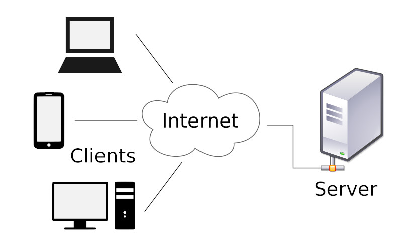

O computador que **solicita** o serviço é chamado de **cliente**. 

O computador que **disponibiliza** o serviço é chamado de **servidor**.

## 1.1. Arquitetura cliente-servidor

A maioria dos serviços de rede utiliza o **modelo cliente-servidor**.
- Alguém solicita um serviço (cliente) e alguém fornece esse serviço (servidor).

Uma maquina pode funcionar como cliente e servidor ao mesmo tempo, dependendo do serviço que está sendo utilizado.
- **Ex**: Um computador pode ser um cliente de um servidor DHCP (quando ele pede que a rede atribua um endereço IP a ele) e ao mesmo tempo ser um servidor web (quando ele fornece o conteúdo de um site para alguém).


**Exemplos**:

| Serviço | Cliente                          | Servidor                          |
| ------- | -------------------------------- | --------------------------------- |
| DHCP    | Computador que precisa de IP     | Servidor DHCP                     |
| DNS     | Sistema operacional ou navegador | Servidor DNS                      |
| HTTP    | Navegador                        | Servidor Web (Apache, Nginx, etc) |
| SSH     | Cliente SSH                      | Servidor OpenSSH                  |
| FTP     | Cliente FTP                      | Servidor FTP                      |
| SMB     | Explorador de arquivos           | Servidor Samba                    |
| NTP     | Cliente NTP                      | Servidor de horário               |
| SNMP    | Sistema de monitoramento         | Equipamento monitorado            |

O **servidor** normalmente fica associado a um **endereço IP fixo**.
- Isto é, para o cliente poder encontrar o servidor, ele precisa **saber o endereço IP do servidor**.
- Logo, o endereço do servidor nao pode mudar.
- **Analogia**: O cliente precisa saber o endereço do restaurante para poder ir até lá.

Já o **cliente** normalmente **utiliza um endereço IP dinâmico**.
- Isto é, o endereço IP do cliente pode mudar, sempre que ele se conectar a rede (conectar um cabo de rede, fazer login em uma rede Wi-Fi, etc).
- **Analogia**: 
  - O cliente pode ir a diferentes restaurantes, 
  - Cada restaurante que o cliente visita nao precisa saber o endereço do cliente para poder atende-lo (*"o restaurante somente atende ao cliente, quando ele chega"*).
- Assim, podemos configurar um programa no cliente para **obter um endereço IP automaticamente** (usando o protocolo DHCP, que veremos mais a frente).
- Isso facilita a vida do técnico da rede, pois nao é preciso configurar manualmente o endereço IP de cada cliente que tenta se conectar na rede.
  - Imagine se fosse necessário configurar o IP de cada smartphone, laptop, PC, etc que tentasse se conectar a uma rede grande, como a do Instituto Federal. 
  - Isso seria inviável!
  - O serviço DHCP resolve esse problema, fornecendo endereços IP automaticamente para os clientes.

## 1.2. Portas e serviços

Ja sabemos que para um pacote chegar em um programa, ele precisa:
1. Ser encaminhado para o endereço MAC ou IP correto do computador de destino (isso quem faz é o  switch ou roteador)
2. Quando o pacote chega no computador de destino, o sistema operacional (Windows, Linux, MacOS, etc) precisa encaminhar o pacote para o programa correto (isso é feito através da **porta de destino**). 
 
A porta de destino é uma das informações que estão contidas na **camada de transporte**, bem como o protocolo usado na comunicação (que pode ser **TCP** ou **UDP**).
- Assim, se tivermos o **IP de destino + Porta de Destino + Protocolo de transporte**, o pacote consegue chegar ao programa de destino correto.
- **Analogia**: Imagine que:
  - Endereço IP = endereço de um prédio,
  - Porta de destino = número do apartamento.
  - Nessa analogia, o porteiro (sistema operacional) precisa saber para qual apartamento (programa) entregar a correspondência (pacote).
  - O protocolo de transporte (TCP ou UDP) é a forma de entrega dessa correspondência (por exemplo, se é uma carta registrada ou uma carta simples).
    - **Carta registrada = TCP** (carta entregue por oficial de justiça, que **garante que a carta chegou no destinatário** - pois o destinatário confirmou o recebimento)
    - **Carta simples = UDP** (carta entregue por um carteiro comum, que **NAO garante que a carta chegou no destinatário** - pois o destinatário nao precisa confirmar o recebimento)

**Exemplo**: Pense que eu tenho um servidor web rodando em `192.168.1.10:80 (tcp)`.
- Isso significa que o serviço está associado ao endereço IP ``192.168.1.10`` (o IP do servidor é esse) e à porta que ele esta escutando é a **TCP 80**.
- Se um cliente quiser acessar esse serviço, ele precisa enviar pacotes para o endereço IP `192.168.1.10` na porta `80` usando o protocolo `tcp`.
  - Se o cliente enviar a solicitação para outra porta, por exemplo a porta `22`, o servidor nao vai receber a solicitação, pois ele nao está escutando nessa porta.
  - Se o cliente enviar a solicitação para a porta `80`, mas usando o protocolo `udp`, o servidor também nao vai receber a solicitação, pois ele nao está escutando nessa porta com esse protocolo.
  - Seria como **tentar falar com um turista**, que so **entende ingles**, usando o português, por exemplo.

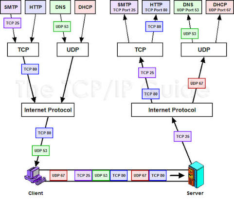

**Algumas portas mais conhecidas**:

| Porta | Protocolo de transporte | Serviço |
| ----- | ----------------------- | ------- |
| 20/21 | TCP                     | FTP     |
| 25    | TCP                     | SMTP    |
| 53    | UDP/TCP                 | DNS     |
| 67/68 | UDP                     | DHCP    |
| 80    | TCP                     | HTTP    |
| 110   | TCP                     | POP3    |

**Atenção:** uma porta não é o serviço em si. 
- **Um serviço pode utilizar portas diferentes** das convencionais (algumas inclusive foram listadas na tabela acima), 
  - Por exemplo, **um servidor web (que executa o protocolo HTTP), NAO é obrigado** a usar a porta 80 (que é a porta padrão para HTTP - vide tabela acima).
- **Analogia**:
  - Uma empresa (serviço) pode ter sua sede em uma sala (porta) com número diferente do que está no catálogo de apartamentos (porta padrão - vide tabela acima) que o porteiro (sistema operacional) do prédio comercial conhece.
  - Nesse caso, a empresa precisa informar ao porteiro (sistema operacional) o número correto da sala (porta em que o serviço está rodando) para que ele possa entregar a correspondência (pacotes enviados pelos clientes) no lugar correto.

De forma parecida com o endereço IP dinâmico, o cliente também utiliza uma **porta de origem dinâmica**.
- Isto é, o cliente nao precisa se preocupar em escolher uma porta para se comunicar com servidor, pois o **sistema operacional escolhe automaticamente uma porta livre** para ele.
- Ou seja, **para uma comunicação entre cliente-servidor acontecer** basta que o cliente saiba:
  - IP do servidor
  - Porta do servidor
  - Protocolo de transporte (TCP ou UDP)
  - **O resto é gerenciado automaticamente** 
    - **Porta de origem**: é definida pelo sistema operacional do cliente.
    - **Endereço IP do cliente**: é definido pelo serviço DHCP da rede do cliente.

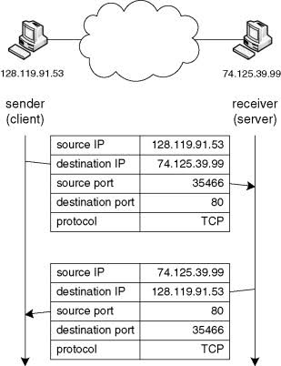

## 1.3. O que é um servidor?

Um servidor é um computador, com  um sistema operacional instalado, que executa programas.
- Cada programa fornece serviços para outros computadores (clientes) em uma rede.
- Qualquer máquina pode operar como servidor, desde que tenha um sistema operacional e programas instalados.
  - **Ex**: 
    - Um computador com Windows 10 pode ser um servidor web instalado, como o programa Apache ou Nginx. 
    - Um computador com Linux pode ser um servidor de arquivos, se tiver um programa como o Samba instalado.
    - Um laptop pode ser um servidor de impressão, se tiver o programa CUPS instalado.
    - Um smartphone pode ser um servidor de mídia (capaz de reproduzir conteúdo de vídeo e musicas), se tiver um programa como o Plex ou Jellyfin instalado.

Logo um servidor Web na mais é do que um computador, com um sistema operacional, e um programa de servidor web instalado, como o Apache ou Nginx.

**Porque então muitos servidores utilizam o sistema operacional Linux?**
- Porque o Linux é um sistema operacional **estável, seguro e de baixo custo**.
  - **Estável**: pouco suscetível a travamentos e falhas, mesmo com grande carga de trabalho.
  - **Seguro**: menos vulnerável a ataques de vírus e malware, quando comparado a outros sistemas operacionais (Windows, por exemplo).
  - **Baixo custo**: a maioria das distribuições Linux são **gratuitas**, e o código-fonte é aberto, permitindo que qualquer pessoa possa estudar, modificar e redistribuir o sistema operacional.
- Porque o Linux é **flexível e personalizável**, permitindo que o administrador do servidor instale apenas os programas necessários para fornecer os serviços desejados.
  - O **Linux pode rodar sem interface gráfica**, utilizando apenas o terminal, o que reduz o consumo de recursos do computador (CPU, memoria RAM, etc).
  - Logo, esses recursos podem ser direcionados para os serviços que o servidor precisa fornecer.
  - Por exemplo, ter mais CPU e RAM disponível significa que o servidor pode lidar com mais tarefas simultaneamente.
    - **Ex**: um servidor web se torna capaz de processar mais requisições HTTP simultaneamente.

# 2. Protocolo DHCP (Dynamic Host Configuration Protocol)

DHCP é o protocolo **utilizado para configurar automaticamente parâmetros de rede** dos dispositivos.
- Isto é, para cada computador que se conecta na rede, ele configura:
  - Endereço IP do PC;
  - Máscara de sub-rede;
  - Gateway padrão;
  - Servidores DNS (que veremos mais a frente);
  - Outros parâmetros opcionais.

Sem DHCP, seria necessário configurar manualmente em cada computador!
- Isto tornaria redes grandes, com centenas de computadores, muito difíceis de gerenciar.
- Imagine o que seria para uma pessoa ter que configurar manualmente centenas de computadores...
  - O risco de realizar configurações incorretas seria muito grande, e o tempo gasto para realizar essa tarefa seria enorme.
- O DHCP automatiza essa configuração.

## 2.1. Como funciona o DHCP?

O processo tradicional de obtenção de um endereço IPv4 é conhecido como DORA:

1. **Discover** (descoberta do servidor DHCP)
   1. Essa descoberta é feita enviando pacotes *broadcast* para tentar localizar um servidor DHCP na rede (qualquer servidor DHCP que receber o pacote de broadcast poderá responder).
2. **Offer** (um servidor DHCP responde)
   1. Um servidor DHCP responde, oferecendo parâmetros de configuração para o cliente (computador que esta se conectando na rede).
3. **Request** (cliente responde ao servidor DHCP)
   1. O cliente responde ao servidor DHCP, informando que deseja utilizar os parâmetros oferecidos.
4. **Acknowledgment** (servidor confirma a concessão do endereço)
   1. O servidor confirma a concessão do endereço, e o cliente pode utilizar os parâmetros recebidos.

Para manter o controle dos endereços IP, o servidor DHCP mantém uma **tabela de concessões (leases)**, que registra os endereços IP que foram concedidos aos clientes.
- Veja um exemplo na tabela de concessões fictícia abaixo.

| MAC do Cliente    | Endereço IP    | Tempo de Concessão |
| ----------------- | -------------- | ------------------ |
| 00:11:22:33:44:55 | 192.168.10.100 | 24 horas           |
| AA:BB:CC:DD:EE:FF | 192.168.10.101 | 24 horas           |
| 11:22:33:44:55:66 | 192.168.10.102 | 24 horas           |

## 2.2. Lease time (tempo de concessão do endereço)

O **endereço IP fornecido pelo DHCP** normalmente é **concedido por um período de tempo** bem definido, chamado de **tempo de concessão (lease time)**.
- O **tempo de concessão** é definido pelo administrador do servidor DHCP, e pode variar de alguns minutos a vários dias.
- Quando o **tempo de concessão** expira, o cliente precisa solicitar uma renovação do endereço IP.
  - Caso o cliente não consiga renovar o endereço IP, ele precisará solicitar um novo endereço IP ao servidor DHCP.  

**Exemplo**: Um servidor DHCP foi configurado para ter **tempo de concessão de 24 horas**.
- Um computador ``PC0`` recebe o endereço ``192.168.10.100`` às **10h**.
- Às **10h do dia seguinte**, o tempo de concessão expira, e o computador ``PC0`` precisa solicitar um novo endereço IP ao servidor DHCP.
- Caso o computador ``PC0`` deseje manter o mesmo endereço IP que ele estava utilizando ate então, ele precisa pedir uma renovação do endereço ao servidor DHCP antes que o tempo de concessão expire.
- Mesmo que o ``PC0`` solicite a renovação, não há garantia de que o servidor irá conceder o mesmo endereço.
  - O servidor DHCP pode decidir conceder um endereço diferente, caso o endereço anterior tenha sido atribuído a outro cliente que pediu um endereço antes de ``PC0`` (``PC1``, por exemplo).
  - Se desejarmos que o ``PC0`` sempre receba o mesmo endereço IP, podemos configurar uma **reserva DHCP** para ele.
  - A **reserva DHCP** é basicamente uma **associação entre o endereço IP e o endereço MAC** do computador (veja exemplo na tabela de reservas fictícia abaixo).

| MAC do Cliente    | Endereço IP Reservado |
| ----------------- | --------------------- |
| 00:11:22:33:44:55 | 192.168.10.100        |
| AA:BB:CC:DD:EE:FF | 192.168.10.101        |
| 11:22:33:44:55:66 | 192.168.10.102        |

Uma vez configurada a reserva, o servidor DHCP sempre irá conceder o mesmo endereço IP para o cliente.
- **Ex**: `00:11:22:33:44:55` sempre receberá o endereço `192.168.10.100`, mesmo que o tempo de concessão expire, ou que o cliente solicite uma renovação do endereço IP, ou haja uma solicitação por parte do cliente por um novo endereço IP.
- Nesse caso, o IP do cliente estará garantido, e estará vinculado ao seu endereço MAC.

## 2.3. Escopo DHCP

Um escopo define o **conjunto de endereços que o servidor pode disponibilizar** aos clientes.
- Geralmente o escopo é definido pelo **IP de rede** e **máscara de sub-rede**.
- Isto é, o DHCP inicia a distribuição de IPs para cada cliente (host) que se conecta na rede, a partir do **endereço imediatamente seguinte ao IP da rede**, até o limite de IPs disponíveis definido pela **máscara de sub-rede**.

**Exemplo**:

```
Rede:       192.168.10.0
Mascara:    255.255.255.0
Gateway:    192.168.10.1
DNS:        192.168.10.10
```

Nesse caso, o DHCP irá oferecer a faixa de IPs:
- `192.168.10.1` (primeiro IP após o IP da rede) 
- até
- `192.168.10.254` (ultimo IP antes do IP de broadcast, que é o `192.168.10.255` - ultimo IP da rede).
  
**IMPORTANTE**: É possível alterar a faixa de IPs distribuída pelo DHCP, para que o servidor nao ofereça todos os IPs disponíveis na rede.
- Isto é, nem sempre o servidor DHCP vai oferecer todos os IPs disponíveis, conforme definido pela **mascara de sub-rede**.

**É possível configurar um servidor DHCP para oferecer apenas uma faixa de IPs** (e nao todos os IPs possível, conforme definido pela mascara de sub-rede).
- **Por exemplo**, podemos definir a faixa de endereços de `192.168.10.100` ao `192.168.10.200` no DHCP, 
- Assim, apesar da rede ``192.168.10.0/24`` ter a faixa de IPs disponíveis de `192.168.10.1` a `192.168.10.254`, o DHCP irá atribuir apenas os IPs da faixa definida entre `192.168.10.100` e `192.168.10.200`.

**É realmente necessário restringir a faixa de endereços no DHCP?**
- Nao, pois dispositivos que realmente precisam de IPs fixos (como servidores, impressoras, cameras IP, etc) podem ter seus IPs previamente configurados na **tabela de reservas DHCP**.
- Assim, essa restrição de faixa de endereços no DHCP é redundante e opcional, na maioria dos casos.

## 2.4. Configurando DHCP no Cisco Packet Tracer

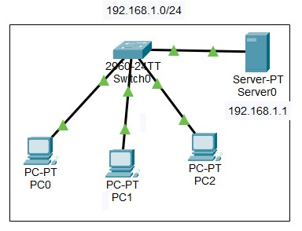

Crie a topologia de rede (PCs, switch e servidor) da figura acima. 

Em seguida, siga os passos abaixo para configurar o serviço DHCP no servidor:
1. Clique no servidor, vá até a aba `Services`.
2. Va no menu `DHCP` (vide figura abaixo).
3. Ative o serviço DHCP (clique em **ON**).
4. Configure o `Default Gateway` (IP do gateway padrão), se houver um roteador na rede. 
   1. Se nao houver roteador, configure o ``Default Gateway`` como `0.0.0.0` ou deixe-o em branco.
   2. Configure também o `DNS Server` (IP do servidor DNS), se houver um servidor DNS na rede (veremos para que serve um servidor DNS mais a frente).
5. Defina o IP de inicio (`Start IP Address`), 
6. Defina a mascara de sub-rede (`Subnet Mask`), 
7. Defina o número total de IPs que o DHCP poderá distribuir (`Maximum Number of Users`).
8. Aperte em Salvar (`Save`), para que as configurações sejam aplicadas.
9. Com essas informações, o servidor DHCP pode calcular a faixa de IPs que irá oferecer aos clientes.
   1. Veja que apesar da mascara de sub-rede, ainda podemos restringir o número máximo de IPs que o DHCP irá oferecer, definindo o número máximo de usuários do DHCP (`Maximum Number of Users`).
   2. Na maioria dos casos, deixaremos o número máximo de usuários do DHCP igual ao número de IPs disponíveis na rede, conforme definido pela mascara de sub-rede (neste exemplo, como a mascara de sub-rede é `/24`, temos ``254 IPs disponíveis``, logo o número máximo de usuários do DHCP será **254**).
   3. **IMPORTANTE**: O IP de inicio deve ser **maior que o IP da rede** (que é o primeiro IP da faixa de endereços da rede). 
      1. No exemplo da figura, nossa rede é `192.168.1.0/24`, logo o IP de rede é `192.168.1.0` e o primeiro IP que poderíamos configurar no DHCP é o `192.168.1.1`.
      2. Contudo, note que iniciamos a faixa de IPs do DHCP em `192.168.1.2` (nesse exemplo, o IP `192.168.1.1` ja esta sendo usado pelo `Server0`).
   4. **ATENÇÃO**: O serviço DHCP dos Servidores no Packet Tracer **nao possui o recurso de reserva de DHCP**. 
      1. Assim, se precisarmos fazer reserva de DHCP, iremos configurar o IP manualmente em cada PC que precisar do IP fixo, e nao no servidor DHCP. 
      2. Isso é uma limitação do simulador, e nao do serviço ou protocolo DHCP em si.
      3. Tanto é uma limitação do simulador, que se usarmos um **roteador doméstico SOHO** no lugar do servidor, podemos **configurar reservas de DHCP normalmente**, dentro do serviço DHCP do roteador SOHO (faremos isso em uma das atividades práticas desse roteiro, mais abaixo).

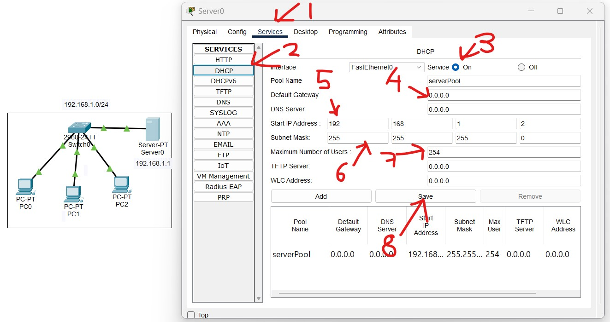

Agora, configure os PCs para obterem o endereço IP automaticamente (usando DHCP):
1. Clique em cada PC, vá até a aba `Config`,
2. Vá no menu `FastEthernet0` (ou qualquer que seja o nome da interface de rede do PC aqui),
3. Selecione a opção `IP Configuration` -> `DHCP` (vide figura abaixo).
4. Faça isso para todos os PCs da rede, e eles irão obter o endereço IP automaticamente do servidor DHCP.
5. Verifique se os PCs receberam o endereço IP corretamente.

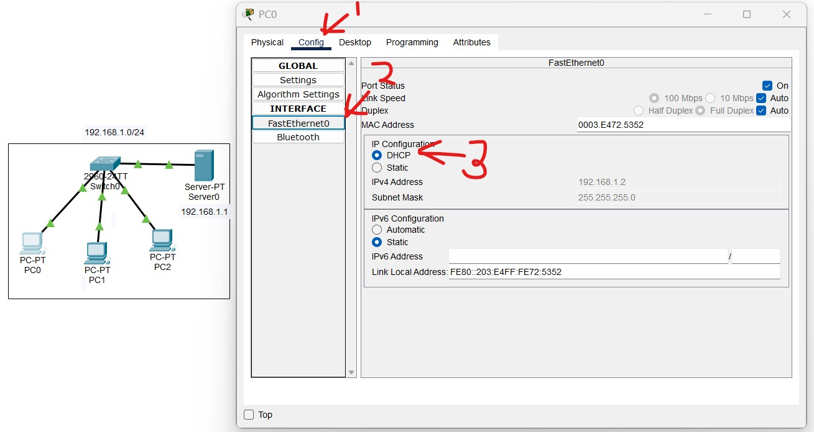

Formas de verificar se o endereço IP foi atribuído corretamente:
1. **Forma 1 - Verificação pela aba de Config**:
   1. Clique em cada PC, vá até a aba `Config` -> `FastEthernet0` (ou qualquer que seja o nome da interface de rede do PC aqui)
   2. Verifique se o **endereço IP** e **máscara de sub-rede** foram atribuídos corretamente (eles devem aparecer ao lado do ``IPv4 Address``, em texto cinca). 
   3. Veja imagem abaixo.

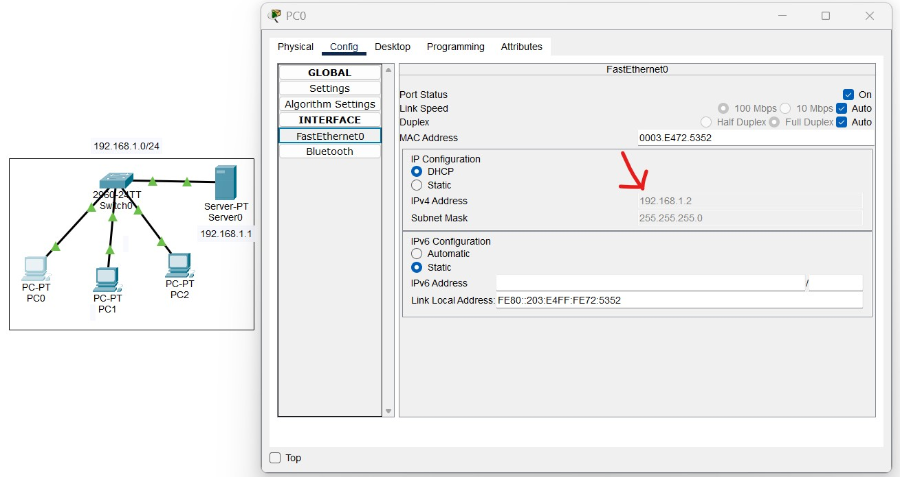

2. **Forma 2 - Verificação pelo mouse**:
   1. Posicione o mouse em cima do PC e espere,
   2. Deve aparecer uma caixa de texto com o endereço IP da interface de rede `FastEthernet0` (ou qualquer que seja o nome da interface de rede do PC aqui)
   3. Veja figura abaixo.

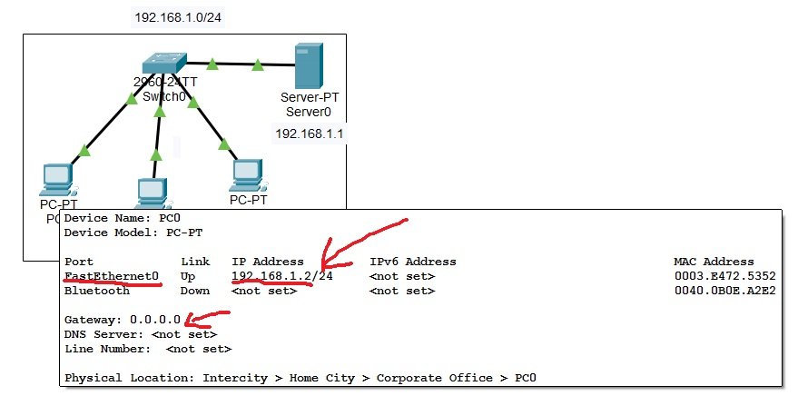

3. **Forma 3 - Verificação pelo prompt de comando**:
   1. Abra o PC e vá em `Desktop`
   2. Depois vá em `Command Prompt`.
   3. Digite `ipconfig` e pressione Enter.
   4. Verifique se o **endereço IP** e **máscara de sub-rede** foram atribuídos corretamente.
   5. Veja figura abaixo.

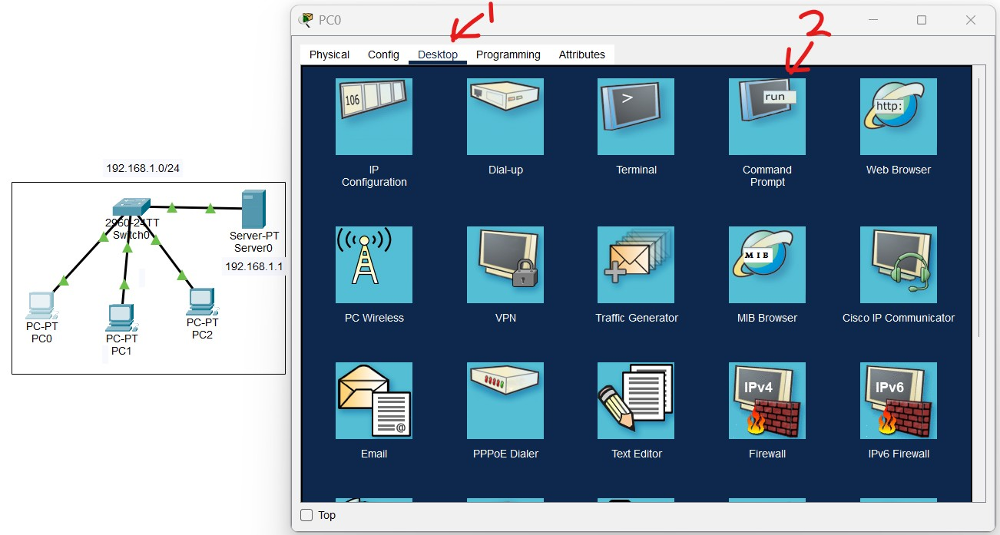

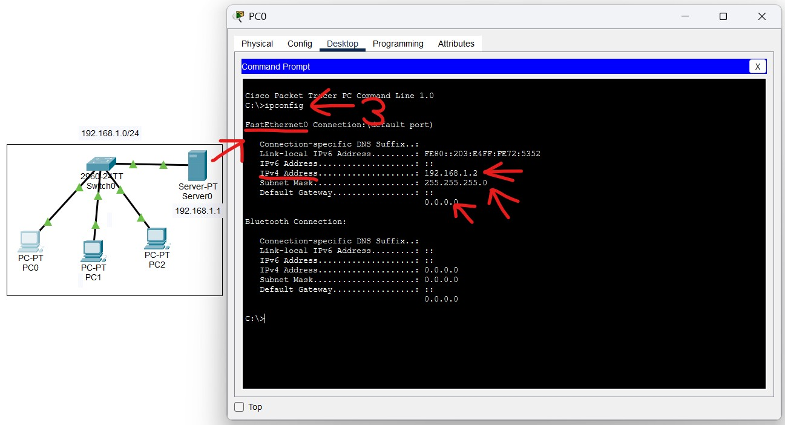

# 3. DNS (Domain Name System)

Endereços IP sao difíceis de memorizar, e podem mudar com frequência (quando o computador se conecta a diferentes redes, por exemplo).
- Pessoas preferem utilizar **nomes de domínio**, que são mais fáceis de memorizar e identificar.
- Porem computadores e roteadores só conseguem se comunicar utilizando **endereços IP**.
- **Solução**: usar um **DNS (Domain Name System)**, que é o serviço que **faz a tradução de nomes de domínio em endereços IP**.

O DNS permite descobrir o endereço IP associado a um nome de domínio.

Sem DNS, seria necessário memorizar os endereços IP dos servidores.

Para isso, um serviço DNS utiliza principalmente a porta **UDP/53**.
- Mas ele pode usar também a porta **TCP/53**, a depender da situação.

## 3.1. Testando a resolução DNS (no Windows)

No Windows, abra um `Terminal` e digite:

```pwsh
nslookup www.google.com
```

Resultado:
```
Servidor:  dns.google
Address:  8.8.8.8

Não é resposta autoritativa:
Nome:    www.google.com
Addresses:  2001:4860:4828:7700::
          2001:4860:482a:7700::
          2001:4860:4829:7700::
          2001:4860:4826:7700::
          2001:4860:4827:7700::
          2001:4860:482c:7700::
          2001:4860:482d:7700::
          2001:4860:482b:7700::
          142.251.154.119
          142.251.150.119
          142.251.156.119
          142.251.152.119
          142.251.155.119
          142.251.157.119
          142.251.153.119
          142.251.151.119
```

O comando `nslookup` consulta o servidor DNS configurado no sistema operacional, e retorna o endereço IP associado ao nome de domínio.

A parte que tem:
```
Servidor:  dns.google
Address:  8.8.8.8
```

Mostra qual é o servidor DNS respondeu (IP `8.8.8.8`).
- No caso desse IP específico, ele pertence ao Google Public DNS, que é um serviço de DNS público e gratuito fornecido pelo Google.

Ja a parte que tem:
```
Não é resposta autoritativa:
Nome:    www.google.com
Addresses:  2001:4860:4828:7700::
          2001:4860:482a:7700::
          2001:4860:4829:7700::
          2001:4860:4826:7700::
          2001:4860:4827:7700::
          2001:4860:482c:7700::
          2001:4860:482d:7700::
          2001:4860:482b:7700::
          142.251.154.119
          142.251.150.119
          142.251.156.119
          142.251.152.119
          142.251.155.119
          142.251.157.119
          142.251.153.119
          142.251.151.119
```

Mostra os IPs associados ao nome de domínio `www.google.com`, tanto IPv4 quanto IPv6.
- Os IPs que tem um formato maior, que parece com um MAC (endereço de hardware), como `2001:4860:4828:7700::` são endereços IPv6.
  - **LEMBRE-SE**: IPv6 tem 128 bits e é maior do que IPv4, que tem 32 bits
  - Logo, IPv6 é representado em hexadecimal (de **0 a 9** e de **A a F**), separado por dois pontos.
- Já os IPs que tem o formato de 4 octetos, como `142.251.154.119`, são endereços IPv4.
  - **LEMBRE-SE**: IPv4 tem 32 bits e é representado em decimal, com valores de 0 a 255, separados por pontos.
  - IPv4 tem 4 octetos, e cada octeto tem 8 bits (4 octetos x 8 bits = 32 bits).
  - Cada octeto pode ter valores de 0 a 255, pois 2^8 = 256 (0 a 255).
  - Cada octeto é separado por um ponto.

## 3.2. Verificando a configuração de DNS do sistema operacional (no Windows)

No Windows, abra um `Terminal` e digite:

```pwsh
ipconfig /all
```

Deve aparecer uma lista de placas de rede (NICs) do computador, com suas configurações de rede.

**Exemplo**:
```
Adaptador de Rede sem Fio Wi-Fi:

   Sufixo DNS específico de conexão. . . . . . :
   Descrição . . . . . . . . . . . . . . . . . : Intel(R) Wi-Fi 6 AX203
   Endereço Físico . . . . . . . . . . . . . . : AA-BB-50-DD-EE-FF
   DHCP Habilitado . . . . . . . . . . . . . . : Sim
   Configuração Automática Habilitada. . . . . : Sim
   Endereço IPv6 de link local . . . . . . . . : fe80::8A43:71e:FFAA:fae1%8(Preferencial)
   Endereço IPv4. . . . . . . .  . . . . . . . : 192.168.3.16(Preferencial)
   Máscara de Sub-rede . . . . . . . . . . . . : 255.255.255.0
   Concessão Obtida. . . . . . . . . . . . . . : sábado, 28 de novembro de 2026 10:30:28
   Concessão Expira. . . . . . . . . . . . . . : domingo, 29 de novembro de 2026 10:30:28
   Gateway Padrão. . . . . . . . . . . . . . . : 192.168.3.1
   Servidor DHCP . . . . . . . . . . . . . . . : 192.168.3.1
   IAID de DHCPv6. . . . . . . . . . . . . . . : 340320592
   DUID de Cliente DHCPv6. . . . . . . . . . . : 00-01-01-00-32-23-82-DD-48-E1-50-C0-F9-E5
   Servidores DNS. . . . . . . . . . . . . . . : 8.8.8.8
                                                 8.8.4.4
   NetBIOS em Tcpip. . . . . . . . . . . . . . : Habilitado
```

Note que nesses resultados há várias informações de rede, como:
- Endereço MAC da placa de rede (endereço físico);
- Endereço IPv6;
- Endereço IPv4;
- Mascara de sub-rede; 
- Gateway padrão;
- Servidor DHCP (que forneceu a configuração de IP desta maquina na qual rodamos o comando `ipconfig /all`);
- Servidores DNS (note que há 2 IPs de servidores aqui).

Muitas dessas configurações foram obtidas automaticamente do servidor DHCP da rede, tais como:
- Endereço IPv6;
- Endereço IPv4;
- Máscara de sub-rede;
- Gateway padrão;
- Servidores DNS.

**Porque há dois servidores DNS configurados?**
- O sistema operacional pode ter **mais de um servidor DNS configurado**.
- O primeiro servidor DNS é o **servidor preferencial**.
  - É ele que será consultado primeiro, quando o sistema precisar **resolver um nome de domínio** (*"traduzir o nome em endereço IP"*).
- Se o primeiro servidor DNS não responder, o sistema operacional irá consultar o **segundo servidor DNS** (servidor alternativo).
- Se o segundo servidor DNS também não responder, o sistema operacional irá consultar o **terceiro servidor DNS**, e assim por diante, até que todos os servidores DNS configurados sejam consultados.
- Normalmente se configuram pelo menos 2 servidores DNS, para que haja redundância e confiabilidade no serviço de resolução de nomes.
  - Isto é, o serviço DNS é tao importante para uma rede, que se ele falha o usuário acaba nao conseguindo acessar a internet.
- **Exemplo**: Considere um usuário leigo, que tenta acessar ``www.google.com` no navegador.
  - Se o serviço DNS falhar, o usuário não conseguirá acessar o site, mesmo que a internet esteja funcionando corretamente.
  - Ele teria que conhecer o IP do site `www.google.com` para conseguir acessá-lo, o que é inviável para a maioria das pessoas (a maioria dos máximo da internet sequer sabe o que um IP, quanto mais acessar sites por IP).
  - Logo, uma falha no DNS pode impedir que o usuário acesse a internet, mesmo que a conexão esteja funcionando corretamente.
  - Faremos testes sobre essas falhas no Packet Tracer, mais adiante.  

## 3.3. Como funciona a resolução DNS?

Quando um usuário digita o seguinte endereço no navegador:

```
www.example.com
```

No navegador, o sistema precisa descobrir o endereço IP correspondente ao nome de domínio `www.example.com`.

Para isso, as seguintes etapas são realizadas:

1. O navegador do cliente verifica seu cache DNS
   1. **Ex**: digamos que o usuário acessa `www.google.com` com frequência, então o navegador pode ter armazenado o endereço IP correspondente a esse nome de domínio em uma memória especial, chamada de **cache**.
   2. **Cache**: é uma memória temporária, que armazena informações que foram acessadas recentemente, para que possam ser acessadas mais rapidamente no futuro.
2. O sistema operacional do cliente verifica seu cache local.
   1. Além da aplicação (navegador) também há o cache do sistema operacional, que armazena informações de nomes de domínio e endereços IP correspondentes.
3. Se nenhum dos caches contiver o mapeamento nome -> IP que o usuário solicitou, o sistema operacional do cliente consulta os **servidores DNS** configurados na máquina (veja figura abaixo).
   1. **LEMBRE-SE**: Quem configura os servidores DNS na máquina é o **serviço DHCP da rede**, que fornece o endereço IP do servidor DNS junto com outras configurações de rede (IP da máquina, mascara de sub-rede, gateway padrão, etc).
4. O servidor DNS verifica seu próprio cache.
   1. Se o servidor DNS tiver o mapeamento nome -> IP, ele retorna a resposta ao cliente.
5. Se o servidor DNS nao possuir a informação em seu cache, ele consulta outros servidores DNS, seguindo uma **hierarquia de DNSs** (veremos isso mais a frente).
6. O servidor DNS obtém uma resposta (seja do seu próprio cache ou de outro servidor DNS na **hierarquia de DNSs**).
7. Retorna o endereço IP do nome de domínio para o aplicativo do cliente (navegador).

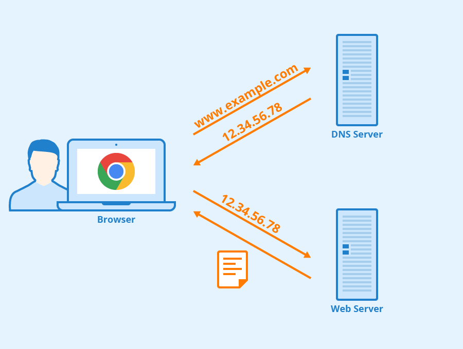

**Analogia**: Imagine que você está procurando o endereço de uma pessoa em uma cidade. 
- Você primeiro verifica seu próprio caderno de endereços (cache do navegador). 
- Se não encontrar, você consulta o guia telefônico da cidade (cache do sistema operacional). 
- Se ainda não encontrar, você liga para o serviço de informações da cidade (servidores DNS) para obter o endereço.

Para isso funcionar, é necessário que o cliente saiba **qual servidor DNS consultar**.
- Normalmente, o cliente obtém essa informação automaticamente do **servidor DHCP** da rede, que fornece o endereço IP do servidor DNS junto com outras configurações de rede.
- **IMPORTANTE**: Se o **cliente não tiver um servidor DNS configurado**, ele não conseguirá resolver nomes de domínio em endereços IP, e portanto **não conseguirá acessar servidores usando nomes** de domínio.

## 3.4. Hierarquia do DNS

A **hierarquia do DNS** é uma **estrutura organizada de servidores DNS que trabalham juntos** para resolver nomes de domínio em endereços IP.
- Ela é composta por diferentes **níveis de servidores DNS**, cada um responsável por uma parte específica do espaço de nomes do DNS.

A hierarquia do DNS é organizada nos seguintes níveis, cada um contendo diferentes tipos de servidores DNS, que respondem por uma parte do nome de domínio:
1. Servidores raiz (root servers)
2. Servidores de domínios de topo (TLD servers)
3. Servidores autoritativos dos domínios
4. Servidores que respondem pelos subdomínios

Pense nos níveis como sendo uma árvore, onde cada nível é um ramo que leva a outros ramos ou folhas (veja figura abaixo).
  - Isto é, cada pedaço de um nome de domínio, como o `www.google.com` é dividido em partes, usando os pontos.
  - **Ex**: `www`, `google`, `com`, `.` (esse último ponto nao aparece no nome - ele representa a raiz do DNS, que é o nível mais alto da hierarquia)
  - A partir dessa divisão, o DNS pesquisa a resposta correta perguntando quem consegue responder por cada parte dessa do nome (seguindo a **ordem da direita pra esquerda**).

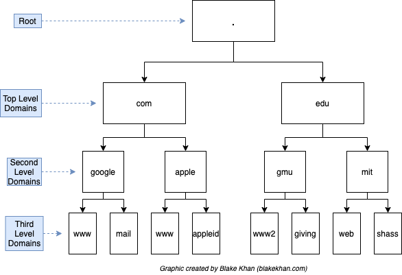

**Exemplo**: Para resolver `www.google.com`, o DNS segue os seguintes passos:
1. Pergunta aos **servidores raiz (root servers)** qual servidor DNS é responsável pelo domínio de topo `.com`.
2. Os servidores raiz respondem com os endereços dos servidores DNS responsáveis pelo domínio `.com`.
   1. Esses servidores DNS, responsáveis por esta primeira parte do nome de domínio (`.com`, nesse exemplo), sao chamados de **servidores TLD (Top-Level Domain)** (veja figura acima).
3. O serviço DNS do cliente então pergunta aos servidores TLD de `.com` quem é responsável pelo domínio `google.com`.
4. Os servidores TLD respondem com os endereços dos servidores DNS capazes de responder pelo domínio `google.com`.
5. Finalmente, o serviço DNS do cliente pergunta aos servidores DNS responsáveis pelo domínio `google.com` qual é o endereço IP de `www.google.com`, e recebe a resposta.

**Analogia**: Imagine que você está procurando o endereço de uma pessoa em uma cidade.
- Você primeiro liga para o serviço de informações da cidade (servidores raiz) e pergunta qual é o bairro onde a pessoa mora (domínio de topo).
  - No nosso exemplo, o bairro é o domínio de topo `.com`.
- O serviço de informações da cidade responde com o nome do bairro (servidores TLD).
  - No nosso exemplo, agora sabemos quem responde pelo *"bairro"* cujo domínio é `.com`.
- Em seguida, você liga para o serviço de informações do bairro (servidores TLD) e pergunta qual é a rua onde a pessoa mora (servidores autoritativos do domínio).
  - No nosso exemplo, desejamos saber quem responde pela *"rua"* cujo domínio é `google.com`.
- O serviço de informações do bairro responde com o nome da rua (servidores autoritativos do domínio).
  - Agora ja sabemos quem responde pela *"rua"* (domínio `google.com`).
- Finalmente, você liga para o serviço de informações da rua (servidores autoritativos do domínio) e pergunta qual é o número da casa da pessoa (endereço IP), e recebe a resposta.
  - No nosso exemplo, o número da casa é o endereço IP de `www.google.com`.

## 3.5. DNS recursivo e DNS autoritativo

É importante distinguir esses papéis:
- **DNS recursivo**: **Recebe solicitações** dos clientes e **procura uma resposta** (endereço IP correto para o nome de domínio solicitado).
  - Pode consultar diferentes servidores DNS em nome do cliente.
  - **Analogia**: É como se o DNS recursivo fosse um **carteiro**, que é uma pessoa que recebe uma solicitação (*"endereço para entregar uma carta ou pacote"*) e vai atrás da resposta, perguntando para diferentes pessoas (*"outros carteiros, pessoas na rua, etc"*) até encontrar a informação correta (*"o local onde a pessoa mora, o endereço IP"*).
- **DNS autoritativo**: **Armazena informações oficiais** de uma zona DNS (ou seja, os registros DNS que definem como o domínio deve ser resolvido).
  - **Exemplo**: Um servidor autoritativo para `empresa.com.br` mantém registros que determinam os endereços e outros serviços daquele domínio.
    - Ou seja, é esse servidor autoritativo que sabe o endereço IP de `www.empresa.com.br`, o endereço do servidor de e-mail (que pode ser algo como `mail.empresa.com.br`), entre outros registros de outros serviços e servidores desse domínio.
  - **Analogia**: É como se o DNS autoritativo fosse um **cartório**, que é uma instituição que mantém registros oficiais e confiáveis sobre pessoas, propriedades e outros assuntos.
    - No nosso exemplo, o cartório (DNS autoritativo) tem os registros oficiais do domínio `empresa.com.br`, incluindo os endereços IP dos servidores e outros serviços associados a esse domínio.
- Veja figura de exemplo abaixo.

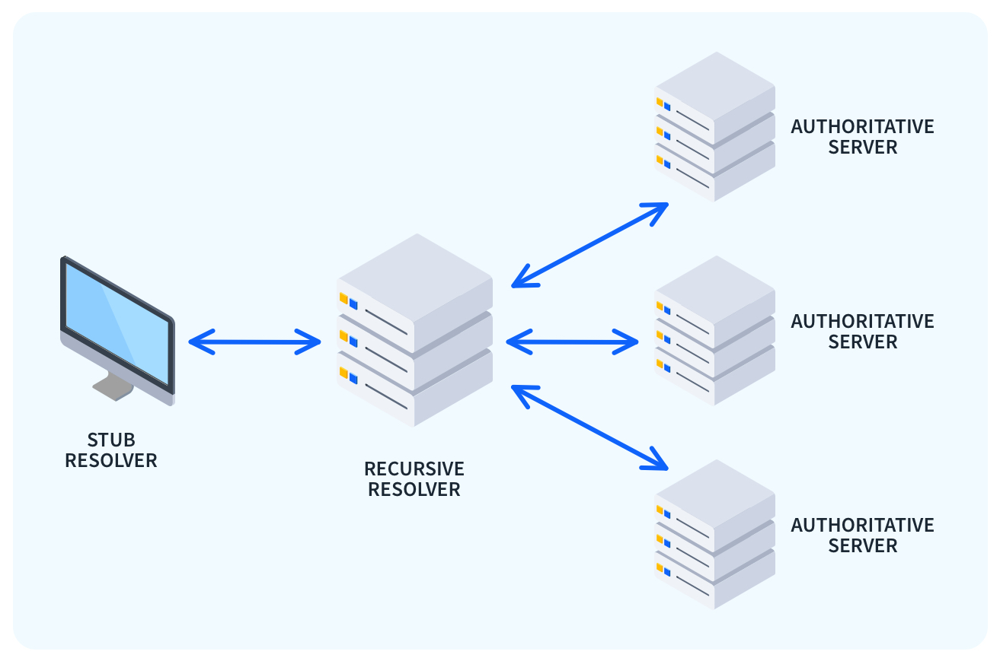

**NOTA**: Um **mesmo software pode desempenhar AMBAS** as funções.
- Por exemplo, um servidor DNS pode atuar como **recursivo** para os clientes que solicitam resolução de nomes, e ao mesmo tempo ser **autoritativo** para os domínios que ele gerencia.
- **Ex**: Um servidor DNS pode ser recursivo para os clientes da rede interna, mas também ser autoritativo para o domínio `empresa.com.br`, que ele gerencia.
- Isso inclusive é muito comum em grandes instituições e empresas, como os Institutos Federais e Universidades.

## 3.6. Registros DNS

Os registros DNS são informações que definem como um nome de domínio deve ser resolvido.
- Cada registro DNS tem um **tipo** que indica a função do registro, e um **valor** que fornece a informação associada ao nome de domínio.

| Registro | Função                                  | Exemplo de Valor                       |
| -------- | --------------------------------------- | -------------------------------------- |
| A        | Associa nome a endereço IPv4            | `www.empresa.com → 192.168.10.10`      |
| A        | Associa nome a endereço IPv4            | `ns1.empresa.com → 192.168.10.20`      |
| AAAA     | Associa nome a endereço IPv6            | `www.empresa.com → 2001:db8::10`       |
| CNAME    | Cria um apelido (alias) para um nome    | `portal.empresa.com → www.empresa.com` |
| MX       | Define servidores de e-mail do domínio  | `mail.empresa.com -> 192.168.10.40`    |
| NS       | Identifica servidores DNS autoritativos | `empresa.com -> ns1.empresa.com`       |

- **Registro A**: Associa um nome de domínio a um endereço IPv4.
  - **Ex**: `www.empresa.com → 192.168.10.10`
- **Registro AAAA**: Associa um nome de domínio a um endereço IPv6.
  - **Ex**: `www.empresa.com → 2001:db8::10`
- **Registro CNAME**: Cria um apelido (alias) para um nome.
  - **Ex**: `portal.empresa.com → www.empresa.com`
  - Isto é, sempre que alguém acessar `portal.empresa.com`, o DNS irá redirecionar para o mesmo servidor de `www.empresa.com` (qualquer que seja ela, conforme os **registros A** e **AAAA** que definem o IP desse servidor ``www.empresa.com`).
- **Registro MX**: Define os servidores de e-mail do domínio (quem é responsável pelo envio e recebimento de mensagens para emails com o domínio `@empresa.com`).
  - **Ex**: `mail.empresa.com -> 192.168.10.40`
- **Registro NS**: Identifica os servidores DNS autoritativos para o domínio.
  - **Ex**: `empresa.com -> ns1.empresa.com`
  - Isto é, o servidor DNS `ns1.empresa.com` é o responsável por responder pelas consultas de nomes do domínio `empresa.com`.

## 3.7. Configurando DNS no Cisco Packet Tracer

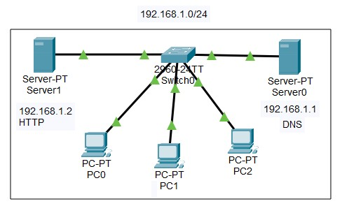

Para configurar um DNS no Cisco Packet Tracer, siga os passos abaixo:
1. Crie a topologia de rede (PCs, switch e servidor) da figura acima.
2. Configure os IPs dos PCs e do servidor, conforme a topologia.
   1. **Lembre-se**: o servidor deve ter um IP fixo, e os PCs podem ter IPs fixos ou dinâmicos (via DHCP).
   2. Nesse caso, nao iremos configurar o DHCP ainda, pois o foco é configurar o DNS.
   3. Assim, configure os IPs dos PCs e do servidor manualmente, conforme a rede da figura (`192.168.1.0/24`).
   4. **Lembre-se** de calcular a mascara de sub-rede conforme o CIDR `/24`.
3. Configure o DNS nos PCs (vide figura abaixo):
   1. Clique em cada PC, vá até a aba `Config`,
   2. Vá no menu `Settings`,
   3. Clique em `Gateway/DNS IPv4` -> `Static` e digite o IP do servidor DNS em `DNS Server`.
   4. Selecione a opção `IP Configuration` -> `Static` (ou `Manual`, dependendo da versão do Packet Tracer).
   5. Lembre-se de configurar também os IPs e mascara de sub-rede do PC, conforme a topologia.
   6. Repita esses passos para todos os PCs da rede.

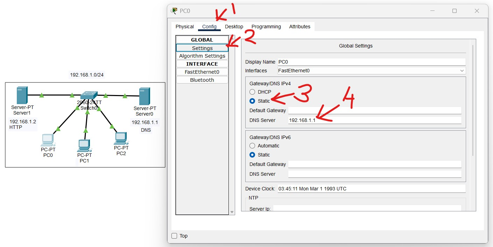

4. No servidor, **depois de ja ter configurado seu IP e mascara de sub-rede**, iremos configurar o serviço DNS (vide figura abaixo):
   1. Vá até a aba `Services` ,
   2. Depois va para o menu `DNS` ,
   3. Ative o serviço DNS (clique em **ON**),
   4. Selecione o tipo do registro `A` 
   5. Digite o nome do domínio que desejamos configurar `www.servidor.local`, 
   6. Digite o IP do servidor web que irá responder pelo nome de domínio `www.servidor.local`
      1. Nesse caso, será o IP do servidor ``Server1`` (`192.168.1.2`)
   7. Clique em `Add` para adicionar o registro DNS.   

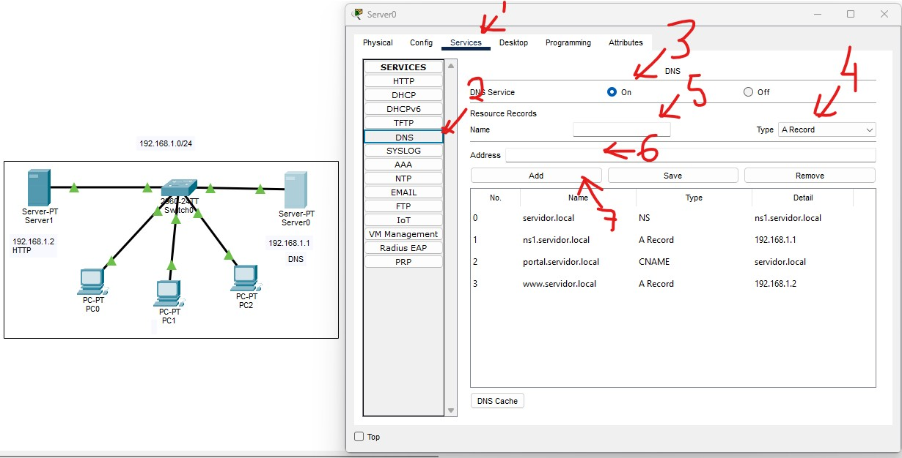

8. Faça algo parecido com o que fizemos acima, agora para o registro do tipo `NS` (registro que indica qual é o servidor DNS autoritativo para o domínio `servidor.local`).
      1. Digite o nome do domínio que o DNS autoritativo responde (`servidor.local`),
      2. Agora digite o nome do servidor DNS autoritativo que irá responder pelas consultas do domínio `servidor.local`, que nesse caso vamos chamar de `ns1.servidor.local` (geralmente usamos o prefixo `ns1` para indicar que é o primeiro servidor DNS autoritativo do domínio - se fosse o segundo, usaríamos `ns2`, e assim por diante),
      3. Clique em `Add` para adicionar o registro ``NS``.
         1. Porem, note que o registro do tipo `NS` não possui um endereço IP associado, apenas o nome do servidor DNS autoritativo (precisamos de registro `A` para associar o IP do servidor DNS autoritativo a esse nome `ns1.servidor.local`).
      4. Agora precisamos criar um registro tipo `A` para o próprio servidor DNS que estamos configurando (`ns1.servidor.local -> 192.168.1.1`).
         1. Isto é, cada registro desse tem uma finalidade diferente:
            1. **Registro do tipo** `NS`: O servidor `ns1.servidor.local` é o DNS autoritativo que responde por todos os nomes que pertencem ao domínio `servidor.local` (ou seja, todos os nomes que terminal com `servidor.local`).
            2. **Registro do tipo** `A`: O servidor `ns1.servidor.local` possui o IP `192.168.1.1`  
9.  Faça agora a configuração do registro do tipo ``CNAME``, que será um apelido para o nome de domínio `www.servidor.local`.
   1. Digite o nome do alias (apelido) `portal.servidor.local`, 
   2. Digite o nome do domínio que ele irá apontar, que nesse caso é `www.servidor.local`.
   3. Clique em `Add` para adicionar o registro CNAME.
10. No final voce deve ter uma configuração parecida com a figura abaixo, com os registros DNS do tipo `A`, `NS` e `CNAME` configurados.

Agora, para testar se a configuração do DNS está funcionando:
1. Abra o navegador de um dos PCs.
   1. Vá em `Desktop` -> `Web Browser`.
2. Digite o nome de servidor Web que configuramos no DNS,
   1. Nesse caso é `www.servidor.local`.
3. Voce deve ver a pagina web na tela (vide figura abaixo).

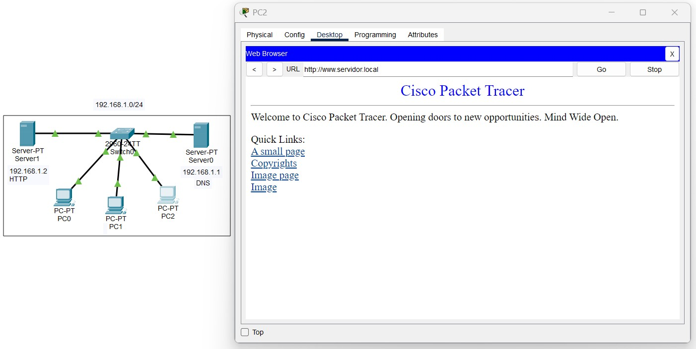

Agora refaça o teste, mas usando o nome do apelido (alias) que configuramos no DNS (`portal.servidor.local`)
- Deve aparecer a mesma página web, pois o registro CNAME faz o redirecionamento do *alias* para o nome do servidor Web (`www.servidor.local`).

# 4. HTTP (Hypertext Transfer Protocol) e HTTPS (Hypertext Transfer Protocol Secure)

HTTP é o protocolo utilizado para comunicação entre clientes Web (navegadores) e servidores web (servidores de conteúdo).
- Quando um usuário acessa um site, o navegador envia uma solicitação HTTP ao servidor.

O servidor processa a solicitação e retorna uma resposta.

**Exemplo**:

```
Cliente: GET /index.html
Servidor: 200 OK
```

Dessa forma, qualquer programa capaz de utilizar o protocolo HTTP ou HTTPS para responder a solicitações de um navegador web de um cliente, estará atuando como um **servidor web**.
- **Exemplos de servidores Web**:
  - Apache
  - Nginx
  - Outros
- Para isso, eles precisam estar rodando quando um cliente enviar uma solicitação HTTP ou HTTPS (um pacote chegar ate o servidor), 

Os protocolos HTTP e HTTPS são **protocolos de aplicação** (assim como o **DHCP** e **DNS**), E NORMALMENTE operam sobre as portas:
- **TCP/80 (HTTP)**,
- **TCP/443 (HTTPS)**.

**LEMBRE-SE**: Nao é obrigatório o uso dessas portas padrão, mas é o que normalmente se utiliza, e é o que a maioria dos navegadores e servidores web esperam.
- Podemos configurar um servidor Web para operar em qualquer porta TCP.
- Porém, se o servidor Web estiver operando em uma porta diferente da padrão, o cliente precisará especificar a porta na hora de acessar a pagina Web.
  - **Ex**: http://www.empresa.com:8080
  - Nesse caso estamos acessando a pagina ``www.empresa.com``, usando protocolo **HTTP**, na porta ``TCP/8080``, que é diferente da porta padrão do HTTP (``TCP/80``).
  - Isso é feito porque as portas padrão do HTTP e HTTPS podem estar bloqueadas por algum firewall, ou podem estar sendo utilizadas por outro programa dentro do sistema operacional.
  - Também existe uma restrição de que **portas ate o número 1023** sao consideradas **portas privilegiadas**, e **apenas programas com privilégios de administrador** podem abrir essas portas.
    - Logo, se um servidor Web estiver rodando em um sistema operacional **sem privilégios de administrador**, ele nao conseguira abrir a porta ``TCP/80`` (HTTP) ou ``TCP/443`` (HTTPS), 
    - Portanto, precisaríamos utilizar uma porta diferente (como a ``TCP/8080``, ou outra porta TCP qualquer).

**Qual a diferença entre HTTP e HTTPS?**
- HTTP envia dados na forma de **texto**, sem criptografia.
- HTTPS envia os mesmos dados na forma de texto, porem agora **criptografados**, utilizando um outro protocolo chamado de **SSL ou TLS**.
- Isto é, uma pessoa pode, teoricamente, interceptar um pacote HTTP e ler os dados que estão sendo enviados (e depender da situação, ate consegue alterar o conteúdo que esta sendo enviado, antes de chegar ao cliente que solicitou a pagina Web), 
- Ja **na comunicação HTTPS, mesmo que alguém intercepte os dados, não conseguirá ler** o conteúdo, nem poderá alterar as informações do pacote, pois os dados estão protegidos (**criptografados** usando uma formula matemática complexa).

## 4.1. Como funciona o HTTP?

O HTTP é baseado em um modelo de **requisição-resposta**.
- O cliente envia uma **requisição** HTTP ao servidor (um pedido de acesso a um recurso).
- O servidor processa a requisição e envia uma **resposta** ao cliente.
  
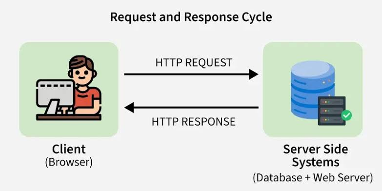

**Toda requisição ou resposta HTTP** é composta por:
- Um **método** (GET, POST, PUT, DELETE, etc);
  - Pense no método como sendo um comando que indica ao servidor o que o cliente deseja fazer com o recurso solicitado.
    - ``POST`` é o método que indica que o cliente deseja **enviar** dados para o servidor, para que ele processe esses dados
      - **Ex**: criar um perfil em uma rede social.
    - ``GET`` é o método que indica que o cliente deseja **obter** (ou recuperar) um recurso do servidor.
      - **Ex**: obter as informações do perfil de um usuário em uma rede social.
    - ``PUT`` é o método que indica que o cliente deseja **atualizar** uma informação no servidor .
      - **Ex**: alterar uma postagem em uma rede social.
    - ``DELETE`` é o método que indica que o cliente deseja **remover** um recurso do servidor .
      - **Ex**: deletar uma postagem em uma rede social.
    - Juntos esses métodos formam o conjunto de métodos HTTP mais utilizados (popularmente conhecidos como ``CRUD`` - **Create, Read, Update e Delete** - pois eles permitem realizar as operações básicas de **criação, leitura, atualização e exclusão de dados**, respectivamente)
      - **Create**: ``POST`` (criar um novo recurso no servidor)
      - **Read**:   ``GET``  (ler ou recuperar um recurso do servidor)
      - **Update**: ``PUT``  (atualizar ou modificar um recurso no servidor)
      - **Delete**: ``DELETE`` (remover um recurso do servidor)
    - Existem outros métodos HTTP além desses que foram citados acima, porem eles sao menos utilizados.
- Um **caminho** para o recurso solicitado;
  - Pense no caminho como sendo um **nome** ou **endereço** que o cliente deseja acessar no servidor.
  - Esse endereço é chamado de **URL (Uniform Resource Locator)**, e é composto por:
    - O **protocolo** (HTTP ou HTTPS);
    - O **nome do servidor Web** (ou endereço IP);
    - O **caminho do recurso** (o arquivo ou página que o cliente deseja acessar).
  - **Ex**: `http://www.empresa.com.br/index.html` é uma URL que indica:
    - **Protocolo**: HTTP
    - **Nome do servidor Web**: `www.empresa.com.br` (lembre-se, esse nome precisa ser resolvido em um endereço IP pelo serviço DNS, para que o cliente possa acessar o servidor Web)
    - **Caminho do recurso** (que o cliente deseja acessar): `/index.html`
- **Cabeçalhos HTTP** (informações adicionais sobre a requisição);
- **Um corpo (*body*)** (opcional, usado pelo servidor para enviar dados, a depender do método utilizado - nem todo método suporta o envio de *body*, como por exemplo o ``GET``).

**Exemplo de requisição HTTP** ``GET``:

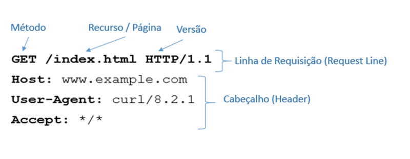

**Exemplo de resposta HTTP a solicitação** ``GET``:

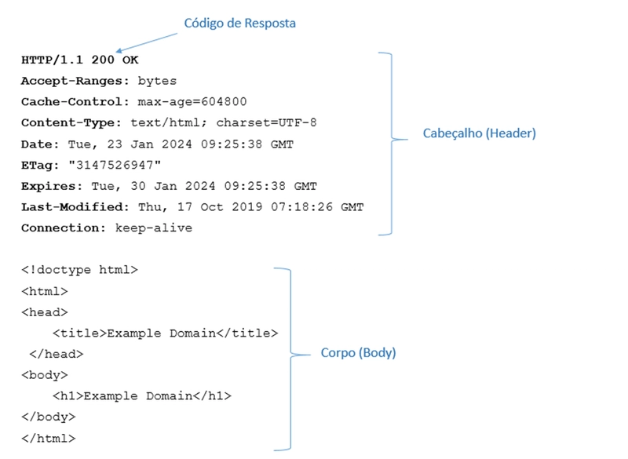

**IMPORTANTE**: Note que tudo no HTTP é baseado em **texto**. 
- Para uma página abrir uma foto, video, etc o navegador precisa **interpretar esse texto** da resposta HTTP (usando uma linguagem de programação chamada ``HTML``), para então baixar os arquivos de mídia (imagens, vídeos, etc).
- O ``HTML`` é uma linguagem de marcação que define a estrutura e o conteúdo de uma página web.
- Porem o ``HTML`` nao consegue fazer animações ou deixar uma página web bonita, ou interativa (**ex**: o usuário aperta em um botão e pagina faz alguma coisa).
- Para isso, se usam outras linguagens junto ao ``HTML``, como ``CSS`` (para estilizar a página, deixando-a mais bonita) e ``JavaScript`` (para adicionar interatividade e funcionalidades).
- O navegador interpreta o ``HTML``, ``CSS`` e ``JavaScript`` para exibir a página web corretamente para o usuário.
- Porem **todos esses comandos e linguagens** sao enviados como **texto** no **corpo** da resposta HTTP, 
- É o **navegador que precisa interpretar esse texto** para exibir a página corretamente.

## 4.2. Métodos HTTP (mais utilizados)

| Operação CRUD | Método HTTP | Função                   |
| ------------- | ----------- | ------------------------ |
| Create        | POST        | Criar uma informação     |
| Read          | GET         | Obter uma informação     |
| Update        | PUT         | Atualizar uma informação |
| Delete        | DELETE      | Remover uma informação   |

O código 200 indica sucesso.

## 4.3. Códigos de status HTTP


Note que em uma resposta HTTP (veja figura acima), o servidor retorna um **código de status**.
- **Código de status**: indica o resultado da solicitação do cliente (se a requisição foi bem-sucedida, se houve erro, etc).
- Há uma lista de códigos de status HTTP, cada um com um significado específico.
- Para os fins da nossa disciplina, vamos considerar que
  - o **inicio dos códigos** define a **categoria do código**, 
  - o **final do código** define o **significado específico** do código.
  - **Ex**: 
    - Todos os códigos que começam com `2` indicam **sucesso** (como o código `200` que indica que a requisição foi bem-sucedida).
    - Assim como todos os códigos que começam com `4` indicam **erro do cliente** (como o código `404` que indica que a pagina ou recurso solicitado não foi encontrado no servidor - *"pagina nao existe"*).
    - Iremos escrever a lista da seguinte forma `2xx` para indicar que todos os códigos que começam com `2` são de sucesso, e `4xx` para indicar que todos os códigos que começam com `4` são de erro do cliente, e assim por diante.
- Veja a tabela abaixo com os códigos de status HTTP mais comuns.

| Código | Significado                                                                                                                                              |
| ------ | -------------------------------------------------------------------------------------------------------------------------------------------------------- |
| 2xx    | Sucesso                                                                                                                                                  |
| 3xx    | Redirecionamento (pagina foi movida para outro endereço)                                                                                                 |
| 4xx    | Erro do cliente (pagina nao existe, ou o cliente nao tem permissão para acessar a pagina, ou outra coisa)                                                |
| 5xx    | Erro do servidor (o servidor nao conseguiu processar a requisição do cliente, por algum motivo interno - pode ser uma falha no servidor, ou outra coisa) |

## 4.4. Configuração do serviço HTTP no Cisco Packet Tracer


No Packet Tracer, construa a topologia da figura acima, e configure os IPs dos PCs e do servidor, conforme a topologia.

Agora, abra o servidor para configurar o serviço HTTP no servidor, e faça o seguinte (veja imagem abaixo):
1. Clique na aba `Services`.
2. Clique no menu `HTTP`.
3. Verifique se o serviço HTTP está ativado (clique em **ON**)
   1. Normalmente quando criamos um servidor no Packet Tracer ele ja vem com o serviço HTTP ativado por padrão.

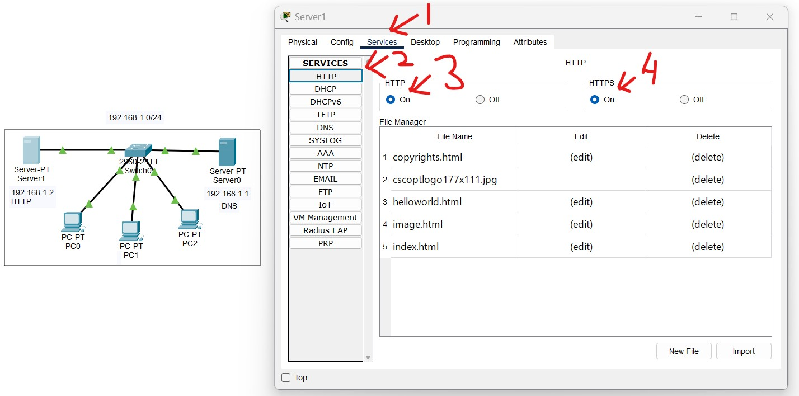

4. Agora você ja deve conseguir acessar o servidor HTTP usando um navegador web de um dos PCs da rede, digitando o endereço IP do servidor HTTP na barra de endereços do navegador.
   1. Abra o PC, vá até a aba `Desktop` -> `Web Browser`.
   2. Digite o endereço IP do servidor HTTP na barra de endereços do navegador.
      1. **Ex**: `192.168.1.2` (o IP que você configurou para o servidor HTTP).
   3. Se houver um DNS configurado na rede, você também pode acessar o servidor HTTP usando o nome do servidor que você configurou no DNS (veja seção anterior sobre configuração de DNS).
      1. **Ex**: `www.servidor.local` (o nome do domínio que você configurou no DNS).

No Packet Tracer, você também pode alterar a pagina Web que o servidor HTTP irá responder:
1. Dentro do servidor, clique na aba `Services` -> `HTTP`.
2. De um duplo clique me cima da célula ``(edit)`` ao lado do arquivo `index.html` para abrir o editor de texto (veja figura abaixo).
   1. Esse arquivo `index.html` é a página padrão que o servidor HTTP irá responder quando um cliente acessar o servidor.
   2. Você pode alterar o conteúdo desse arquivo para personalizar a página web que será exibida para os clientes.

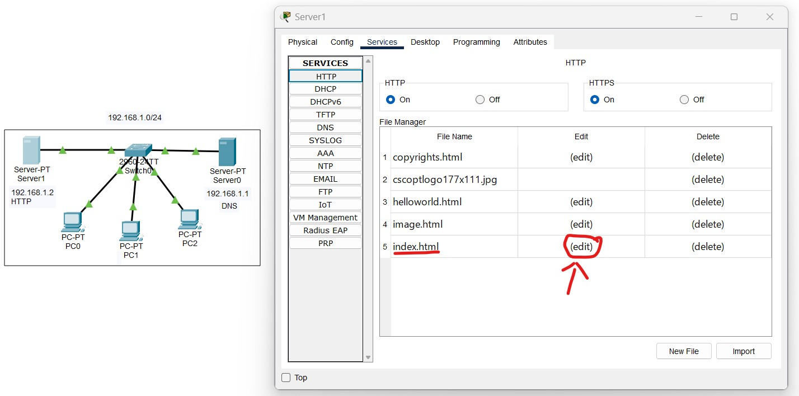

3. Depois de alterar o conteúdo do arquivo `index.html`, clique em `Save` para salvar as alterações.

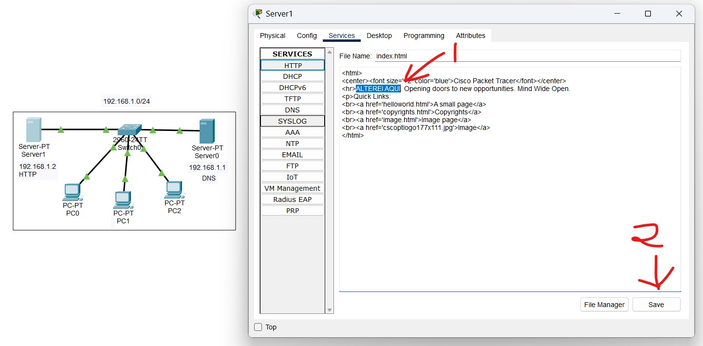

# 5. Diagnóstico de problemas em serviços de rede

Administrar serviços de rede exige saber identificar em qual etapa está ocorrendo a falha.

Um serviço pode estar instalado, mas não estar funcionando corretamente.

O diagnóstico deve considerar diferentes camadas (Física, Enlace, Rede, Transporte, e Aplicação).

## 5.1. Etapa 1 — Verificar cabeamento e conectividade física

Há algum problema físico na rede? Verifique:
- Cabos conectados corretamente?
- LEDs de link acesos?
- O switch está funcionando?
- No Packet Tracer, há algum cabo/enlace incorreto ou com falha (**triangulo vermelho para baixo**)?
  - **Ex**: Straight-through no lugar de Crossover, Serial, etc.
- Há alguma interface de rede com falha ou desligada (**triangulo vermelho para baixo**)?
  - **Ex**: Interface de rede do servidor ou do cliente desligada, ou com falha.
- Há alguma VLAN configurada incorretamente no switch?
  - **Ex**: VLAN errada, porta do switch em VLAN errada, etc.
  - Teste comunicação entre dispositivos de um mesmo switch (`ping <IP_do_outro_dispositivo>`), de uma mesma VLAN, para verificar se a configuração da VLAN está correta.

## 5.2. Etapa 2 — Verificar a conectividade IP

Dentro de `Desktop` -> `Command Prompt` em um PC ou outra máquina da rede, utilize:

```pwsh
ipconfig /all
ping <IP_de_uma_outra_maquina_na_rede>
```

**Perguntas**:

- O PC possui endereço IP?
- A máscara está correta?
- O gateway está configurado?
- O DNS e DHCP estão configurados?
- Existe conectividade com o cliente (o `ping` consegue retornar respostas)?

## 5.3. Etapa 3 — Verificar a resolução DNS

Em `Desktop` -> `Command Prompt`, utilize:

```pwsh
nslookup <nome_do_servidor_que_deseja_testar>
```

**Perguntas**:

- O DNS retorna a resposta correta?
- O registro existe?
- O servidor DNS está respondendo?
- O nome resolve para o endereço esperado?

# 6. Exercícios de fixação

## Parte A — Conceitos

1. O que é um serviço de rede?
2. Qual é a diferença entre cliente e servidor?
3. Para que serve uma porta de origem e destino?
4. Qual a diferença entre TCP ou UDP?
5. Qual é a diferença entre DHCP e DNS?
6. Explique como funciona o DHCP (etapas DORA).
7. Qual é a diferença entre uma reserva DHCP e um endereço IP estático?
8. Qual é a função do DNS?
9.  Explique a diferença entre DNS recursivo e autoritativo.
10. Qual é a diferença entre registros A e AAAA?
11. Qual é a função de um registro CNAME no DNS? E do registro NS?
12. Um computador consegue acessar um servidor pelo endereço IP, mas não pelo nome. Qual serviço deve ser investigado primeiro?
13. Um servidor DNS está funcionando localmente, mas clientes de outra sub-rede não conseguem consultá-lo. Cite possíveis causas.
14. Um servidor web possui o nome `web.servidor.com` configurado usando um registro to tipo A no DNS. Os clientes desejam alcançar esse mesmo servidor pelo nome ``pagina.servidor.com`. Como isso pode ser feito?
15. Um servidor web está configurado para responder na porta 80 (HTTP). Um cliente deseja acessar o mesmo servidor usando HTTPS. O que deve ser feito para que isso funcione?

# 7. Atividades práticas

## Atividade 1 — Configuração de DNS no Packet Tracer

Construa a topologia da figura abaixo, e configure os IPs dos PCs e do servidor, conforme a topologia.


Configure o DNS conforma as instruções da seção [3.7. Configurando DNS no Cisco Packet Tracer](#37-configurando-dns-no-cisco-packet-tracer).

**Responda**:
1. Todos os PCs conseguem utilizar o DNS para resolver nomes de domínio em endereços IP, e acessar o servidor web usando o nome do domínio configurado no DNS.
2. Todos os PCs conseguem acessar o servidor web usando o nome do alias (apelido) configurado no DNS.
3. Quem é o servidor DNS autoritativo para o domínio `servidor.local`?
4. Qual é o endereço IP do servidor web que responde pelo nome de domínio `www.servidor.local`?
   1. E se eu tentar o acesso usando IP do servidor Web, funciona?

## Atividade 2 — Configuração de servidor HTTP, com DHCP + DNS no Packet Tracer

Usando a mesma topologia da atividade anterior (atividade 1), configure o servidor DNS para também fornecer **endereços IP dinamicamente** (serviço DHCP) para os PCs da rede.
- Para isso sigas as instruções de configuração do serviço DHCP da seção [2.4. Configurando DHCP no Cisco Packet Tracer](#24-configurando-dhcp-no-cisco-packet-tracer).

Responda:
1. Os PCs conseguem acessar o servidor web usando o nome do domínio configurado no DNS, mesmo com IPs dinâmicos definidos pelo DHCP?
2. E se eu tentar o acesso usando IP do servidor Web, funciona?
3. Até quantos PCs consigo adicionar nessa rede?
4. Adicione alguns PCs e verifique se todos
   1. Conseguem obter um IP dinâmico via DHCP, quando se conectam na rede,
   2. Conseguem acessar o servidor web usando o nome do domínio configurado no DNS.

## Atividade 3 — Configuração de HTTP + DHCP + DNS com Roteadores no Packet Tracer

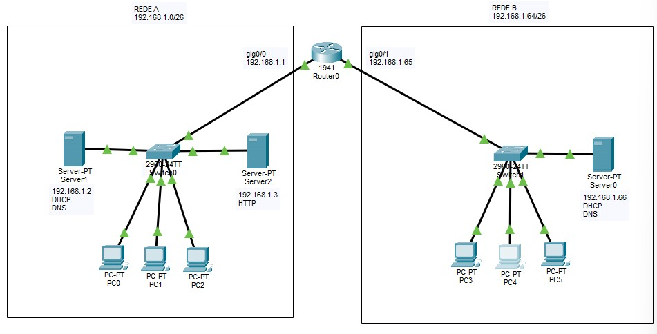

Construa a topologia da figura acima, e configure os PCs, roteadores e servidores, conforme a topologia.

Considere que:
- O servidor DHCP e DNS da rede `A` é o servidor `Server1` (IP: `192.168.1.2`).
  - Essa maquina deve executar somente DHCP e DNS e mais nenhum outro serviço (garanta que ela não executa nenhum outro serviço).
  - O servidor DNS da rede `A` é o servidor DNS autoritativo para o domínio `empresa.com`, e deve possuir os registros DNS necessários para resolver os nomes do domínio.
  - O DHCP deve estar configurado para fornecer endereços IP dinamicamente para os PCs da rede `A` (`192.168.1.0/26`), e todos os demais parâmetros de configuração de rede para que as maquinas possam se comunicar corretamente entre si e com o servidor web.
- O servidor web da rede `A` é o servidor `Server2` (IP: `192.168.1.3`).
  - Os PCs de ambas as redes `A` e `B` devem conseguir acessar o servidor web da rede `A` usando os nomes `web.empresa.com` e ``portal.empresa.com``.

Também considere que:
- O servidor DHCP e DNS da rede `B` é o servidor `Server0` (IP: `192.168.1.66`).
  - Essa maquina deve executar somente DHCP e DNS e mais nenhum outro serviço (garanta que ela não executa nenhum outro serviço).
  - O servidor DNS da rede `B` deve estar configurado de forma a repassar solicitações de resolução de nomes do domínio `empresa.com` para o DNS autoritativo `ns1.empresa.com`.
  - O DHCP da rede `B` deve estar configurado para fornecer endereços IP dinamicamente para os PCs da rede `B` (`192.168.1.64/26`), e todos os demais parâmetros de configuração de rede para que as maquinas possam se comunicar corretamente entre si e com o servidor web da rede `A`.
- Configure o roteador para que ambas as redes `A` e `B` possam se comunicar entre si.
  - Garanta que todos os computadores, de ambas as redes, consigam acessar o servidor web da rede `A`, tanto pelo IP do servidor Web quanto pelos seus nomes.

Para isso consulte o material das seções:
- [Roteiro 4 - Equipamentos de Rede -> Configuração do roteador no Cisco Packet Tracer](./4_equipamentos_de_rede.md#43-exemplo-no-cisco-packet-tracer)
- [Roteiro 5 - Redes IP, Mascaras e Sub-redes -> Conversão de CIDR para Mascara de Sub-rede](./5_redes.md#35-como-converter-prefixo-cidr-em-máscara)
- [2.4. Configurando DHCP no Cisco Packet Tracer](#24-configurando-dhcp-no-cisco-packet-tracer)
- [3.7. Configurando DNS no Cisco Packet Tracer](#37-configurando-dns-no-cisco-packet-tracer)
- [4.4. Configuração do serviço HTTP no Cisco Packet Tracer](#44-configuração-do-serviço-http-no-cisco-packet-tracer)